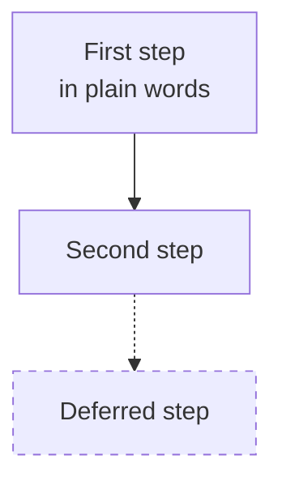

# Docs style — the house format

**What this page contains.** The format of every document the planning steps write under `docs/`:
design pages, the grilling log, the build order, decision records, specs and research notes.

**How to read it.** Apply every section to the page you are writing; the skeleton at the end shows
them together. A page that departs from this is brought in line the next time it is edited.

## The opening lines

Right under its title, every page opens with two labelled lines:

- **What this page contains.** One or two sentences naming what is on the page.
- **How to read it.** Where to start, what to follow, and what the page's marks mean.

A design page (anything in `docs/design/`) adds **Status.** — `design phase`, `built` or
`superseded`, with the date. A later revision adds one italic line under these
(`*Updated <yyyy-mm-dd> after <cause>: <what changed>.*`); the history is never rewritten.

A decision record is the one exception: the title is the decision as a sentence, then `Status:
accepted (<yyyy-mm-dd>)`, the decision with its reason, `## Considered options` when others were
weighed, and `## Consequences`.

## Plain language

- The reader did not sit in the session: short sentences in everyday words, one idea each.
- A term is in **bold** the first time it appears on a page and has its line in `CONTEXT.md`. No
  jargon or abbreviation goes unexplained.
- A decision is stated as a decision, with its reason, and links to its `Q#` in the grilling log or
  to its decision record: `Each bank is a profile file, so a new bank needs no code ([Q4](…)).`

## Diagrams

A page that describes a flow, a structure or a sequence has at least one ```` ```mermaid ````
diagram: `flowchart` for a pipeline or how parts fit together, `sequenceDiagram` for an
interaction over time, `stateDiagram-v2` for a lifecycle.

- Node labels are plain words (`"Find the header row"`), never identifiers; `<br/>` breaks a line.
- An optional or deferred part is drawn dashed: `-.->` arrows and a `stroke-dasharray` class.
- The sentence directly under the diagram says what to notice in it.

## Tables

Parallel facts go in a table, one row per thing; a row that no longer holds stays, marked
*superseded*. Three tables always have these columns:

- parts, in an overview: `Part | What it does | What it deliberately does not do`
- questions, in a grilling log or a spec: `# | Question | Decision | Why`
- features, in the build order: `# | Feature | Contains | Done when`

## Where to read next

An overview ends with a **Reading order**: a numbered list of the other pages in the order to read
them, each with a few words on what it holds.

## What never goes in

Secrets, keys and passwords; real personal or client data (examples use invented names and
amounts); attribution lines such as `Co-Authored-By` or "Generated with …".

## Skeleton

````markdown
# <Part name>

**What this page contains.** How <input> becomes <output>, and the rule for each step.

**How to read it.** Follow the diagram top to bottom; each step has a row in the table below it.

**Status.** Design phase (<yyyy-mm-dd>). Nothing here is built.



The dashed step is designed but not scheduled ([Q14](grilling-log.md)).
````
