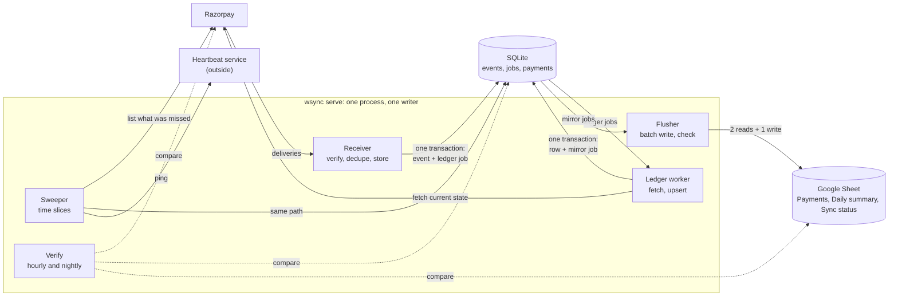

# webhook-sync

This service receives Razorpay payment events, keeps one row per payment in a SQLite ledger, copies that row to a Google Sheet, and checks every night that Razorpay, the ledger and the sheet agree.

## The problem

Zapier's own help page, [Google Sheets: Zap is creating duplicate rows](https://help.zapier.com/hc/en-us/articles/21637060333325-Google-Sheets-Zap-is-creating-duplicate-rows) (last updated 25 July 2025, read 5 October 2026), says a Zap can write the same row twice when the spreadsheet is large and Autoreplay is on, and its fix is to start a new spreadsheet with less data in it.

On n8n's forum, [a user sent about 100 webhooks in quick succession](https://community.n8n.io/t/google-sheets-append-row-drops-rows-under-high-webhook-concurrency/254786) (posted 23 January 2026, read 5 October 2026) and the Google Sheets "Append Row" node wrote fewer rows than that every time: "Sometimes it stops at row ~56. Other times ~63."

## The demo

<!-- The two recordings go here once the files exist in docs/media/, each under 10 MB.


-->

I haven't recorded the two GIFs yet. They will show the `duplicates` and `outage` scenes below. `reset` clears the way before a scene, and `verify` checks the result after one.

| Command | What it does |
|---|---|
| `uv run wsync demo reset` | Empties the database and the three tabs of the demo sheet, and sets `retry_profile = "demo"` in the config file. |
| `uv run wsync demo outage` | Pays three test orders with the receiver stopped (`--orders N` changes the count). Then it starts a receiver, sweeps until every payment is stored, waits for the rows and stops the receiver. |
| `uv run wsync demo duplicates` | Starts a receiver with `--demo-fail-first 4`, pays one test order and prints each delivery as Razorpay retries it. Razorpay has to reach the receiver, so this scene needs a public URL. When it ends, it leaves a receiver running in its normal mode. |
| `uv run wsync demo verify` | Runs a full verify and prints its line. |

The first three refuse while a server is running, so stop `wsync serve` before any of them: `reset` won't empty a database under a server, and the other two start the receiver themselves. `verify` goes through the running server when there is one and reads the database directly when there isn't.

Every scene also refuses unless the Razorpay key starts with `rzp_test_` and the spreadsheet id is listed under `[demo] spreadsheet_ids` in the config, so a mistyped id can't empty a real sheet. A test payment is an order created through the API and paid in headless Chromium on Razorpay's mock bank page, which needs the browser installed once (`uv run playwright install chromium`). If the headless payment fails, the scene prints the payment page's URL for a person to pay.

## What it promises, and the test for each

`uv run pytest` runs every test named here offline, except the last one under promise 5, which pays real test orders. Offline, Razorpay is a fake that replays deliveries and API answers recorded from test mode. Google Sheets has no test mode, so its fake is an in-memory model of the calls the flusher makes, and a contract test holds that model to answers recorded from the real API.

1. One payment has one row, however many times Razorpay delivers its events. Razorpay's [webhook best practices](https://razorpay.com/docs/webhooks/best-practices/) say the same event can arrive more than once and give each event an `x-razorpay-event-id` header. The receiver stores an event once under that id and counts later copies as duplicates. The ledger's key is the payment id, so every event about a payment lands on the same row.
   - `tests/scenarios/test_duplicate_storm.py::test_one_delivery_sent_many_times_makes_one_event_one_row_and_one_sheet_row`
   - `tests/load/test_duplicate_storm.py::test_a_storm_of_1000_replays_answers_none_503_and_stores_one_event_and_row`

2. A delivery answered with a 2xx is not lost, even if the process dies the moment after. Before it answers, the receiver commits the event and the job to process it in one SQLite transaction, and the server sets SQLite to wait for the disk to confirm each commit (WAL with `synchronous=FULL`). To test this the server has named crash points. A test arms one with `WSYNC_CRASH_AT`, the real server process exits at that point through `os._exit` with nothing cleaned up, and the test restarts it on the same database and looks for anything missing or written twice.
   - `tests/crash/test_after_event_commit.py::test_a_crash_after_the_event_is_stored_loses_nothing_and_stores_it_once`
   - `tests/crash/test_after_sheet_write_before_done.py::test_a_crash_after_the_sheet_is_written_never_writes_a_second_row`

3. Payments made while the server was down come back. The sweeper lists Razorpay's payments and refunds from its checkpoint onwards, at start and then every 10 minutes, and stores whatever is missing. In the sheet those rows show `sweep` in the Via column. The second test crashes a sweep halfway through a slice.
   - `tests/scenarios/test_outage_and_catch_up.py::test_payments_made_while_the_server_was_down_come_back_through_the_sweep_once_each`
   - `tests/crash/test_mid_slice.py::test_a_crash_in_the_middle_of_a_sweep_slice_skips_nothing_and_rewalks_one_slice`

4. A later capture, refund or late authorisation updates the same row. The ledger worker treats an event as a hint that a payment changed: it fetches the payment's current state from Razorpay and writes that, so events arriving out of order can't leave an older state on the row.
   - `tests/scenarios/test_late_authorisation.py::test_a_failed_payment_authorised_and_captured_later_updates_its_row_after_the_re_list`
   - `tests/scenarios/test_partial_and_failed_refund.py::test_a_partial_refund_shows_on_the_payments_own_row_and_in_the_daily_summary`
   - `tests/scenarios/test_partial_and_failed_refund.py::test_a_refund_that_fails_leaves_the_row_at_the_money_that_moved`

5. Every night at 02:00 (`[verify] nightly_at`) the server compares the last 30 days of payments with Razorpay, and every hour it compares the sheet with the ledger. The run lists each difference. With `auto_repair` on, which is the default, a missing or stale row gets a repair job in the ordinary queue, and a row Razorpay doesn't know is reported and left alone. `uv run wsync verify --full` makes the same comparison on request and repairs only when given `--repair`.
   - `tests/test_verify_full.py::test_a_payment_only_at_razorpay_is_missing_and_repaired_into_the_ledger_and_sheet`
   - `tests/test_verify_full.py::test_a_ledger_row_whose_fee_differs_from_razorpays_is_stale_and_repaired`
   - `tests/test_verify_full.py::test_a_ledger_payment_razorpay_doesnt_list_is_orphaned_and_not_changed`
   - `tests/test_verify_full.py::test_a_server_running_at_nightly_at_runs_the_full_verify_then`
   - `tests/test_verify_sheet.py::test_an_edited_amount_is_reported_differs_and_rewritten`
   - `tests/live/test_demo_live.py::test_reset_outage_and_verify_pay_real_test_orders_and_end_on_0_differences`

The fakes could be wrong about Razorpay, so once a week a CI job (`real-run` in [.github/workflows/weekly.yml](.github/workflows/weekly.yml)) pays two test orders on the real Razorpay with the receiver stopped, sweeps them in and runs `wsync verify --full`. I started it by hand four times on 5 October 2026, on GitHub-hosted Linux runners, and it passed three times. In the run that failed, the job paid both orders, but Razorpay's payments list did not show them during the five minutes the scene waited, and the same query returned both twenty minutes later. I raised the wait to 12 minutes, and [the next run](https://github.com/lalitkarthik/webhook-sync/actions/runs/37287445967) swept for 5 minutes 5 seconds before the list showed the payments and ended with `Verified 05 Oct 14:39 IST: last 30 days, 25 payments, 0 differences`. Later that afternoon the list fell further behind. Five payments I timed took 39 to 54 minutes to appear in it, and a sweep only re-reads the 10 minutes before its checkpoint. The scene now sweeps until its checkpoint is more than 10 minutes past a payment the list hasn't shown, then asks for the re-list every 15 seconds, and gives up two hours after its first sweep. Run that way on my laptop, the live test waited 53 minutes for the list and ended with `Verified 05 Oct 17:14 IST: last 30 days, 34 payments, 0 differences`.

### Measured numbers

These figures come from `uv run pytest -m load`, which I ran on 4 October 2026 on the laptop the service was built on, an Acer Nitro AN515-58 (Intel Core i7-12650H, 16 GB of RAM, NVMe SSD, Windows 11). The server ran with `synchronous=FULL` against the local fakes, so no number here was measured on a server or over the internet. They are that day's final run, recorded under P5 in [CHANGELOG.md](CHANGELOG.md), and Q172 in [docs/design/grilling-log.md](docs/design/grilling-log.md) holds the earlier runs and the range across them.

The storm check sent 1,000 copies of one signed delivery at the same moment. The server accepted 73 at once (one answered 202, 72 answered 200), the rate cap answered 429 to the other 927, and none got a 503. The check then sent the 927 again under the cap until each was accepted. The database ended with one event, one ledger row, one sheet row and 999 counted duplicates. The server handled 99% of the deliveries it accepted within 0.79 s each, and across the day's runs that figure was between 0.75 and 1.14 s. Measured from the client, 99% of answers came within 4.3 s, and most of that wait is 1,000 connections opening against one listener on Windows.

The burst check sent 200 payments, and all 200 reached the sheet in 324 s. That took 104 flushes and 314 Sheets API calls: three for each flush, plus two that created the tabs. It takes that long because one worker fetches one payment at a time, and the fake made each fetch take the 1.6 s the recorded call took.

## Why not Coupler, Zapier or Hookdeck?

I took the prices and plans from each pricing page on 5 October 2026.

- [Coupler.io](https://www.coupler.io/pricing) copies data on a schedule: once a day on the $32 and $132 monthly plans, once an hour on the $259 plan. Here a row follows its event by a few seconds.
- [Zapier](https://zapier.com/pricing)'s Professional plan starts at $29.99 a month, or $19.99 a month billed yearly, for 750 tasks. This service has no subscription and no task count.
- [Hookdeck](https://hookdeck.com/pricing), from $39 a month on its Team plan, receives webhooks, queues and retries them, and forwards them to an endpoint that you write and host. In this repository that endpoint is already written, and it runs as one Python process with one SQLite file on your own machine.
- Coupler's scheduled refresh reads the source again, so its sheet is brought up to date once a day or once an hour. Zapier and Hookdeck act on each event as it arrives. webhook-sync writes a row within seconds of its event, and every night it also compares the last 30 days with Razorpay and shows the number of differences on the Sync status tab.

## How it works



When a delivery arrives, the receiver checks its signature, stores the event and a job in one transaction, and answers. The ledger worker picks the job up and fetches the payment from Razorpay, then writes its row with a job for the sheet in the same transaction. Every 3 seconds the flusher writes the waiting rows in one batch and reads back the keys it wrote, while the sweeper and verify cover whatever the deliveries missed. The design starts at [docs/design/00-overview.md](docs/design/00-overview.md) and gives the reason for each choice.

## Quickstart

You need [uv](https://docs.astral.sh/uv/), a Razorpay test-mode key with a webhook secret, a Google service-account key, and a spreadsheet shared with that service account as an Editor.

```
git clone https://github.com/lalitkarthik/webhook-sync.git
cd webhook-sync
uv sync
uv run wsync doctor
uv run wsync serve
```

Before `uv run wsync doctor`, copy `webhook-sync.toml.example` to `webhook-sync.toml` and `.env.example` to `.env`, and fill both in. `.env` takes `RAZORPAY_KEY_ID`, `RAZORPAY_KEY_SECRET`, `RAZORPAY_WEBHOOK_SECRET` and `GOOGLE_SERVICE_ACCOUNT_B64`, which is the service account's JSON key in base64 (`python scripts/set_env.py google path/to/key.json` writes it for you). `webhook-sync.toml` takes your Razorpay account id and the spreadsheet's id; set `heartbeat_url` to a check of your own, or to `""`.

`wsync doctor` prints one line per check (config, secrets, the Razorpay key, Razorpay's webhook, the clock, the sheet, the database) and exits 0 unless one of them fails, and it changes nothing. `wsync serve` creates the database and then listens on port 8080, where `http://127.0.0.1:8080/health` answers `{"status":"ok"}`. Its first sweep reads the last 30 days, and its first flush makes the three tabs in the sheet. When I ran this on a fresh clone on 5 October 2026, the first sweep took about two minutes for a test account with 21 payments, and `uv run wsync verify --full` then printed "21 payments, 0 differences".

For live deliveries, add a webhook in the Razorpay Dashboard that points at `/webhooks/razorpay` on your public address and sends `payment.authorized`, `payment.captured`, `payment.failed`, `refund.created`, `refund.processed`, `refund.failed` and `refund.speed_changed`. `uv run wsync doctor --url https://your-host.example/webhooks/razorpay` then posts an empty body to that address and fails unless the receiver's own 400 comes back, which catches a tunnel that answers with a warning page of its own. `uv run wsync status` shows the source, the sheet, the jobs waiting and dead, and the last sweep and verify.

## Honest limits

A row appears a few seconds after its event. The receiver answers Razorpay first, the ledger worker then fetches the payment, and the flusher writes the sheet in batches every 3 seconds. There is one ledger worker and it fetches one payment at a time, so a burst drains at about one payment per fetch, which is why 200 payments took 324 s in the load check. The receiver itself takes 50 deliveries a second with a burst of 50. It answers 429 to a storm beyond that rate cap and stores nothing for it, and Razorpay, which treats any non-2xx answer as a failed delivery, [retries with exponential backoff for 24 hours](https://razorpay.com/docs/webhooks/best-practices/). If deliveries fail for 24 hours on end, Razorpay disables the webhook. The sweeper still brings the payments in, and `wsync doctor` warns about a disabled webhook when Razorpay lets the key read the webhook list (when it doesn't, that line reads "can't check").

One deployment serves one buyer: one Razorpay account, one spreadsheet, one SQLite file and one server process. The database has to sit on a local disk, and `wsync doctor` fails on a network drive or a synced folder. Version 1 stores a dispute event and ignores it. Stripe is designed in [docs/design/sources.md](docs/design/sources.md) and not built, and the config refuses a `[sources.stripe]` section. There are no admin pages yet either. `wsync status` and the Sync status tab are the only views, and a job that has failed every retry shows in `wsync status` but can't yet be retried by a command.

Razorpay's API has no list of past events, so the sweeper lists payments and refunds by creation date, and an hourly re-list covers payments created in the last 7 days and refunds created in the last 21. A change to anything older reaches its row when the nightly verify finds the difference, and verify looks back 30 days. For dates older than that, `wsync backfill --from 2026-08-01 --to 2026-08-31` reads a range again on request. A new payment can also be slow to appear in Razorpay's list. In test mode on 5 October 2026, five payments I timed appeared in it 39 to 54 minutes after they were made (the timings are in [docs/research/razorpay-list-facts.md](docs/research/razorpay-list-facts.md)). For three of them I also timed the fetch by id, which returned the payment within 22 seconds. Every sweep re-reads the 10 minutes before its checkpoint, so the sweeper picks up a payment listed up to about 10 minutes late. One listed later than that comes in with the next hourly re-list. So a payment made while the server was down can come back as much as an hour after Razorpay's list first shows it.

The duplicate scene provokes Razorpay's own retries. The receiver stores the event and then answers 500 to its first four deliveries on purpose (`wsync serve --demo-fail-first 4`, test mode only), and how long the retries take is up to Razorpay. Razorpay's Dashboard can also [replay an event](https://razorpay.com/docs/webhooks/replay-events/) up to 7 days old and allows five replays in 24 hours, but the scene doesn't use that. Fees in test mode are illustrative, because test mode moves no money. Razorpay's [payments FAQ](https://razorpay.com/docs/payments/payments/faqs/) says of test payments that "No money is deducted as these are simulated transactions". The Fee, GST and Net columns show what test mode returns, and a live account's plan sets the real figures. The same page says GST is not charged on the fee for domestic card payments up to ₹2,000, so a GST of 0 on such a row is correct. Test mode gives no way to make a refund fail, so that test replays Razorpay's documented sample events and is marked `unrecorded`.

The Payments, Daily summary and Sync status tabs belong to the service. Sort and filter them with Data › Create filter view, and keep your own work in another tab. The flusher finds its rows by payment id on every write and catches and repairs a sort made while it is writing, and the hourly check rewrites an edited cell. Text goes into the sheet as text, so Sheets never runs a description that starts with `=` as a formula. A CSV export loses that protection, and Excel may run the text as a formula when it opens the file.

## Next adapters

Two more sinks are outlined in [docs/design/next-adapters.md](docs/design/next-adapters.md), and neither is built. The forwarding sink would send each change to a row to an n8n, Zapier or Make workflow, signed and exactly once, for teams that want to keep the automation they have. The database sink would write the rows, and later subscriptions, into the buyer's own Postgres or Supabase database.

## Credits

I ported four parts of this code from open-source projects and then reworked them: the receiver from [hookline](https://github.com/hassanatic/hookline) (MIT), the job queue and the sweeper from [driftless](https://github.com/quyumkehinde/driftless) (Apache-2.0), and the Sheets writer from [sync-engine](https://github.com/stripe/sync-engine) (Apache-2.0). The retry schedule uses one idea from [Svix](https://github.com/svix/svix-webhooks) (MIT), a fixed table of waits. [THIRD_PARTY_NOTICES.md](THIRD_PARTY_NOTICES.md) lists each file with its origin, its copyright line, what was changed and the licence texts.

Written by [Lalit Karthikeyan M A](https://github.com/lalitkarthik).
