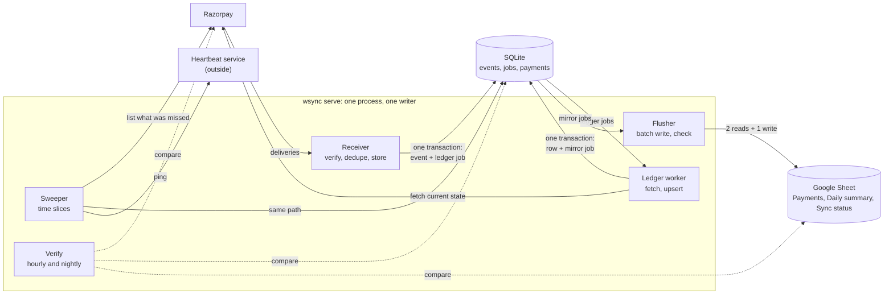

# webhook-sync

This service receives Razorpay payment events, keeps one row per payment in a SQLite ledger, copies that row to a Google Sheet, and checks every night that Razorpay, the ledger and the sheet agree.

## The problem

Zapier's own help page, [Google Sheets: Zap is creating duplicate rows](https://help.zapier.com/hc/en-us/articles/21637060333325-Google-Sheets-Zap-is-creating-duplicate-rows) (last updated 25 July 2025), says a Zap can write the same row twice when the spreadsheet is large and Autoreplay is on, and its fix is to start a new spreadsheet with less data in it.

On n8n's forum, [a user sent about 100 webhooks in quick succession](https://community.n8n.io/t/google-sheets-append-row-drops-rows-under-high-webhook-concurrency/254786) (23 January 2026) and the Google Sheets "Append Row" node wrote fewer rows than that every time: "Sometimes it stops at row ~56. Other times ~63."

Both pages said this on 5 October 2026. A sheet of payments with a doubled row or a missing row gives wrong totals, and this service is built to prevent both.

## The demo

<!-- The two recordings go here once the files exist in docs/media/, each under 10 MB.


-->

The two recordings don't exist yet. These four commands run the scenes they will show, against Razorpay test mode:

| Command | What it does |
|---|---|
| `uv run wsync demo reset` | Empties the database and the three tabs of the demo sheet, and sets `retry_profile = "demo"` in the config file. It refuses while a server is running, so stop `wsync serve` first. |
| `uv run wsync demo outage` | Pays three test orders with the receiver stopped (`--orders N` changes the count), then starts a receiver of its own, sweeps until every payment is stored, waits for the rows and stops that receiver. It also refuses while a server is running. |
| `uv run wsync demo duplicates` | Starts a receiver of its own with `--demo-fail-first 4`, pays one test order and prints each delivery as Razorpay retries it. Razorpay has to reach the receiver, so this scene needs a public URL. It leaves a receiver running in its normal mode. |
| `uv run wsync demo verify` | Runs a full verify and prints its line. It goes through the running server when there is one and works on the database directly when there isn't. |

Every scene refuses to run unless the Razorpay key starts with `rzp_test_` and the spreadsheet id is listed under `[demo] spreadsheet_ids` in the config, so a mistyped id can't empty a real sheet. A test payment is an order created through the API and paid in headless Chromium on Razorpay's mock bank page. That needs the browser installed once with `uv run playwright install chromium`. When the headless payment fails, the scene prints the payment page's URL so a person can pay it.

## What it promises, and the test for each

`uv run pytest` runs every test named here except the live one, which says so. The tests run offline against fakes of Razorpay and Google Sheets: stand-ins that replay deliveries and API answers recorded from test mode.

1. One payment has one row, however many times Razorpay delivers its events. Razorpay's [webhook best practices](https://razorpay.com/docs/webhooks/best-practices/) say the same event can arrive more than once and give each event an `x-razorpay-event-id` header. The receiver stores an event once under that id and counts later copies as duplicates. The ledger's key is the payment id, so every event about a payment lands on the same row.
   - `tests/scenarios/test_duplicate_storm.py::test_one_delivery_sent_many_times_makes_one_event_one_row_and_one_sheet_row`
   - `tests/load/test_duplicate_storm.py::test_a_storm_of_1000_replays_answers_none_503_and_stores_one_event_and_row`

2. A delivery that was answered with a 2xx is not lost, even when the process dies straight afterwards. The receiver commits the event and the job to process it in one SQLite transaction (WAL, `synchronous=FULL`) before it answers. The crash tests kill the real server process at a named point, restart it on the same database, and check that nothing is missing and nothing was written twice.
   - `tests/crash/test_after_event_commit.py::test_a_crash_after_the_event_is_stored_loses_nothing_and_stores_it_once`
   - `tests/crash/test_after_sheet_write_before_done.py::test_a_crash_after_the_sheet_is_written_never_writes_a_second_row`

3. Payments made while the server was down come back. At start and every 10 minutes the sweeper lists Razorpay's payments and refunds from its checkpoint onwards and stores whatever is missing. Those rows show `sweep` in the sheet's Via column.
   - `tests/scenarios/test_outage_and_catch_up.py::test_payments_made_while_the_server_was_down_come_back_through_the_sweep_once_each`
   - `tests/crash/test_mid_slice.py::test_a_crash_in_the_middle_of_a_sweep_slice_skips_nothing_and_rewalks_one_slice`

4. A later capture, refund or late authorisation updates the same row. The service treats an event as a hint that a payment changed: it fetches the payment's current state from Razorpay and writes that, so events arriving out of order can't leave an older state on the row.
   - `tests/scenarios/test_late_authorisation.py::test_a_failed_payment_authorised_and_captured_later_updates_its_row_after_the_re_list`
   - `tests/scenarios/test_partial_and_failed_refund.py::test_a_partial_refund_shows_on_the_payments_own_row_and_in_the_daily_summary`

5. Every night at 02:00 (`[verify] nightly_at`) the service compares the last 30 days of payments with Razorpay, and every hour it compares the sheet with the ledger. It lists each difference and repairs a missing or stale row through the ordinary job queue. A row Razorpay doesn't know is reported and left as it is. `uv run wsync verify --full` runs the same check on request.
   - `tests/test_verify_full.py::test_a_payment_only_at_razorpay_is_missing_and_repaired_into_the_ledger_and_sheet`
   - `tests/test_verify_full.py::test_a_server_running_at_nightly_at_runs_the_full_verify_then`
   - `tests/test_verify_sheet.py::test_an_edited_amount_is_reported_differs_and_rewritten`
   - `tests/live/test_demo_live.py::test_reset_outage_and_verify_pay_real_test_orders_and_end_on_0_differences`, which calls the real Razorpay test mode and runs only under `uv run pytest -m live`

The fakes could be wrong about Razorpay, so once a week a CI job (`real-run` in [.github/workflows/weekly.yml](.github/workflows/weekly.yml)) pays two test orders on the real Razorpay with the receiver stopped, sweeps them in and runs `wsync verify --full`. The run started by hand on 5 October 2026, on a GitHub-hosted Linux runner, ended with `Verified 05 Oct 12:10 IST: last 30 days, 20 payments, 0 differences`.

### Measured numbers

These come from `uv run pytest -m load` on 4 October 2026, on an Acer Nitro AN515-58 laptop (Intel Core i7-12650H, 16 GB of RAM, NVMe SSD, Windows 11). The server ran with `synchronous=FULL`, and Razorpay and Google Sheets were the local fakes, so no number here was measured on a server or over the internet. The figures are recorded in [CHANGELOG.md](CHANGELOG.md) under P5 and in Q171 to Q173 of [docs/design/grilling-log.md](docs/design/grilling-log.md).

In the storm, the test sent 1,000 copies of one signed delivery at the same moment. The server accepted 73 at once (one answered 202, 72 answered 200), the rate cap answered 429 to the other 927, and none got a 503. The test then sent the 927 again under the cap until the server accepted each. The database ended with one event, one ledger row, one sheet row and 999 counted duplicates. The server handled 99% of the deliveries it accepted within 0.79 s each; across that day's runs the same figure was between 0.75 and 1.14 s. Measured from the client, 99% of answers came within 4.3 s. Most of that wait is 1,000 connections opening against one listener on Windows.

In the burst, 200 payments reached the sheet in 324 s, through 104 flushes and 314 Sheets API calls, never more than three calls a flush. The time is long because one worker fetches one payment at a time, and the fake made each fetch take the 1.6 s the recorded call took.

## Why not Coupler, Zapier or Hookdeck?

Prices and plans are as each pricing page showed them on 5 October 2026.

- [Coupler.io](https://www.coupler.io/pricing) copies data on a schedule: once a day on the $32 and $132 monthly plans, once an hour on the $259 plan. Here a row follows its event by a few seconds.
- [Zapier](https://zapier.com/pricing)'s Professional plan starts at $29.99 a month, or $19.99 a month billed yearly, for 750 tasks. This service has no subscription and counts no tasks.
- [Hookdeck](https://hookdeck.com/pricing) receives webhooks, queues and retries them, and forwards them to an endpoint you run, from $39 a month on its Team plan. The endpoint that fetches the payment and writes the row is still yours to write. This repository is that endpoint. It runs as one Python process with one SQLite file on your own machine.
- Every night this service compares the last 30 days with Razorpay and the sheet with the ledger, and the Sync status tab shows the last run's result.

## How it works



The receiver checks a delivery's signature, stores the event with a job in one transaction and answers. The ledger worker takes the job and fetches the payment from Razorpay. It writes the payment's row in the same transaction as a job for the sheet. Every 3 seconds the flusher writes the waiting rows to the sheet in one batch and reads back the keys it wrote. The sweeper and verify cover whatever the webhooks missed. The design, with the reasons for each choice, starts at [docs/design/00-overview.md](docs/design/00-overview.md).

## Quickstart

You need [uv](https://docs.astral.sh/uv/), a Razorpay test-mode key with a webhook secret, a Google service-account key, and a spreadsheet shared with that service account as an Editor.

```
git clone https://github.com/lalitkarthik/webhook-sync.git && cd webhook-sync
uv sync
cp webhook-sync.toml.example webhook-sync.toml && cp .env.example .env
uv run wsync doctor
uv run wsync serve
```

Fill in the two copied files before the fourth command. `.env` takes `RAZORPAY_KEY_ID`, `RAZORPAY_KEY_SECRET`, `RAZORPAY_WEBHOOK_SECRET` and `GOOGLE_SERVICE_ACCOUNT_B64`, which is the service account's JSON key in base64 (`python scripts/set_env.py google path/to/key.json` writes it for you). `webhook-sync.toml` takes your Razorpay account id and the spreadsheet's id. Set `heartbeat_url` to a check of your own, or to `""`.

`wsync doctor` prints one line per check (config, secrets, the Razorpay key, Razorpay's webhook, the clock, the sheet, the database) and exits 0 unless one of them fails. It changes nothing. `wsync serve` creates the database and the sheet's three tabs, then listens on port 8080; `http://127.0.0.1:8080/health` answers `{"status":"ok"}`. On its first start it sweeps the last 30 days. On a fresh clone on 5 October 2026 that sweep took about two minutes for a test account with 21 payments, and `uv run wsync verify --full` then printed "21 payments, 0 differences".

For live deliveries, add a webhook in the Razorpay Dashboard that points at `/webhooks/razorpay` on your public address and sends `payment.authorized`, `payment.captured`, `payment.failed`, `refund.created`, `refund.processed`, `refund.failed` and `refund.speed_changed`. `uv run wsync doctor --url https://your-host.example/webhooks/razorpay` then posts an empty body to that address and fails unless the receiver's own 400 comes back, which catches a tunnel that answers with a warning page of its own. `uv run wsync status` shows the source, the sheet, the jobs waiting and dead, and the last sweep and verify.

## Honest limits

- Rows appear a few seconds after the event. The service answers Razorpay first, then fetches the payment, and writes the sheet in batches every 3 seconds.
- One worker fetches one payment at a time. A burst drains at about one payment per fetch, which is why 200 payments took 324 s in the load check.
- One deployment serves one buyer: one Razorpay account, one spreadsheet, one SQLite file and one server process. The database must be on a local disk, and `wsync doctor` fails on a network drive or a synced folder.
- Razorpay's API has no list of past events, so the sweeper lists payments and refunds by creation date. An hourly re-list covers payments created in the last 7 days and refunds created in the last 21. A change to anything older reaches its row when the nightly verify finds the difference, and verify looks back 30 days. `wsync backfill --from 2026-08-01 --to 2026-08-31` reads older dates again on request.
- The duplicate scene provokes Razorpay's own retries. The receiver stores the event and then answers 500 to its first four deliveries on purpose (`wsync serve --demo-fail-first 4`, test mode only). The retry timing is Razorpay's, so the scene's length varies. Razorpay's Dashboard can also [replay an event](https://razorpay.com/docs/webhooks/replay-events/) up to 7 days old, five times in 24 hours, but the scene doesn't use that.
- Test-mode fees are illustrative. Razorpay's [payments FAQ](https://razorpay.com/docs/payments/payments/faqs/) says of test payments that "No money is deducted as these are simulated transactions", so the Fee, GST and Net columns show what test mode returns, and a live account's plan sets the real figures. The same page says GST is not charged on the fee for domestic card payments up to ₹2,000, so a GST of 0 on such a row is correct.
- A storm beyond the rate cap is answered 429, and Razorpay sends those deliveries again. The receiver takes 50 deliveries a second with a burst of 50 and stores nothing for the rest. Razorpay treats any non-2xx answer as a failed delivery and [retries with exponential backoff for 24 hours](https://razorpay.com/docs/webhooks/best-practices/). If deliveries fail for 24 hours on end, Razorpay disables the webhook. The sweeper still brings the payments in, and `wsync doctor` warns about the disabled webhook.
- Version 1 does not handle disputes: it stores a dispute event and ignores it. A failed refund can't be produced in test mode, so its test replays Razorpay's documented sample events and is marked `unrecorded`.
- Stripe is designed in [docs/design/sources.md](docs/design/sources.md) and not built. The config refuses a `[sources.stripe]` section.
- The Payments, Daily summary and Sync status tabs belong to the service. Sort and filter them with Data › Create filter view and keep your own work in another tab. The service finds its rows by payment id on every write, and it catches and repairs a sort made while it is writing. The hourly check rewrites an edited cell.
- The service writes text to the sheet as text, so Sheets never runs a description that starts with `=` as a formula. A CSV export loses that protection, and Excel may run the text as a formula when it opens the file.
- There are no admin pages yet. `wsync status` and the Sync status tab are the only views, and a dead job has no command of its own.

## Next adapters

Two more sinks are outlined in [docs/design/next-adapters.md](docs/design/next-adapters.md), and neither is built. The forwarding sink sends each change to a row, once and signed, to an n8n, Zapier or Make workflow, for teams that want to keep the automation they have. The database sink writes the rows, and later subscriptions, into the buyer's own Postgres or Supabase database.

## Credits

Four parts of this code started as ports of open-source projects and were then reworked: the receiver from [hookline](https://github.com/hassanatic/hookline) (MIT), the job queue and the sweeper from [driftless](https://github.com/quyumkehinde/driftless) (Apache-2.0), the Sheets writer from [sync-engine](https://github.com/stripe/sync-engine) (Apache-2.0), and the retry schedule from [Svix](https://github.com/svix/svix-webhooks) (MIT). [THIRD_PARTY_NOTICES.md](THIRD_PARTY_NOTICES.md) lists each file with its origin, its copyright line, what was changed and the licence texts.

Written by [Lalit Karthikeyan M A](https://github.com/lalitkarthik).
