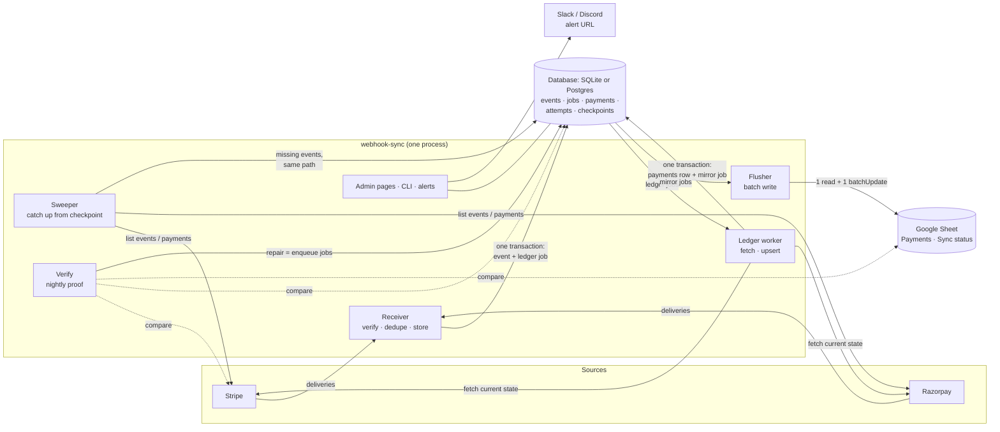
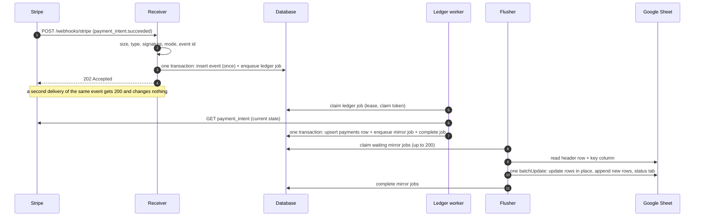

# Webhook sync: overview

**What this page contains.** A picture of the whole service, what each part does and deliberately doesn't do, the rules every part follows, and where to read next.

**How to read it.** Read the first four sections, then follow the reading order at the bottom. Words in **bold** are defined in [CONTEXT.md](../../CONTEXT.md). Everything here is a **decision, not a description**: none of it is built yet. The questions behind each decision are in [grilling-log.md](grilling-log.md).

**Status: design complete, awaiting review** (2026-09-30). Every question is answered in [grilling-log.md](grilling-log.md) (Q1–Q61). The part pages below are the design; the implementation plan is written later.

## What it is, in one paragraph

A small service that receives payment **events** from Stripe and Razorpay and keeps a database and a Google Sheet in step with them. However often an event is delivered, in whatever order, and whatever breaks along the way (the server, the sheet, the source), it ends with exactly one correct row per **payment**. Every night it proves that the sheet matches the source. It exists because no-code tools get this wrong: Zapier's own help pages admit duplicate rows, and an n8n forum thread shows 100 concurrent events producing 56-63 rows, all marked successful.

## The whole service, in one picture

## One payment's path, in order

## The parts, one at a time

| Part | What it does | What it deliberately does not do |
|---|---|---|
| **Receiver** | Checks size, content type, signature, **mode** and **event id**; stores the event once; creates its **ledger job** in the same transaction; answers 202 (new) or 200 (**duplicate**). [receiver.md](receiver.md) | Never calls a source's API. Never does work inline. Never answers 500 to bad input. |
| **Source adapters** | One per **source**: verify a delivery, find its event id, say which payment an event is about, fetch a payment's current state, list events or payments for the sweeper. [sources.md](sources.md) | Never touch the queue, the ledger or a sink. |
| **Queue** | Six operations on the `jobs` table: enqueue (with **coalescing**), claim, heartbeat, complete, fail, reap. Leases, **fencing**, retry classes, the **dead-letter queue**, **paused sinks**. [queue.md](queue.md) | Knows nothing about payments. Can be replaced by Redis Streams later ([ADR 0004](decisions/0004-queue-in-the-database-behind-an-interface.md)). |
| **Ledger worker** | Claims a ledger job, fetches the payment, upserts its **business row** with **terminal states** sticky, and creates a **mirror job** only if the row changed. [ledger-worker.md](ledger-worker.md) | Never calls a source's API inside a database transaction. |
| **Sheets sink** | The **flusher** writes waiting mirror jobs in one batch by key; checks the header row; pauses on a revoked key or a changed layout; **rebuilds** the tab from the ledger. [sheets-sink.md](sheets-sink.md) | Never reads the sheet as truth. Never deletes the buyer's rows. |
| **Sweeper** | From each source's **checkpoint**, finds events or payments we never received and stores them through the receiver's path. Detects **silent webhooks**. [sweeper.md](sweeper.md) | Never writes business rows directly. |
| **Verify** | Compares source, ledger and sheet; lists **missing**, **stale** and **orphaned** payments and sheet differences; **repairs** by enqueuing jobs. [verify.md](verify.md) | Never edits a row. |
| **Admin pages, CLI, alerts** | Overview, events, timelines, dead letters, verify, **admin actions**; `wsync` commands including `doctor`; one outgoing alert URL. [operations.md](operations.md) | No side door: every action goes through the same jobs as automatic work. |

## Rules every part follows

1. **The database is the ledger; the sheet is a mirror.** [ADR 0001](decisions/0001-database-is-the-ledger-sheet-is-a-mirror.md)
2. **Store first, answer second, work later.** A change and the job it causes are written in one transaction (the **outbox**), so nothing acknowledged can be lost. [ADR 0004](decisions/0004-queue-in-the-database-behind-an-interface.md)
3. **The current state beats the payload.** Events are hints; the worker fetches what is true now. [ADR 0002](decisions/0002-fetch-current-state-not-event-payload.md)
4. **Every write is idempotent.** Running any job twice gives the same result as running it once.
5. **Nothing disappears silently.** Every delivery ends as stored, duplicate, conflict or rejection; every job ends as done, dead with a reason, or resolved by a person; every event is handled or **ignored** with its type recorded.
6. **Fail closed.** A missing secret, a missing admin token on a public address, or a mode mismatch stops the service from starting.
7. **Everything traces back to its event.** Every job, attempt, row change and log line carries the event id that caused it.
8. **One buyer per deployment.** [ADR 0003](decisions/0003-one-buyer-per-deployment.md)
9. **Permissive licences only.** [ADR 0005](decisions/0005-permissive-licences-only.md)

## What version 1 includes, and what it leaves out

| In version 1 | Left out on purpose |
|---|---|
| Stripe (test and live), then Razorpay | Standard Webhooks generic source (designed for in [sources.md](sources.md), built later) |
| SQLite by default; Postgres via `DATABASE_URL` | Redis (a queue backend could be added later) |
| Google Sheets mirror | Other mirrors: Airtable, Notion, a client's own database, demo 1's JSON |
| One payment per row, with refunds and disputes as columns | Subscriptions, invoices, payouts, customers as their own rows |
| Admin pages, CLI, Slack/Discord alerts | Email alerts, Prometheus metrics, a public live demo |
| One buyer, one account per source | Stripe Connect, several buyers in one deployment |

## Reading order

1. [CONTEXT.md](../../CONTEXT.md): the words.
2. This page.
3. The parts, in the order an event meets them:
   1. [data-model.md](data-model.md): every table, and what each column is for
   2. [receiver.md](receiver.md): from delivery to 202, and every rejection
   3. [sources.md](sources.md): the Stripe and Razorpay adapters, status order, fetching
   4. [queue.md](queue.md): the job state machine, leases, retries, dead letters, pausing
   5. [ledger-worker.md](ledger-worker.md): fetch, upsert, terminal states, the payload fallback
   6. [sheets-sink.md](sheets-sink.md): the flush, the sheet's layout, tampering, rebuild
   7. [sweeper.md](sweeper.md): checkpoints, the horizon, silent webhooks
   8. [verify.md](verify.md): the nightly proof and repair
4. Running it: [operations.md](operations.md): admin pages, CLI, `doctor`, alerts, config, shutdown, retention, backups.
5. Proving it: [edge-cases.md](edge-cases.md) (every edge case, how it's handled, which test proves it) and [testing.md](testing.md).
6. Selling it: [showcase.md](showcase.md): the five scenes, `wsync demo`, the README.
7. [build-order.md](build-order.md): slices, package layout, the pitch-ready milestone.
8. [decisions/](decisions/): five ADRs for the choices that are hard to reverse.
9. [grilling-log.md](grilling-log.md): every question and answer (Q1–Q61).
10. Research: [feature-inventory.md](../research/feature-inventory.md): what seventeen repos already do, their bugs, and what we take.
