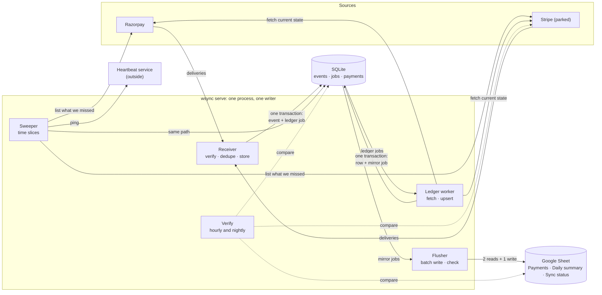
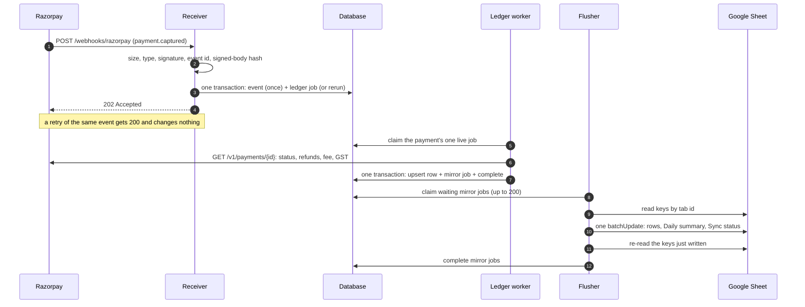

# Webhook sync: overview

**What this page contains.** A picture of the whole service, what each part does and deliberately doesn't do, the rules every part follows, who it is for, and where to read next.

**How to read it.** Read the first five sections, then follow the reading order at the bottom. Words in **bold** are defined in [CONTEXT.md](../../CONTEXT.md). Everything here is a **decision, not a description**: none of it is built. The questions behind each decision are in [grilling-log.md](grilling-log.md).

**Status (2026-10-02).** Designed in eleven grilling rounds (Q1-Q114), audited independently ([38 findings](audit/2026-09-30-design-audit.md)), revised, and checked against primary sources ([research-gaps.md](research-gaps.md), 2026-10-01 and 2026-10-02). Round 11 made **Razorpay the first source** and parked Stripe ([Q103](grilling-log.md)); [the audit response](audit/2026-09-30-audit-response.md) maps every finding to its change. Awaiting review. The implementation plan is written later.

## What it is, in one paragraph

A small service that receives payment **events** from Razorpay (and, if a buyer gives access, Stripe) and keeps a database and a Google Sheet in step with them. However often an event is delivered, in whatever order, and whatever breaks along the way, it ends with exactly one correct row per **payment**, with its fee, net and payment method, plus a **Daily summary**. Every night it proves the last 30 days match the source. It exists because no-code tools get this wrong: Zapier's own help pages admit duplicate rows, and an n8n forum thread shows 100 concurrent events producing 56-63 rows, all marked successful.

## Who it is for

Three **buyers**, one core ([Q66](grilling-log.md)): a small business that wants a live sales sheet; a team whose n8n or Zapier automations lose or double-count events; and a SaaS founder who needs payment and subscription state in their own database. The sheet is the clearest demo. The database sink is the first paid adapter, because that is where the posted jobs are ([next-adapters.md](next-adapters.md)).

## The whole service, in one picture

## One payment's path

## The parts, one at a time

| Part | What it does | What it deliberately does not do |
|---|---|---|
| **Receiver** | Checks rate, size, type, signature, **mode** and **event id**; stores the event once with its **ledger job** in one transaction; answers 202 or 200. [receiver.md](receiver.md) | Never calls a source. Never does work inline. Never answers 500 to bad input. |
| **Source adapters** | Verify, describe (payment key, **fingerprint**), fetch a payment's current state, list for the sweeper and verify, check setup. [sources.md](sources.md) | Never touch the queue or a sink. |
| **Queue** | One live job per payment with a **rerun** flag; leases, **fencing**, three error classes, backoff, the **dead-letter queue**, pausing. [queue.md](queue.md) | Knows nothing about payments beyond the key ([ADR 0004](decisions/0004-queue-in-the-database-behind-an-interface.md)). |
| **Ledger worker** | Fetches the payment, builds its **business row** with fee, net, method and metadata, upserts it, and makes a **mirror job** only if something changed. [ledger-worker.md](ledger-worker.md) | Never calls a source inside a transaction. Never writes an event's own contents ([ADR 0002](decisions/0002-fetch-current-state-not-event-payload.md)). |
| **Sheets sink** | The **flusher** writes machine-owned tabs by key in one batch, checks the write landed, keeps the Daily summary; pauses with a reason; **rebuilds** in place. [sheets-sink.md](sheets-sink.md) | Never reads the sheet as truth. Never touches the buyer's own tabs ([ADR 0006](decisions/0006-machine-owned-tabs.md)). |
| **Sweeper** | Walks the source's history in **time slices** from the **checkpoint**, stores what is missing, detects **silent webhooks**, pings the dead-man's switch. [sweeper.md](sweeper.md) | Never writes business rows directly. |
| **Verify** | Hourly: ledger against sheet. Nightly: source against ledger, and independent totals. **Repair** by enqueuing jobs. [verify.md](verify.md) | Never edits a row. Never claims more than the last 30 days. |
| **Operations** | The admin port, `wsync` commands, `doctor`, alerts; hosting, backups, monitoring, handover. [operations.md](operations.md), [hosting.md](hosting.md) | No side door: every action goes through the same jobs. |

## Rules every part follows

1. **The database is the ledger; the sheet is a mirror.** [ADR 0001](decisions/0001-database-is-the-ledger-sheet-is-a-mirror.md)
2. **Store first, answer second, work later.** A change and the job it causes commit together (the **outbox**).
3. **The current state beats the event.** Events are hints; the worker fetches what is true now. [ADR 0002](decisions/0002-fetch-current-state-not-event-payload.md)
4. **One live job per payment.** Work for a payment is never done twice at once. [ADR 0004](decisions/0004-queue-in-the-database-behind-an-interface.md)
5. **Every write is idempotent.** Running any job twice gives the same result as once.
6. **Nothing disappears silently.** Every delivery ends as stored, duplicate, conflict or rejection; every job as done, dead with a reason, or resolved by a person; every event as handled or ignored with a reason.
7. **Fail closed.** A missing secret, a key whose prefix doesn't match the configured mode, a full-access Stripe key, or a second server stops the service from starting.
8. **Everything traces back to its event**, including events folded into one job.
9. **One buyer and one server process per database.** [ADR 0003](decisions/0003-one-buyer-per-deployment.md), [ADR 0007](decisions/0007-one-server-process-per-database.md)
10. **Permissive licences only.** [ADR 0005](decisions/0005-permissive-licences-only.md)

## What is built when

| Stage | Contents |
|---|---|
| **Prototype** (10-12 h; GIF on 8 October if the laptop spike is done by 4 October) | Razorpay receiver, queue, fetch, flusher, a minimal sweeper: a GIF of the duplicate storm and the outage catch-up |
| **Pitch-ready cut** (26-30 h in all) | About ten finished features ([Q104](grilling-log.md)): the prototype tested; the sweeper with its hourly re-list; verify; Sync status and Daily summary; `demo` paying test orders headless; three scenes; README |
| **After pitching** | Forwarding sink; admin pages, probes, rebuild and the full alert list; disputes; Hypothesis suites; Stripe only if a buyer gives access |
| **When asked** | Database sink with subscriptions; Postgres and several workers (Linux) |
| **Not planned** | Stripe Connect or several buyers in one deployment; Shopify or WooCommerce orders; a public live demo |

Details and hours in [build-order.md](build-order.md).

## Reading order

1. [CONTEXT.md](../../CONTEXT.md): the words.
2. This page.
3. The parts, in the order an event meets them: [data-model.md](data-model.md), [receiver.md](receiver.md), [sources.md](sources.md), [queue.md](queue.md), [ledger-worker.md](ledger-worker.md), [sheets-sink.md](sheets-sink.md), [sweeper.md](sweeper.md), [verify.md](verify.md).
4. Running it: [operations.md](operations.md), [hosting.md](hosting.md).
5. Proving it: [edge-cases.md](edge-cases.md), [testing.md](testing.md).
6. Selling it: [showcase.md](showcase.md), [next-adapters.md](next-adapters.md).
7. [build-order.md](build-order.md).
8. [decisions/](decisions/): seven ADRs.
9. [grilling-log.md](grilling-log.md) (Q1-Q114), the [design audit](audit/2026-09-30-design-audit.md) and the [audit response](audit/2026-09-30-audit-response.md).
10. Research: [feature-inventory.md](../research/feature-inventory.md), [research-gaps.md](research-gaps.md) and the notes it links, including [razorpay-first.md](../research/razorpay-first.md).
