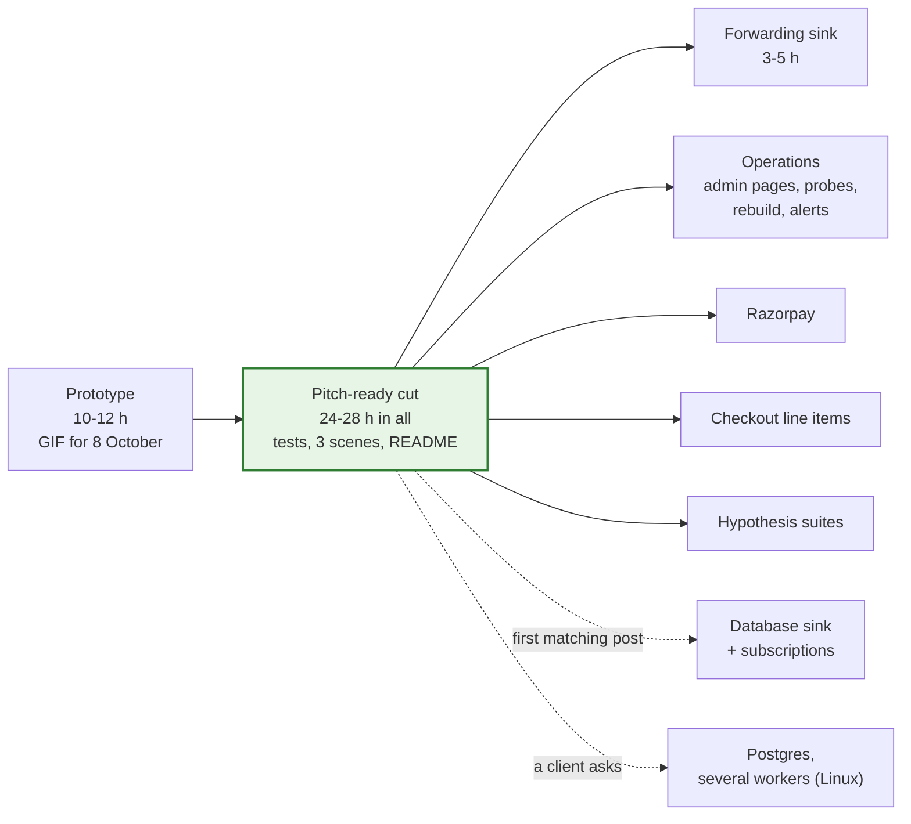

# Build order

**What this page contains.** The three stages (prototype, pitch-ready cut, after pitching), what each step contains and roughly how long it takes, the package layout, and where ported code comes from. The step-by-step implementation plan is written separately, later.

**How to read it.** The picture is the plan. The full design in the other pages is the target; this page is the order to reach it, with a working, shown result early ([Q67](grilling-log.md), audit F30).

## Why it is staged

The audit estimated the full slices at 85-123 hours. After pitching, demo 1 and demo 3, about 4-8 build hours a week are left for this repository, so building everything before pitching would mean pitching in mid-December at the earliest. Instead a prototype is shown from 8 October, a 24-28 hour cut makes it solid, and the rest follows as buyers ask. This repository's prototype is built before demo 1's MVP; after that, the posts that actually arrive decide where the hours go ([Q68](grilling-log.md)).



## The prototype (10-12 h)

Steps P1-P3 below without the tests, plus a **minimal sweeper**: one walk of Stripe's events list in time slices, at startup and on demand, with its checkpoint. `stripe listen` never retries a delivery it failed to forward, so without the sweeper the outage scene can't be shot ([Q98](grilling-log.md), G5). Together they are enough for a 20-second GIF of the duplicate storm and the outage catch-up, attached to the first Stripe-webhook pitches. It is not throwaway: it is the cut's code, finished and tested in the steps that follow.

## The pitch-ready cut (24-28 h, including the prototype)

| Step | Contents | Hours |
|---|---|---|
| P0 | Accounts: Stripe test mode, a restricted key, the CLI; a Google Cloud project with a service account; a throwaway sheet. The **recording spike** ([testing.md](testing.md)). | 2-3 |
| P1 | Config and fail-closed start; the lock file; the writer; migrations; the Stripe receiver (every check, fingerprint, one transaction); the queue with one live job and rerun, lease, token, fenced complete, backoff, dead after N, the reaper | 5-6 |
| P2 | Fetch with the balance transaction expanded; the mapping including fee, net, settlement, method, metadata keys, disputes; the row-creation rule; the ledger upsert with row hash | 2-3 |
| P3 | The flusher: read by tab id, one `batchUpdate` by key, typed values and dates, append after the last row, keys only on append, the post-write check; Sync status; the Daily summary tab; stop and alert on a pause-class error, `wsync resume` | 4-5 |
| P4 | The sweeper finished (the prototype has its slice walk): every 10 minutes, the horizon and full backfill, the heartbeat ping; `wsync verify` (ledger against sheet; source against ledger; totals) writing its line to Sync status | 3 |
| P5 | Tests: FakeStripe and FakeSheets replaying the recordings; the five scripted scenarios with the invariants; the duplicate storm and the burst; three subprocess crash points | 3 |
| P6 | Three scenes with `wsync demo`, the README with its honest limits and the "why not Coupler" answer, `doctor`'s core checks | 5-6 |

**Left out of the cut on purpose:** admin pages (the CLI and Sync status cover it), probes and automatic resume, rebuild, the full alert list (three kinds only), rejection samples beyond counters, the deployment-id check, cell tracking, DST handling, Hypothesis suites, most `doctor` checks, pruning and backup automation (the manual commands are documented), Razorpay, Checkout line items, Postgres.

## After pitching starts

In roughly this order, adjusted to what buyers ask for:

| Item | Hours | Why this place |
|---|---|---|
| Forwarding sink ([next-adapters.md](next-adapters.md)) | 3-5 | Turns the duplicate-storm scene into an offer for n8n and Zapier users ([Q77](grilling-log.md)) |
| Operations: admin pages, reason-specific probes, rebuild in place, the full alert list, pruner and backup, the hosting template, the handover runbook | 14-20 | Needed before the first real client runs it ([hosting.md](hosting.md)) |
| Checkout line items and order id | 3-5 | The most common small-business Stripe setup leaves Description empty |
| Razorpay | 8-12 | Indian buyers |
| Hypothesis suites and the remaining crash points | 4-6 | Deeper proof |
| Database sink with subscriptions | 8-15 | When the first matching post arrives ([Q78](grilling-log.md)) |
| Postgres and several workers, Linux only | 6-10 | When a client needs it ([Q75](grilling-log.md)) |

## Package layout

```
webhook-sync/
├── CONTEXT.md · README.md · THIRD_PARTY_NOTICES.md
├── webhook-sync.toml.example · .env.example
├── migrations/0001_init.sql
├── deploy/                       platform template, compose.yml with Caddy (after pitching)
├── src/webhook_sync/
│   ├── config.py                 TOML + env, validation, fail closed
│   ├── db/                       writer.py (one connection, lock, BEGIN IMMEDIATE), reader.py, migrate.py, lockfile.py
│   ├── receiver/                 routes, the checks, the one transaction, rejection counters
│   ├── sources/                  base.py (the interface), stripe.py, razorpay.py (later), ratelimit.py
│   ├── queue/                    operations.py, sql_sqlite.py, backoff.py, classes.py, pause.py
│   ├── ledger/                   the ledger worker, row building
│   ├── sinks/                    base.py, sheets.py (ported writer), encoding.py, summary.py, forward.py (later)
│   ├── sweeper/                  slices, checkpoints, heartbeat ping, silent-webhook check
│   ├── verify/                   the checks, repair
│   ├── admin/                    admin API; pages later
│   ├── alerts.py · crashpoints.py
│   └── cli/                      wsync commands, doctor, demo
└── tests/
    ├── recordings/               from the recording spike
    ├── fakes/                    fake_stripe.py, fake_sheets.py
    ├── unit/ · integration/ · crash/ · load/ · live/ (weekly)
    └── conftest.py               settle helper, invariants
```

Stack: Python 3.14, uv, FastAPI, uvicorn, SQLAlchemy Core (async) with aiosqlite, httpx, stripe, gspread and google-auth, Jinja2 and htmx (later); pytest, respx, time-machine, ruff; Hypothesis later. All install on Python 3.14 on Windows (checked 2026-09-30).

## Where ported code comes from

[ADR 0005](decisions/0005-permissive-licences-only.md). Every ported file starts with a header naming its origin and what changed.

| Our file | Ported from | Licence | Main changes |
|---|---|---|---|
| `receiver/` | hookline `app.py`, `store.py` | MIT | per-source dedupe key; `NOT NULL`; fingerprint conflicts; rollback on every path; fail closed; 400 not 500; duplicate-header check |
| `queue/` | driftless `jobs.sql`, `queue.go` | Apache-2.0 | Python on SQLite; one live job with rerun (driftless's own requeue idea); claim tokens and heartbeats; error classes; row-by-row reaper with backoff |
| `sweeper/` | driftless `sweep/sweeper.go` | Apache-2.0 | time slices on the source clock; empty slices advance; Razorpay polling |
| `sinks/sheets.py` | sync-engine `destination-google-sheets/src/writer.ts` | Apache-2.0, "Copyright 2025 Supabase" (G24) | abort on a failed read; read by sheet id; typed `updateCells` instead of `pasteData`; keys only on append; post-write check; no sheet-side version guard |
| `queue/backoff.py` | Svix retry schedule idea | MIT | two profiles; a 0.5-1.5 factor; `Retry-After` never clamped |

## Where to go next

Back to [00-overview.md](00-overview.md), or to [decisions/](decisions/) for the choices that are hard to reverse.
