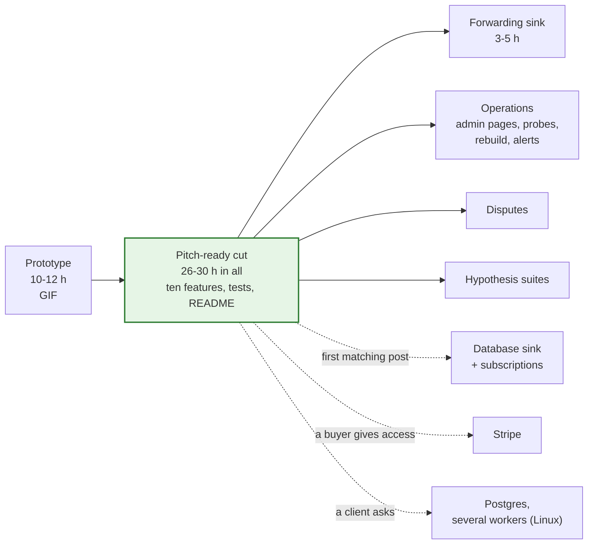

# Build order

**What this page contains.** The three stages (prototype, pitch-ready cut, after pitching), what the cut shows, what each step contains and roughly how long it takes, the package layout, and where ported code comes from. The step-by-step implementation plan is written separately, later.

**How to read it.** The picture is the plan. The full design in the other pages is the target; this page is the order to reach it, with a working, shown result early ([Q67](grilling-log.md), audit F30).

## Why it is staged

The audit estimated the full slices at 85-123 hours. After pitching, demo 1 and demo 3, about 4-8 build hours a week are left for this repository, so building everything before pitching would mean pitching in mid-December at the earliest. Instead a prototype is shown first, a cut of about ten finished features makes it solid, and the rest follows as buyers ask. This repository's prototype is built before demo 1's MVP; after that, the posts that actually arrive decide where the hours go ([Q68](grilling-log.md)).

**Razorpay is the first source** ([Q103](grilling-log.md)). Stripe is invite-only in India, so it is **parked**: its pages stay as the design of a second adapter, and it is built only if a buyer gives access. The cut is proof of work for freelance pitches: few features, each finished and proved by a test ([Q104](grilling-log.md)).



## What the cut shows

About ten features ([Q104](grilling-log.md)), each with the test that proves it:

| # | A buyer sees | Proved by |
|---|---|---|
| 1 | A live Payments tab: amount, status, refund state, fee, GST, net, method | the invariants in every scenario |
| 2 | One row per payment however often Razorpay delivers it; duplicates counted | duplicate storm (load), crash point `after_event_commit` |
| 3 | Payments made while the service was down come back, Via = `sweep` | outage scenario, crash point `mid_slice` |
| 4 | A later capture, refund or late authorisation updates the same row | late-authorisation and refund scenarios |
| 5 | `wsync verify`: "N payments, 0 differences", Razorpay against ledger against sheet | verify in every scenario; the weekly real run |
| 6 | The Sync status tab | Sheets 429 scenario |
| 7 | Sheets failures retried with backoff, then a stop that says why | Sheets 429 scenario; crash point `after_sheet_write_before_done` |
| + | The Daily summary tab: gross, fees and net per day | invariant 2 |
| 8-10 | Three crash points; `serve`, `sweep`, `verify`, `demo`, `doctor`; a README with the GIF, each promise beside its test, and honest limits | — |

## The prototype (10-12 h)

Steps P1-P3 below without the tests, plus a **minimal sweeper**: one walk of `GET /v1/payments` in creation-time slices, at startup and on demand, with its checkpoint ([Q107](grilling-log.md)). Enough for a 20-second GIF of the duplicate storm and the outage catch-up. It is not throwaway: it is the cut's code, finished and tested in the steps that follow. The GIF keeps **8 October** only if P0 is done by 4 October; otherwise the date moves, not P0 ([Q114](grilling-log.md)).

## The pitch-ready cut (26-30 h, including the prototype)

| Step | Contents | Hours |
|---|---|---|
| P0 | On the owner's laptop, step by step in issue #4: a Razorpay test-mode webhook through the tunnel ([hosting.md](hosting.md)); the **recording spike** ([testing.md](testing.md)). The Google service account and throwaway sheet already exist (G21 and G18 were checked against them) | 2-3 |
| P1 | Config and fail-closed start (mode and key prefix); the lock file; the writer; migrations; the Razorpay receiver (raw-body signature, event id and signed-body hash, one transaction, the demo fail-first switch); the queue with one live job and rerun, lease, token, fenced complete, backoff, dead after N, the reaper | 5-6 |
| P2 | Fetch `GET /v1/payments/{id}` and its refunds; the mapping (status, refund state, fee, GST, net, method, metadata keys); `created` makes no row; the ledger upsert with row hash | 2-3 |
| P3 | The flusher: read by tab id, one `batchUpdate` by key, typed values and dates, append after the last row, keys only on append, the post-write check; Sync status; the Daily summary tab; stop and alert on a pause-class error, `wsync resume` | 4-5 |
| P4 | The sweeper finished: slices every 10 minutes, the hourly **re-list** ([Q108](grilling-log.md)), full backfill, the heartbeat ping; `wsync verify` (ledger against sheet; Razorpay against ledger) writing its line to Sync status | 3 |
| P5 | Tests: FakeRazorpay and FakeSheets replaying the recordings; five scripted scenarios with the invariants; the duplicate storm and the burst; three subprocess crash points | 3 |
| P6 | `wsync demo` paying test orders headless ([Q105](grilling-log.md)); `doctor`'s core checks and `--url`; the weekly real run; the README with its honest limits and the "why not Coupler" answer; the GIF and video | 5-6 |

**Left out of the cut on purpose:** Stripe, disputes, admin pages (the CLI and Sync status cover it), probes and automatic resume, rebuild, the full alert list (three kinds only), rejection samples beyond counters, the deployment-id check, cell tracking, DST handling, Hypothesis suites, most `doctor` checks, pruning and backup automation (the manual commands are documented), currencies other than INR, Postgres.

## After pitching starts

In roughly this order, adjusted to what buyers ask for:

| Item | Hours | Why this place |
|---|---|---|
| Forwarding sink ([next-adapters.md](next-adapters.md)) | 3-5 | Turns the duplicate-storm scene into an offer for n8n and Zapier users ([Q77](grilling-log.md)) |
| Operations: admin pages, reason-specific probes, rebuild in place, the full alert list, pruner and backup, the hosting template, the handover runbook | 14-20 | Needed before the first real client runs it ([hosting.md](hosting.md)) |
| Disputes: the hourly disputes poll, the dispute column, `payment.dispute.*` handled | 2-3 | Tested on documented samples only: Razorpay test mode can't make one (G52) |
| Hypothesis suites and the remaining crash points | 4-6 | Deeper proof |
| Database sink with subscriptions | 8-15 | When the first matching post arrives ([Q78](grilling-log.md)) |
| Stripe: its recording spike, then the adapter and Checkout line items | 2-3, then 10-15 | Only if a buyer gives access ([Q103](grilling-log.md)) |
| Postgres and several workers, Linux only | 6-10 | When a client needs it ([Q75](grilling-log.md)) |

## Package layout

```
webhook-sync/
├── CONTEXT.md · README.md · THIRD_PARTY_NOTICES.md
├── webhook-sync.toml.example · .env.example
├── migrations/0001_init.sqlite.sql
├── deploy/                       platform template, compose.yml with Caddy (after pitching)
├── src/webhook_sync/
│   ├── config.py                 TOML + env, validation, fail closed
│   ├── db/                       writer.py (one connection, lock, BEGIN IMMEDIATE), reader.py, migrate.py, lockfile.py
│   ├── receiver/                 routes, the checks, the one transaction, rejection counters
│   ├── sources/                  base.py (the interface), razorpay.py, stripe.py (parked), ratelimit.py
│   ├── queue/                    operations.py, sql_sqlite.py, backoff.py, classes.py, pause.py
│   ├── ledger/                   the ledger worker, row building
│   ├── sinks/                    base.py, sheets.py (ported writer), encoding.py, summary.py, forward.py (later)
│   ├── sweeper/                  slices, checkpoints, heartbeat ping, silent-webhook check
│   ├── verify/                   the checks, repair
│   ├── admin/                    admin API; pages later
│   ├── alerts.py · crashpoints.py
│   └── cli/                      wsync commands, doctor, demo (Playwright in the `wsync[demo]` extra)
└── tests/
    ├── recordings/               from the recording spike
    ├── fakes/                    fake_razorpay.py, fake_sheets.py
    ├── unit/ · integration/ · crash/ · load/ · live/ (weekly)
    └── conftest.py               settle helper, invariants
```

Stack: Python 3.14, uv, FastAPI, uvicorn, SQLAlchemy Core (async) with aiosqlite, httpx, razorpay, gspread and google-auth, Playwright (demo extra only), Jinja2 and htmx (later); pytest, respx, time-machine, ruff; Hypothesis later. All install on Python 3.14 on Windows (checked 2026-09-30).

## Where ported code comes from

[ADR 0005](decisions/0005-permissive-licences-only.md). Every ported file starts with a header naming its origin and what changed.

| Our file | Ported from | Licence | Main changes |
|---|---|---|---|
| `receiver/` | hookline `app.py`, `store.py` | MIT | per-source dedupe key; `NOT NULL`; fingerprint conflicts; rollback on every path; fail closed; 400 not 500; duplicate-header check |
| `queue/` | driftless `jobs.sql`, `queue.go` | Apache-2.0 | Python on SQLite; one live job with rerun (driftless's own requeue idea); claim tokens and heartbeats; error classes; row-by-row reaper with backoff |
| `sweeper/` | driftless `sweep/sweeper.go` | Apache-2.0 | time slices on the source clock; empty slices advance; Razorpay polling |
| `sinks/sheets.py` | sync-engine `destination-google-sheets/src/writer.ts` | Apache-2.0, "Copyright 2025 Supabase" (G24) | abort on a failed read; read by sheet id; typed `updateCells` instead of `pasteData`; keys only on append; post-write check; no sheet-side version guard |
| `queue/backoff.py` | Svix retry schedule idea | MIT | two profiles; a 0.5-1.5 factor; `Retry-After` never clamped |

## Where to go next

Back to [00-overview.md](00-overview.md), or to [decisions/](decisions/) for the choices that are hard to reverse.
