# Build order

**What this page contains.** The package layout, the eight slices in build order with what each ends with, the pitch-ready line, what must exist before slice 1, and where ported code comes from.

**How to read it.** The picture is the plan. Each slice ends with something that works and is tested; nothing depends on a later slice. The step-by-step implementation plan is written separately, later.

## Slices

```mermaid
flowchart LR
  P0["0. Accounts<br/>Stripe test · Google service account"] --> S1
  S1["1. Stripe → ledger<br/>receive · verify · store ·<br/>ledger job · payments"] --> S2["2. Queue robustness<br/>leases · fencing · retries ·<br/>dead letters · pause · shutdown"]
  S2 --> S3["3. Sheets<br/>flusher · layout · rebuild"]
  S3 --> S4["4. Sweeper and verify"]
  S4 --> S5["5. Admin pages ·<br/>alerts · doctor"]
  S5 --> S6["6. Showcase<br/>wsync demo · video · README"]
  S6 --> PR(["PITCH-READY"])
  PR --> S7["7. Razorpay"]
  S7 --> S8["8. Postgres ·<br/>Docker Compose"]
  classDef ready fill:#e6f5e6,stroke:#2e7d32,stroke-width:2px
  class PR ready
```



| Slice | Ends with | Proved by |
|---|---|---|
| 0 | Stripe test account and CLI login; Google Cloud service account; a test spreadsheet shared with it (Lalit, about 20 minutes) | `stripe listen` forwards to a local port |
| 1 | `POST /webhooks/stripe` stores events once with their ledger job; the worker fetches and writes `payments`; migrations; config and fail-closed start | unit tests for signatures and mapping; integration with FakeStripe; invariants 1 and 3 |
| 2 | claim, heartbeat, fencing, reaper, the three error classes, backoff profiles, dead letters, source pause, graceful shutdown | crash points in the ledger worker; property tests over retries |
| 3 | the flusher, typed encoding, Sync status tab, header check, sink pause and probe, rebuild | FakeSheets: lost replies, tampering, 429s; invariant 2; burst load check |
| 4 | the Stripe sweeper with checkpoints and horizon, silent-webhook detection, backfill, replay, verify quick and full, repair | crash point `mid_sweep_page`; outage scenarios; verify against FakeStripe |
| 5 | admin pages, alerts, admin actions log, `doctor`, pruner, backup | integration tests on the routes; `doctor` against a broken setup |
| 6 | `wsync demo`, the recorded video, the README with GIFs and numbers | end to end by hand |
| 7 | Razorpay adapter: signature, header event id, fetch, polling sweep | FakeRazorpay; the same invariants |
| 8 | Postgres dialect and `--workers N`; `compose.yml` with Caddy and a volume | the integration suite on Postgres in CI; the multi-worker race |

**Pitch-ready = slices 1-6**: Stripe, SQLite and Sheets, fully proved and on video ([Q59](grilling-log.md)). Razorpay and Postgres follow while pitching has started. The plan's dates (demos 1 and 2 in 1-7 October, pitching from 8 October) are tight for this; if demo 1 takes the week, demo 2 starts pitching a few days later rather than cutting the proof layer, because the proof layer is the product.

## Package layout

```
webhook-sync/
├── CONTEXT.md
├── README.md                     slice 6
├── THIRD_PARTY_NOTICES.md
├── webhook-sync.toml.example
├── .env.example
├── compose.yml                   slice 8
├── migrations/
│   ├── 0001_init.sqlite.sql
│   └── 0001_init.postgres.sql
├── src/webhook_sync/
│   ├── config.py                 TOML + env, validation, fail closed
│   ├── db.py                     SQLAlchemy Core engine, dialect switches, migrations runner
│   ├── receiver/                 FastAPI routes, the checks, the one transaction
│   ├── sources/                  base.py (the interface), stripe.py, razorpay.py, ratelimit.py
│   ├── queue/                    the six operations, backoff, error classes, pause
│   ├── ledger/                   the ledger worker, row building, payload fallback
│   ├── sinks/                    base.py, sheets.py (ported writer), encoding.py
│   ├── sweeper/                  checkpoints, sweeps, silent-webhook check
│   ├── verify/                   the three checks, repair
│   ├── admin/                    pages, templates, static (Pico.css, htmx)
│   ├── alerts.py
│   ├── crashpoints.py            no-ops unless enabled by tests
│   └── cli/                      wsync commands, doctor, demo
└── tests/
    ├── fakes/                    fake_stripe.py, fake_razorpay.py, fake_sheets.py
    ├── fixtures/stripe/          recorded test-mode events
    ├── unit/ · integration/ · property/ · load/
    └── conftest.py               settle helper, invariants
```

Stack: Python 3.14, uv, FastAPI, uvicorn, SQLAlchemy Core (async) with aiosqlite or psycopg, httpx, stripe, razorpay, gspread and google-auth, Jinja2, htmx; pytest, Hypothesis, respx, time-machine, ruff ([Q8](grilling-log.md), [Q61](grilling-log.md)). All install on Python 3.14 on Windows (checked 2026-09-30).

## Where ported code comes from

[ADR 0005](decisions/0005-permissive-licences-only.md). Every ported file starts with a header naming its origin and what changed.

| Our file | Ported from | Licence | Main changes |
|---|---|---|---|
| `receiver/` | hookline `app.py`, `store.py` | MIT | per-source dedupe key; `NOT NULL`; rollback on every path; fail closed; 400 not 500; duplicate-header check |
| `queue/` | driftless `jobs.sql`, `queue.go` | Apache-2.0 | Python and SQLAlchemy; SQLite support; claim tokens and heartbeats; error classes; retry through enqueue; backoff on reaped jobs |
| `sweeper/` | driftless `sweep/sweeper.go` | Apache-2.0 | page and checkpoint in one transaction; source clock for the checkpoint; Razorpay polling |
| `sinks/sheets.py` | sync-engine `destination-google-sheets/src/writer.ts` | Apache-2.0 | abort on a failed read; typed `updateCells` instead of `pasteData`; header check; 50,000-character cut; no sheet-side version guard |
| `queue/backoff.py` | Svix retry schedule idea; AWS jitter article | MIT / formula | schedule profiles; 0.5-1.5 factor; `Retry-After` never clamped |

## Where to go next

Back to [00-overview.md](00-overview.md), or to [decisions/](decisions/) for the choices that are hard to reverse.
