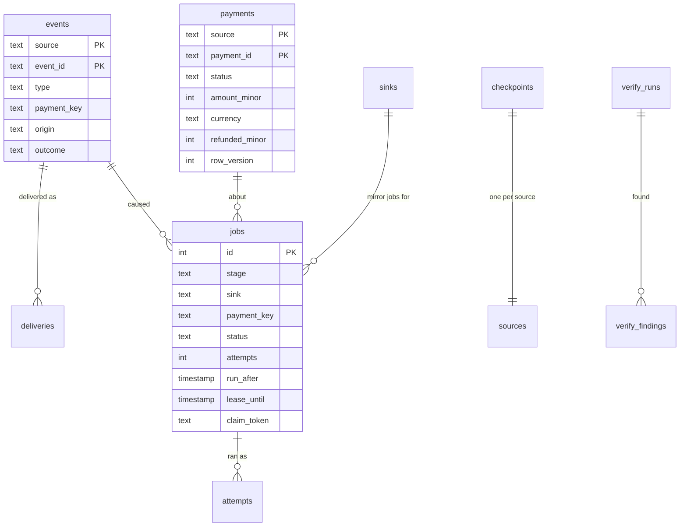

# Data model

**What this page contains.** Every table in the database, what one row means, the columns that matter and why each exists, the unique keys that enforce the guarantees, and how long rows are kept.

**How to read it.** Start with the picture. The three tables that carry the guarantees are `events`, `jobs` and `payments`; read those closely and skim the rest. Column types are written generically (`text`, `int`, `timestamp`); the SQLite and Postgres migrations spell them per dialect ([Q48](grilling-log.md)). Every timestamp is UTC ([Q20](grilling-log.md)).

## The tables, in one picture

`sources` is configuration, not a table: it is drawn only to show one checkpoint per source.

## events: one row per event, ever

The audit trail. A row is written once, by the receiver or the sweeper, and never updated except for its outcome and, after 90 days, its payload.

| Column | Meaning | Why |
|---|---|---|
| `source`, `event_id` | The **dedupe key**. Both `NOT NULL`; **primary key**. | The one constraint that makes a duplicate delivery harmless ([Q14](grilling-log.md)). hookline's key allowed `NULL` twice. |
| `type` | The source's event type, e.g. `payment_intent.succeeded` | To decide handled or **ignored** |
| `mode` | `test` or `live`, from the event | Kept for the record; a mismatch never gets this far ([Q16](grilling-log.md)) |
| `payment_key` | The payment this event is about, e.g. `pi_3Nx…`; `NULL` for ignored events | Links the event to its business row and jobs |
| `origin` | `delivery`, `sweep`, `backfill` or `replay` | Shows how we learned of it; the video's `sweep` tag |
| `outcome`, `ignore_reason` | `queued` or `ignored`; for ignored events a reason such as `unhandled_type` or `no_payment_intent` | Rule 5: every event is handled or ignored with a reason |
| `body_sha256` | Hash of the raw body as received | Tells a **duplicate** (same hash) from a **conflict** (different hash) |
| `payload` | The raw body, as text | For replay and debugging. Set to `NULL` after 90 days ([Q21](grilling-log.md)); the hash stays. |
| `source_created_at` | The event's own creation time | Ordering guard in payload mode; sweeper overlap |
| `received_at` | When we stored it | |
| `secret_index` | Which of the source's secrets matched (0 = newest) | Shows when an old secret can be removed ([Q17](grilling-log.md)) |

## deliveries and rejections: one row per HTTP request

| Table | One row per | Key columns | Why |
|---|---|---|---|
| `deliveries` | request that passed every check | `source`, `event_id`, `result` (`new`, `duplicate`, `conflict`), `status_code`, `received_at`, `duration_ms` | Counts duplicates for the admin page and the video; a conflict points a person at both bodies. |
| `rejections` | request refused before storing | `source`, `reason` (`bad_signature`, `stale_timestamp`, `future_timestamp`, `wrong_mode`, `missing_id`, `duplicate_header`, `too_large`, `not_json`, `malformed`), `status_code`, `size`, `headers` (secrets and signatures removed), `received_at` | Makes probing and misconfiguration visible without storing anything unverified. The body is never kept. Capped at 100,000 rows, oldest dropped first, so a flood of junk can't grow it without limit; a counter on the admin page keeps the total. |

## payments: one business row per payment

The ledger. Written only by the ledger worker. The Sheets tab is a copy of this table.

| Column | Meaning | Why |
|---|---|---|
| `source`, `payment_id` | **Primary key.** Stripe PaymentIntent id (`pi_…`) or Razorpay payment id (`pay_…`) | One row per payment, enforced by the database ([ADR 0001](decisions/0001-database-is-the-ledger-sheet-is-a-mirror.md)) |
| `status` | Our normalised status: `pending`, `requires_action`, `processing`, `authorized`, `failed`, `succeeded`, `partially_refunded`, `refunded`, `canceled` | One vocabulary across sources; order and terminal states in [sources.md](sources.md) |
| `source_status` | The source's own status word | So nothing is lost in normalising |
| `amount_minor`, `currency` | Amount in **minor units**, ISO currency code | Exact money ([Q19](grilling-log.md)) |
| `refunded_minor` | Total refunded so far, minor units | Partial refunds without a row per refund |
| `dispute_status` | `NULL`, `open`, `won`, `lost` | Separate from `status`, so a dispute on a refunded payment still shows |
| `customer_email`, `customer_name`, `description` | As the source reports them | Configurable sheet columns; masking happens at write time ([Q21](grilling-log.md)) |
| `source_created_at` | When the payment was created at the source | The sheet's date column; verify's window |
| `written_from` | `fetch` or `payload` | Rows written from a payload are flagged ([ADR 0002](decisions/0002-fetch-current-state-not-event-payload.md)) |
| `payload_version` | `(source_created_at, event_id)` of the event last written in payload mode | The guard that stops an older payload overwriting a newer one |
| `last_event_id` | The event whose job last changed this row | Traceability (rule 7) |
| `row_hash` | Hash of every mirrored column | A fetch that changes nothing makes no mirror job |
| `row_version` | Counter, +1 on every change | Lets the timeline show which change reached the sheet |
| `updated_at` | Last change | |

## jobs: one row per piece of work

Written by the receiver, the sweeper, the ledger worker, verify's repair and admin actions. The state machine and every query are in [queue.md](queue.md).

| Column | Meaning |
|---|---|
| `id` | Primary key |
| `stage` | `ledger` or `mirror` |
| `sink` | `ledger` for ledger jobs; the sink name (`sheets`) for mirror jobs |
| `source`, `payment_key` | Which payment |
| `status` | `waiting`, `running`, `done`, `dead`, `resolved` |
| `attempts`, `max_attempts` | Attempts used and allowed (10 in the production profile, 6 in the demo profile) |
| `run_after` | Earliest time it may be claimed; backoff is stored here, never slept |
| `lease_until`, `claim_token` | Set by a claim; the token **fences** completion |
| `last_error`, `last_error_class` | `retry`, `dead` or `pause` ([Q28](grilling-log.md)) |
| `caused_by_event_id` | The latest event folded into this job |
| `created_at`, `updated_at`, `resolved_note` | |

**The coalescing key.** A partial unique index on `(stage, sink, source, payment_key) WHERE status = 'waiting'` allows at most one waiting job per payment per stage and sink. A running job does not block it, so a new event during a run creates exactly one follow-up ([Q25](grilling-log.md)).

## attempts: one row per run of a job

`job_id`, `number`, `started_at`, `finished_at`, `outcome` (`ok`, `retry`, `dead`, `pause`, `reaped`, `released`), `error`, `duration_ms`, `worker`. Append-only. This is the timeline on the admin page, and the proof in the video that retries back off.

## The small tables

| Table | One row per | Holds |
|---|---|---|
| `sinks` | sink | `state` (`active`, `paused`), `paused_reason`, `paused_since`, `consecutive_failures`, `next_probe_at` ([Q30](grilling-log.md)) |
| `checkpoints` | source | `checkpoint_at`, `last_sweep_at`, `last_sweep_found`, `horizon_warned_at` ([sweeper.md](sweeper.md)) |
| `singletons` | named loop that must run once (`flusher`, `sweeper`, `verify`, `pruner`) | `holder_token`, `lease_until`. Stops a second process from running the same loop ([Q26](grilling-log.md)). |
| `verify_runs` | run of verify | `mode`, times, counts of missing, stale, orphaned and sheet differences, totals per currency |
| `verify_findings` | difference found | `run_id`, `kind`, `source`, `payment_key`, `detail`, `repaired_job_id` |
| `alerts` | alert kind | `last_sent_at`, `suppressed_count` (one per kind per hour, [Q42](grilling-log.md)) |
| `admin_actions` | thing a person did | `at`, `token_label`, `action`, `target`, `note` ([Q43](grilling-log.md)) |
| `schema_version` | migration applied | `version`, `applied_at` |

## How long rows are kept

The pruner runs daily, 1,000 rows per transaction ([Q44](grilling-log.md)).

| What | Kept |
|---|---|
| `events.payload` | 90 days, then `NULL`; the row and hash stay |
| `events` rows | forever (small once the payload is gone) |
| `jobs` in `done` | 7 days |
| `attempts` | 30 days |
| `deliveries`, `rejections` | 30 days |
| `jobs` in `dead`, `admin_actions` | until resolved, then 90 days |
| `verify_runs`, `verify_findings` | 90 days |
| `payments` | forever |

## Open questions

- Whether `events` rows themselves should ever be pruned. Written: no; a few hundred bytes each without the payload. Revisit if a client has millions a year.

## Where to go next

[receiver.md](receiver.md): how a delivery becomes an `events` row and a job.
