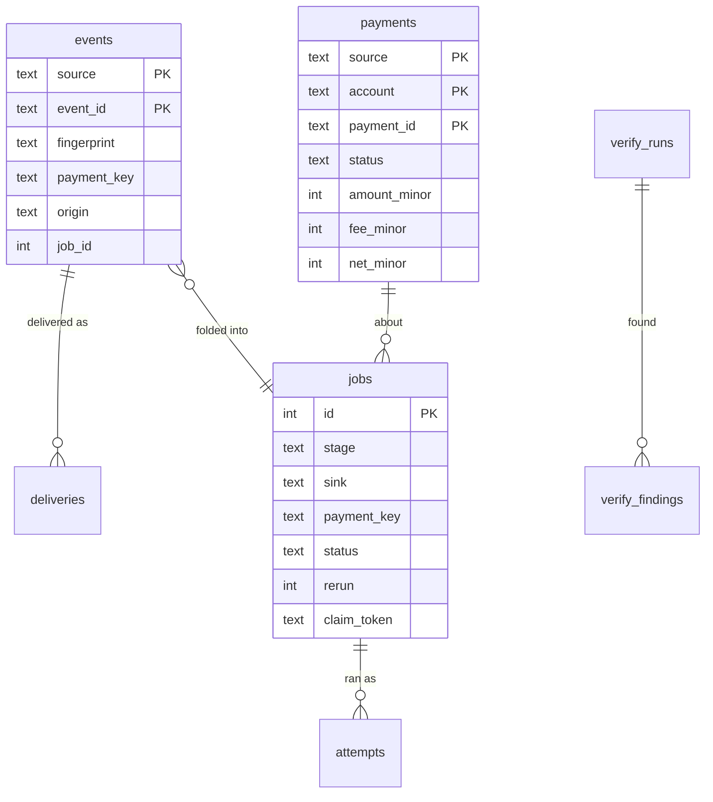

# Data model

**What this page contains.** Every table, what one row means, the columns that matter and why each exists, the unique keys that enforce the guarantees, and how long rows are kept.

**How to read it.** Start with the picture. The three tables that carry the guarantees are `events`, `jobs` and `payments`; read those closely and skim the rest. Types are written generically (`text`, `int`, `timestamp`); version 1 runs on SQLite only ([Q75](grilling-log.md)). Every timestamp is UTC.

## The tables, in one picture

## events: one row per event, ever

The audit trail. Written once, by the receiver or the sweeper.

| Column | Meaning | Why |
|---|---|---|
| `source`, `event_id` | The **dedupe key**. Both `NOT NULL`; primary key. | A duplicate delivery can't make a second row ([Q14](grilling-log.md)). |
| `account` | The source account the event belongs to | The business-row key carries it ([Q76](grilling-log.md)) |
| `type`, `mode` | Event type; test or live | Handled or ignored; the mode check |
| `fingerprint` | Hash of type, object id, creation time and mode | A **conflict** is a different fingerprint under the same id ([Q71](grilling-log.md)) |
| `body_sha256` | Hash of the raw body as received | Kept for information. For Razorpay, whose event id isn't signed, a unique index on `(source, body_sha256)` makes a replayed body under a fresh id a duplicate ([Q86](grilling-log.md)) |
| `payment_key` | The payment this event is about; `NULL` for ignored events | Links event, row and job |
| `origin` | `delivery`, `sweep`, `backfill` or `replay` | How we learned of it |
| `outcome`, `ignore_reason` | `queued` or `ignored`, with a reason (`unhandled_type`, `no_payment_intent`, `connect_account`) | Nothing disappears without a reason |
| `job_id` | The job this event was folded into | Traceability survives coalescing (F17) |
| `payload` | The body with fields no adapter reads removed (addresses, phone, IP, payment-method details) | For debugging. Set to `NULL` after 30 days ([Q91](grilling-log.md)) |
| `source_created_at`, `received_at` | The event's own time; when we stored it | |

## deliveries and rejections

| Table | One row per | Holds | Why |
|---|---|---|---|
| `deliveries` | HTTP request that passed every check | `source`, `event_id`, `result` (`new`, `duplicate`, `conflict`), `status_code`, `received_at`, `duration_ms` | Counts duplicates for the video and the admin page. The sweeper writes none: it isn't a delivery (F02). |
| `rejection_counts` | reason, per source, per minute | `count` | Rejections are counted in memory and written once a minute, so a junk flood can't become a write flood ([Q84](grilling-log.md)). |
| `rejection_samples` | one of the last 100 rejections | reason, size, headers with secrets and IP removed | Enough to diagnose a misconfiguration. No body is ever kept. |

## payments: one business row per payment

The ledger. Written only by the ledger worker. The Payments tab is a copy.

| Column | Meaning | Why |
|---|---|---|
| `source`, `account`, `payment_id` | **Primary key.** Stripe PaymentIntent id (`pi_…`) or Razorpay payment id (`pay_…`) | One row per payment, enforced by the database ([ADR 0001](decisions/0001-database-is-the-ledger-sheet-is-a-mirror.md)) |
| `status`, `source_status` | Our status (`processing`, `authorized`, `failed`, `succeeded`, `partially_refunded`, `refunded`, `canceled`) and the source's own word | One vocabulary across sources ([sources.md](sources.md)) |
| `amount_minor`, `authorized_minor`, `currency` | Amount received, in **minor units**; the amount authorised when it differs (partial capture); currency | Revenue isn't overstated after a partial capture (F10) |
| `refunded_minor` | Total refunded so far | |
| `fee_minor`, `net_minor`, `settlement_minor`, `settlement_currency` | What the source kept, what the buyer receives, and the paid-out amount and currency | The first things a bookkeeper asks for ([Q69](grilling-log.md)) |
| `fee_tax_minor` | Tax on the fee (Razorpay reports GST on its fee) | An input credit Indian accountants claim |
| `method` | `card` (with brand), `upi`, `netbanking`, `wallet`, … | Standard in Indian sales reports |
| `metadata` | The configured metadata keys (Stripe `metadata`, Razorpay `notes`), as JSON | Joins the sheet to the buyer's own order ids |
| `dispute_status` | `inquiry`, `needs_response`, `under_review`, `won`, `lost`, `prevented`, `closed`, or empty | Stripe's eight dispute states mapped without losing meaning (F10) |
| `customer_email`, `customer_name`, `description` | As the source reports them | Masked at write time if configured |
| `source_created_at` | When the payment was created at the source | The sheet's date column and the Daily summary's day |
| `not_found_at` | Set when a fetch returned 404 | The row keeps its last fetched values and is flagged ([ADR 0002](decisions/0002-fetch-current-state-not-event-payload.md)) |
| `unknown_columns` | Columns an optional read couldn't fill (a missing key permission) | Shown as "unknown", never as zero ([Q85](grilling-log.md)) |
| `via` | `delivery` or `sweep`: how the payment's latest change reached us | The optional "Via" column the outage scene shows (F36) |
| `last_event_id`, `row_hash`, `row_version`, `updated_at` | Trace, change detection, change counter, time | A fetch that changes nothing makes no mirror job |

## jobs: one row per piece of work

The state machine and every statement are in [queue.md](queue.md).

| Column | Meaning |
|---|---|
| `id` | Primary key |
| `stage`, `sink` | `ledger` / `ledger`, or `mirror` / the sink name (`sheets`) |
| `source`, `account`, `payment_key` | Which payment |
| `status` | `waiting`, `running`, `done`, `dead`, `resolved` |
| `rerun` | New work arrived while running; run once more on completion ([Q70](grilling-log.md)) |
| `attempts`, `max_attempts` | Used and allowed (10 in the production profile, 6 in demo) |
| `run_after` | Earliest claim time; backoff is stored here, never slept |
| `lease_until`, `claim_token`, `claimed_by` | Set by a claim; the token fences completion; `claimed_by` is the server's instance id and start time (F17) |
| `prefetched` | A state already listed by a backfill or repair, used instead of a fetch if no newer event has arrived (F18) |
| `last_error`, `last_error_class`, `caused_by_event_id`, `created_at`, `updated_at`, `resolved_note` | |

**The one-live-job key.** A unique index on `(stage, sink, source, account, payment_key) WHERE status IN ('waiting', 'running')`. There is never a second live job for a payment, so failing, reaping or releasing a job can't collide with anything (F01), and two fetches for one payment can't run at once (F04).

## attempts, and the small tables

`attempts`: `job_id`, `number`, `started_at`, `finished_at`, `outcome` (`ok`, `retry`, `dead`, `pause`, `reaped`, `released`), `error`, `duration_ms`. Append-only; the timeline on the admin page.

| Table | One row per | Holds |
|---|---|---|
| `sinks` | sink, and source | `state` (`active`, `paused`), `paused_reason`, `paused_since`, `consecutive_failures`, `next_probe_at` ([queue.md](queue.md)) |
| `checkpoints` | source and account | `checkpoint_at` (the source's clock), `last_sweep_at`, `last_sweep_stored`, `horizon_warned_at` ([sweeper.md](sweeper.md)) |
| `sheet_state` | spreadsheet | tab ids, `deployment_id`, last flush, cell count |
| `verify_runs`, `verify_findings` | run; difference found | counts, totals per currency, the finding and the job that repaired it |
| `alerts` | alert kind | `last_sent_at`, `suppressed_count` |
| `admin_actions` | thing a person did | `at`, `token_label`, `action`, `target`, `note` |
| `schema_version` | migration applied | `version`, `applied_at` |

There is no `singletons` table: one server process owns the database ([ADR 0007](decisions/0007-one-server-process-per-database.md)).

## How long rows are kept

The pruner runs daily, 1,000 rows per transaction ([Q44](grilling-log.md), [Q91](grilling-log.md)).

| What | Kept |
|---|---|
| `events.payload` | 30 days, then `NULL`; the row and hashes stay |
| `events` rows | forever (small once the payload is gone) |
| `jobs` in `done` | 7 days |
| `attempts`, `deliveries`, `rejection_counts` | 30 days |
| `rejection_samples` | the last 100 |
| `jobs` in `dead`, `admin_actions`, `verify_*` | until resolved, then 90 days |
| `payments` | forever |
| backups | 30 days, encrypted, off the machine ([hosting.md](hosting.md)) |

## Where to go next

[receiver.md](receiver.md): how a delivery becomes an `events` row and a job.
