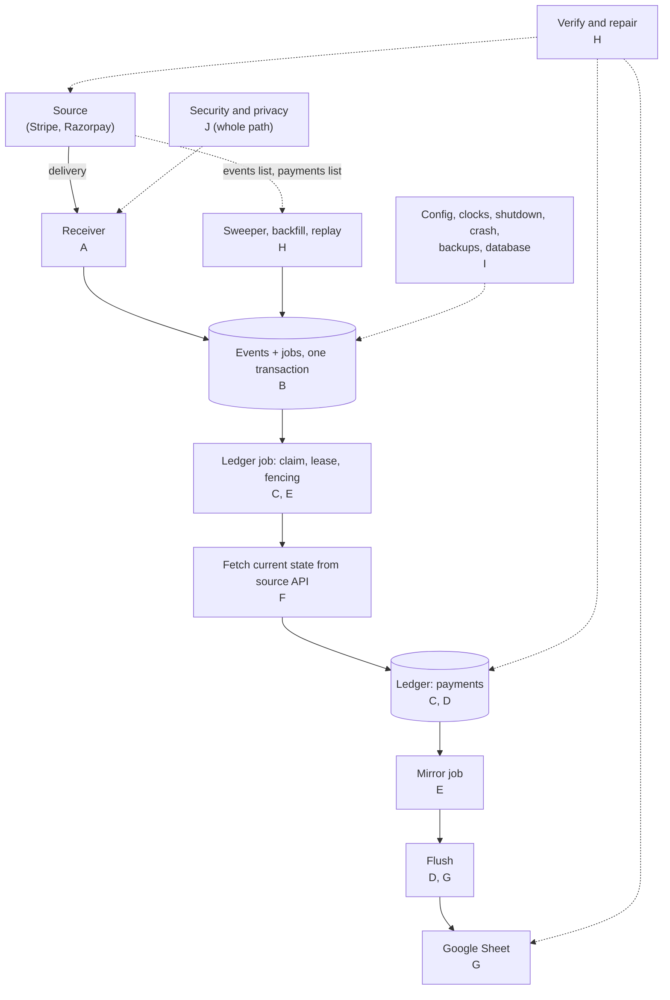

# Edge-case catalogue

**What this page contains.** Every edge case the webhook sync must handle, grouped by where on the path it happens: what the service does, which decision says so, and the test that proves it. Everything here is a decision, not a description. Nothing is built yet.

**How to read it.** The diagram shows where each section sits on the path. Each table row is one case. "Decided in" links the question in the [grilling log](grilling-log.md) or the ADR that settles it; "OQn" means the design has no answer yet, and the proposed default is in [Open questions](#open-questions). "Proved by" names the test kind from Q51–Q53. Crash point names other than the three in Q52 are proposed. Where the [feature inventory](../research/feature-inventory.md) suggested one thing and a decision chose another, the decision wins and the row says so. Words in **bold** are defined in [CONTEXT.md](../../CONTEXT.md).

## A. Deliveries and signatures

| # | Case | What happens | Decided in | Proved by |
|---|---|---|---|---|
| A1 | New, correctly signed delivery | Event and its ledger job are written in one transaction, then 202. | [Q14](grilling-log.md), [Q15](grilling-log.md), [Q24](grilling-log.md) | integration (FakeStripe) |
| A2 | Bad or missing signature; signature header with non-ASCII bytes or a malformed list (e.g. a double space) | 400, row in `rejections` with secrets removed. Every verifier call is wrapped, so no input becomes a 500. | [Q15](grilling-log.md) | unit |
| A3 | A security header sent twice (`stripe-signature`, `x-razorpay-signature`, `webhook-id`, `webhook-timestamp`, `webhook-signature`) | 400 before verifying. Closes the Standard Webhooks first-versus-last header bypass. | [Q14](grilling-log.md) | unit |
| A4 | Timestamp more than 5 min in the past, or more than 5 min in the future | 400 rejection. Stripe's own check is past-only unless given a tolerance, so we pass one and add the future bound. | [Q15](grilling-log.md) | unit |
| A5 | Sender signs with two secrets during its rotation (several `v1` values); buyer lists two secrets during ours | Accepted if any signature matches any configured secret. The admin page shows which secret matched recently. | [Q17](grilling-log.md) | unit |
| A6 | Secret rotated mid-burst in the source's dashboard with immediate expiry, new one not yet configured | Every delivery gets 400 and the source retries. The sweeper stores the events from the API (it uses the API key, not the webhook secret). The silent-webhooks alert fires. | [Q17](grilling-log.md), [Q38](grilling-log.md), [Q40](grilling-log.md) | integration (FakeStripe) |
| A7 | Empty body, invalid UTF-8, a BOM, signed JSON that is a list or scalar, or an event id missing, empty or `null` | 400. An empty body is refused before the HMAC. Both dedupe key columns are `NOT NULL`. | [Q14](grilling-log.md), [Q15](grilling-log.md) | unit |
| A8 | Body over 1 MB (with `Content-Length`, or chunked without it); `Content-Type` not JSON | 413; the streamed read stops at 1 MB. 415 for a non-JSON type; `application/json` with parameters and any `+json` type count as JSON (the inventory advised not rejecting; the decision is 415). | [Q15](grilling-log.md), [receiver.md](receiver.md) | unit |
| A9 | Event of the other **mode** (live event at a test deployment) | 400, logged. It usually fails the signature first, since each mode has its own secret. The inventory proposed 200 plus quarantine; the decision is 400. | [Q16](grilling-log.md) | unit |
| A10 | Verified event of a type we don't handle (`payment_intent.created`, `customer.updated`) | Stored as an **ignored event**, answered 200, no job. An error answer would make the source retry for days. | [Q12](grilling-log.md) | integration (FakeStripe) |

## B. Dedupe and storage

| # | Case | What happens | Decided in | Proved by |
|---|---|---|---|---|
| B1 | Same delivery sent 5 times; same event id from two different sources | One event per `(source, event_id)`. Each resend is a **duplicate**: 200, delivery logged, nothing changes. | [Q14](grilling-log.md), [Q15](grilling-log.md) | property (invariants) |
| B2 | 1,000 concurrent deliveries of one event | One event, one row, 999 duplicates logged. `INSERT … ON CONFLICT DO NOTHING` in the same transaction as the job. | [Q24](grilling-log.md), [Q53](grilling-log.md) | load |
| B3 | Same event id, different body | **Conflict**: first body kept, 200, logged for a person to look at. | [Q14](grilling-log.md) | unit |
| B4 | Event committed, then the process dies before the 202 leaves; or a power cut just after the 202 | Source retries and the resend is a duplicate. `synchronous=FULL` means a committed event survives a power cut. | [Q15](grilling-log.md), [Q24](grilling-log.md), [Q50](grilling-log.md) | crash point `after_event_commit` |
| B5 | Database locked or unreachable when a delivery arrives | Waits up to 5 s (`busy_timeout`), then 503 so the source retries. Inside a worker, "database is locked" is retry later. | [Q15](grilling-log.md), [Q28](grilling-log.md), [Q50](grilling-log.md) | integration (FakeStripe) |
| B6 | Sweeper, backfill and a delivery store the same event at the same moment | One insert wins and enqueues; the others are no-ops. **Origin** records which path won. | [Q38](grilling-log.md), [Q43](grilling-log.md) | property (invariants) |
| B7 | An event comes back after its raw payload was pruned (90 days) | Not from the source: Stripe stops retrying after 3 days and the sweeper looks back at most 30. A manual replay still works, since fetch mode needs only the payment id. | [Q38](grilling-log.md), [Q44](grilling-log.md), [sweeper.md](sweeper.md) | unit |

## C. Ordering and state

| # | Case | What happens | Decided in | Proved by |
|---|---|---|---|---|
| C1 | Deliveries out of order (refund before success), or several events in the same second | Each event only triggers a fetch, so the row gets the current state whatever the order. No timestamp comparison, so no ties. | [ADR 0002](decisions/0002-fetch-current-state-not-event-payload.md), [Q13](grilling-log.md) | property (invariants) |
| C2 | Several events for one change (`charge.refunded` and `refund.created`; Razorpay `payment.authorized` then `payment.captured`) | All stored; **coalescing** folds them into one ledger job and one fetch. | [Q12](grilling-log.md), [Q25](grilling-log.md) | integration (FakeStripe) |
| C3 | PaymentIntent event with no charge yet (`processing`, or `canceled` before any charge) | Row written with the PaymentIntent's status and amount, refunded 0. Row key: the PaymentIntent id. | [Q12](grilling-log.md), [Q13](grilling-log.md), [sources.md](sources.md) | integration (FakeStripe) |
| C4 | Payment failed, then succeeded on the same PaymentIntent | One row. It ends `succeeded`, even if the failure event arrives last. | [Q13](grilling-log.md) | integration (FakeStripe) |
| C5 | Partial refunds that add up to the full amount | Refunded amount equals the amount; the row shows `refunded`. Not a **terminal state**: a later failed refund can lower it again ([sources.md](sources.md)). | [Q13](grilling-log.md), [ADR 0002](decisions/0002-fetch-current-state-not-event-payload.md) | integration (FakeStripe) |
| C6 | Refund created, then failed | The fetch sees the lower refunded amount and the row goes back to `partially_refunded` or `succeeded`. Fetched state is always written; stickiness applies to payload mode only. | [Q13](grilling-log.md) (refined), [sources.md](sources.md) | integration (FakeStripe) |
| C7 | Dispute opened on a refunded payment; dispute won or lost | The fetch writes the dispute's current state into the separate `dispute_status` column (`open`, `won`, `lost`); status and refunded amount are unchanged. | [Q11](grilling-log.md), [data-model.md](data-model.md) | integration (FakeStripe) |
| C8 | Razorpay: authorized, never captured, auto-refunded by Razorpay | The fetch returns `refunded` and the row shows it. If no event arrives, the backfill poll finds it. | [Q13](grilling-log.md), [Q39](grilling-log.md) | integration (signed Razorpay samples) |
| C9 | Razorpay: payment failed, customer pays again on the same order | A new payment id, so two rows: one failed, one captured. A **payment** is one charge, not one order. | [Q11](grilling-log.md) | unit |
| C10 | Payload-mode write older than the row, or moving it backwards or out of `canceled` | Ignored by the `(created, event_id)` guard and the payload-mode ordering rule. A later successful fetch overwrites the row and sets `written_from` back to `fetch`. | [ADR 0002](decisions/0002-fetch-current-state-not-event-payload.md), [ledger-worker.md](ledger-worker.md) | unit |

## D. Money, time and text

| # | Case | What happens | Decided in | Proved by |
|---|---|---|---|---|
| D1 | Zero-decimal (JPY 1999) and three-decimal (KWD 1999) currencies | Ledger keeps **minor units** plus currency. Sheet shows 1999 and 1.999, computed with `Decimal` from the ISO 4217 exponent table. No floats. | [Q19](grilling-log.md) | unit |
| D2 | Currency where Stripe's minor units differ from ISO 4217, a code missing from the table, or lower-case `usd` | Per-source exponent override table; codes upper-cased. Unknown code: ledger row written, mirror job dead with an alert, so no wrong amount reaches the sheet. | [Q62](grilling-log.md) | unit |
| D3 | Amount 0; negative or non-integer amount; amount past what a Sheets number holds exactly | 0 is stored and shown (0.00, or 0 for JPY). Negative or non-integer is bad data: ledger job dead now, first-dead alert. Exact integer always kept in the ledger; amounts past 15 significant digits go to the sheet as text. | [Q19](grilling-log.md), [Q28](grilling-log.md), [Q42](grilling-log.md), [Q62](grilling-log.md) | unit |
| D4 | Times shown to the buyer, including the repeated hour of a DST change | UTC in the ledger. Sheet gets text in the buyer's zone with its abbreviation (`2026-10-25 02:30 CEST`, then `02:30 CET`), so the hour is unambiguous and Sheets can't reinterpret it. | [Q20](grilling-log.md) | unit |
| D5 | Text cell starting with `=`, `+`, `-` or `@` (`=IMPORTXML(…)`, `+91…`) | Written as a typed `stringValue`, never user-entered: never runs, never becomes a number. Applies to text cells; amounts are numbers. | [Q23](grilling-log.md) | integration (FakeSheets); e2e (manual) for real coercion |
| D6 | Description with emoji, newlines or tabs | Kept as is (typed values, JSON over UTF-8). Logs are UTF-8 forced, so an emoji can't crash a Windows console. | [Q23](grilling-log.md), [operations.md](operations.md) | integration (FakeSheets) |
| D7 | Text over 50,000 characters | Cut with `…[truncated]`; the ledger keeps the full value. One cell can't block the flush. | [Q23](grilling-log.md) | unit |
| D8 | Payment key or ids that Sheets could reformat (scientific notation, leading zeros) | Written as typed strings; the key column is read back unformatted. | [Q23](grilling-log.md), [Q32](grilling-log.md) | e2e (manual) |

## E. Queue, workers and crashes

| # | Case | What happens | Decided in | Proved by |
|---|---|---|---|---|
| E1 | Worker killed after its **claim**, before the fetch | Lease runs out (60 s); the **reaper** (every 30 s) returns the job to waiting, one attempt used, normal backoff. | [Q27](grilling-log.md) | crash point `after_claim` |
| E2 | Worker killed after the ledger commit | Upsert and mirror job committed together, so the mirror job runs. | [Q25](grilling-log.md) | crash point `after_ledger_commit` |
| E3 | A job that crashes the process every time | Each reap uses an attempt and adds backoff, so it goes **dead** after 10 attempts instead of looping. | [Q27](grilling-log.md), [Q29](grilling-log.md) | integration (FakeStripe) |
| E4 | Worker stalls past its lease (laptop sleep) and another claim takes the job | **Fencing**: the old worker's complete is refused, since its claim token no longer matches, and because complete is in the same transaction as its ledger write, that write rolls back too. Heartbeats are fenced the same way. | [Q27](grilling-log.md), [ledger-worker.md](ledger-worker.md) | integration (FakeStripe) |
| E5 | New event while the payment's ledger job is running; 100 events in a burst for one payment | At most one follow-up waiting job per stage, sink and payment. | [Q25](grilling-log.md) | property (invariants) |
| E6 | Dead job retried (one, or all for a sink) while a newer job for the same payment waits | Goes through the coalescing enqueue and folds in; attempts reset; the fetch gets the current state. No single conflict aborts **Retry all**. | [Q31](grilling-log.md) | integration (FakeStripe/FakeSheets) |
| E7 | Many jobs fail at once; a sink sends a long `Retry-After` | Each wait is multiplied by a random factor between 0.5 and 1.5, which spreads retries and is never zero. `Retry-After` is honoured as given, never shortened. The next time is stored in `run_after`; no worker sleeps. | [Q29](grilling-log.md) | unit |
| E8 | Two ledger workers race for one job (Postgres, `--workers N`) | `FOR UPDATE SKIP LOCKED`: one wins. Race tests run on Postgres only. | [Q26](grilling-log.md), [Q54](grilling-log.md) | integration (FakeStripe), Postgres |

## F. Fetching from sources

| # | Case | What happens | Decided in | Proved by |
|---|---|---|---|---|
| F1 | Source API 5xx, timeout, connection error or 429 on a fetch | Retry later; 429 honours `Retry-After`. A per-source token bucket (10 a second) keeps a burst under the limit. | [Q28](grilling-log.md), [Q29](grilling-log.md), [Q36](grilling-log.md) | integration (FakeStripe) |
| F2 | Stripe API down for longer than the retry schedule (about 16 h) | Jobs go dead: first-dead alert, then an hourly digest. After recovery, **Retry all**; nightly verify finds the stale rows and repair enqueues them. | [Q29](grilling-log.md), [Q31](grilling-log.md), [Q41](grilling-log.md), [Q42](grilling-log.md) | integration (FakeStripe) |
| F3 | Fetch returns 404 | **Payload mode** with the `(created, event_id)` guard; row flagged `from_payload`. | [Q28](grilling-log.md), [ADR 0002](decisions/0002-fetch-current-state-not-event-payload.md) | integration (FakeStripe) |
| F4 | Source API key revoked or rolled (401/403); key of the wrong mode (`sk_live_` with a test config) | Wrong mode: refuses to start. 401/403 on fetch: a `pause` error, so that source's ledger jobs stop being claimed (probe every 60 s, alert); payload mode is only for 404. | [Q28](grilling-log.md), [Q47](grilling-log.md), [queue.md](queue.md), [receiver.md](receiver.md) | doctor; integration (FakeStripe) |
| F5 | Refund or dispute event for a payment the ledger has never seen (it predates the deployment) | The fetch reads the payment itself and creates its row. | [Q13](grilling-log.md) | integration (FakeStripe) |
| F6 | Event for an object we can't map to a payment (a charge with no PaymentIntent; a Connect event with `account`) | Stored as **ignored**, reason `no_payment_intent` or `connect_account`, counted on the admin page; no job. Connect is out of scope. | [ADR 0003](decisions/0003-one-buyer-per-deployment.md), [sources.md](sources.md) | unit |
| F7 | Stripe API version change adds, renames or drops fields | The client pins its API version, so fetched shapes don't change; only ids are read from event payloads, so the endpoint's version doesn't matter. A mapped field missing is a `dead` error. | [sources.md](sources.md) | unit (recorded fixtures) |

## G. The sheet (quota, tampering, encoding, layout)

| # | Case | What happens | Decided in | Proved by |
|---|---|---|---|---|
| G1 | Burst of 200 events | At most 10 Sheets API calls: two per **flush** (one read, one `batchUpdate`). | [Q32](grilling-log.md), [Q53](grilling-log.md) | load |
| G2 | Header or key read fails; 429 or 5xx on the write | Flush aborts. `batchUpdate` is all or nothing, so nothing is half-written. Jobs stay waiting with `run_after`. Five retryable failures in a row pause the sink. | [Q29](grilling-log.md), [Q30](grilling-log.md), [Q32](grilling-log.md) | integration (FakeSheets) |
| G3 | Write lands but the reply is lost, or the process dies before marking jobs done | Next flush re-reads the keys and updates in place. No duplicate rows. | [Q32](grilling-log.md) | crash point `after_sheet_write_before_done` |
| G4 | Buyer sorts or filters between flushes | Fine: rows are found by key on every flush. Sort during a flush: the post-write key check pauses the sink with "sheet changed during write" and offers Rebuild. | [Q33](grilling-log.md), [Q63](grilling-log.md) | integration (FakeSheets) |
| G5 | Buyer edits one of our cells; adds columns to the right | Our cell is overwritten at the payment's next change, and the Sync status tab says so. Their columns are kept. | [Q33](grilling-log.md), [Q35](grilling-log.md) | integration (FakeSheets) |
| G6 | Buyer inserts, renames or deletes one of our columns | **Paused sink**, reason "layout changed"; **Rebuild** offered. | [Q30](grilling-log.md), [Q33](grilling-log.md) | integration (FakeSheets) |
| G7 | Buyer deletes a row; copies a key row | Deleted row comes back on the next change or rebuild, and verify reports it. Duplicate key: the first is updated, the rest reported. We never delete the buyer's rows. | [Q33](grilling-log.md), [Q41](grilling-log.md) | integration (FakeSheets) |
| G8 | Payments tab renamed; Sync status tab deleted | Tabs are found by their numeric id, so a rename is followed. A deleted Sync status tab is recreated on the next flush (it holds nothing of the buyer's). | [sheets-sink.md](sheets-sink.md) | integration (FakeSheets) |
| G9 | Payments tab or the whole spreadsheet deleted; service account unshared; Google key revoked (401/403) | Pause-class error: paused at once, alert, one probe every 60 s, attempts don't count down. **Resume now** after resharing; drains in normal batches. The inventory proposed recreating a deleted tab; the decision is pause and offer Rebuild. | [Q28](grilling-log.md), [Q30](grilling-log.md), [Q33](grilling-log.md), [Q42](grilling-log.md) | integration (FakeSheets); e2e (manual) scene 3 |
| G10 | Sheets refuses a whole batch (400) because of one row | The batch is split in halves until the bad row is found; that mirror job goes dead, the rest are written. | [sheets-sink.md](sheets-sink.md) | integration (FakeSheets) |
| G11 | Rebuild | Every `payments` row goes to a new tab; one atomic call renames the old tab `Payments (old <date time>)` and the new one `Payments`. Rebuild holds the flusher's lease from start to swap, so no flush runs alongside it. | [Q34](grilling-log.md), [sheets-sink.md](sheets-sink.md) | integration (FakeSheets) |
| G12 | Spreadsheet near the 10 M-cell limit, including old tabs left by rebuilds | Cell use (all tabs) shown on Sync status and in `doctor`; alert at 80 %; a rebuild that would cross the limit is refused; at the limit the sink pauses with "sheet full". | [sheets-sink.md](sheets-sink.md), [verify.md](verify.md) | unit |
| G13 | A second process on the same database starts a flusher; a second deployment with its own database points at the same sheet | Same database: the flusher lock lets one run, the other skips. Separate databases: the flusher writes its deployment id to Sync status and pauses with "another deployment writes here" if a different id wrote in the last 10 min. | [Q26](grilling-log.md), [Q32](grilling-log.md), [sheets-sink.md](sheets-sink.md) | integration (FakeSheets) |

## H. Sweeper, backfill and verify

| # | Case | What happens | Decided in | Proved by |
|---|---|---|---|---|
| H1 | A delivery never arrives; no delivery for 24 h while the sweeper finds activity | The sweeper stores the event within 10 min (origin `sweep`). **Silent webhooks** alert: check the webhook settings in the source's dashboard. | [Q38](grilling-log.md), [Q40](grilling-log.md) | integration (FakeStripe) |
| H2 | Service down for days; for 25 days; past the 30-day **horizon** | Startup sweep from the checkpoint minus 60 s. Warning alert at 25 days. Past 30 days, PaymentIntents are listed by creation date (full backfill), and the event trail has a gap. | [Q38](grilling-log.md), [Q42](grilling-log.md) | integration (FakeStripe) |
| H3 | Crash in the middle of a sweep | Each page commits with its **checkpoint**; the restart continues from the last saved page. | [Q38](grilling-log.md) | crash point `mid_sweep_page` |
| H4 | Sweep while the Stripe API is down | The pass fails and the checkpoint stays; the next pass, 10 min later, covers the wider window. | [Q38](grilling-log.md) | integration (FakeStripe) |
| H5 | First start, no checkpoint yet | Looks back `initial_lookback_days` (30); `0` starts empty; older history by `backfill`. | [Q64](grilling-log.md) | integration (FakeStripe) |
| H6 | Razorpay: a payment created while we page (offset paging shifts) | 10-min overlap; every payment returned gets a ledger job; fetch mode makes repeats harmless. The event trail has gaps, and the README says so. | [Q39](grilling-log.md) | integration (signed Razorpay samples) |
| H7 | Manual replay of an event older than the horizon, or whose payload was pruned | Works: replay enqueues a ledger job for the event's payment, and fetch mode needs only the id. An event never stored and older than 30 days can only come back through `backfill`. | [Q43](grilling-log.md), [sweeper.md](sweeper.md) | integration (FakeStripe) |
| H8 | Verify finds a payment **missing** or **stale**; the sheet has a key twice or missing; per-currency count or sum differs | Shown on the verify page and one line on the Sync status tab; alert. **Repair** only enqueues ledger or mirror jobs, never edits rows. | [Q41](grilling-log.md), [Q42](grilling-log.md) | property (invariants) |
| H9 | Verify finds a payment **orphaned** (the buyer deleted test data in the Stripe dashboard) | Reported only, never deleted or changed; repair skips it. | [verify.md](verify.md) | integration (FakeStripe) |
| H10 | Verify runs while jobs are still in flight | Payments with a waiting or running job, or changed since the run started, are skipped, so a sync in progress is never reported as stale. | [verify.md](verify.md) | property (invariants) |
| H11 | Nightly verify (02:00 local) on a DST change day | Runs at the first valid local time at or after 02:00, once per local date. (India has no DST; this matters for US and EU buyers.) | [verify.md](verify.md) | unit |

## I. Operations (config, clocks, shutdown, backups, secrets rotation, database)

| # | Case | What happens | Decided in | Proved by |
|---|---|---|---|---|
| I1 | Bad config (unknown column, bad time zone, secret in the TOML); database schema newer than the code | Refuses to start with a message saying what to fix. Schema newer than the code: refuses to start. | [Q46](grilling-log.md), [Q48](grilling-log.md), [operations.md](operations.md) | unit |
| I2 | Delivery after shutdown has started | 503; the source retries. | [Q37](grilling-log.md) | integration (FakeStripe) |
| I3 | Shutdown with jobs running (Ctrl-C on Windows, `docker stop`) | Stop claiming; running jobs get 20 s to finish and record with a fresh connection; unfinished leases go back to waiting, no attempt used. Compose sets `stop_grace_period: 30s`. | [Q37](grilling-log.md) | integration (FakeStripe/FakeSheets); e2e (manual) on Windows |
| I4 | Clock jumps backwards or forwards | Backwards: leases last longer, so jobs are reclaimed late but never twice. Forwards: leases expire early, the reaper returns running jobs, fencing refuses the old worker. | [Q27](grilling-log.md) | unit (time-machine) |
| I5 | Clock drifts from Stripe's (laptop `w32time`) | Past 5 min every delivery fails with 400. `doctor` fails beyond 30 s. The sweeper's 60 s overlap absorbs small drift. The checkpoint uses the source's clock, never ours. Skew over 60 s raises an alert. | [Q15](grilling-log.md), [Q38](grilling-log.md), [Q47](grilling-log.md), [sweeper.md](sweeper.md) | doctor |
| I6 | Restoring an old backup | Restore, `wsync sweep`, `verify --repair`. The sweep lists all events since the restored checkpoint, so it refills the gap. `wsync backup` uses `VACUUM INTO`, so a copy taken under traffic is consistent. | [Q38](grilling-log.md), [Q49](grilling-log.md) | integration (FakeStripe/FakeSheets) |
| I7 | Database file on a network drive or in a synced folder (OneDrive, Dropbox) | `serve` warns and `doctor` fails on a UNC or mapped network path and on known sync folders (best effort): SQLite's locking is unreliable there. | [operations.md](operations.md) | doctor |
| I8 | Disk full | Writes fail: deliveries get 503 and the source retries; jobs retry later. Alert on failing database writes. | [Q15](grilling-log.md), [Q28](grilling-log.md), [operations.md](operations.md) | integration (FakeStripe) |
| I9 | Two processes against one SQLite file by mistake | One writer at a time (`BEGIN IMMEDIATE`, `busy_timeout=5000`), one flusher lock, fenced claims. | [Q26](grilling-log.md), [Q27](grilling-log.md), [Q50](grilling-log.md) | integration (FakeStripe/FakeSheets) |
| I10 | Tables grow for months | Daily pruner, 1,000 rows at a time: payloads 90 days, done jobs 7, attempts, deliveries and rejections 30; `payments` forever. | [Q44](grilling-log.md) | integration (FakeStripe) |

## J. Security and privacy

| # | Case | What happens | Decided in | Proved by |
|---|---|---|---|---|
| J1 | A source's secret unset or empty; bound to a non-local address without `ADMIN_TOKEN` | Refuses to start. Blocks the fail-open empty-key HMAC and an open admin page. | [Q15](grilling-log.md), [Q22](grilling-log.md) | unit |
| J2 | Admin POST without a valid CSRF check or token | Refused. Every accepted **admin action** is logged with which token and when. | [Q22](grilling-log.md), [Q43](grilling-log.md) | integration (FakeStripe) |
| J3 | Captured delivery replayed; with an extra id header prepended; old Razorpay delivery replayed (no timestamp to check) | Same id: duplicate, 200. Extra header: 400. Any replay can at most trigger a fetch, which writes only the source's current state. | [Q14](grilling-log.md), [ADR 0002](decisions/0002-fetch-current-state-not-event-payload.md) | unit |
| J4 | Secrets or personal data reaching logs or `rejections` | Rejections are stored with secrets removed. Logs never hold emails, phone numbers or secrets. | [Q15](grilling-log.md), [Q21](grilling-log.md) | unit |
| J5 | Buyer shares the sheet with "anyone with the link" | Only configured columns reach it: email on (optionally masked `a***@gmail.com`), phone and address off. | [Q21](grilling-log.md) | unit |
| J6 | Personal data inside stored raw payloads | Payloads pruned after 90 days; `payments` rows kept. | [Q21](grilling-log.md), [Q44](grilling-log.md) | integration (FakeStripe) |
| J7 | Flood of junk requests at the webhook endpoint | Each is a cheap 400 before any work. `rejections` is capped at 100,000 rows, oldest dropped first, with a counter on the admin page. | [Q15](grilling-log.md), [data-model.md](data-model.md) | load |

## Settled open questions

This catalogue first raised 25 open questions (OQ1-OQ25). Twenty-two were settled while the part pages were written, each as the proposed default; the rows above point at the page that settles them. The last three were real choices; Lalit accepted the proposed defaults on 2026-09-30 ([Q62-Q64](grilling-log.md)):

| # | Question | Decision | Rows |
|---|---|---|---|
| OQ6 | **Currencies the table doesn't cover.** Stripe documents a few currencies whose API minor units differ from ISO 4217; a code can be unknown; a huge amount can exceed what a Sheets number holds exactly (15 significant digits). | A per-source exponent override table, checked against Stripe's currency page before building. Codes upper-cased. An unknown code still writes the ledger row (minor units are exact), but its mirror job goes dead with an alert, so no wrong amount reaches the sheet. Amounts past 15 significant digits are written as text. | D2, D3 |
| OQ11 | **A buyer sorts the sheet during a flush.** Between our read and our write (about a second), a sort would send updates to the wrong rows: a payment's values land on another payment's row. | After each write, re-read the key column for the rows just written (one more read, still under quota: at most 40 reads a minute). If any key moved, pause the sink with "sheet changed during write" and offer Rebuild. Later option: tag rows with developer metadata, which moves with a sorted row. | G4 |
| OQ14 | **The first checkpoint.** On a first start, how far back does the sweeper look? | 30 days (`initial_lookback_days = 30`), so a new buyer's sheet starts with the last month's payments; `0` starts empty; older history by `backfill`. Logged loudly on first start. | H5 |

Settled, for the record: OQ1 refund failure vs stickiness ([sources.md](sources.md)); OQ2 dispute column ([data-model.md](data-model.md)); OQ3 row key and unmappable events ([sources.md](sources.md)); OQ4 revoked or wrong-mode keys ([queue.md](queue.md), [receiver.md](receiver.md)); OQ5 API version pinning ([sources.md](sources.md)); OQ7 clearing the payload flag and OQ8 one transaction with fencing ([ledger-worker.md](ledger-worker.md)); OQ9 splitting a bad batch, OQ10 tab identity, OQ12 cell limit, OQ13 two deployments on one sheet ([sheets-sink.md](sheets-sink.md)); OQ15 checkpoint clock and OQ16 replay past the horizon ([sweeper.md](sweeper.md)); OQ17 orphaned payments, OQ18 verify during in-flight work, OQ19 DST ([verify.md](verify.md)); OQ20 extra alerts, OQ21 network drives, OQ22 schema newer than code, OQ24 log encoding ([operations.md](operations.md)); OQ23 JSON content types ([receiver.md](receiver.md)); OQ25 rejection cap ([data-model.md](data-model.md)).

## Where to go next

[testing.md](testing.md): how each "Proved by" test is built: the fakes, the invariants, the crash points and the load checks.
