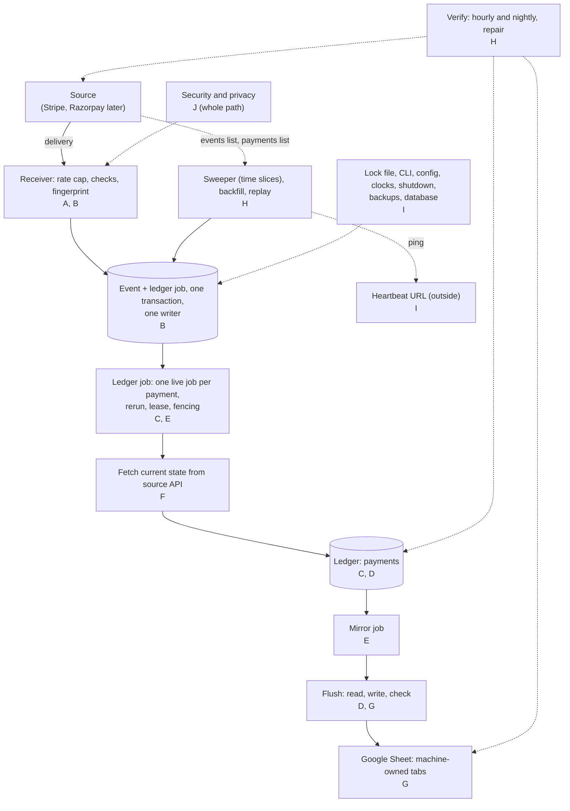

# Edge-case catalogue

**What this page contains.** Every edge case the webhook sync must handle, grouped by where on the path it happens: what the service does, which decision says so, and the test that proves it. Everything here is a decision, not a description. Nothing is built yet.

**Status.** Revised 2026-09-30 after the [design audit](audit/2026-09-30-design-audit.md) and grilling rounds 7 and 8 ([Q66-Q93](grilling-log.md)), so that every row matches the rewritten part pages. The first version's 91 cases are kept where they still apply and rewritten where the design changed; payload mode, the tab swap, the singletons table, buyer columns on our tabs and the rejections table are gone. 29 cases the audit raised are added. [The audit response](audit/2026-09-30-audit-response.md) maps each finding to its change.

**How to read it.** The diagram shows where each section sits on the path. Each row is one case. "Decided in" links the question in the [grilling log](grilling-log.md), the ADR or the part page that settles it. "Proved by" names a kind from [testing.md](testing.md): **unit**; **integration** (real SQLite, with FakeStripe and FakeSheets replaying the recording spike); **scenario** (a scripted scenario checked against the nine invariants, "inv. N" naming one); **crash point** (a subprocess killed at that named place); **load** (the duplicate storm or the burst); **doctor**. Razorpay rows use signed sample payloads and are built after pitching, as are probes, rebuild and the admin pages ([build-order.md](build-order.md)). Words in **bold** are defined in [CONTEXT.md](../../CONTEXT.md).

## A. Deliveries and signatures

| # | Case | What happens | Decided in | Proved by |
|---|---|---|---|---|
| A1 | New, correctly signed delivery | The event and its ledger job (or the `rerun` flag on the payment's live job) commit in one transaction through the **writer**, then 202. | [Q14](grilling-log.md), [Q24](grilling-log.md), [Q70](grilling-log.md), [receiver.md](receiver.md) | integration (FakeStripe) |
| A2 | Bad or missing signature; a signature header with non-ASCII bytes or a malformed list (e.g. a double space) | 400 `bad_signature`. Every verifier call is wrapped, so no input becomes a 500. The **rejection** is counted in memory by reason and may be kept as one of the last 100 samples, with secrets, signatures and IP removed and no body. | [Q15](grilling-log.md), [Q84](grilling-log.md), [receiver.md](receiver.md) | unit |
| A3 | A security header sent twice (`stripe-signature`, `x-razorpay-signature`, `x-razorpay-event-id`, `webhook-id`, `webhook-timestamp`, `webhook-signature`) | 400 `duplicate_header` before verifying. Closes the Standard Webhooks first-versus-last header bypass. | [Q14](grilling-log.md), [receiver.md](receiver.md) | unit |
| A4 | Stripe timestamp more than 5 min in the past or in the future | 400 `stale_timestamp` or `future_timestamp`. stripe-python checks only the past, and only when given a tolerance, so we pass one and add the future bound. Razorpay signs no timestamp. | [Q15](grilling-log.md), [sources.md](sources.md) | unit |
| A5 | Sender signs with two secrets during its rotation (several `v1` values); buyer lists two secrets during ours | Accepted if any signature matches any configured secret. `verify` reports which secret matched, so the old one can be removed safely. | [Q17](grilling-log.md), [sources.md](sources.md) | unit |
| A6 | Secret rotated in the source's dashboard with immediate expiry, the new one not yet configured | Every delivery gets 400 and the source retries. The next sweep stores the events from the events list (it uses the restricted key, not the webhook secret). The **silent webhooks** alert fires. | [Q17](grilling-log.md), [Q40](grilling-log.md), [sweeper.md](sweeper.md) | integration (FakeStripe) |
| A7 | Empty body, invalid UTF-8, a BOM, signed JSON that is a list or scalar, or an event id missing, empty or `null` | 400 `malformed` or `missing_id`. Both dedupe key columns are `NOT NULL`. The Razorpay adapter decodes UTF-8 itself; a decoding failure is `malformed`. | [Q14](grilling-log.md), [receiver.md](receiver.md), [sources.md](sources.md) | unit |
| A8 | Body over 1 MB (with `Content-Length`, or chunked without it); `Content-Type` not JSON | 413 `too_large`, enforced while reading the stream. 415 `not_json`; `application/json` with any parameters and any `…+json` type count as JSON. | [Q15](grilling-log.md), [receiver.md](receiver.md) | unit |
| A9 | Event of the other **mode** (a live event at a test deployment) | 400 `wrong_mode`. It usually fails the signature first, since each mode has its own secret. Razorpay events carry no mode; its key prefix (`rzp_test_`, `rzp_live_`) is checked at startup and by `doctor`. | [Q16](grilling-log.md), [receiver.md](receiver.md) | unit |
| A10 | Verified event of a type we don't handle (`customer.updated`; also `payment_intent.created`, `.requires_action`) | Stored as an **ignored event** with its reason and answered 202, so the source stops; no job. An error answer would make the source retry for days. | [Q12](grilling-log.md), [sources.md](sources.md) | integration (FakeStripe) |

## B. Dedupe and storage

| # | Case | What happens | Decided in | Proved by |
|---|---|---|---|---|
| B1 | Same delivery sent 5 times; the same event id from two different sources | One event per `(source, event_id)`. Each resend with the same **fingerprint** is a **duplicate**: 200, delivery logged, nothing changes. | [Q14](grilling-log.md), [Q71](grilling-log.md) | scenario (duplicate storm), inv. 3 |
| B2 | 1,000 concurrent deliveries of one event | They queue in order on the one writer, not on SQLite's lock. Every request gets 2xx, with zero 503s and a p99 under 2 s on the development laptop; then one event, one row, one sheet row, 999 duplicates logged. | [Q83](grilling-log.md), [testing.md](testing.md) | load (duplicate storm) |
| B3 | Same event id, different bytes, same meaning (Stripe renders a resend for another API version, or with a changed `pending_webhooks`) | A duplicate. The comparison is on the fingerprint (type, object id, creation time, mode), never on raw bytes. | [Q71](grilling-log.md), [receiver.md](receiver.md) | integration (FakeStripe replaying recorded resends), inv. 7 |
| B4 | Same event id, different fingerprint | **Conflict**: the first event is kept, the delivery is answered 200 and logged `conflict`, and an alert names both. | [Q71](grilling-log.md), [receiver.md](receiver.md) | unit |
| B5 | Process dies before the event commits; after the commit but before the 202 leaves; a power cut just after the 202 | Before: nothing stored, and the source's retry stores it once. After: the retry is a duplicate. `synchronous=FULL` means a committed event survives a power cut. | [Q50](grilling-log.md), [Q83](grilling-log.md), [operations.md](operations.md) | crash points `before_event_commit`, `after_event_commit` |
| B6 | Database unwritable when a delivery arrives (disk full, read-only file) | 503, so the source retries. There is no lock to wait on: the server's writes queue on its one writer, and `busy_timeout` matters only for a command run while no server holds the lock. | [Q83](grilling-log.md), [ADR 0004](decisions/0004-queue-in-the-database-behind-an-interface.md), [operations.md](operations.md) | integration |
| B7 | A delivery and the sweeper store the same event at the same moment; a backfill or repair lists the same payment | One insert wins and enqueues (or sets `rerun`); the other is a no-op. The sweeper compares nothing and writes no `deliveries` row, so a swept copy is never a conflict. A listed state rides on the job as `prefetched` and is dropped if a newer event arrives. **Origin** records which path stored the event. | [Q38](grilling-log.md), [Q71](grilling-log.md), [sweeper.md](sweeper.md), [queue.md](queue.md) | scenario (outage and catch-up), inv. 3, 7 |
| B8 | An event is redelivered after its payload was pruned (30 days) | Still a duplicate: the `events` row, its fingerprint and hashes are kept forever; only the payload goes. In practice Stripe stops retrying after about 3 days, and a replay needs only the payment id. | [Q91](grilling-log.md), [data-model.md](data-model.md) | unit |
| B9 | Razorpay delivery replayed under a fresh `x-razorpay-event-id` (the header isn't signed) | A duplicate: Razorpay events also have a unique index on the signed body's hash, and a genuine Razorpay retry resends the same body. | [Q86](grilling-log.md), [receiver.md](receiver.md), [data-model.md](data-model.md) | unit (signed Razorpay samples) |

## C. Ordering and state

| # | Case | What happens | Decided in | Proved by |
|---|---|---|---|---|
| C1 | Deliveries out of order (refund before success), or several events in the same second | Each event only triggers a fetch, so the row gets the current state whatever the order. With one live job per payment only one fetch runs at a time, so an older answer can't land after a newer one. | [ADR 0002](decisions/0002-fetch-current-state-not-event-payload.md), [Q70](grilling-log.md) | scenario, inv. 1, 5 |
| C2 | Several events for one change (`charge.refunded` and `refund.created`; Razorpay `payment.authorized` then `payment.captured`) | All stored; **coalescing** folds them into the payment's one live job and one fetch. Each event's `job_id` points at that job. | [Q25](grilling-log.md), [Q70](grilling-log.md), [data-model.md](data-model.md) | integration (FakeStripe) |
| C3 | Payment not yet charged: abandoned at checkout, or canceled before any charge | No row. A row is created only at `processing`, `authorized`, `failed` or `succeeded`, so the sheet holds no amounts nobody paid; the job completes without one. | [sources.md](sources.md), [ledger-worker.md](ledger-worker.md) | integration (FakeStripe) |
| C4 | Payment failed, then succeeded (or the customer retried) on the same PaymentIntent | One row, keyed `(source, account, PaymentIntent id)`. It can go `failed` → `processing` → `succeeded`, and ends `succeeded` even if the failure event arrives last. | [Q13](grilling-log.md), [Q76](grilling-log.md), [sources.md](sources.md) | integration (FakeStripe) |
| C5 | Partial refunds that add up to the full amount | Refunded equals the amount received; the row shows `refunded`. Not a **terminal state**: only `canceled` is. | [sources.md](sources.md) | scenario (partial and failed refund) |
| C6 | Refund created, then failed | The fetch sees the lower refunded amount and the row goes back to `partially_refunded` or `succeeded`. The fetched state is always written as it is. The recording spike confirms how Stripe reports it (F20). | [Q13](grilling-log.md), [sources.md](sources.md), [testing.md](testing.md) | scenario (partial and failed refund), from the recorded failed refund |
| C7 | Separate authorisation and capture: authorised, captured in part, or released | `requires_capture` → `authorized`; capture → `succeeded`; release or expiry → `canceled`. Amount is `amount_received`; the authorised amount is kept in `authorized_minor` when it differs, so a partial capture doesn't overstate revenue. | [sources.md](sources.md), [data-model.md](data-model.md) | unit (mapping) |
| C8 | Dispute opened, won or lost, including on a refunded payment | If `latest_charge.disputed` is true, the fetch makes a second call (`GET /v1/disputes?payment_intent=…`) and writes the Dispute column; status and refunded amount are unchanged. | [Q69](grilling-log.md), [sources.md](sources.md) | scenario (payment with a dispute) |
| C9 | Stripe dispute inquiry vs chargeback | Seven values: `warning_needs_response` and `warning_under_review` → `inquiry`; `warning_closed` → `closed`; `needs_response`, `under_review`, `won`, `lost` and `prevented` as they are. An inquiry never reads as a chargeback. The source's own word stays in `source_status`. | [sources.md](sources.md), [data-model.md](data-model.md) | unit (mapping), from the recorded dispute states |
| C10 | Razorpay: a dispute event folded into one job with a later refund event | A payment fetch never clears the Dispute column. Dispute state comes only from dispute events and the hourly disputes poll, so coalescing can't lose it. | [Q86](grilling-log.md), [sources.md](sources.md) | unit (signed Razorpay samples) |
| C11 | Razorpay: authorised, never captured, auto-refunded by Razorpay | The fetch returns `refunded` and the row shows it. If no event arrives, the hourly re-fetch of ledger payments under 7 days old that are still `authorized` finds it. | [Q86](grilling-log.md), [sources.md](sources.md), [sweeper.md](sweeper.md) | unit (signed Razorpay samples) |
| C12 | Razorpay: payment failed, customer pays again on the same order | A new payment id, so two rows: one failed, one succeeded. A **payment** is one charge, not one order. The Daily summary counts only the one that succeeded. | [Q11](grilling-log.md), [sheets-sink.md](sheets-sink.md) | unit |

## D. Money, time and text

| # | Case | What happens | Decided in | Proved by |
|---|---|---|---|---|
| D1 | Zero-decimal (JPY 1999) and three-decimal (KWD 1999) currencies | Ledger keeps **minor units** plus currency. Sheet shows 1999 and 1.999, computed with `Decimal` from the ISO 4217 exponent table, with a number format per exponent. No floats. | [Q19](grilling-log.md), [sheets-sink.md](sheets-sink.md) | unit |
| D2 | Currency whose Stripe minor units differ from ISO 4217; lower-case `usd` | A per-source exponent override table, checked against Stripe's currency page before building; codes upper-cased. | [Q62](grilling-log.md) | unit |
| D3 | Unknown currency: a code in neither table | The ledger row is written (minor units are exact), but its mirror job goes dead with an "unknown currency" alert, so no amount 100 times off reaches the sheet. | [Q62](grilling-log.md), [sheets-sink.md](sheets-sink.md), [operations.md](operations.md) | unit |
| D4 | Amount 0; negative or non-integer amount; amount past 15 significant digits | 0 is stored and shown. Negative or non-integer is bad data: class `dead`, first-dead alert. The ledger always keeps the exact integer; amounts past 15 significant digits go to the sheet as text. | [Q19](grilling-log.md), [Q62](grilling-log.md), [queue.md](queue.md) | unit |
| D5 | Sale in one currency, paid out in another (USD sale, INR payout); Razorpay's GST on its fee | Amount and Refunded in the currency paid in; Settled, Fee and Net in the **settlement currency** (Settled in), from the balance transaction. Razorpay's fee tax goes in `fee_tax_minor`. The Daily summary splits by currency paid in and currency paid out. | [Q69](grilling-log.md), [sources.md](sources.md), [sheets-sink.md](sheets-sink.md) | unit (mapping) |
| D6 | Dates the buyer filters, pivots and totals by month | Typed date serials in the buyer's zone with a `yyyy-mm-dd hh:mm:ss` format; the zone is in the header, "Created (IST)". Sheets doesn't re-parse them by locale. UTC in the ledger. | [Q87](grilling-log.md), [sheets-sink.md](sheets-sink.md) | unit (encoding) |
| D7 | The repeated hour of a DST change (US and EU buyers; India has none) | The ledger keeps UTC. In the sheet, two times in the repeated hour look the same, so the header names the zone ("Created (Europe/Berlin)") and one ambiguous hour a year is accepted. | [Q87](grilling-log.md), [Q95](grilling-log.md) | unit (encoding) |
| D8 | Text cell starting with `=`, `+`, `-` or `@` (`=IMPORTXML(…)`, `+91…`) | Written as a typed `stringValue` in `updateCells`, never user-entered: it never runs and never becomes a number. | [Q23](grilling-log.md), [sheets-sink.md](sheets-sink.md) | unit (encoding) |
| D9 | Description with emoji, newlines or tabs | Kept as is (typed values, JSON over UTF-8). Logs are UTF-8 JSON, so an emoji can't crash a Windows console. | [Q23](grilling-log.md), [receiver.md](receiver.md) | unit |
| D10 | Text over 50,000 characters | Cut, ending `…[truncated]`; the ledger keeps the full value. One cell can't block the flush. | [Q23](grilling-log.md), [sheets-sink.md](sheets-sink.md) | unit |
| D11 | Payment ids that Sheets could reformat (scientific notation, leading zeros) | Typed strings; the key column is read back unformatted. | [Q23](grilling-log.md), [sheets-sink.md](sheets-sink.md) | integration (FakeSheets) |

## E. Queue, workers and crashes

| # | Case | What happens | Decided in | Proved by |
|---|---|---|---|---|
| E1 | Process killed after a **claim**, after the fetch, or before the ledger commit | An open transaction rolls back; the job goes back to waiting and the next run fetches again. [ledger-worker.md](ledger-worker.md) has the **reaper** return it after its 60 s lease, attempt used, with backoff; [operations.md](operations.md) returns it at restart the same way, attempt counted. | [Q27](grilling-log.md), [ledger-worker.md](ledger-worker.md), [operations.md](operations.md) | crash points `after_claim`, `after_fetch`, `before_ledger_commit` |
| E2 | Process killed after the ledger commit | The upsert, its mirror jobs and `complete` committed together: nothing to redo, and the flusher takes the mirror job. | [Q25](grilling-log.md), [ledger-worker.md](ledger-worker.md) | crash point `after_ledger_commit` |
| E3 | A job that kills the process every time | Each crash uses an attempt and backs off, so the job goes **dead** after 10 instead of looping. A restart counts the attempt too ([operations.md](operations.md)). | [Q27](grilling-log.md), [Q29](grilling-log.md) | crash point `after_claim`, repeated |
| E4 | Worker stalls past its lease (laptop sleep, a hung call) and the job is claimed again | **Fencing**: the stale `complete` matches no row, so its transaction rolls back with its ledger write. Heartbeats are fenced the same way; fewer rows than expected, and the worker stops without writing. With one server process, this is a stall inside that process. | [Q27](grilling-log.md), [queue.md](queue.md), [ADR 0007](decisions/0007-one-server-process-per-database.md) | integration (FakeStripe, a call that stalls) |
| E5 | New event while that payment's job is running; 100 events in a burst for one payment | Enqueue sets the running job's **rerun** flag. On completion the job goes straight back to waiting (attempts reset) and fetches once more. There is never a second live job, so at most one fetch per payment runs at a time. | [Q70](grilling-log.md), [queue.md](queue.md), [ADR 0004](decisions/0004-queue-in-the-database-behind-an-interface.md) | scenario, inv. 4, 5 |
| E6 | A running job fails, is reaped, or is released at shutdown | It goes back to waiting as the payment's only live row, so nothing collides with the unique index. The reaper works one row at a time, so one bad row can't stop reaping for every other job. | [Q70](grilling-log.md), [queue.md](queue.md) | crash points `mid_reap`, `during_shutdown_release` |
| E7 | A job goes dead while its `rerun` flag is set | It keeps its history. The new information arrives with the next event or verify's repair, as a fresh job. | [queue.md](queue.md) | unit |
| E8 | Dead job retried (one, or all for a sink) | **Retry one** enqueues a fresh job (attempts 0, fetching the current state), folding into any live job, and marks the dead one resolved, "retried as job N". **Retry all** does the same in batches of 200, each through enqueue, so no single collision aborts the rest. | [Q31](grilling-log.md), [queue.md](queue.md) | integration |
| E9 | Many jobs fail at once; a service sends a long `Retry-After` | Each wait is the schedule value (5 s up to 8 h, 10 attempts) times a random factor between 0.5 and 1.5, so retries spread out and no wait is zero. `Retry-After` is honoured as a minimum, never clamped. The next time is stored in `run_after`; no worker sleeps. | [Q29](grilling-log.md), [queue.md](queue.md) | unit |
| E10 | Two ledger workers race for one job | Can't happen in v1: one server process, one ledger worker, SQLite only. Postgres and several workers claiming with `FOR UPDATE SKIP LOCKED` come when a client needs them, on Linux only. | [Q75](grilling-log.md), [ADR 0004](decisions/0004-queue-in-the-database-behind-an-interface.md) | none in v1 |

## F. Fetching from sources

| # | Case | What happens | Decided in | Proved by |
|---|---|---|---|---|
| F1 | Source API 5xx, timeout, connection error or 429 on a fetch | Class `retry`; a 429 honours `Retry-After`. A per-source token bucket (10 a second) keeps a burst under the limit. | [Q28](grilling-log.md), [Q36](grilling-log.md), [sources.md](sources.md) | integration (FakeStripe) |
| F2 | Stripe API down for hours | Five retry failures in a row pause the source, with an alert; nothing of it is claimed, so jobs wait instead of using attempts. Its probe (a cheap read after 1, 2 and 5 min, then every 15) resumes it and the jobs drain; in the pitch-ready cut, `wsync resume`. Sweeps fail and keep their checkpoint (H7). Any job that did go dead: `wsync dead retry --all`; nightly verify catches anything stale. | [Q30](grilling-log.md), [Q31](grilling-log.md), [queue.md](queue.md), [sweeper.md](sweeper.md) | integration (FakeStripe) |
| F3 | Fetch returns 404 (test data deleted in the dashboard, or another account's payment) | **Not found at source**: the row keeps its last fetched values, `not_found_at` is set, the Note column says so, and verify lists it. Nothing is written from the event's own contents; payload mode was cut. With no row yet, none is made: the job completes and the event stays in the audit trail. | [Q73](grilling-log.md), [ADR 0002](decisions/0002-fetch-current-state-not-event-payload.md), [ledger-worker.md](ledger-worker.md) | integration (FakeStripe) |
| F4 | Stripe key revoked or rolled (401), or a 403 on the main read | Class `pause`: the source pauses with an alert, and the job goes back to waiting with its attempt refunded. Its probe is a cheap read (after pitching; `wsync resume` in the cut). | [Q28](grilling-log.md), [sources.md](sources.md), [queue.md](queue.md) | integration (FakeStripe) |
| F5 | Restricted key missing one permission | A 403 on an optional read (disputes, the balance transaction) writes the row with those columns in `unknown_columns`, shown as "unknown", never zero, and a "missing permission" alert names it; the source isn't paused. `doctor` names every missing permission. | [Q85](grilling-log.md), [sources.md](sources.md), [ledger-worker.md](ledger-worker.md) | doctor; integration (FakeStripe) |
| F6 | Full-access key (`sk_…`), or a key of the wrong mode (`rk_live_` with `mode = "test"`) | Refuses to start; `doctor` fails. | [Q85](grilling-log.md), [receiver.md](receiver.md), [operations.md](operations.md) | unit; doctor |
| F7 | Refund or dispute event for a payment the ledger has never seen (it predates the deployment) | The fetch reads the payment itself and creates its row. | [Q13](grilling-log.md), [sources.md](sources.md) | integration (FakeStripe) |
| F8 | Event for an object we can't map to a payment (a legacy charge with no PaymentIntent; a Connect event with `account`) | Stored as **ignored**, reason `no_payment_intent` or `connect_account`; no job. The verify line shows the ignored count. Connect is out of scope. | [ADR 0003](decisions/0003-one-buyer-per-deployment.md), [sources.md](sources.md), [verify.md](verify.md) | unit |
| F9 | Stripe API version change | The adapter pins its API version, so fetched shapes don't change, and the fingerprint uses fields every version shares. `doctor` warns if the endpoint's version differs from the pinned one. A mapped field missing is class `dead`. | [sources.md](sources.md), [operations.md](operations.md) | unit (recorded bodies); doctor |
| F10 | A long pause, a large backfill or a repair run, against Stripe's read allowance (about 500 reads per payment, at least 10,000 a month) | Probes back off to every 15 min; backfill and repair carry the listed state, so nothing is fetched twice; hourly verify makes no source calls. About 5,000 reads a month for 100 payments. | [Q89](grilling-log.md), [sources.md](sources.md), [queue.md](queue.md) | unit |

## G. The sheet (quota, people, encoding, layout)

| # | Case | What happens | Decided in | Proved by |
|---|---|---|---|---|
| G1 | Burst of 200 payments | Calls grow with time, not with events: a **flush** costs two reads and one write (read, write, check) and runs at most every 3 s. 200 payments arriving over 30 s take about ten flushes, around 30 calls. The README prints the measured number. | [sheets-sink.md](sheets-sink.md), [testing.md](testing.md) | load (burst) |
| G2 | Read fails; 429 or 5xx on the write | The flush aborts; `batchUpdate` is all or nothing, so nothing is half-written. Jobs fail with the class and back off; five retry failures in a row pause the sink. A 429 always backs off (Google may bill over-quota calls later in 2026). | [Q29](grilling-log.md), [Q30](grilling-log.md), [sheets-sink.md](sheets-sink.md) | scenario (Sheets 429 then recovery) |
| G3 | Write lands but the reply is lost; process dies after the claim, after the write, or before the jobs are done | The next flush reads the keys, finds the rows it wrote and updates them in place. Every write is by key, so there are no duplicate rows. | [Q32](grilling-log.md), [sheets-sink.md](sheets-sink.md) | crash points `after_flush_claim`, `after_sheet_write_before_check`, `after_sheet_write_before_done` |
| G4 | Buyer sorts or filters through a filter view, or sorts the tab itself between flushes | Filter view: nothing changes for anyone else. A direct sort between flushes is harmless: rows are found by key on every flush. | [Q74](grilling-log.md), [ADR 0006](decisions/0006-machine-owned-tabs.md) | integration (FakeSheets) |
| G5 | A sort lands between the flush's read and its write | Updates never write the key cell, and keys are written only on append, so the check (re-reading the keys just written) sees a moved row. Every key involved gets a mirror job, the next flush rewrites them, and an alert says so. Twice in a row: the sink pauses, "sheet changed during write", until Resume. | [Q63](grilling-log.md), [Q74](grilling-log.md), [sheets-sink.md](sheets-sink.md) | integration (FakeSheets sorting between two calls), inv. 2, 6 |
| G6 | Buyer edits one of our cells | Hourly verify reports "sheet differs"; the nightly repair or the payment's next change rewrites it. | [ADR 0006](decisions/0006-machine-owned-tabs.md), [verify.md](verify.md) | integration (FakeSheets) |
| G7 | Buyer puts their own column, note or formula on our tab | Not supported: the header note says to sort in filter views and work in a tab of their own. An extra column to the right of ours is left alone (the header check compares only our columns); Sync status and `doctor` warn that a rebuild won't keep it next to its rows. | [ADR 0006](decisions/0006-machine-owned-tabs.md), [Q94](grilling-log.md) | integration (FakeSheets) |
| G8 | Buyer inserts, renames, moves or deletes one of our columns | The header check fails: the sink pauses with "layout changed" and offers **Rebuild**. Its probe re-reads the header. | [Q33](grilling-log.md), [sheets-sink.md](sheets-sink.md), [queue.md](queue.md) | integration (FakeSheets) |
| G9 | Buyer deletes a row; copies a key row | A deleted row is "sheet missing" to verify and comes back through repair, the payment's next change or a rebuild. A duplicate key: the first is updated and verify reports the rest; a rebuild rewrites the tab without it. | [Q33](grilling-log.md), [verify.md](verify.md), [sheets-sink.md](sheets-sink.md) | integration (FakeSheets) |
| G10 | Tab renamed; Sync status tab deleted | Tabs are read by numeric sheet id through `getByDataFilter`, so a rename is followed. A deleted Sync status tab is recreated on the next flush. | [sheets-sink.md](sheets-sink.md) | integration (FakeSheets renaming a tab between calls) |
| G11 | Payments tab or the spreadsheet deleted; spreadsheet unshared; Google credential revoked | 401 or 403: class `pause`. A 404, or a 400 naming a sheet id, grid or range (a tab deleted between read and write): `pause`, "tab missing". Jobs wait with attempts refunded; nothing is lost. After the fix, Resume or `wsync rebuild-sheet`; the sink drains in batches of 200. | [Q28](grilling-log.md), [Q30](grilling-log.md), [sheets-sink.md](sheets-sink.md), [queue.md](queue.md) | integration (FakeSheets) |
| G12 | Sheets refuses a whole batch (400) because of one cell value | The batch is split in halves until the row is found; that mirror job goes dead and the rest are written. | [sheets-sink.md](sheets-sink.md) | integration (FakeSheets) |
| G13 | **Rebuild** | In place: pause mirror writes, rewrite the header and every `payments` row in batches, trim rows past the last, rewrite the Daily summary, verify ledger against sheet, resume on 0 differences. There is no tab swap. | [Q92](grilling-log.md), [sheets-sink.md](sheets-sink.md) | integration (FakeSheets) |
| G14 | Crash mid-rebuild, or the rebuild's verify finds differences | The sink stays paused, "rebuild incomplete", until the rebuild runs again; it never resumes by itself. Nothing of the buyer's is on these tabs. | [Q92](grilling-log.md), [queue.md](queue.md) | crash point `mid_rebuild` |
| G15 | Payment refunded or failed after its day's totals were written | The **Daily summary** counts only payments that succeeded (partly or fully refunded included), and a refund counts on its payment's day. Each flush rewrites the summary rows for every day its payments touch; verify checks them against the ledger. | [Q69](grilling-log.md), [sheets-sink.md](sheets-sink.md), [verify.md](verify.md) | scenario (partial and failed refund), inv. 2 |
| G16 | Spreadsheet near the cell limit (configurable; Google's is 20 M) | Past 80 %: alert. At the limit, or on the API's cell-limit error: pause, "sheet full"; the probe checks the cell count. | [sheets-sink.md](sheets-sink.md), [queue.md](queue.md) | unit |
| G17 | A second deployment, with its own database, points at the same sheet | Each flush checks the deployment id on Sync status; another id there within 10 minutes pauses the sink, "another deployment writes here". | [sheets-sink.md](sheets-sink.md) | integration (FakeSheets) |
| G18 | Buyer's Google organisation blocks service-account keys (the default since May 2024) | OAuth with a dedicated Google user's refresh token instead. `doctor` says which auth is in use and explains the policy error in plain words. | [Q90](grilling-log.md), [sheets-sink.md](sheets-sink.md) | doctor |

## H. Sweeper, backfill and verify

| # | Case | What happens | Decided in | Proved by |
|---|---|---|---|---|
| H1 | A delivery never arrives | The next sweep (within 10 min) stores the event, origin `sweep`; the Via column shows `sweep`. | [Q38](grilling-log.md), [Q72](grilling-log.md), [sweeper.md](sweeper.md) | scenario (outage and catch-up) |
| H2 | Webhooks go silent (a disabled Razorpay webhook, a changed URL, an expired tunnel) | Alert when a sweep stores an event more than 10 min old whose type the endpoint is subscribed to, or when no delivery arrives for 24 h while sweeps find activity: "check the webhook settings in your dashboard". | [Q40](grilling-log.md), [sweeper.md](sweeper.md) | integration (FakeStripe) |
| H3 | Stripe endpoint not subscribed to a handled type | `doctor` fails, naming the type. The sweeper still stores those events, so their rows arrive within a sweep. The silent-webhook alert ignores unsubscribed types, so it doesn't fire every hour. | [sources.md](sources.md), [sweeper.md](sweeper.md), [operations.md](operations.md) | doctor; integration (FakeStripe) |
| H4 | Service down for days; for 25 days; past the 30-day **horizon** | The startup sweep walks from the **checkpoint** in **time slices** of up to 6 h. Past 25 days: a "horizon near" alert. Past 30: a full backfill lists PaymentIntents created since the checkpoint, each as a ledger job with its listed state; the event trail for the gap is missing, and the admin page says so. | [Q38](grilling-log.md), [Q72](grilling-log.md), [sweeper.md](sweeper.md) | integration (FakeStripe) |
| H5 | Crash in the middle of a sweep | The checkpoint moves only after a whole slice is stored, so a restart re-walks at most one slice, and dedupe makes that free. Stripe lists newest first; within a slice, order doesn't matter. | [Q72](grilling-log.md), [sweeper.md](sweeper.md) | crash point `mid_slice` |
| H6 | An event becomes listable a little after its `created` time; our clock drifts | Each slice re-reads a 10-minute overlap. The checkpoint and slice ends use Stripe's clock (its `Date` header), and a slice ends 60 s before Stripe's now. | [Q72](grilling-log.md), [sweeper.md](sweeper.md) | unit |
| H7 | Sweep while the Stripe API is down | The pass fails and the checkpoint stays; the next pass covers the wider window, slice by slice. No sweep succeeds, so the heartbeat isn't pinged and the outside check emails after 30 minutes; the runbook says to check the source's status page. | [Q72](grilling-log.md), [Q96](grilling-log.md), [hosting.md](hosting.md) | integration (FakeStripe) |
| H8 | Quiet account: no events for weeks | Empty slices still advance the checkpoint, so there is no false horizon alert, and each sweep still pings the heartbeat. | [Q72](grilling-log.md), [sweeper.md](sweeper.md) | integration (FakeStripe) |
| H9 | First start, no checkpoint yet | Looks back `initial_lookback_days` (30); `0` starts empty; older history by `backfill`. | [Q64](grilling-log.md), [sweeper.md](sweeper.md) | integration (FakeStripe) |
| H10 | Razorpay: a payment created while we page | The same slices over the payments and refunds lists, with the 10-minute overlap. Each payment is stored as a synthetic event (`sweep:<payment id>:<state hash>`) with a ledger job; repeats are harmless. | [Q39](grilling-log.md), [Q72](grilling-log.md), [sources.md](sources.md) | unit (signed Razorpay samples) |
| H11 | Razorpay: a change to an older payment (captured on day 3, a refund processed on day 5, a dispute on day 40) | Hourly: a re-fetch of every ledger payment under 7 days old that is `authorized` or has a refund not yet processed, and a disputes poll. Older changes arrive through nightly verify (30 days). The README states the gap. | [Q86](grilling-log.md), [sources.md](sources.md), [sweeper.md](sweeper.md) | unit (signed Razorpay samples) |
| H12 | A refund or dispute on a Stripe payment older than the verify window | Its event arrives, or the sweeper lists it (events are listed by their own creation time). Verify doesn't cover it; widen with `--days`. | [verify.md](verify.md), [sweeper.md](sweeper.md) | integration (FakeStripe) |
| H13 | Manual replay of an event older than the horizon, or whose payload was pruned | Works: replay enqueues a ledger job for its payment, and the fetch needs only the id. An event never stored and older than 30 days comes back only through `backfill`. | [Q43](grilling-log.md), [sweeper.md](sweeper.md) | integration (FakeStripe) |
| H14 | Verify finds a payment **missing** or **stale**; a sheet row missing or different; totals that differ | Hourly: ledger against sheet, no source calls. Nightly: source against ledger for 30 days, plus independent balance-transaction totals. Missing or stale: a ledger job with the listed state. Sheet missing or different: a mirror job. Duplicate or foreign sheet rows and total differences: shown for a person. **Repair** never edits a row. One line on Sync status; an alert for what repair can't fix, or a payment stale two nights running. | [Q41](grilling-log.md), [Q89](grilling-log.md), [verify.md](verify.md) | scenario (verify), inv. 1, 2 |
| H15 | Verify finds a payment **orphaned** (test data deleted in the Stripe dashboard) | Reported only, never deleted or changed; repair skips it. Rows not found at source and rows with unknown columns are listed too. | [verify.md](verify.md) | integration (FakeStripe) |
| H16 | Verify runs while jobs are still in flight | Payments with a live job, changed since the run started, or under an hour old with the fee still pending ([Q97](grilling-log.md)) are skipped, so work in progress is never reported as stale. | [verify.md](verify.md) | scenario |
| H17 | Nightly verify (02:00 local) on a DST change day | Runs at the first valid local time at or after 02:00, once per local date. | [verify.md](verify.md) | unit |

## I. Operations (process, CLI, clocks, shutdown, monitoring, backups)

| # | Case | What happens | Decided in | Proved by |
|---|---|---|---|---|
| I1 | Bad config (unknown key, bad time zone, secret in the TOML); database schema newer than the code | Refuses to start with a message saying what to fix. | [Q46](grilling-log.md), [Q48](grilling-log.md), [operations.md](operations.md) | unit |
| I2 | A second `wsync serve` started on the same database | Refuses to start: the first holds an exclusive operating-system lock on `data/webhook-sync.lock`. There is no singletons table and never a second flusher. | [ADR 0007](decisions/0007-one-server-process-per-database.md), [operations.md](operations.md) | integration |
| I3 | A state-changing command (`replay`, `backfill`, `resume`, `dead retry`, `verify --repair`) while the server runs | Sent to the running server's admin port; it runs on its own only when no server holds the lock. Logged as an admin action labelled `cli`. | [ADR 0007](decisions/0007-one-server-process-per-database.md), [operations.md](operations.md) | integration |
| I4 | Delivery after shutdown has started | 503; the source retries. | [Q37](grilling-log.md), [receiver.md](receiver.md) | integration (FakeStripe) |
| I5 | Shutdown with jobs running (Ctrl-C on Windows, `docker stop`) | 503 to deliveries, stop claiming, running jobs get 20 s, unfinished leases are released (attempt refunded), the lock file is released, exit. Results are recorded with a fresh connection. Platforms and Compose give a 30 s grace period. | [Q37](grilling-log.md), [operations.md](operations.md) | crash point `during_shutdown_release`; integration (weekly on Windows) |
| I6 | Clock jumps backwards or forwards | Leases use one clock, the writer's. Backwards: leases last longer, so jobs are reclaimed late but never twice. Forwards: leases expire early, the reaper returns running jobs, and fencing refuses the old worker. The checkpoint is on the source's clock. | [Q27](grilling-log.md), [queue.md](queue.md), [sweeper.md](sweeper.md) | unit (time-machine) |
| I7 | Our clock drifts from Stripe's (laptop `w32time`) | Past 5 min every delivery fails with 400. `doctor` fails beyond 30 s, and a clock-skew alert fires. Sweeps are unaffected (H6). | [Q15](grilling-log.md), [Q47](grilling-log.md), [operations.md](operations.md) | doctor |
| I8 | The process or its host is dead | Nothing inside can alert, so the sweeper's heartbeat pings stop; after 30 min the outside service emails the buyer and Lalit. An uptime check hits `/health` every 5 min. | [Q81](grilling-log.md), [sweeper.md](sweeper.md), [hosting.md](hosting.md) | doctor (heartbeat URL set and reachable) |
| I9 | Disk full | Writes fail: deliveries get 503 and the source retries; jobs retry later; a "database writes failing" alert. Sweeps can't commit, so the heartbeat stops too. | [Q81](grilling-log.md), [operations.md](operations.md), [hosting.md](hosting.md) | integration |
| I10 | A source or sink is paused while the platform checks `/ready` | `/ready` (admin port) answers 200 while a delivery can be stored; pauses don't fail it, so the platform never restarts a working receiver. Pauses show on `/status`. | [Q81](grilling-log.md), [operations.md](operations.md) | integration |
| I11 | Restoring an old backup | Stop, restore, start, `wsync sweep`, `wsync verify --full --repair`: the sweep re-lists everything since the backup's checkpoint. Backups are `VACUUM INTO` copies, encrypted with a key only the buyer holds, kept off the machine for 30 days. | [Q49](grilling-log.md), [Q79](grilling-log.md), [hosting.md](hosting.md) | integration |
| I12 | Database on a network drive or in a synced folder (OneDrive, Dropbox, Google Drive) | `doctor` fails: WAL is unsafe there. | [operations.md](operations.md) | doctor |
| I13 | Tables grow for months | A daily pruner, 1,000 rows per transaction: payloads set to `NULL` after 30 days; done jobs after 7; attempts, deliveries and rejection counts after 30; the last 100 rejection samples; dead jobs, admin actions and verify rows 90 days after resolution; `payments` forever. | [Q44](grilling-log.md), [Q91](grilling-log.md), [data-model.md](data-model.md) | integration |
| I14 | `wsync demo reset` pointed at a spreadsheet not on the demo allow-list | Refused: `demo` runs only when every source is in test mode and the spreadsheet id is on the configured demo allow-list, so a mistyped id can't empty a real sheet. | [Q93](grilling-log.md), [showcase.md](showcase.md) | unit |

## J. Security and privacy

| # | Case | What happens | Decided in | Proved by |
|---|---|---|---|---|
| J1 | A source's secret unset or empty; a Stripe key that isn't restricted | Refuses to start, naming the variable. Blocks the fail-open empty-key HMAC, and a key that could move money. | [Q15](grilling-log.md), [Q85](grilling-log.md), [receiver.md](receiver.md) | unit |
| J2 | Someone tries the admin pages from the internet | They aren't there: admin listens on a second port bound to `127.0.0.1`, reached by SSH tunnel; the public port serves only the webhooks and `/health`. If a buyer insists on a public admin port: tokens of at least 32 characters (`doctor` checks), login throttled to 5 tries a minute per address, a signed session cookie. | [Q88](grilling-log.md), [operations.md](operations.md) | integration; doctor |
| J3 | Admin POST without a valid CSRF token | Refused. Every accepted **admin action** is logged with its token label and time. | [Q22](grilling-log.md), [Q43](grilling-log.md), [operations.md](operations.md) | integration |
| J4 | Captured Stripe delivery replayed; with an extra id header prepended | Older than 5 min: 400 `stale_timestamp`. Within 5 min: a duplicate, 200. Extra header: 400. Any replay can at most trigger a fetch, which writes only the source's current state. Razorpay: B9. | [Q14](grilling-log.md), [ADR 0002](decisions/0002-fetch-current-state-not-event-payload.md) | unit |
| J5 | Secrets or personal data reaching logs, rejection samples or alerts | Samples keep the reason, the size and the headers with secrets, signatures and IP removed; never a body. Logs never hold secrets, signatures, raw bodies, emails or phone numbers. Alert bodies carry ids and counts only. | [Q84](grilling-log.md), [Q91](grilling-log.md), [operations.md](operations.md) | unit |
| J6 | Buyer shares the sheet with "anyone with the link" | Only configured columns reach it: email (masked `a***@gmail.com` when set), no phone or address. | [Q21](grilling-log.md), [sheets-sink.md](sheets-sink.md) | unit |
| J7 | Personal data in stored payloads and backups | Payloads are stripped of fields no adapter reads (addresses, phone, IP, payment-method details) and set to `NULL` after 30 days; backups are encrypted and follow the same 30 days. Support only through the buyer's screen share or a time-limited account. The buyer is the data fiduciary (DPDP) and controller (GDPR). | [Q91](grilling-log.md), [data-model.md](data-model.md), [hosting.md](hosting.md) | unit (payload stripping) |
| J8 | Flood of junk requests at the webhook endpoint | Over the per-source cap (default 50 a second): 429 before any database work. Below it, each is a cheap 400 counted in memory: one write a minute per reason, not one per request. | [Q84](grilling-log.md), [receiver.md](receiver.md) | unit; integration |

## Open questions

None. The catalogue's six open questions were settled on 2026-09-30: OQ1, OQ2 and OQ6 as plain fixes (a crashed run's jobs count the attempt like a reap, [operations.md](operations.md); an ignored event is answered 202, [CONTEXT.md](../../CONTEXT.md); a 404 for a payment with no row makes no row, [ledger-worker.md](ledger-worker.md)), and OQ3-OQ5 as the proposed defaults ([Q94-Q96](grilling-log.md)): a buyer's column to the right of ours is left alone with a rebuild warning ([sheets-sink.md](sheets-sink.md)); a daylight-saving zone is named in the date headers; the heartbeat pings only after a successful sweep, and the runbook covers a source outage ([hosting.md](hosting.md)).

## Where to go next

[testing.md](testing.md): how each "Proved by" test is built: the recording spike, the fakes, the nine invariants, the crash points and the load checks.
