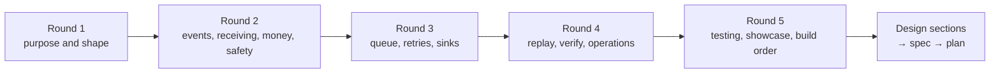

# Design session: every question and its answer

**What this page contains.** Every question asked while designing the webhook sync, the answer chosen, and the reason. It is the raw record behind [00-overview.md](00-overview.md) and the decision records in [decisions/](decisions/).

**How to read it.** Questions are grouped in the rounds they were asked in. Each round only asks questions whose answers don't depend on anything still open. Words in **bold** are defined in [CONTEXT.md](../../CONTEXT.md).

**Status.** The design is being worked out (started 2026-09-30). Nothing here is built.

## Round 1: purpose and shape

Answered 2026-09-30.

| # | Question | Decision | Why |
|---|---|---|---|
| Q1 | Its own offer, or bundled with demo 1? | Its own offer. The sink side is designed so demo 1's JSON can plug in later; that link is not built now. | Different buyer: someone already hurt by Zapier or n8n, not someone with PDFs. Posted webhook budgets are low, so the pitch is reliability, not "connect X to Y". |
| Q2 | Which **sources** in version 1? | Stripe (test mode) in full, Razorpay as the second adapter. A generic Standard Webhooks source is designed for but built later. | Stripe has a CLI that fakes and resends events, and an events API that makes real replay possible. Razorpay makes the Indian pitch honest. |
| Q3 | Where does the data land? | The database is the **ledger** and enforces one row per payment. Google Sheets is a **mirror**, written in batches and rebuildable from the ledger. | Sheets can't enforce uniqueness and allows 60 writes a minute per user. The buyer looks at the sheet; the ledger is what makes "no duplicates" a guarantee. [ADR 0001](decisions/0001-database-is-the-ledger-sheet-is-a-mirror.md) |
| Q4 | Which database? | SQLite by default; Postgres when `DATABASE_URL` is set. | Zero setup for the demo, real concurrency for a client with volume. Only a handful of queries need two dialects. |
| Q5 | Where does it run? | Locally, with `stripe listen` forwarding events, plus Docker Compose so a client can run it anywhere. A public live demo only if pitches ask for one. | Docker Compose is what a client receives. A public demo adds hosting, secrets and abuse risk, with no sign yet that buyers want one. |
| Q6 | How does a person see what's going on? | Admin pages served by FastAPI as plain HTML with htmx for the buttons: events, one event's timeline, dead letters with retry, counters. | One process and one port. The buttons call the same endpoints a client's script would. |
| Q7 | What is the repo, long term? | A reusable starter forked per client: a fixed core plus **source adapters** and **sink adapters**, each about one file. | A new client becomes "an adapter plus config", which makes a $300-500 quote safe. |
| Q8 | Tooling? | The same as demo 1: Python 3.14, uv, pytest, ruff, GitHub Actions. | One toolchain. Checked 2026-09-30: all 23 planned dependencies (FastAPI, uvicorn, stripe, razorpay, standardwebhooks, gspread, google-auth, psycopg-binary, aiosqlite, pytest, ruff, hypothesis, time-machine, respx and their deps) install and import on CPython 3.14.7 on Windows x64 with uv, no source builds. razorpay declares no `requires_python`; it installs and imports. |
| Q9 | GitHub repo? | `lalitkarthik/webhook-sync`, **private for now**. First push once the design docs are committed. Commits carry only Lalit Karthik's name. | Kept private until the demo is ready to show. |
| Q10 | ADR, HLD, LLD? | All three, without separate ceremony: `00-overview.md` is the high-level design, each part page is the low-level design, and ADRs cover only choices that are hard to reverse, surprising and a real trade-off. | The same structure as demo 1 and the Delta execution docs. |

## Round 2: events, receiving, money, safety

Answered 2026-09-30.

| # | Question | Decision | Why |
|---|---|---|---|
| Q11 | What does one row mean? | The ledger keeps every raw **event** (the audit trail) and a `payments` table with one **business row** per payment, holding its current state. The sheet's Payments tab mirrors `payments`. | Buyers asking to "sync Stripe to my sheet" mean one line per sale. An event log in a sheet grows without end and hits the cell limit. |
| Q12 | Which event types in v1? | Stripe: `payment_intent.*` (succeeded, payment_failed, canceled, processing), `charge.refunded`, `refund.*`, `charge.dispute.*`. Razorpay: `payment.authorized/captured/failed`, `refund.created/processed/failed`, `payment.dispute.*`. Anything else is stored, answered 200 and marked **ignored**. | An error answer for an unhandled type would make the source retry for days and eventually disable the endpoint. `charge.refunded` alone misses refund updates (feature inventory). |
| Q13 | Payload mode or fetch mode? | **Fetch mode** by default: an event is a hint that an object changed, and the worker fetches the object's current state from the source's API. Events for one object are coalesced into one fetch. **Terminal states** are sticky. When a fetch fails permanently, payload mode with a version guard is used and the row is flagged. | Neither source guarantees order, and events often share a one-second timestamp, so version guards tie. Fetching the current state removes the ordering problem instead of guarding against it. [ADR 0002](decisions/0002-fetch-current-state-not-event-payload.md) **Refined while writing [sources.md](sources.md):** a refund can fail after being created and the source then lowers the refunded amount, so `refunded` is not terminal. Only `canceled` is. In fetch mode the source's current state is always written; stickiness applies to payload mode only. |
| Q14 | The dedupe key | `(source, event_id)`, both `NOT NULL`, unique. Stripe: `body.id`; Razorpay: the `x-razorpay-event-id` header; Standard Webhooks: the `webhook-id` header. A missing id or a duplicated security header is rejected with 400. The same id with a different body keeps the first, answers 200 and logs a **conflict**. | hookline reads `body["id"]` and so rejects every Razorpay event; Standard Webhooks verifies the last duplicate header while FastAPI reads the first, a dedupe bypass (feature inventory). |
| Q15 | What bad requests get back | 202 new; 200 duplicate; 400 bad or missing signature, timestamp more than 5 minutes in the past **or future**, malformed body, missing id; 413 over 1 MB; 415 not JSON; 503 while shutting down or when the database is unavailable. Every verifier call is wrapped so malformed input never becomes a 500. The service refuses to start if a source's secret is unset. Rejected requests go to a `rejections` table with secrets removed. | Every studied verifier leaks a 500 on some malformed input; hookline and razorpay-python accept an empty secret; Stripe's check skips the time window unless given a tolerance and never rejects a future timestamp. |
| Q16 | Test events vs live events | Each source is configured as test or live. An event of the other **mode** is rejected with 400 and logged. One mode per deployment. | Mixing fake payments into real books is the worst possible bug for this product. |
| Q17 | Rotating a signing secret | Each source takes a list of secrets; any match is valid. The admin page shows which secret matched recently, so the old one can be removed safely. | Stripe signs with the old and new secrets side by side for up to 24 hours. |
| Q18 | One account or many? | One deployment serves one buyer, with one account per source. Stripe Connect and multi-tenant use are out of scope. | Keeps every table free of a tenant column. [ADR 0003](decisions/0003-one-buyer-per-deployment.md) |
| Q19 | Money | The ledger stores `amount_minor` (integer) and `currency`. The sheet shows the major-unit amount, computed with `Decimal` from an ISO 4217 exponent table, next to the currency code. No floats. | JPY has 0 decimals and KWD has 3; none of the studied repos handles this. |
| Q20 | Time | UTC in the database. The sheet shows the buyer's configured time zone (default `Asia/Kolkata`) as text, e.g. `2026-09-30 14:05:12 IST`. | Written as text so Sheets can't reinterpret it in its own locale. |
| Q21 | Customer personal data | Sheet columns are declared in config. By default they include email and exclude phone and address, with an option to mask email (`a***@gmail.com`). Raw payloads are pruned after 90 days (configurable); `payments` rows are kept. Logs never hold emails, phone numbers or secrets. | A sheet is one "anyone with the link" click from being public. |
| Q22 | Who can use the admin pages? | Bind to `127.0.0.1` by default. Admin pages need `ADMIN_TOKEN`, and the service refuses to start on a non-local address without it. Webhook endpoints stay open (signatures protect them). Buttons are POST with a CSRF check. | The buttons retry, replay and rebuild. |
| Q23 | Formula injection | Sheets values are always written RAW. Any cell starting with `= + - @` is written as text. Cells are cut at 50,000 characters with a `…[truncated]` marker. Newlines and tabs are kept. | gspread's `update_cell` forces USER_ENTERED; that runs formulas and turns `+91…` phone numbers into numbers. One oversized cell blocks sync-engine's flush forever. |

## Round 3: queue, retries, sinks

Answered 2026-09-30.

| # | Question | Decision | Why |
|---|---|---|---|
| Q24 | Where does the queue live? | A `jobs` table in the same database, written in the same transaction as the event (the **outbox** pattern). The queue sits behind a small interface (`enqueue`, `claim`, `heartbeat`, `complete`, `fail`, `reap`), so a Redis Streams backend fed from the outbox can be added later for a client who already runs Redis. No Redis in v1. | Asked "why not Redis, I know it better". Answer: the event must be in the database anyway (only a unique constraint guarantees no duplicates), so a Redis queue means two writes to two systems, and a crash between them loses work after the 202; the fix is an outbox table, which is already a queue. Redis's default persistence can also lose jobs on restart, has no official Windows build, and adds a paid service for the client. Payment volume is tens an hour. Every Redis Streams idea maps across: `XREADGROUP` = claim, pending list = running rows, `XAUTOCLAIM` = reaper, `XACK` = complete with fencing. [ADR 0004](decisions/0004-queue-in-the-database-behind-an-interface.md) |
| Q25 | What is one job? | Two stages. A **ledger job** fetches payment X from its source and upserts its business row; a **mirror job** copies X's current row to one sink. Jobs are **coalesced**: at most one waiting job per (stage, sink, payment). If X's job is running, a new event creates one follow-up waiting job, never more. The mirror job is created in the same transaction as the ledger upsert. | 5 events for one payment make 1 fetch and 1 sheet write. driftless's coalescing breaks when a job is already running (feature inventory). |
| Q26 | Workers | By default one process runs everything as async tasks: receiver, one ledger worker, the Sheets flusher, the sweeper and the pruner. On Postgres, `--workers N` adds ledger workers that claim with `FOR UPDATE SKIP LOCKED`. Exactly one flusher, always. | SQLite has one writer anyway. Two flushers could append the same row twice. |
| Q27 | Crashes mid-job | A claim sets `status='running'`, `lease_until = now + 60 s` and a random `claim_token`. The worker **heartbeats** every 20 s. The **reaper** runs every 30 s and returns expired jobs to waiting, using up one attempt, with normal backoff. Completing or failing a job requires the `claim_token` to still match (**fencing**). | driftless and procrastinate let a worker whose lease expired mark a job done that another worker owns; driftless re-runs reaped jobs immediately, looping on a job that crashes the worker. |
| Q28 | Which errors retry | Three classes, decided by each adapter. **Retry later**: 429, 5xx, timeouts, connection errors, "database is locked". **Dead now**: our own bug or bad data. **Pause the sink**: 401/403, sheet or tab deleted, header row changed. A 404 on fetch falls back to payload mode. | driftless retries everything alike, so a hopeless job takes about 1.7 h to reach the dead-letter queue. A revoked key would otherwise dead-letter every job one by one. |
| Q29 | Retry schedule | Production profile: about 5 s, 30 s, 2 min, 10 min, 30 min, 1 h, 2 h, 4 h, 8 h, then dead (10 attempts, about 16 h; first written as "9 attempts", corrected while writing queue.md). Full jitter (saq's formula, MIT). A sink's `Retry-After` is honoured as given. `RETRY_PROFILE=demo`: 1, 2, 4, 8, 16 s, then dead. The next attempt time is stored in `run_after`; no worker sleeps on a job. | Jitter stops jobs that failed together retrying together. Svix clamps `Retry-After`, which the inventory flagged. The demo profile makes backoff visible in the video. **Refined while writing [queue.md](queue.md):** each wait is the schedule value times a random factor between 0.5 and 1.5, because saq's full jitter can give a wait of almost 0 s. |
| Q30 | Pausing a sink | A sink is **paused** after 5 consecutive retryable failures, or at once on a pause-class error. While paused, nothing is claimed and attempts don't count down. One **probe** every 60 s; success resumes the sink, which drains in normal batches. The admin page shows paused, why and since when, with **Resume now**. | Without it, a sink coming back up is hit by every job at once, and quota burns while it's down. No studied repo has this. |
| Q31 | Dead-letter queue | A **dead** job keeps its error and full attempt history. Actions: **Retry one**, **Retry all for this sink** (both go back through the coalescing enqueue with attempts reset, and fetch the current state), and **Resolve with a note**. Dead jobs are never deleted. | driftless's "retry all" aborts entirely when a newer job exists for the same object. |
| Q32 | The Sheets flush | Every 3 s, or once 200 mirror jobs are waiting: take the flusher lock; read the header row and key column once (unformatted values); build a key → row-number map; send **one** `batchUpdate` with in-place updates, appended rows and the status tab; mark the jobs done. A failed read **aborts the flush**. A lost reply is harmless: the next flush re-reads the keys and updates in place. | Two API calls per flush regardless of size, so a 200-event burst stays well inside 60 writes a minute. sync-engine carries on after a failed read and duplicates rows or pastes over the header. |
| Q33 | People touching the sheet | Sorting and filtering: fine, rows are found by key. Editing our cells: overwritten on the payment's next change, and the status tab says so. Columns added to the right: kept. Our columns inserted, renamed or deleted: the sink pauses with "layout changed" and offers **Rebuild**. Deleted rows: restored on the next change or rebuild, reported by verify. Duplicate key rows: the first is updated, the rest reported. We never delete the buyer's rows. | Buyers will edit the sheet; the design must tolerate it without losing their work. |
| Q34 | Rebuilding the sheet | Write every `payments` row to a new tab, then in one atomic call rename the old tab `Payments (old <date time>)` and the new one `Payments`. | The buyer never sees a half-written sheet, and nothing of theirs is deleted. |
| Q35 | What the spreadsheet contains | **Payments**: the configured columns, payment key first and frozen, and a header note: "Managed by webhook-sync. Add your own columns to the right." **Sync status**: last successful flush, rows written, pending, dead, paused, updated in the same batch. | A buyer who only has the sheet can see the sync is alive, at no extra API cost. |
| Q36 | API budget for fetches | A per-source token-bucket rate limiter, 10 requests a second by default. A 429 from the source is retry-later and honours `Retry-After`. | Stripe test mode allows about 25 requests a second; coalescing already cuts calls. |
| Q37 | Graceful shutdown | Stop taking deliveries (503, so the source retries); stop claiming; give running jobs up to 20 s to finish and record results; release the leases of anything unfinished (back to waiting, no attempt used); exit. Compose sets `stop_grace_period: 30s`. | driftless records results with an already-cancelled context, so jobs stick in `running` and lose an attempt. Docker's default stop timeout is 10 s. |

## Round 4: replay, verify, operations

Answered 2026-09-30.

| # | Question | Decision | Why |
|---|---|---|---|
| Q38 | The Stripe sweeper | Runs at startup and every 10 min. Lists **all** events of our types from `GET /v1/events` since the **checkpoint** minus a 60 s **overlap window**, and inserts missing ones through the normal store-and-enqueue path, tagged `origin='sweep'`. Each page and the new checkpoint are saved in one transaction. Warns at 25 days since the checkpoint; past the 30-day **horizon** it lists PaymentIntents by creation date instead (full backfill). | Stripe test mode retries a failed delivery only 3 times over a few hours. Listing all events, not just undelivered ones, also recovers events lost to a restored backup. driftless saves no progress mid-sweep. |
| Q39 | The Razorpay backfill | Polls `GET /v1/payments?from=&to=` (100 a page), `/v1/refunds`, and disputes where the API allows, every 10 min, from the checkpoint minus 10 min. Every payment returned gets a ledger job. The README states that polling sees current states only, so the event trail has gaps for anything learned this way. | Razorpay has no events list. Fetch mode makes repeat jobs harmless. |
| Q40 | Detecting **silent webhooks** | Alert when the sweeper recovers an event that never arrived as a delivery, or when no delivery has arrived for 24 h while the sweeper finds activity. The alert says to check the webhook settings in the source's dashboard. | Razorpay disables a webhook after 24 h of failures; Stripe can too. The buyer would otherwise notice only when the sheet goes quiet. Idea from driftless. |
| Q41 | **Verify** | Three checks: source vs ledger for the last 30 days (each payment **missing**, **stale** or **orphaned**); ledger vs sheet (every key exactly once, values equal); count and sum per currency on both sides. Nightly at 02:00 local time and on demand; quick mode (counts and totals) and full mode (row by row). **Repair** only enqueues jobs, never edits directly. The result goes to a verify page and one line on the Sync status tab. | Demo 1's "prove it" idea applied to syncing. The pitch line: every night it proves your sheet matches Stripe. **Added while writing [verify.md](verify.md):** quick mode also runs after sweeps, at most hourly; repair runs automatically after the nightly full run (`verify.auto_repair = true`), which is safe because repair only enqueues jobs. |
| Q42 | Alerts | One outgoing alert URL, Slack- and Discord-compatible, plus a red banner on the admin page. Fires on: a sink paused, the first dead job then an hourly digest, verify differences, silent webhooks, the 25-day horizon warning. Each kind at most once an hour. Email is later. | SMTP adds setup for every client. |
| Q43 | Manual replay and backfill | Admin buttons with matching CLI commands: replay one event, backfill a date range, rebuild the sheet. Every action is written to an **admin actions** table: which token, what, when. | A person must be able to fix things without SQL, and every fix must be traceable. |
| Q44 | Retention | A daily pruner deletes 1,000 rows at a time. Raw payloads 90 days; done jobs 7 days; attempt log 30 days; delivery log and rejections 30 days; dead jobs and admin actions until resolved, then 90 days; `payments` rows forever. | driftless never prunes, so its job table grows without end. Small batches keep SQLite's write lock short. |
| Q45 | Watching it run | Structured JSON logs with `event_id` or `job_id` on every line; `/health` (process up); `/ready` (database reachable, source keys work), used by Docker's health check; counters on the admin page. Prometheus `/metrics` is later. | Every line traceable to its cause, as in the Delta execution docs. No buyer at this size runs Prometheus. |
| Q46 | Configuration | `webhook-sync.toml` for everything that isn't secret; secrets from environment variables or `.env`, never the TOML. Validated at startup with clear messages. | A mistake fails fast, with a message that says what to fix. |
| Q47 | Commands | `wsync serve`, `sweep`, `verify [--full] [--repair]`, `rebuild-sheet`, `replay <event_id>`, `backfill --from --to`, `dead list/retry/resolve`, `backup`, `doctor`. `doctor` checks secrets, that the Stripe key's mode matches the config, that the sheet is shared with the service account, the header row, that the database is writable, and that the clock is within 30 s of Stripe's. | `doctor` is what proves a client handover works. Signature checks fail when the clock drifts more than 5 min. |
| Q48 | Migrations | Numbered plain SQL files per dialect (`0001_init.sqlite.sql`, `0001_init.postgres.sql`), applied at startup and recorded in `schema_version`. | About ten tables; Alembic is overkill. |
| Q49 | Backups | SQLite: `wsync backup` makes a consistent copy with `VACUUM INTO`, nightly into `backups/`, keeping 7. Postgres: the client's provider. Documented recovery: restore, then `wsync sweep`, then `verify --repair`. | The sweeper refills what the old backup lacks. |
| Q50 | SQLite settings | WAL mode, `synchronous=FULL`, `busy_timeout=5000`, `BEGIN IMMEDIATE` for every write transaction. | `FULL` means a power cut can't lose an event already answered 202. `BEGIN IMMEDIATE` prevents the lock-upgrade deadlock. At tens of events an hour the speed cost doesn't matter. |

## Round 5: testing, showcase, build

Answered 2026-09-30.

| # | Question | Decision | Why |
|---|---|---|---|
| Q51 | Test layers | Unit (signatures, mapping, money, time, retry schedule, error classes); integration on a real SQLite database with **FakeStripe** (respx) and **FakeSheets** (in-memory, can return 429, 500, or write and lose the reply); end to end with the Stripe CLI and a real test sheet, run by hand and before recording, not in CI. | Offline, fast, repeatable tests; CI holds no Google credentials. |
| Q52 | Proving no duplicates and no loss | Four **invariants** checked once everything settles: ledger equals the fake source; sheet equals ledger; every key exactly once; no job stuck running. Hypothesis generates scenarios mixing duplicates, reordering, concurrent identical deliveries, Sheets 429s and lost replies, and sweeps overlapping deliveries. Named **crash points** (`after_event_commit`, `after_ledger_commit`, `after_sheet_write_before_done`, …) kill and restart the worker mid-flight; active only in tests. | The guarantee is the product, so it's tested against thousands of generated scenarios, not a few examples. Hypothesis shrinks a failure to the smallest case. |
| Q53 | Load checks | In CI: a 200-event burst lands 200 rows in no more than 10 Sheets API calls; 1,000 concurrent deliveries of one event give one event, one row and 999 logged duplicates. | Numbers for the README, next to n8n's 56 of 100. |
| Q54 | Postgres in CI | The integration suite runs on SQLite and on a Postgres service container. Multi-worker race tests run on Postgres only. | Both dialects stay honest; private repos get 2,000 free CI minutes a month. |
| Q55 | Accounts and fixtures | Lalit creates a Stripe account (test mode) and a Google Cloud service account before slice 1, and a Razorpay test account at slice 7. Fixtures are recorded from Stripe test mode into `tests/fixtures/`. If Razorpay sign-up is blocked, its adapter is built from documented sample payloads signed locally, and the README says so. | Account creation is Lalit's to do. Test mode holds no real customer data, so fixtures are safe to commit. |
| Q56 | The 60-second video | Result first. Five **scenes**: duplicate storm (5 resends, one row); outage and catch-up (10 payments while down, filled by the sweeper); sheet access revoked (paused, resumed, nothing lost); 200-event burst in a handful of API calls; end card "Verified nightly: 0 differences". `wsync demo <scene>` sets up and drives each one. | Upwork previews only 5-10 seconds. A scripted scene makes a retake cost a minute. |
| Q57 | README | Problem (Zapier's own admission, n8n's numbers); GIFs; the guarantees, each with the test that proves it; architecture diagram; five-command quickstart; configuration; honest limits (Razorpay polling gaps, one buyer per deployment, a few seconds of sheet latency); credits. | Buyers skim; the guarantees list is what they need to trust it. |
| Q58 | Admin pages | Server-rendered HTML, vendored Pico.css (MIT), dark mode, htmx for buttons and live counters, no JavaScript build. Pages: Overview, Events, Event timeline, Dead letters, Verify, Admin actions. | One process, looks like a real operations console in the video. |
| Q59 | Build order | Slices: 1 Stripe receive-to-ledger on SQLite; 2 queue robustness; 3 Sheets flusher and rebuild; 4 sweeper and verify; 5 admin pages, alerts, `doctor`; 6 showcase (**pitch-ready**); 7 Razorpay; 8 Postgres and Docker Compose. If demo 1 takes longer, demo 2 starts pitching later rather than cutting the proof layer. | Each slice ends working. The proof layer is the product. |
| Q60 | Licences and credits | `THIRD_PARTY_NOTICES.md` lists hookline (MIT), driftless and sync-engine (Apache-2.0, ported, with a "derived from … changed …" header in each ported file), saq's jitter formula and Svix's schedule (MIT), with the licence texts. No licence file while private. Demo 1 (`statement-extractor`) chose MIT (vault session log, 29-30 Sept), so MIT is the default when this repo goes public. | Apache-2.0 requires the notices. [ADR 0005](decisions/0005-permissive-licences-only.md) |
| Q61 | Code layout and database access | SQLAlchemy Core (not the ORM) writes each query once for both dialects, including `ON CONFLICT` and `FOR UPDATE SKIP LOCKED`; migrations stay plain SQL. Packages under `src/webhook_sync/`: `receiver`, `sources`, `ledger`, `queue`, `sinks`, `sweeper`, `verify`, `admin`, `cli`; tests mirror them. FastAPI, uvicorn, SQLAlchemy async with aiosqlite or psycopg, httpx. | Raw SQL per dialect would put every query in the code twice. |
