# Design session: every question and its answer

**What this page contains.** Every question asked while designing the webhook sync, the answer chosen, and the reason. It is the raw record behind [00-overview.md](00-overview.md) and the decision records in [decisions/](decisions/).

**How to read it.** Questions are grouped in the rounds they were asked in. Each round only asks questions whose answers don't depend on anything still open. Words in **bold** are defined in [CONTEXT.md](../../CONTEXT.md).

**Status.** Eleven rounds, Q1-Q114. Rounds 1-9 answered 2026-09-30, round 10 on 2026-10-01 after checking outside facts, round 11 on 2026-10-02 when Razorpay became the first source; rounds 7 and 8 after an [independent audit](audit/2026-09-30-design-audit.md). Nothing here is built. Where a later answer changed an earlier one, the earlier row says so.

```mermaid
flowchart LR
  R1["Round 1<br/>purpose and shape"] --> R2["Round 2<br/>events, receiving, money, safety"]
  R2 --> R3["Round 3<br/>queue, retries, sinks"]
  R3 --> R4["Round 4<br/>replay, verify, operations"]
  R4 --> R5["Round 5<br/>testing, showcase, build order"]
  R5 --> R6["Round 6<br/>questions from writing the pages"]
  R6 --> AU["Independent audit<br/>38 findings"]
  AU --> R7["Round 7<br/>direction, urgent fixes"]
  R7 --> R8["Round 8<br/>operations, security, details"]
  R8 --> D["Design pages rewritten"]
  D --> R10["Round 10<br/>research gaps"]
  R10 --> R11["Round 11<br/>Razorpay first"]
```

## Round 1: purpose and shape

Answered 2026-09-30.

| # | Question | Decision | Why |
|---|---|---|---|
| Q1 | Its own offer, or bundled with demo 1? | Its own offer. The sink side is designed so demo 1's JSON can plug in later; that link is not built now. | Different buyer: someone already hurt by Zapier or n8n, not someone with PDFs. Posted webhook budgets are low, so the pitch is reliability, not "connect X to Y". |
| Q2 | Which **sources** in version 1? | Stripe (test mode) in full, Razorpay as the second adapter. A generic Standard Webhooks source is designed for but built later. | Stripe has a CLI that fakes and resends events, and an events API that makes real replay possible. Razorpay makes the Indian pitch honest. **Changed by Q103: Razorpay first; Stripe parked until a buyer gives access.** |
| Q3 | Where does the data land? | The database is the **ledger** and enforces one row per payment. Google Sheets is a **mirror**, written in batches and rebuildable from the ledger. | Sheets can't enforce uniqueness and allows 60 writes a minute per user. The buyer looks at the sheet; the ledger is what makes "no duplicates" a guarantee. [ADR 0001](decisions/0001-database-is-the-ledger-sheet-is-a-mirror.md) |
| Q4 | Which database? | SQLite by default; Postgres when `DATABASE_URL` is set. | Zero setup for the demo, real concurrency for a client with volume. Only a handful of queries need two dialects. **Changed by Q75: SQLite only in v1; Postgres when a client asks, Linux only.** |
| Q5 | Where does it run? | Locally, with `stripe listen` forwarding events, plus Docker Compose so a client can run it anywhere. A public live demo only if pitches ask for one. | Docker Compose is what a client receives. A public demo adds hosting, secrets and abuse risk, with no sign yet that buyers want one. |
| Q6 | How does a person see what's going on? | Admin pages served by FastAPI as plain HTML with htmx for the buttons: events, one event's timeline, dead letters with retry, counters. | One process and one port. The buttons call the same endpoints a client's script would. |
| Q7 | What is the repo, long term? | A reusable starter forked per client: a fixed core plus **source adapters** and **sink adapters**, each about one file. | A new client becomes "an adapter plus config", which makes a $300-500 quote safe. |
| Q8 | Tooling? | The same as demo 1: Python 3.14, uv, pytest, ruff, GitHub Actions. | One toolchain. Checked 2026-09-30: all 23 planned dependencies (FastAPI, uvicorn, stripe, razorpay, standardwebhooks, gspread, google-auth, psycopg-binary, aiosqlite, pytest, ruff, hypothesis, time-machine, respx and their deps) install and import on CPython 3.14.7 on Windows x64 with uv, no source builds. razorpay declares no `requires_python`; it installs and imports. |
| Q9 | GitHub repo? | `lalitkarthik/webhook-sync`, **private for now**. First push once the design docs are committed. Commits carry only Lalit Karthik's name. | Kept private until the demo is ready to show. |
| Q10 | ADR, HLD, LLD? | All three, without separate ceremony: `00-overview.md` is the high-level design, each part page is the low-level design, and ADRs cover only choices that are hard to reverse, surprising and a real trade-off. | The same structure as demo 1 and the Delta execution docs. |

## Round 2: events, receiving, money, safety

Answered 2026-09-30.

| # | Question | Decision | Why |
|---|---|---|---|
| Q11 | What does one row mean? | The ledger keeps every raw **event** (the audit trail) and a `payments` table with one **business row** per payment, holding its current state. The sheet's Payments tab mirrors `payments`. | Buyers asking to "sync Stripe to my sheet" mean one line per sale. An event log in a sheet grows without end and hits the cell limit. |
| Q12 | Which event types in v1? | Stripe: `payment_intent.*` (succeeded, payment_failed, canceled, processing), `charge.refunded`, `refund.*`, `charge.dispute.*`. Razorpay: `payment.authorized/captured/failed`, `refund.created/processed/failed`, `payment.dispute.*`. Anything else is stored, answered 200 and marked **ignored**. | An error answer for an unhandled type would make the source retry for days and eventually disable the endpoint. `charge.refunded` alone misses refund updates (feature inventory). |
| Q13 | Payload mode or fetch mode? | **Fetch mode** by default: an event is a hint that an object changed, and the worker fetches the object's current state from the source's API. Events for one object are coalesced into one fetch. **Terminal states** are sticky. When a fetch fails permanently, payload mode with a version guard is used and the row is flagged. | Neither source guarantees order, and events often share a one-second timestamp, so version guards tie. Fetching the current state removes the ordering problem instead of guarding against it. [ADR 0002](decisions/0002-fetch-current-state-not-event-payload.md) **Refined while writing [sources.md](sources.md):** a refund can fail after being created and the source then lowers the refunded amount, so `refunded` is not terminal. Only `canceled` is. In fetch mode the source's current state is always written; stickiness applies to payload mode only. **Changed by Q73: fetch only; the payload fallback is cut.** |
| Q14 | The dedupe key | `(source, event_id)`, both `NOT NULL`, unique. Stripe: `body.id`; Razorpay: the `x-razorpay-event-id` header; Standard Webhooks: the `webhook-id` header. A missing id or a duplicated security header is rejected with 400. The same id with a different body keeps the first, answers 200 and logs a **conflict**. | hookline reads `body["id"]` and so rejects every Razorpay event; Standard Webhooks verifies the last duplicate header while FastAPI reads the first, a dedupe bypass (feature inventory). **Changed by Q71 (a conflict is a different fingerprint, not different bytes) and Q86 (Razorpay also dedupes on the signed body).** |
| Q15 | What bad requests get back | 202 new; 200 duplicate; 400 bad or missing signature, timestamp more than 5 minutes in the past **or future**, malformed body, missing id; 413 over 1 MB; 415 not JSON; 503 while shutting down or when the database is unavailable. Every verifier call is wrapped so malformed input never becomes a 500. The service refuses to start if a source's secret is unset. Rejected requests go to a `rejections` table with secrets removed. | Every studied verifier leaks a 500 on some malformed input; hookline and razorpay-python accept an empty secret; Stripe's check skips the time window unless given a tolerance and never rejects a future timestamp. **Changed by Q81 (/ready) and Q84 (rejections counted in memory).** |
| Q16 | Test events vs live events | Each source is configured as test or live. An event of the other **mode** is rejected with 400 and logged. One mode per deployment. | Mixing fake payments into real books is the worst possible bug for this product. |
| Q17 | Rotating a signing secret | Each source takes a list of secrets; any match is valid. The admin page shows which secret matched recently, so the old one can be removed safely. | Stripe signs with the old and new secrets side by side for up to 24 hours. |
| Q18 | One account or many? | One deployment serves one buyer, with one account per source. Stripe Connect and multi-tenant use are out of scope. | Keeps every table free of a tenant column. [ADR 0003](decisions/0003-one-buyer-per-deployment.md) |
| Q19 | Money | The ledger stores `amount_minor` (integer) and `currency`. The sheet shows the major-unit amount, computed with `Decimal` from an ISO 4217 exponent table, next to the currency code. No floats. | JPY has 0 decimals and KWD has 3; none of the studied repos handles this. |
| Q20 | Time | UTC in the database. The sheet shows the buyer's configured time zone (default `Asia/Kolkata`) as text, e.g. `2026-09-30 14:05:12 IST`. | Written as text so Sheets can't reinterpret it in its own locale. **Changed by Q87: typed dates, zone in the header.** |
| Q21 | Customer personal data | Sheet columns are declared in config. By default they include email and exclude phone and address, with an option to mask email (`a***@gmail.com`). Raw payloads are pruned after 90 days (configurable); `payments` rows are kept. Logs never hold emails, phone numbers or secrets. | A sheet is one "anyone with the link" click from being public. **Changed by Q91: payloads kept 30 days and stripped of unread fields.** |
| Q22 | Who can use the admin pages? | Bind to `127.0.0.1` by default. Admin pages need `ADMIN_TOKEN`, and the service refuses to start on a non-local address without it. Webhook endpoints stay open (signatures protect them). Buttons are POST with a CSRF check. | The buttons retry, replay and rebuild. **Changed by Q88: admin on a localhost-only port.** |
| Q23 | Formula injection | Sheets values are always written RAW. Any cell starting with `= + - @` is written as text. Cells are cut at 50,000 characters with a `…[truncated]` marker. Newlines and tabs are kept. | gspread's `update_cell` forces USER_ENTERED; that runs formulas and turns `+91…` phone numbers into numbers. One oversized cell blocks sync-engine's flush forever. |

## Round 3: queue, retries, sinks

Answered 2026-09-30.

| # | Question | Decision | Why |
|---|---|---|---|
| Q24 | Where does the queue live? | A `jobs` table in the same database, written in the same transaction as the event (the **outbox** pattern). The queue sits behind a small interface (`enqueue`, `claim`, `heartbeat`, `complete`, `fail`, `reap`), so a Redis Streams backend fed from the outbox can be added later for a client who already runs Redis. No Redis in v1. | Asked "why not Redis, I know it better". Answer: the event must be in the database anyway (only a unique constraint guarantees no duplicates), so a Redis queue means two writes to two systems, and a crash between them loses work after the 202; the fix is an outbox table, which is already a queue. Redis's default persistence can also lose jobs on restart, has no official Windows build, and adds a paid service for the client. Payment volume is tens an hour. Every Redis Streams idea maps across: `XREADGROUP` = claim, pending list = running rows, `XAUTOCLAIM` = reaper, `XACK` = complete with fencing. [ADR 0004](decisions/0004-queue-in-the-database-behind-an-interface.md) |
| Q25 | What is one job? | Two stages. A **ledger job** fetches payment X from its source and upserts its business row; a **mirror job** copies X's current row to one sink. Jobs are **coalesced**: at most one waiting job per (stage, sink, payment). If X's job is running, a new event creates one follow-up waiting job, never more. The mirror job is created in the same transaction as the ledger upsert. | 5 events for one payment make 1 fetch and 1 sheet write. driftless's coalescing breaks when a job is already running (feature inventory). **Changed by Q70: one live job per payment, with a rerun flag.** |
| Q26 | Workers | By default one process runs everything as async tasks: receiver, one ledger worker, the Sheets flusher, the sweeper and the pruner. On Postgres, `--workers N` adds ledger workers that claim with `FOR UPDATE SKIP LOCKED`. Exactly one flusher, always. | SQLite has one writer anyway. Two flushers could append the same row twice. **Changed by Q75 and ADR 0007: one serve process per database; no `--workers` in v1.** |
| Q27 | Crashes mid-job | A claim sets `status='running'`, `lease_until = now + 60 s` and a random `claim_token`. The worker **heartbeats** every 20 s. The **reaper** runs every 30 s and returns expired jobs to waiting, using up one attempt, with normal backoff. Completing or failing a job requires the `claim_token` to still match (**fencing**). | driftless and procrastinate let a worker whose lease expired mark a job done that another worker owns; driftless re-runs reaped jobs immediately, looping on a job that crashes the worker. **Kept; with one live job per payment, fail, reap and release no longer collide (Q70).** |
| Q28 | Which errors retry | Three classes, decided by each adapter. **Retry later**: 429, 5xx, timeouts, connection errors, "database is locked". **Dead now**: our own bug or bad data. **Pause the sink**: 401/403, sheet or tab deleted, header row changed. A 404 on fetch falls back to payload mode. | driftless retries everything alike, so a hopeless job takes about 1.7 h to reach the dead-letter queue. A revoked key would otherwise dead-letter every job one by one. |
| Q29 | Retry schedule | Production profile: about 5 s, 30 s, 2 min, 10 min, 30 min, 1 h, 2 h, 4 h, 8 h, then dead (10 attempts, about 16 h; first written as "9 attempts", corrected while writing queue.md). Full jitter (saq's formula, MIT). A sink's `Retry-After` is honoured as given. `RETRY_PROFILE=demo`: 1, 2, 4, 8, 16 s, then dead. The next attempt time is stored in `run_after`; no worker sleeps on a job. | Jitter stops jobs that failed together retrying together. Svix clamps `Retry-After`, which the inventory flagged. The demo profile makes backoff visible in the video. **Refined while writing [queue.md](queue.md):** each wait is the schedule value times a random factor between 0.5 and 1.5, because saq's full jitter can give a wait of almost 0 s. |
| Q30 | Pausing a sink | A sink is **paused** after 5 consecutive retryable failures, or at once on a pause-class error. While paused, nothing is claimed and attempts don't count down. One **probe** every 60 s; success resumes the sink, which drains in normal batches. The admin page shows paused, why and since when, with **Resume now**. | Without it, a sink coming back up is hit by every job at once, and quota burns while it's down. No studied repo has this. |
| Q31 | Dead-letter queue | A **dead** job keeps its error and full attempt history. Actions: **Retry one**, **Retry all for this sink** (both go back through the coalescing enqueue with attempts reset, and fetch the current state), and **Resolve with a note**. Dead jobs are never deleted. | driftless's "retry all" aborts entirely when a newer job exists for the same object. |
| Q32 | The Sheets flush | Every 3 s, or once 200 mirror jobs are waiting: take the flusher lock; read the header row and key column once (unformatted values); build a key → row-number map; send **one** `batchUpdate` with in-place updates, appended rows and the status tab; mark the jobs done. A failed read **aborts the flush**. A lost reply is harmless: the next flush re-reads the keys and updates in place. | Two API calls per flush regardless of size, so a 200-event burst stays well inside 60 writes a minute. sync-engine carries on after a failed read and duplicates rows or pastes over the header. **Changed by Q63 and Q74: three calls per flush; keys written only on append; a moved row is repaired.** |
| Q33 | People touching the sheet | Sorting and filtering: fine, rows are found by key. Editing our cells: overwritten on the payment's next change, and the status tab says so. Columns added to the right: kept. Our columns inserted, renamed or deleted: the sink pauses with "layout changed" and offers **Rebuild**. Deleted rows: restored on the next change or rebuild, reported by verify. Duplicate key rows: the first is updated, the rest reported. We never delete the buyer's rows. | Buyers will edit the sheet; the design must tolerate it without losing their work. **Changed by Q74: the tab is machine-owned; buyers use filter views or their own tabs.** |
| Q34 | Rebuilding the sheet | Write every `payments` row to a new tab, then in one atomic call rename the old tab `Payments (old <date time>)` and the new one `Payments`. | The buyer never sees a half-written sheet, and nothing of theirs is deleted. **Changed by Q92: rebuild in place.** |
| Q35 | What the spreadsheet contains | **Payments**: the configured columns, payment key first and frozen, and a header note: "Managed by webhook-sync. Add your own columns to the right." **Sync status**: last successful flush, rows written, pending, dead, paused, updated in the same batch. | A buyer who only has the sheet can see the sync is alive, at no extra API cost. **Changed by Q69: a Daily summary tab joins Payments and Sync status.** |
| Q36 | API budget for fetches | A per-source token-bucket rate limiter, 10 requests a second by default. A 429 from the source is retry-later and honours `Retry-After`. | Stripe test mode allows about 25 requests a second; coalescing already cuts calls. |
| Q37 | Graceful shutdown | Stop taking deliveries (503, so the source retries); stop claiming; give running jobs up to 20 s to finish and record results; release the leases of anything unfinished (back to waiting, no attempt used); exit. Compose sets `stop_grace_period: 30s`. | driftless records results with an already-cancelled context, so jobs stick in `running` and lose an attempt. Docker's default stop timeout is 10 s. |

## Round 4: replay, verify, operations

Answered 2026-09-30.

| # | Question | Decision | Why |
|---|---|---|---|
| Q38 | The Stripe sweeper | Runs at startup and every 10 min. Lists **all** events of our types from `GET /v1/events` since the **checkpoint** minus a 60 s **overlap window**, and inserts missing ones through the normal store-and-enqueue path, tagged `origin='sweep'`. Each page and the new checkpoint are saved in one transaction. Warns at 25 days since the checkpoint; past the 30-day **horizon** it lists PaymentIntents by creation date instead (full backfill). | Stripe test mode retries a failed delivery only 3 times over a few hours. Listing all events, not just undelivered ones, also recovers events lost to a restored backup. driftless saves no progress mid-sweep. **Changed by Q72: time slices on the source clock, 10-minute overlap.** |
| Q39 | The Razorpay backfill | Polls `GET /v1/payments?from=&to=` (100 a page), `/v1/refunds`, and disputes where the API allows, every 10 min, from the checkpoint minus 10 min. Every payment returned gets a ledger job. The README states that polling sees current states only, so the event trail has gaps for anything learned this way. | Razorpay has no events list. Fetch mode makes repeat jobs harmless. |
| Q40 | Detecting **silent webhooks** | Alert when the sweeper recovers an event that never arrived as a delivery, or when no delivery has arrived for 24 h while the sweeper finds activity. The alert says to check the webhook settings in the source's dashboard. | Razorpay disables a webhook after 24 h of failures; Stripe can too. The buyer would otherwise notice only when the sheet goes quiet. Idea from driftless. |
| Q41 | **Verify** | Three checks: source vs ledger for the last 30 days (each payment **missing**, **stale** or **orphaned**); ledger vs sheet (every key exactly once, values equal); count and sum per currency on both sides. Nightly at 02:00 local time and on demand; quick mode (counts and totals) and full mode (row by row). **Repair** only enqueues jobs, never edits directly. The result goes to a verify page and one line on the Sync status tab. | Demo 1's "prove it" idea applied to syncing. The pitch line: every night it proves your sheet matches Stripe. **Added while writing [verify.md](verify.md):** quick mode also runs after sweeps, at most hourly; repair runs automatically after the nightly full run (`verify.auto_repair = true`), which is safe because repair only enqueues jobs. **Changed by Q89: hourly quick verify is ledger against sheet only.** **Changed by Q99: independent totals grouped by reporting category.** |
| Q42 | Alerts | One outgoing alert URL, Slack- and Discord-compatible, plus a red banner on the admin page. Fires on: a sink paused, the first dead job then an hourly digest, verify differences, silent webhooks, the 25-day horizon warning. Each kind at most once an hour. Email is later. | SMTP adds setup for every client. |
| Q43 | Manual replay and backfill | Admin buttons with matching CLI commands: replay one event, backfill a date range, rebuild the sheet. Every action is written to an **admin actions** table: which token, what, when. | A person must be able to fix things without SQL, and every fix must be traceable. |
| Q44 | Retention | A daily pruner deletes 1,000 rows at a time. Raw payloads 90 days; done jobs 7 days; attempt log 30 days; delivery log and rejections 30 days; dead jobs and admin actions until resolved, then 90 days; `payments` rows forever. | driftless never prunes, so its job table grows without end. Small batches keep SQLite's write lock short. **Changed by Q91: payloads 30 days.** |
| Q45 | Watching it run | Structured JSON logs with `event_id` or `job_id` on every line; `/health` (process up); `/ready` (database reachable, source keys work), used by Docker's health check; counters on the admin page. Prometheus `/metrics` is later. | Every line traceable to its cause, as in the Delta execution docs. No buyer at this size runs Prometheus. **Changed by Q81: `/ready` means "can store a delivery".** |
| Q46 | Configuration | `webhook-sync.toml` for everything that isn't secret; secrets from environment variables or `.env`, never the TOML. Validated at startup with clear messages. | A mistake fails fast, with a message that says what to fix. |
| Q47 | Commands | `wsync serve`, `sweep`, `verify [--full] [--repair]`, `rebuild-sheet`, `replay <event_id>`, `backfill --from --to`, `dead list/retry/resolve`, `backup`, `doctor`. `doctor` checks secrets, that the Stripe key's mode matches the config, that the sheet is shared with the service account, the header row, that the database is writable, and that the clock is within 30 s of Stripe's. | `doctor` is what proves a client handover works. Signature checks fail when the clock drifts more than 5 min. |
| Q48 | Migrations | Numbered plain SQL files per dialect (`0001_init.sqlite.sql`, `0001_init.postgres.sql`), applied at startup and recorded in `schema_version`. | About ten tables; Alembic is overkill. |
| Q49 | Backups | SQLite: `wsync backup` makes a consistent copy with `VACUUM INTO`, nightly into `backups/`, keeping 7. Postgres: the client's provider. Documented recovery: restore, then `wsync sweep`, then `verify --repair`. | The sweeper refills what the old backup lacks. **Changed by Q79-Q80: backups encrypted and copied off the machine.** |
| Q50 | SQLite settings | WAL mode, `synchronous=FULL`, `busy_timeout=5000`, `BEGIN IMMEDIATE` for every write transaction. | `FULL` means a power cut can't lose an event already answered 202. `BEGIN IMMEDIATE` prevents the lock-upgrade deadlock. At tens of events an hour the speed cost doesn't matter. |

## Round 5: testing, showcase, build

Answered 2026-09-30.

| # | Question | Decision | Why |
|---|---|---|---|
| Q51 | Test layers | Unit (signatures, mapping, money, time, retry schedule, error classes); integration on a real SQLite database with **FakeStripe** (respx) and **FakeSheets** (in-memory, can return 429, 500, or write and lose the reply); end to end with the Stripe CLI and a real test sheet, run by hand and before recording, not in CI. | Offline, fast, repeatable tests; CI holds no Google credentials. **Changed by Q82: a weekly CI job uses test-mode credentials; fakes replay recordings.** |
| Q52 | Proving no duplicates and no loss | Four **invariants** checked once everything settles: ledger equals the fake source; sheet equals ledger; every key exactly once; no job stuck running. Hypothesis generates scenarios mixing duplicates, reordering, concurrent identical deliveries, Sheets 429s and lost replies, and sweeps overlapping deliveries. Named **crash points** (`after_event_commit`, `after_ledger_commit`, `after_sheet_write_before_done`, …) kill and restart the worker mid-flight; active only in tests. | The guarantee is the product, so it's tested against thousands of generated scenarios, not a few examples. Hypothesis shrinks a failure to the smallest case. |
| Q53 | Load checks | In CI: a 200-event burst lands 200 rows in no more than 10 Sheets API calls; 1,000 concurrent deliveries of one event give one event, one row and 999 logged duplicates. | Numbers for the README, next to n8n's 56 of 100. **Changed by the audit (F19): Sheets calls grow with time, not with events; the burst check asserts that, and the README prints the measured count.** |
| Q54 | Postgres in CI | The integration suite runs on SQLite and on a Postgres service container. Multi-worker race tests run on Postgres only. | Both dialects stay honest; private repos get 2,000 free CI minutes a month. **Changed by Q75: no Postgres in v1 CI.** |
| Q55 | Accounts and fixtures | Lalit creates a Stripe account (test mode) and a Google Cloud service account before slice 1, and a Razorpay test account at slice 7. Fixtures are recorded from Stripe test mode into `tests/fixtures/`. If Razorpay sign-up is blocked, its adapter is built from documented sample payloads signed locally, and the README says so. | Account creation is Lalit's to do. Test mode holds no real customer data, so fixtures are safe to commit. |
| Q56 | The 60-second video | Result first. Five **scenes**: duplicate storm (5 resends, one row); outage and catch-up (10 payments while down, filled by the sweeper); sheet access revoked (paused, resumed, nothing lost); 200-event burst in a handful of API calls; end card "Verified nightly: 0 differences". `wsync demo <scene>` sets up and drives each one. | Upwork previews only 5-10 seconds. A scripted scene makes a retake cost a minute. **Changed by Q93.** |
| Q57 | README | Problem (Zapier's own admission, n8n's numbers); GIFs; the guarantees, each with the test that proves it; architecture diagram; five-command quickstart; configuration; honest limits (Razorpay polling gaps, one buyer per deployment, a few seconds of sheet latency); credits. | Buyers skim; the guarantees list is what they need to trust it. |
| Q58 | Admin pages | Server-rendered HTML, vendored Pico.css (MIT), dark mode, htmx for buttons and live counters, no JavaScript build. Pages: Overview, Events, Event timeline, Dead letters, Verify, Admin actions. | One process, looks like a real operations console in the video. **Changed by Q67: admin pages come after pitching; the cut is CLI only.** |
| Q59 | Build order | Slices: 1 Stripe receive-to-ledger on SQLite; 2 queue robustness; 3 Sheets flusher and rebuild; 4 sweeper and verify; 5 admin pages, alerts, `doctor`; 6 showcase (**pitch-ready**); 7 Razorpay; 8 Postgres and Docker Compose. If demo 1 takes longer, demo 2 starts pitching later rather than cutting the proof layer. | Each slice ends working. The proof layer is the product. **Changed by Q67: a prototype, then a 24-28 h cut, then the remaining slices.** |
| Q60 | Licences and credits | `THIRD_PARTY_NOTICES.md` lists hookline (MIT), driftless and sync-engine (Apache-2.0, ported, with a "derived from … changed …" header in each ported file), saq's jitter formula and Svix's schedule (MIT), with the licence texts. No licence file while private. Demo 1 (`statement-extractor`) chose MIT (vault session log, 29-30 Sept), so MIT is the default when this repo goes public. | Apache-2.0 requires the notices. [ADR 0005](decisions/0005-permissive-licences-only.md) |
| Q61 | Code layout and database access | SQLAlchemy Core (not the ORM) writes each query once for both dialects, including `ON CONFLICT` and `FOR UPDATE SKIP LOCKED`; migrations stay plain SQL. Packages under `src/webhook_sync/`: `receiver`, `sources`, `ledger`, `queue`, `sinks`, `sweeper`, `verify`, `admin`, `cli`; tests mirror them. FastAPI, uvicorn, SQLAlchemy async with aiosqlite or psycopg, httpx. | Raw SQL per dialect would put every query in the code twice. **Changed by Q75 and Q83: SQLite only in v1; the enqueue and claim statements live in a per-dialect file.** |

## Round 6: questions raised while writing the pages

Raised by the edge-case catalogue (OQ6, OQ11, OQ14). Answered 2026-09-30: the proposed defaults were accepted.

| # | Question | Decision | Why |
|---|---|---|---|
| Q62 | Currencies the exponent table doesn't cover | A per-source exponent override table, checked against Stripe's currency page before building; codes upper-cased. An unknown code still writes the ledger row (minor units are exact), but its mirror job goes dead with an alert, so no wrong amount reaches the sheet. Amounts past 15 significant digits are written to the sheet as text. | Stripe documents a few currencies whose API minor units differ from ISO 4217; a wrong exponent shows an amount 100× off. **Refined by Q100: the table comes from Stripe's lists; seven codes count as unknown until recorded.** |
| Q63 | A buyer sorts the sheet during a flush | After each write, the flusher re-reads the keys of the rows it just wrote. If any key moved, the sink pauses with "sheet changed during write" and offers Rebuild. One extra read per flush, at most 40 reads a minute. Tagging rows with developer metadata stays a later option. | Between the read and the write, a sort sends updates to the wrong rows; this turns a silent wrong row into a visible pause. |
| Q64 | How far back the first sweep looks | `initial_lookback_days = 30`: a new buyer's sheet starts with the last month's payments. `0` starts empty; older history by `backfill`. Logged loudly on first start. | Buyers want their recent payments in the sheet on day one; 30 days is Stripe's events horizon. |
| Q65 | Which demo is built first | Answered as Q68 in round 7. | |

## Round 7: after the audit, direction and urgent fixes

Asked after the [design audit](audit/2026-09-30-design-audit.md) (38 findings: 2 critical, 11 high, 19 medium, 6 low). Answered 2026-09-30; every recommendation accepted. Finding ids (F01…) refer to the audit.

| # | Question | Decision | Why |
|---|---|---|---|
| Q66 | Who is the paying buyer? | Three audiences, one core. The video and portfolio show a small business's **live sales sheet** and **n8n/Zapier users** who need a deduplicating front door. The first paid adapter is a **SaaS founder's app database with subscriptions**. | "Stripe to a sheet" already sells for $0-35 a month (Coupler, Stripe Marketplace apps, Pabbly); the only real paid webhook post in the vault ($120) wanted subscriptions in the app's own database (F31). The sheet is the clearest demo; the database sink is the product. |
| Q67 | What is pitch-ready? | First an **8-10 h prototype** with a GIF for the 8 October pitches, then the audit's **24-28 h cut**: Stripe receiver, fixed queue, fetch with fee and net, flusher, sweeper, `wsync verify`, a few crash tests, three scenes, README. Admin pages, rebuild, Razorpay and Postgres move to after pitching starts. The full design stays the target, not the gate. | Slices 0-6 are 85-123 h against about 4-8 build hours a week (F30). **Changed by Q98: the prototype is 10-12 h with a minimal sweeper.** **Changed by Q104 and Q114: the cut is Razorpay-first, about ten features.** |
| Q68 | Which demo is built first (Q65) | The webhook prototype first, then demo 1's MVP. After that, the posts that actually arrive decide where the next hours go. | The prototype is smaller, so a GIF exists sooner; the vault's research ranks PDF work above API glue, so demand decides after that. |
| Q69 | Sheet columns in the cut | The current columns plus **fee, net, settlement amount and currency, payment method, configured metadata keys** (such as an order id), and a **Daily summary** tab (gross, refunds, fees, net, count, per day per currency). Checkout line items come next. | The first things a buyer asks for; fee and net cost one `expand` on the existing call. Summing pending rows gives wrong totals (F10, F32). **Refined by Q97: fee, net and settled are pending until `charge.updated`.** |
| Q70 | The queue fix | **One live job per (stage, sink, payment)**, with a `rerun` flag. A new event while the job runs sets `rerun`; on completion a job with `rerun` set goes straight back to waiting. Replaces "one waiting plus one running". | Fail, reap and release put a running job back to waiting next to its follow-up, which breaks the partial unique index; the reaper's single `UPDATE` then never reaps again (F01, reproduced). Also stops two fetches for one payment running at once (F04). |
| Q71 | What is a conflict? | A different **semantic fingerprint**: `(type, object id, created, livemode)`. Raw bytes are kept for information only. The sweeper never compares. | Stripe renders one event with different bytes (API versions, `pending_webhooks`), so a raw-hash comparison flags nearly every event (F02). |
| Q72 | How the sweeper checkpoints | **Time slices**: walk one window fully, save "done up to" using the source's clock, always re-read a 10-minute overlap. The same scheme for Razorpay polling. | Stripe lists filtered events newest first, so a per-page checkpoint skips older pages after a crash; on a quiet account the checkpoint never moved, causing false horizon alerts (F03). |
| Q73 | Keep payload mode? | **Cut.** A 404 marks the row "not found at source" and verify lists it. ADR 0002 becomes fetch-only. | Its three rules contradicted each other, for a case that almost always means deleted test data (F09). |
| Q74 | Who owns the Payments tab? | **The machine owns it.** Keys are never rewritten; repair happens in place; buyers sort and filter with Sheets' filter views or their own tab. | Three audit bugs came from sharing one tab with a person: a sort check that can't see sorts, appends landing in the wrong place, a rebuild that detaches the buyer's columns (F05-F07). |
| Q75 | Postgres and `--workers` in v1? | Deferred until a client asks; Linux only when added. SQLite is the queue's only database in v1. | psycopg's async mode needs special event-loop setup on Windows (F16); no buyer this size needs parallel workers. The database *sink* (Q66) is a different thing. |
| Q76 | The business-row key | `(source, account, payment_id)`, with one account per source in v1. | Free now; a migration of every table later (missing-features table, multi-account). |

## Round 8: product edges, operations, security, details

Answered 2026-09-30; every recommendation accepted. The audit's other findings needed no decision and are fixed in the pages; [the audit response](audit/2026-09-30-audit-response.md) maps all 38.

| # | Question | Decision | Why |
|---|---|---|---|
| Q77 | The n8n/Zapier front door (a **forwarding sink**) | Built right after the pitch-ready cut, not in it. Until then the README names it as the next adapter. | The cut is already 24-28 h; the duplicate-storm scene already shows the n8n pain. [next-adapters.md](next-adapters.md) |
| Q78 | The database sink with subscriptions | A one-page outline now; the full design waits for the first matching post. | Its details depend on the buyer's stack (Supabase, plain Postgres, an ORM schema). [next-adapters.md](next-adapters.md) |
| Q79 | Where a client's copy runs | A platform with an always-on process and a persistent volume, from a one-click template; a plain VM with Compose documented as the alternative. Every quote states the monthly hosting cost. | SQLite is a file and the loops need an always-on process, so scale-to-zero and ephemeral disks are out (F28). [hosting.md](hosting.md) |
| Q80 | After 30 April 2027 | A handover runbook and pinned versions, so any developer can take over. Upkeep ends on a fixed date written into every quote. | Payment infrastructure keeps running after Lalit stops (F28). |
| Q81 | Knowing when the whole thing is down | The sweeper pings a dead-man's switch (Healthchecks.io free tier) after every sweep; an external uptime check hits `/health`. `/ready` means "can store a delivery" and ignores paused sources and sinks. | Every alert came from inside the process, so a dead process said nothing; a paused source made the container "unhealthy" and invited restarts (F27). |
| Q82 | Real credentials in CI | A weekly GitHub Actions job with a Stripe test-mode restricted key and a throwaway sheet runs the end-to-end scenes. Before that, a one-time **recording spike** captures real resends, list order, a failed refund and real Sheets errors; the fakes replay those recordings. Crash tests kill a subprocess. **Changes Q51.** | The fakes were built from the design's own assumptions, so they agreed with its bugs (F21). **Changed by Q113: the spike is Razorpay-only; the weekly run makes real Razorpay payments headless.** |
| Q83 | How the app writes to SQLite | One writer connection behind an async lock, issuing `BEGIN IMMEDIATE` itself; a separate read-only connection for pages, verify and exports. `synchronous=FULL` kept. The storm test asserts zero 503s and a p99 under 2 s; if FULL can't meet that, revisit with numbers. | A pool plus `busy_timeout` gave 39 "database is locked" errors in a 1,000-delivery storm; the documented begin-event recipe made reads wait for writes (F14, F15). |
| Q84 | Storing rejections | In-memory counters per reason, written as one row per reason per minute, plus the last 100 samples. **Changes Q15.** | One fsync'd row per junk request turned a flood into a write storm (F15). |
| Q85 | Which Stripe key | A **restricted** read-only key is required, in test mode too; `doctor` checks each permission. A 403 on an optional read (disputes, balance transaction) marks that column unknown and alerts, instead of pausing the source. Razorpay keys can't be restricted; the handover says so. | A full secret key can move money; one missing permission paused every payment (F23). **Changed by Q102: Razorpay keys are rolled with a 24-hour overlap.** |
| Q86 | Two Razorpay gaps | Razorpay events also get a unique hash of the signed body, so a replay under a fresh id is a duplicate. Polling adds an hourly re-fetch of ledger payments younger than 7 days that aren't settled, and a disputes poll; nightly verify covers 30 days. Both in the Razorpay slice. | The event-id header isn't signed (F12); Razorpay's list filters by creation time, so later changes to older payments were missed (F13). **Changed by Q108: the hourly re-fetch becomes an hourly re-list; the dispute poll waits with disputes.** |
| Q87 | Dates in the sheet | Real date values with a date-time format; the time zone goes in the header, e.g. "Created (IST)". **Changes Q20.** | Text dates break date filters, pivots and monthly totals; typed values aren't re-parsed by locale (F33). |
| Q88 | Where the admin UI is reachable | On a separate port bound to localhost, reached by SSH tunnel. If a buyer insists on public access: tokens of at least 32 characters, a throttled login, a signed session cookie. **Changes Q22.** | In Compose the app listens on all interfaces, so the admin pages were on the internet next to the webhook (F24). |
| Q89 | What quick verify does | Hourly: ledger against sheet only, no source calls. Nightly: source against ledger. Every page states a monthly API read budget. | Stripe has no totals endpoint, so "quick" source totals cost a full listing; Stripe caps reads at about 500 per payment with a 10,000-a-month floor (F18). |
| Q90 | Google auth when keys are blocked | Service account by default. For a buyer whose Google organisation blocks key files, OAuth with a dedicated Google user's refresh token, documented in the runbook; `doctor` says which is in use and explains the policy error in plain words. | Organisations created since May 2024 block service-account keys by default (F26). **Changed by Q101: the fallback is an Internal OAuth app.** |
| Q91 | Privacy roles and retention | The README and runbook state that the buyer decides what is collected and why (data fiduciary under India's DPDP Act, controller under the GDPR). Raw payloads kept **30 days** (was 90), stripped of fields no adapter reads; backups encrypted and on the same retention; support access only through the buyer's screen share or a time-limited account. **Changes Q21 and Q44.** | Payloads carry names, emails, phones and addresses in the database and in every backup (F25). |
| Q92 | Rebuild, now that the tab is machine-owned | **In place**: pause mirror writes, rewrite every row under the header, trim extra rows, run a ledger-against-sheet verify, resume. A crash leaves the sink paused with "rebuild incomplete" until rerun. **Changes Q34.** | The tab swap existed to keep buyer columns, which a machine-owned tab no longer has; the swap was where the crash bug lived (F06). |
| Q93 | Scenes | Prototype GIF: **duplicate storm** and **outage catch-up**. The cut adds **verify with the Daily summary**. Access-revoked and burst move to the later full video, rescripted. **Changes Q56.** | Three of the five scenes couldn't be shot as written (F36). **Changed by Q98: the outage scene needs the minimal sweeper.** **Changed by Q106 and Q107: Razorpay versions of both scenes.** |

## Round 9: questions from updating the edge-case catalogue

Raised 2026-09-30 while matching [edge-cases.md](edge-cases.md) to the revised pages. Answered the same day: the proposed defaults were accepted.

| # | Question | Decision | Why |
|---|---|---|---|
| Q94 | A column a buyer adds to the right of ours (edge case OQ3) | The header check compares only our configured columns, so the extra column is left alone; Sync status and `doctor` warn that a rebuild won't keep it next to its rows. | Machine-owned tabs say not to, but buyers will. |
| Q95 | A daylight-saving time zone in the date headers (OQ4) | Name the zone, "Created (Europe/Berlin)"; accept one ambiguous hour a year in the sheet; the ledger keeps UTC. | Typed dates can't carry a changing abbreviation. |
| Q96 | The heartbeat when the source's API is down (OQ5) | Ping only after a successful sweep; add a runbook line: "or the source's API is unreachable: check its status page". | Otherwise a Stripe outage over 30 minutes looks like our server being down. |

## Round 10: facts that research contradicted

Raised 2026-10-01 by [research-gaps.md](research-gaps.md), after two research notes checked the design's outside facts against primary sources ([gaps-stripe.md](../research/gaps-stripe.md), [gaps-google-python-razorpay.md](../research/gaps-google-python-razorpay.md)). Answered the same day: every recommendation accepted.

| # | Question | Decision | Why |
|---|---|---|---|
| Q97 | Fee and net arrive after the payment succeeds (G2) | Handle `charge.updated`. Fee, net and settled show **pending** until the balance transaction exists; the Daily summary leaves pending payments out of settled, fees and net; verify skips payments under an hour old whose fee is pending. | Since API version 2024-04-10 card fees settle asynchronously: the balance transaction is null at `payment_intent.succeeded` and arrives with `charge.updated`, within an hour. |
| Q98 | The prototype GIF's outage scene (G5) | A **minimal sweeper** (one slice walk at startup and on demand, with its checkpoint) moves into the prototype, now 10-12 h. P4 adds the timer, the horizon and the heartbeat. | `stripe listen` acknowledges each event to Stripe and forwards it once, so events missed while the server is down are only in the events list. **Changed by Q107: the minimal sweeper polls Razorpay by creation time.** |
| Q99 | How the nightly totals sum Stripe (G30) | Group balance transactions by `reporting_category`, compare in the settlement currency, window by each balance transaction's own time, and build the ledger's side the same way. | Summing types `charge` and `refund` misses `payment` and `payment_refund`, counts partial-capture reversals as refunds, and ignores failures and disputes. |
| Q100 | Unusual currencies (G15) | Our own exponent table from Stripe's zero-decimal and special-case lists. BHD, JOD, KWD, OMR, TND, UGX and ISK count as unknown (row held back, alert, Q62) until the spike records a real charge in each; the spike adds UGX and ISK. | Stripe publishes no list of differences from ISO 4217 and no longer lists three-decimal currencies; ISK and UGX are sent as two-decimal values. |
| Q101 | Workspace buyers who block outside sharing (G3) | The service account stays the default. The fallback is an **Internal** OAuth app in the buyer's own Workspace; `doctor` explains the sharing-blocked error and both options. **Changes Q90.** | The allowlist takes only Workspace domains, so it can't admit a service account; a "Testing" OAuth app's refresh token expires after 7 days, an Internal app's doesn't and needs no review. |
| Q102 | Rotating Razorpay keys at handover (G40) | Roll with Razorpay's 24-hour overlap and tell the buyer to update their checkout inside it. | Each mode has one key set, which the buyer's checkout also uses; a plain rotation would break it. |

**Decided internally** (2026-10-01): the sheet-full ceiling is a setting, default 20 million cells, and the API's cell-limit error also pauses as "sheet full" (G22); the writer pins `autocommit=LEGACY_TRANSACTION_CONTROL` (G11); the lock file uses `filelock` with a short timeout and no soft fallback (G12); one signal handler of our own stops both listeners (G13); the sync-engine notice reads "Copyright 2025 Supabase" (G24); Razorpay net is `amount − fee`, and a `created` payment makes no row (G41); the menu path is "Data › Create filter view" (G23); the recording spike checks whether a key without Balance read gets a 403 on the expanded balance transaction alone (G1).

## Round 11: Razorpay first

Raised 2026-10-02 by [razorpay-first-brief.md](razorpay-first-brief.md), after research into its ten questions ([razorpay-first.md](../research/razorpay-first.md), G45-G58 in [research-gaps.md](research-gaps.md)). Answered the same day: every recommendation accepted, except that Stripe is parked rather than planned (Q103).

| # | Question | Decision | Why |
|---|---|---|---|
| Q103 | Which source comes first, and what happens to Stripe | **Razorpay first.** Stripe is **parked**: its pages stay as the design of a second adapter, nothing Stripe is scheduled, and it is built only if a buyer gives access (an invite to their sandbox, or their own restricted key). Never open an account under another country. A one-off try of `stripe sandbox create` is optional, not planned. The README says Stripe is designed, not built. **Changes Q2.** | Stripe is invite-only in India, and its agreement ties the account country to where the business is (G58). The owner has Razorpay test keys. |
| Q104 | The smallest product worth showing | About ten features, each finished and proved by a test. A buyer sees: (1) a live Payments tab with amount, status, refund state, fee, GST, net and method; (2) one row however often a payment is delivered, duplicates counted; (3) payments made while down come back, Via = `sweep`; (4) later captures, refunds and late authorisations update the same row; (5) `wsync verify`: "N payments, 0 differences"; (6) the Sync status tab; (7) Sheets failures retried with backoff, then a stop that says why; plus the **Daily summary** tab. Underneath: (8) three crash points; (9) `serve`, `sweep`, `verify`, `demo`, `doctor`; (10) a README with the GIF, each promise beside its test, and honest limits. Disputes and everything else in the brief's "later" list wait. | Proof of work for freelance pitches: few features, each one impressive and true, rather than twenty half-done. Disputes can't be produced in Razorpay test mode (G52), so they can't be shown. |
| Q105 | Making test payments | `wsync demo` creates an order by API and pays it in headless Chromium through Checkout: Netbanking, any bank, **Success** on the mock bank page; ₹100 or more so fee and GST show. Playwright sits in an optional `wsync[demo]` extra. If the headless run fails, `demo` prints the payment URL to pay by hand. | It works with no human and no feature flag, captured in about 28 s (G45); Payment Links are capped at 30 per business. |
| Q106 | The duplicate-storm scene | A demo-only switch `--demo-fail-first N` stores the event, then answers 500 to the first N attempts, so Razorpay's own retries make the five deliveries. It refuses to start unless the key is `rzp_test_` and the sheet is on the demo allow-list. The recording spike decides the footage: retries within about 2 minutes, real time; within about 30 minutes, sped up with a clock on screen; slower, a replay of one recorded delivery, captioned "recorded once, re-sent by us". The load test always uses replays. | Razorpay has no resend button or API (G47) and doesn't publish its retry timing (G48); a recorded body verifies forever, so a replay is honest only if it says so. |
| Q107 | The outage scene | The startup sweep brings missed payments back with Via = `sweep`; Razorpay's own late retries then arrive as counted duplicates. The minimal sweeper slices by **creation time** on Razorpay's clock, with a 10-minute overlap, pages without relying on order within one second, and runs at startup, on demand and every 10 minutes. An alert says a webhook Razorpay disabled after 24 h of failures stays disabled until re-enabled. **Changes Q98.** | Razorpay keeps retrying for 24 h, so each missed payment can arrive twice; showing both paths ending in one row is the stronger demo. Lists are newest first with inclusive bounds (G50). |
| Q108 | Keeping older rows correct | An **hourly re-list** replaces the hourly re-fetch: payments created in the last 7 days and refunds created in the last 21 days. An item whose **state hash** changed becomes a synthetic event and a ledger job. The hash covers status, captured, amount, amount refunded, refund status, fee, tax and the error fields, never the bank reference. The dispute poll waits with disputes. Nightly verify still covers 30 days. **Changes Q86.** | A `failed` payment can turn `authorized` up to 3 days later, `created` payments move on, and fees arrive at capture; no endpoint lists by update time (G53). About 1,500 calls a month. |
| Q109 | Events handled in the first version | Handled: `payment.authorized`, `payment.captured`, `payment.failed`, `refund.created`, `refund.processed`, `refund.failed`, `refund.speed_changed`. Stored and ignored with a reason: `order.paid`, `payment_link.*`, `payment.dispute.*`. A `created` payment makes no row. | Each handled event only triggers a fetch, so one per state change is enough; disputes wait (Q104). |
| Q110 | Fee, GST and net | Fee and GST come only from the fetch. Null shows as **pending**, as for Stripe (Q97); captured payments with a pending fee stay in the re-list. Net = amount − fee. The README says test-mode fees are illustrative and GST is 0 on domestic cards up to ₹2,000. | Both are null until capture, and one documented captured sample still has a null fee; the test rate was 2.2% + GST against an advertised 2% (G51). |
| Q111 | Test or live | The config names the mode and the key prefix must match it, or the service refuses to start; `demo` runs in test mode only. `doctor` lists the account's webhooks (`GET /v1/webhooks`) and **warns** when ours is missing, disabled or lacks a handled event. The quickstart says to use a different webhook secret in each mode. | Nothing in a delivery or response names the mode, and the secrets differ only if the owner types different ones (G55). |
| Q112 | The tunnel to the laptop | zrok with a reserved name; the first test checks the delivery's Response in Razorpay's log for zrok's warning page. Fallback: a Cloudflare quick tunnel. `wsync doctor --url` POSTs an empty body and fails on a 200 with an HTML page. | Razorpay refuses ngrok.io and other testing hosts and suggests zrok, but zrok's free warning page answers 200, which would silently swallow a delivery (G49). |
| Q113 | Testing without real failures | The recording spike is Razorpay-only, on the laptop: retry timing and bytes, the tunnel, two refunds, a manual-capture payment for the fee at `authorized`, a delivery copied from the Dashboard log. FakeRazorpay replays those recordings plus Razorpay's documented samples (failed refund, speed changed), signed by our fixture code and marked `unrecorded`; its lists return newest first with ties in shifting order. Five scenarios: duplicate storm, outage and catch-up, a Sheets 429, a late authorisation, a partial and a failed refund. Three crash points. A **weekly real run** pays Razorpay test orders headless, then runs `sweep` and `verify` against a throwaway sheet. **Changes Q82.** | Test mode can't produce disputes or failed refunds (G52); a cloud machine can't receive webhooks but can make payments, so the weekly run proves the sweep path against the real Razorpay. |
| Q114 | Build order | P0 (laptop, 2-3 h): test webhook through the tunnel, the recording spike, the service account and a throwaway sheet. P1 (5-6 h): config, fail-closed start, lock, writer, migrations, the Razorpay receiver with the demo switch, the queue. P2 (2-3 h): fetch, mapping, the `created` rule, ledger upsert. P3 (4-5 h): the flusher with Payments, Sync status and Daily summary. P4 (3 h): the sweeper finished with the re-list; verify. P5 (3 h): tests. P6 (5-6 h): `demo`, `doctor`, the weekly run, README, GIF and video. The prototype is P1-P3 plus the minimal sweeper, 10-12 h. The GIF keeps **8 October** only if P0 is done by 4 October; otherwise the date moves, not P0. After pitching: the forwarding sink, operations, disputes, then what buyers ask; Stripe only if access appears. **Changes Q67.** | Razorpay's work replaces Stripe's inside the cut, so the total stays about 26-30 h. Without P0 the duplicate scene and the tunnel are guesses. |

