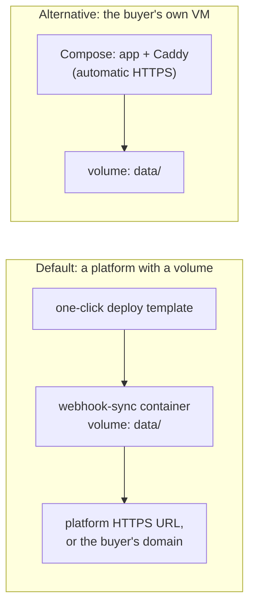

# Hosting, monitoring and handover

**What this page contains.** Where a client's copy runs and what it costs, HTTPS, how upgrades reach each client, backups off the machine, outside monitoring, privacy roles and support access, the handover runbook, and what happens after 30 April 2027.

**How to read it.** This page is about the service's life around the code. Every quote a client receives is written from it ([Q79](grilling-log.md), [Q80](grilling-log.md), [Q81](grilling-log.md), [Q91](grilling-log.md); audit F25, F27, F28).

## What the service needs from a host

| Need | Why | Rules out |
|---|---|---|
| An always-on process | The flusher, sweeper, verify and backup run on timers | Scale-to-zero platforms; cold starts can exceed Razorpay's 5 s timeout |
| A persistent disk | SQLite is a file | Ephemeral disks, which lose the ledger on redeploy; serverless containers |
| HTTPS on a stable URL | Sources require HTTPS in live mode | A laptop tunnel for anything but the demo |

## Where it runs

- **Default:** a platform that runs an always-on container with a persistent volume, deployed from a template in the repo. The platform's own HTTPS URL works without the buyer owning a domain. Which platform is chosen when the first client needs it, against the table above and its price that month; the template is written for that one.
- **Alternative:** the buyer's own small VM with Docker Compose and Caddy, which needs a DNS name pointing at the machine.
- **Cost:** every quote states the monthly hosting cost at that day's list price (about $4-9 a month for the smallest always-on option in October 2026, G37). The buyer owns and pays for the account from the start (plan: "the client owns every account").

## Upgrades

Each client repository **pins a released version** of the core (a tagged image) instead of forking it. What differs per client lives in config and adapter files. A fix to the core is a new release and a one-line version bump per client, not a cherry-pick into diverging forks.

## Backups

`wsync backup` runs nightly: a consistent copy (`VACUUM INTO`), encrypted with a key only the buyer holds (age), then copied **off the machine** to the buyer's own Google Drive or S3 bucket. Backups follow the payload retention: 30 days. A backup on the same disk doesn't survive the disk, the VM or the account.

**Restoring:** stop, restore the file, start, `wsync sweep`, `wsync verify --full --repair`. The sweeper re-lists everything since the backup's checkpoint.

## Monitoring from outside

Every in-process alert is silent when the process is dead. Two outside checks, both free tiers, set up at handover and checked by `doctor`:
- **A dead-man's switch.** The sweeper pings a heartbeat URL (Healthchecks.io) after each successful sweep. No ping for 30 minutes means an email to the buyer and to Lalit.
- **An uptime check** on the public `/health` every 5 minutes.

## Privacy

- **Roles.** The buyer decides what is collected and why: the data fiduciary under India's DPDP Act, the controller under the GDPR. The service runs on the buyer's infrastructure. Lalit handles personal data only during setup and support, as the buyer's processor, under a one-paragraph data-processing clause in the quote.
- **Less data.** Stored payloads are stripped of fields no adapter reads (addresses, phone numbers, IP addresses, payment-method details) and kept 30 days. Backups follow the same retention and are encrypted.
- **Support access** only through the buyer's own screen share or a time-limited account on their host, never by copying data out. (The vault's client-data rule applies.)
- **Keys.** Stripe keys are restricted to reading. Razorpay keys can't be restricted: they live only in the host's environment and are rolled at handover with Razorpay's 24-hour overlap, because the buyer's checkout uses the same key set ([Q102](grilling-log.md)).

## The handover runbook

Written into each client's repository. The five calls most likely to come:

| Call | Cause | Fix |
|---|---|---|
| "The sheet stopped updating" | A paused sink: someone moved a column, unshared the sheet, or the key expired | `wsync status`; fix the cause; `wsync resume` or `wsync rebuild-sheet` |
| "Rows look wrong after I sorted" | The tab was sorted directly | Use filter views; the check repairs moved rows; `wsync verify --repair` |
| "I'm getting alerts every hour" | An endpoint missing a subscribed type, or a real dead job | `wsync doctor`; fix the Stripe endpoint; `wsync dead list` |
| "The heartbeat check emailed me" | The process or host is down, or the source's API is unreachable ([Q96](grilling-log.md)) | `/health` answers? Check the source's status page. It doesn't? The host's dashboard: restart. Then `wsync sweep` catches up |
| "The hosting bill" | The platform plan | The plan named in the quote |

## After 30 April 2027

Upkeep contracts end on a fixed date written into every quote. Before then, each client gets the runbook, the pinned version, the admin tokens rotated to their own, and a note for their next developer: where the code is, how to deploy a new version, and how to run `doctor`. The service keeps running without Lalit; nothing depends on him ([Q80](grilling-log.md)).

## Where to go next

[edge-cases.md](edge-cases.md) and [testing.md](testing.md): how all of this is proved.
