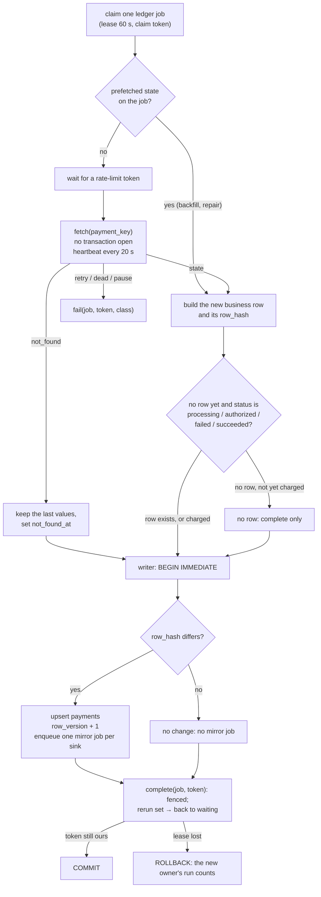

# The ledger worker

**What this page contains.** What happens between claiming a ledger job and completing it: the fetch outside any transaction, the one short write, when a row is created, when a mirror job is made, what "not found at source" means, and the crash points that prove none of it can double-write or lose a change.

**How to read it.** The flowchart is the page; the two rules under it explain its shape.

## The job in one sentence

For one payment, get its true current state from the source and make the ledger's business row equal to it; then ask every mirror to catch up, but only if something changed.

## One ledger job

## The two rules that shape it

**1. Never call a source inside a transaction.** driftless fetches inside its apply transaction, with retries at 30 s timeouts; on SQLite that holds the only write lock for minutes. Here the fetch happens with no transaction open, and the write that follows takes milliseconds.

**2. The work and its completion commit together.** The upsert, the mirror jobs and `complete` are one transaction. If the process dies before `COMMIT`, none of it happened and the job is reaped and runs again; if it dies after, all of it happened.

And because there is only ever one live job per payment ([queue.md](queue.md)), only one fetch for a payment runs at a time. An older answer can't land after a newer one (F04). New events that arrive mid-fetch set the job's `rerun` flag, so it fetches once more straight after.

## Building the new row

The fetched state is mapped as [sources.md](sources.md) describes and written as it is: whatever order the events arrived in, the row ends up equal to the source ([ADR 0002](decisions/0002-fetch-current-state-not-event-payload.md)).

- **A row is created only once the payment is charged or attempted**: `processing`, `authorized`, `failed` or `succeeded`. A payment still pending, or canceled before any charge, completes the job without a row (F10).
- **Columns an optional read couldn't fill** (a restricted key without dispute or balance-transaction access) are recorded in `unknown_columns` and shown as "unknown", never as empty or zero ([Q85](grilling-log.md)).
- **A prefetched state** (a backfill or repair already listed the payment in full) is used instead of a fetch, unless a newer event has arrived since. Enqueue clears it in that case (F18).

## Not found at source

If the payment has no row yet, a 404 makes none: the job completes and the event stays in the audit trail. Otherwise: a fetch that returns 404 usually means test data was deleted in the dashboard, or the payment belongs to another account. The row keeps its last fetched values, `not_found_at` is set, the sheet's Note column says "not found at source", and verify lists it. Nothing is written from the event's own contents; that fallback was removed ([Q73](grilling-log.md)).

## When a mirror job is made

Only when `row_hash` changes. `row_hash` covers exactly the columns the mirrors show. A fetch that finds nothing new (a duplicate hint from the sweeper, a replay of an old event) costs one API call and no sheet write, which is also why a replay is always safe.

## Crash points

Each is tested by killing a subprocess at that point ([testing.md](testing.md)):

| Crash point | State left behind | What happens after restart |
|---|---|---|
| `after_claim` | job `running`, nothing fetched | Reaped after 60 s, backs off, runs again |
| `after_fetch` | job `running`, state fetched, not written | The same; the next run fetches again |
| `before_ledger_commit` | transaction open | Rolled back by the database; reaped; runs again |
| `after_ledger_commit` | row written, mirror job waiting, ledger job done | Nothing to redo; the flusher takes the mirror job |

## Where to go next

[sheets-sink.md](sheets-sink.md): what the flusher does with the mirror jobs made here.
