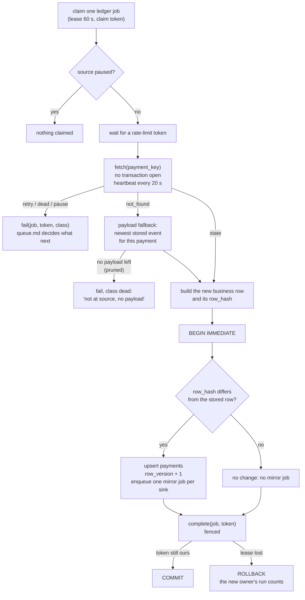

# The ledger worker

**What this page contains.** What happens between claiming a ledger job and completing it: the fetch outside any transaction, the one short write, when a mirror job is made, the payload fallback, and the crash points that prove none of it can double-write or lose a change.

**How to read it.** The flowchart is the page. The two rules under it are the reason for its shape.

## The job in one sentence

For one payment, get its true current state from the source and make the ledger's business row equal to it, then ask every mirror to catch up, but only if something changed.

## One ledger job

## The two rules that shape it

**1. Never call a source inside a transaction.** driftless fetches from Stripe inside its apply transaction, with up to five in-client retries at 30 s timeouts. On SQLite that holds the only write lock for minutes and every delivery gets "database is locked". Here the fetch happens first, with no transaction open, and the write that follows takes milliseconds ([Q27](grilling-log.md), feature inventory).

**2. The work and its completion commit together.** The upsert, the mirror jobs and `complete` are one transaction. If the process dies before `COMMIT`, none of it happened and the reaper hands the job out again; if it dies after, all of it happened. There is no moment where the row changed but the job is still waiting, or the job is done but the sheet was never told.

## Building the new row

In **fetch mode** (the default, [ADR 0002](decisions/0002-fetch-current-state-not-event-payload.md)), the new row is the fetched state mapped as [sources.md](sources.md) describes, written as it is. Whatever order the events arrived in, the row ends up equal to the source.

In **payload mode**, used only when the fetch says `not_found`:
- the newest stored event for this payment is used, ordered by `(source_created_at, event_id)`;
- it is written only if that pair is newer than the row's `payload_version`, and never moves the row out of `canceled` or backwards along the status order;
- the row is marked `written_from = 'payload'`, the sheet shows it, and verify lists it;
- the next successful fetch for that payment overwrites the row and sets `written_from` back to `fetch`.

A `not_found` usually means test data was deleted at the source, or the key belongs to another account. If every event's payload has already been pruned (after 90 days), the job goes dead with a reason a person can read.

## When a mirror job is made

Only when `row_hash` changes. `row_hash` covers exactly the columns the mirrors show. A fetch that finds nothing new, such as a duplicate hint from the sweeper or a replay of an old event, costs one API call and no sheet write. This is also why a replay is always safe: in the worst case it changes nothing.

One mirror job is enqueued per configured mirror sink (in version 1, only `sheets`), with the same coalescing insert as every other job. If ten ledger jobs for ten payments finish within one flush interval, the flusher writes all ten rows in one call.

## Heartbeats

A fetch is normally well under a second. The heartbeat still runs every 20 s while the job is running, so a slow API (a 30 s timeout plus rate-limit waits) never lets the lease expire under a healthy worker. If a heartbeat finds the lease already lost, the worker abandons the job without writing anything.

## Crash points

These named points let tests kill the worker and restart it ([testing.md](testing.md)):

| Crash point | State left behind | What happens after restart |
|---|---|---|
| `after_claim` | job `running`, nothing fetched | Reaped after 60 s, backs off, runs again |
| `after_fetch` | job `running`, state fetched but not written | Same; the next run fetches again (idempotent) |
| `before_ledger_commit` | transaction open | Rolled back by the database; reaped; runs again |
| `after_ledger_commit` | row written, mirror job waiting, ledger job done | Nothing to redo; the flusher picks up the mirror job |

After every one of them, the invariants hold: the row equals the source, the sheet catches up, nothing is written twice.

## Open questions

- Whether a `not_found` should also raise an alert. Written: no; it shows in verify as orphaned and in the dead-letter queue if no payload remains.

## Where to go next

[sheets-sink.md](sheets-sink.md): what the flusher does with the mirror jobs made here.
