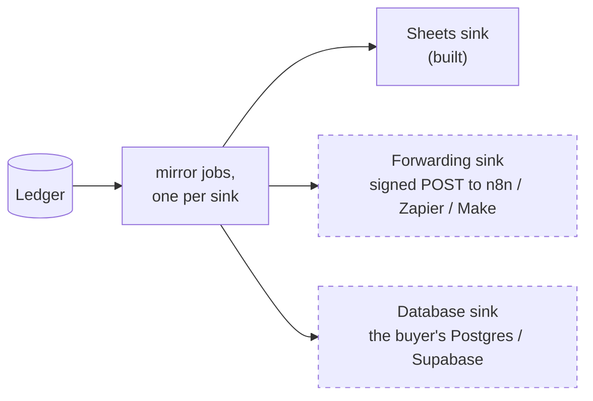

# Next adapters: forwarding, and the buyer's database

**What this page contains.** Outlines of the two adapters that come right after the pitch-ready cut: the forwarding sink for n8n and Zapier users ([Q77](grilling-log.md)), and the database sink with subscriptions, the first paid adapter ([Q78](grilling-log.md)). Outlines only: the full design of the database sink waits for the first matching job post, because it depends on the buyer's stack.

**How to read it.** Both are sink adapters. The core (receive, store once, queue, sweep, verify) doesn't change for either.

## Where they sit

## The forwarding sink

**For:** a team whose automation already lives in n8n, Zapier or Make, and loses or double-counts payment events. The pitch: "keep your automation; put this in front of it".

- **What it sends:** one POST per business-row change (not per raw event), carrying the payment's current row, the change counter (`row_version`) and the event ids folded into it. The receiver on the other side gets each change once, in order per payment, with no duplicates to filter.
- **Signed** with the Standard Webhooks scheme (`webhook-id`, `webhook-timestamp`, `webhook-signature`), so the other side can verify it; the `webhook-id` is `payment id : row_version`, stable across retries, so a receiver that dedupes by id is safe.
- **Retries** on the same queue, classes and backoff as every sink; a 410 or a repeated 401 pauses the sink.
- **Effort:** 3-5 h, mostly reusing the Sheets sink's shape.

## The database sink, with subscriptions

**For:** a SaaS founder whose app needs to know who has paid. The posted jobs look like "sync `invoice.paid` and `customer.subscription.deleted` into Supabase" (the $120 post in the vault's research).

**What it needs beyond today's core:**
- **New business rows in the ledger:** subscriptions and invoices, alongside payments, from `checkout.session.completed`, `customer.subscription.created/updated/deleted`, `invoice.paid` and `invoice.payment_failed`. Fetch mode applies as it does to payments.
- **A subscription state the app can use:** `active`, `trialing`, `past_due`, `canceled`, `unpaid`, with the current period's end, the price and the customer.
- **A sink that writes into the buyer's own database**, by upsert on the source's ids, idempotent like the Sheets flush.

**Decisions left for the first real job:**
- Write into a schema we own (`webhook_sync.subscriptions`) that the app reads, or into the app's own tables through a column mapping.
- Which database and driver: Supabase over its REST API, or plain Postgres with a connection string.
- How a customer maps to the app's user: by email, by a Stripe `metadata` key, or by the Stripe customer id stored in the app.
- Whether the app also wants a signal (a POST, or a Postgres `NOTIFY`) when an entitlement changes.

**Effort:** 8-15 h for subscriptions, invoices and the sink, once the stack is known.

## Other adapters that fit the same shape

Refunds as their own rows (for period accounting), payouts and bank reconciliation (the bridge to demo 1), Checkout line items, Airtable or Notion sinks, Tally or QuickBooks exports. Each is listed with its effort in the audit's missing-features table; each is an adapter, not a change to the core.

## Where to go next

[build-order.md](build-order.md): when each of these is built.
