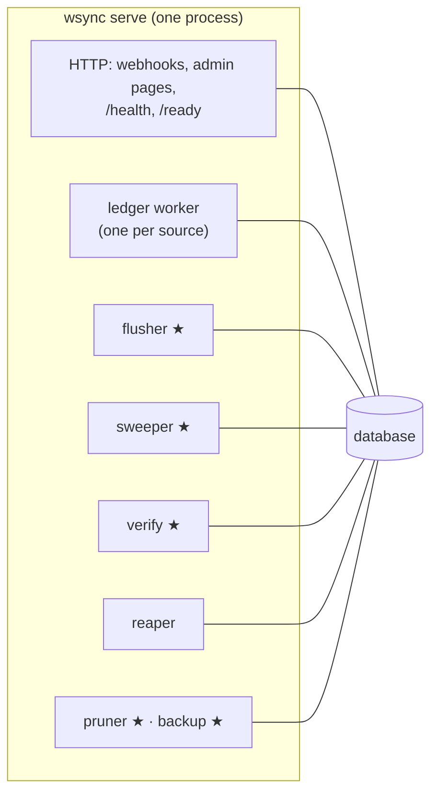
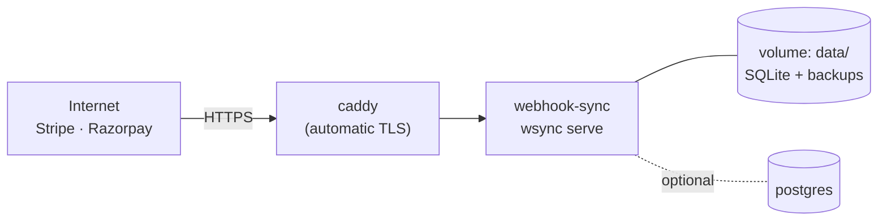

# Operations

**What this page contains.** Everything about running the service: the admin pages, the `wsync` commands and `doctor`, alerts, configuration and secrets, starting and stopping, logs and health checks, retention, backups, the SQLite settings, and how a client runs it with Docker Compose.

**How to read it.** Each section stands alone. The config example and the `doctor` checklist are what a client handover needs.

## One process, several loops



★ = singleton, held by a lease in `singletons`, so a second process started by mistake can't run it twice. On Postgres, `wsync serve --workers N` adds ledger workers only ([Q26](grilling-log.md)).

## Admin pages

Server-rendered HTML, vendored Pico.css (MIT), dark mode, htmx for the buttons and for counters that refresh every 5 s. No JavaScript build ([Q58](grilling-log.md)).

| Page | Shows | Actions |
|---|---|---|
| **Overview** | counters (received, duplicates, conflicts, rejected, done, waiting, dead), each source's and sink's state, last sweep, last verify, red banners for anything needing a person | Sweep now, Backfill range, Resume sink, Rebuild sheet |
| **Events** | filterable list: source, type, origin, outcome, date | |
| **Event timeline** | one event: its deliveries, its ledger job and every attempt, the row change it caused (`row_version`), the mirror job and its flush | Replay |
| **Dead letters** | dead jobs by sink, with error and history | Retry one, Retry all for sink, Resolve with note |
| **Verify** | runs, totals per currency, findings | Run full verify, Repair |
| **Admin actions** | who did what, when | |
| **Rejections** | recent rejections by reason (no bodies) | |

**Access** ([Q22](grilling-log.md)). Every admin page and action needs `ADMIN_TOKEN` (a bearer header, or a login form that sets a secure cookie). Actions are `POST` with a CSRF token. The service listens on `127.0.0.1` unless configured otherwise, and refuses to listen anywhere else without an admin token. Each token has a label, which is what the admin actions log records.

## Commands

| Command | Does |
|---|---|
| `wsync serve` | Runs everything above |
| `wsync doctor` | Checks a setup end to end (below). Exit code 0 only if every check passes. |
| `wsync sweep` / `wsync backfill --from --to` | [sweeper.md](sweeper.md) |
| `wsync replay <event_id>` | Enqueue a ledger job for that event's payment |
| `wsync verify [--full] [--repair] [--days N]` | [verify.md](verify.md) |
| `wsync rebuild-sheet` | [sheets-sink.md](sheets-sink.md) |
| `wsync dead list / retry <id or --all> / resolve <id> --note` | The dead-letter queue |
| `wsync backup` | Consistent SQLite copy |
| `wsync demo <scene>` | [showcase.md](showcase.md) |

Each command that changes anything writes an admin action, labelled `cli` ([Q47](grilling-log.md)).

## doctor

What a client handover runs to prove the setup works, and the first thing to run when something looks wrong.

| Check | Fails when |
|---|---|
| Config parses and validates | a typo, an unknown key, a missing required field |
| Every source has a non-empty secret | fail-open risk |
| Each API key's mode matches the configured mode | `sk_live_` with `mode = "test"`, `rzp_test_` with `mode = "live"` |
| Each API key works (one cheap read) | revoked or wrong key |
| Our clock is within 30 s of the source's (from its `Date` header) | Stripe signatures fail beyond 5 minutes of drift |
| The spreadsheet is shared with the service account, and the header row matches config | unshared, wrong id, columns moved |
| The database is writable, migrations are current, SQLite is in WAL mode with `synchronous=FULL` | read-only disk, network drive, old schema |
| `ADMIN_TOKEN` set if listening on a non-local address | |
| The public webhook URL answers (optional `--url`) | tunnel down, wrong path |

## Alerts

One outgoing URL (`alerts.url`), sent a Slack- and Discord-compatible JSON message, plus a red banner on the Overview page ([Q42](grilling-log.md)). Each kind of alert is sent at most once an hour; suppressed repeats are counted and reported in the next one.

| Alert | Fires when |
|---|---|
| sink paused / source paused | a pause, with the reason |
| dead jobs | the first dead job, then an hourly digest while any remain unresolved |
| verify differences | a full verify finds differences it couldn't repair, or the same payment is stale two nights running |
| silent webhooks | [sweeper.md](sweeper.md) |
| horizon near | 25 days since a Stripe checkpoint |
| conflict | a delivery with a known id and a different body |
| sheet capacity | the spreadsheet (all tabs) past 80 % of the cell limit |
| database writes failing | a write fails for a reason other than a short lock: disk full, read-only file, lost Postgres connection |
| clock skew | our clock more than 60 s from a source's `Date` header (checked on accepted deliveries) |
| backup failed | the nightly `wsync backup` did not produce a file |
| unknown currency | a payment in a currency the exponent table doesn't know; its sheet row is held back ([Q62](grilling-log.md)) |

## Configuration and secrets

Everything that isn't secret lives in `webhook-sync.toml`; secrets come from environment variables or `.env`, never the TOML ([Q46](grilling-log.md)). Validated at startup with messages that say what to fix.

```toml
[service]
listen = "127.0.0.1:8000"
timezone = "Asia/Kolkata"
retry_profile = "production"        # or "demo"

[sources.stripe]
mode = "test"                       # secrets: STRIPE_WEBHOOK_SECRETS (comma-separated, newest first), STRIPE_API_KEY
rate_limit_per_second = 10

[sources.razorpay]
enabled = false
mode = "test"                       # secrets: RAZORPAY_WEBHOOK_SECRETS, RAZORPAY_KEY_ID, RAZORPAY_KEY_SECRET

[sinks.sheets]
spreadsheet_id = "1AbC…"            # secret: GOOGLE_SERVICE_ACCOUNT_JSON (path or JSON)
columns = ["payment_id", "source", "created", "status", "amount", "currency",
           "refunded", "dispute", "customer_email", "description",
           "written_from", "last_event", "updated"]
mask_email = true

[verify]
days = 30
nightly_at = "02:00"
auto_repair = true

[sweeper]
initial_lookback_days = 30          # first start only; 0 = start empty

[retention]
payload_days = 90

[alerts]
url = ""                            # Slack or Discord incoming-webhook URL; empty = banner only
```

`DATABASE_URL` selects Postgres; without it, the database is `data/webhook-sync.db`.

## Starting and stopping

**Start:** validate config (fail closed, [receiver.md](receiver.md)) → refuse to start if the database's `schema_version` is newer than any migration this code knows (an older copy started against a newer database) → apply migrations → release any leases held by this host's previous run → start loops → start accepting deliveries.

**Stop** ([Q37](grilling-log.md)): answer 503 to new deliveries → stop claiming → give running jobs up to 20 s to finish and record their result → release the leases of anything unfinished (back to waiting, attempt refunded, `attempts` row marked `released`) → exit. Results are recorded with a fresh database session, never one tied to the cancelled request; driftless records results with an already-cancelled context, which leaves jobs stuck in `running`. Docker Compose sets `stop_grace_period: 30s` because Docker's default of 10 s is shorter than the 20 s drain.

## Logs and health

- **Logs:** one JSON object per line, UTF-8 forced (so an emoji in a description can't crash a Windows console), each line carrying `event_id`, `job_id` and `payment_key` where known. Never logged: secrets, signatures, raw bodies, emails, phone numbers ([Q21](grilling-log.md), [Q45](grilling-log.md)).
- **`GET /health`:** 200 if the process is up.
- **`GET /ready`:** 200 if the database answers, migrations are current, and no source is paused. Docker's health check uses it.

## Retention and pruning

The pruner runs daily at 03:00 local time, deleting or blanking 1,000 rows per transaction so SQLite's write lock is never held long. The table of what is kept for how long is in [data-model.md](data-model.md).

## Backups

SQLite: `wsync backup` runs `VACUUM INTO backups/webhook-sync-<date>.db`, a consistent copy taken while the service runs; it runs nightly after the pruner and keeps 7. Postgres: the client's provider ([Q49](grilling-log.md)).

**Restoring an old backup:** stop, replace the file, start, run `wsync sweep`, then `wsync verify --full --repair`. The sweeper re-lists everything since the backup's checkpoint, so the events the backup lacks come back.

## SQLite settings

| Setting | Why ([Q50](grilling-log.md)) |
|---|---|
| `journal_mode=WAL` | Admin pages read while the worker writes |
| `synchronous=FULL` | Each commit is on disk before we answer 202, so even a power cut can't lose an acknowledged event |
| `busy_timeout=5000` | Wait up to 5 s for the write lock instead of failing at once; past that, the receiver answers 503 |
| `BEGIN IMMEDIATE` for every write | Takes the write lock at the start, avoiding the lock-upgrade deadlock between two writers |
| Database on a local disk | `serve` warns and `doctor` fails on a UNC or mapped network path and on known sync folders (OneDrive, Dropbox, Google Drive), best effort: SQLite's locking is unreliable there |

## Running it for a client: Docker Compose



`compose.yml` has the app, a Caddy container for HTTPS (sources require HTTPS in live mode), a named volume for `data/`, an optional Postgres profile, the health check on `/ready`, and `stop_grace_period: 30s`. For the local demo, no Compose is needed: `stripe listen --forward-to localhost:8000/webhooks/stripe` tunnels events in ([Q5](grilling-log.md)).

## Open questions

- Whether Caddy belongs in the default Compose file or only in a documented example, since many clients' hosts terminate HTTPS themselves. Written: included, behind a Compose profile.

## Where to go next

[edge-cases.md](edge-cases.md) and [testing.md](testing.md): how all of this is proved.
