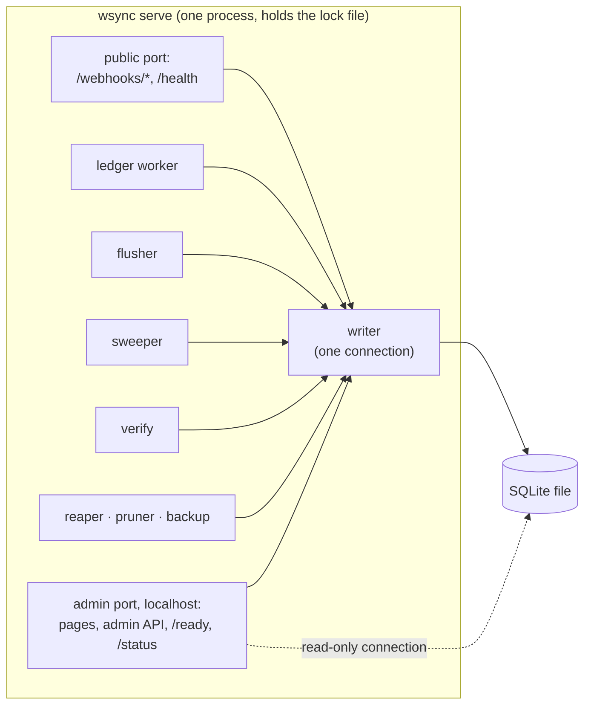

# Operations

**What this page contains.** Running the service: the one process and its loops, the admin port, the `wsync` commands and `doctor`, alerts, configuration and secrets, starting and stopping, logs and health checks, and the SQLite settings. Where it runs, backups, monitoring and handover are in [hosting.md](hosting.md).

**How to read it.** Each section stands alone. The `doctor` table and the config example are what a handover needs.

## One process, several loops



`wsync serve` takes an exclusive lock on `data/webhook-sync.lock` and refuses to start if another server holds it ([ADR 0007](decisions/0007-one-server-process-per-database.md)). Every write goes through the one writer; pages, verify and exports read through a read-only connection ([Q83](grilling-log.md)).

## The admin port

The admin pages and the admin API listen on a **second port bound to `127.0.0.1`**, reached from elsewhere by an SSH tunnel. The public port serves only the webhooks and `/health` ([Q88](grilling-log.md), F24).

| Page (after pitching) | Shows | Actions |
|---|---|---|
| **Overview** | counters, each source's and sink's state, last sweep, last verify, banners | Sweep now, Backfill, Resume, Rebuild |
| **Events** and **Event timeline** | events, filterable; one event's deliveries, job, attempts, row change and flush | Replay |
| **Dead letters** | dead jobs with error and history | Retry one, Retry all, Resolve |
| **Verify** | runs, totals, findings | Run, Repair |
| **Admin actions**, **Rejections** | who did what; rejection counts and samples | |

Server-rendered HTML, vendored Pico.css (MIT), htmx for buttons, no JavaScript build ([Q58](grilling-log.md)). The pitch-ready cut has no pages: the CLI and the Sync status tab cover it ([Q67](grilling-log.md)).

**Access.** Tokens are set as `ADMIN_TOKENS=label:token,…`; the label is what the admin-actions log records. If a buyer insists on exposing the admin port publicly: every token at least 32 random characters (`doctor` checks), login throttled to 5 tries a minute per address, compared with `hmac.compare_digest`, and a signed session cookie (`HttpOnly`, `SameSite=Strict`, `Secure`). Actions are `POST` with a CSRF token.

## Commands

| Command | Does |
|---|---|
| `wsync serve` | Runs everything above |
| `wsync doctor` | Checks a setup end to end (below); exit code 0 only if every check passes |
| `wsync status` | What `/status` shows: paused sources and sinks with reasons, counters, last sweep and verify |
| `wsync sweep` / `backfill --from --to` / `replay <event_id>` | [sweeper.md](sweeper.md) |
| `wsync verify [--full] [--repair] [--days N]` | [verify.md](verify.md) |
| `wsync rebuild-sheet` / `wsync resume <sink or source>` | [sheets-sink.md](sheets-sink.md), [queue.md](queue.md) |
| `wsync dead list / retry <id or --all> / resolve <id> --note` | The dead-letter queue |
| `wsync backup` | Encrypted consistent copy ([hosting.md](hosting.md)) |
| `wsync demo <scene>` | [showcase.md](showcase.md) |

When a server is running, commands that change state ask it over the admin port; otherwise they run on their own. Each is logged as an admin action, labelled `cli`.

## doctor

What a handover runs to prove the setup works, and the first thing to run when something looks wrong.

| Check | Fails when |
|---|---|
| Config parses and validates | a typo, an unknown key, a missing field |
| Every source has a non-empty secret | fail-open risk |
| Stripe key is a **restricted** key with every needed read permission; each key's mode matches the config | `sk_live_` used, a permission missing (named), `rk_live_` with `mode = "test"` ([Q85](grilling-log.md)) |
| Stripe's webhook endpoint for this URL is subscribed to every handled type; its API version matches the pinned one | a type not ticked (fail); a version differs (warning) (F29) |
| Our clock within 30 s of the source's `Date` header | Stripe signatures fail beyond 5 minutes |
| The spreadsheet is reachable and shared, the tabs and header match, the deployment id is ours; which Google auth is in use | unshared, wrong id, columns moved; the organisation blocks keys (explained in plain words, [Q90](grilling-log.md)) |
| Database writable, migrations current, schema not newer than the code, WAL and `synchronous=FULL` on, on a local disk | read-only, network drive or synced folder (OneDrive, Dropbox, Google Drive) |
| Admin tokens long enough if the admin port is public | |
| The heartbeat URL and the backup destination are set and reachable | [hosting.md](hosting.md) |
| The public webhook URL answers (with `--url`) | tunnel or DNS down |

## Alerts

One outgoing URL (Slack- or Discord-compatible) plus a banner on the Overview. Each kind at most once an hour; suppressed repeats are counted in the next. Alert bodies carry ids and counts only, never emails, names or descriptions ([Q91](grilling-log.md)).

| Alert | Fires when |
|---|---|
| source or sink paused | with the reason |
| dead jobs | the first, then an hourly digest while any remain |
| verify differences | a nightly run finds differences it can't repair, or the same payment stale two nights running |
| silent webhooks, horizon near | [sweeper.md](sweeper.md) |
| conflict | a known event id with a different fingerprint |
| sheet changed during write | a moved row was caught and repaired |
| missing permission | an optional read returned 403 |
| unknown currency | a sheet row held back ([Q62](grilling-log.md)) |
| database writes failing, clock skew, backup failed, sheet capacity | as named |

In the pitch-ready cut only three kinds exist: paused, dead jobs, verify differences. The dead-man's switch covers a dead process ([hosting.md](hosting.md)).

## Configuration and secrets

Everything that isn't secret lives in `webhook-sync.toml`; secrets come from environment variables or `.env`, never the TOML ([Q46](grilling-log.md)).

```toml
[service]
public_listen = "0.0.0.0:8000"      # webhooks and /health only
admin_listen = "127.0.0.1:8001"     # secrets: ADMIN_TOKENS=label:token,...
timezone = "Asia/Kolkata"
retry_profile = "production"        # or "demo"

[sources.stripe]
mode = "test"                       # secrets: STRIPE_WEBHOOK_SECRETS (newest first), STRIPE_RESTRICTED_KEY
account = "acct_…"
metadata_keys = ["order_id"]

[sinks.sheets]
spreadsheet_id = "1AbC…"            # secret: GOOGLE_SERVICE_ACCOUNT_JSON, or GOOGLE_OAUTH_REFRESH_TOKEN
columns = ["payment_id", "source", "created", "status", "amount", "currency", "refunded",
           "settled", "fee", "net", "settled_in", "method", "dispute", "customer_email",
           "description", "metadata", "via", "note", "updated"]
mask_email = true

[sweeper]
initial_lookback_days = 30
heartbeat_url = "https://hc-ping.com/…"

[verify]
days = 30
nightly_at = "02:00"
auto_repair = true

[retention]
payload_days = 30

[alerts]
url = ""                            # Slack or Discord incoming-webhook URL; empty = banner only
```

## Starting and stopping

**Start:** take the lock file → validate config (fail closed, [receiver.md](receiver.md)) → refuse if the database's schema is newer than this code → apply migrations → return any `running` jobs whose `claimed_by` is a previous run of this instance to waiting, with the attempt counted and normal backoff, as the reaper does (a job that crashes the process every time must still reach `dead`) → start loops → start accepting deliveries.

**Stop** ([Q37](grilling-log.md)): answer 503 to new deliveries → stop claiming → give running jobs up to 20 s → release the leases of anything unfinished (back to waiting, attempt refunded) → release the lock file → exit. Results are recorded with a fresh connection, never one tied to a cancelled request. Platforms and Compose are given a 30 s stop grace period.

## Logs and health

- **Logs:** one UTF-8 JSON object per line, carrying `event_id`, `job_id` and `payment_key` where known. Never logged: secrets, signatures, raw bodies, emails, phone numbers.
- **`GET /health`** (public): 200 if the process is up.
- **`GET /ready`** (admin port): 200 if a delivery can be stored now: the database is writable and migrations are current. Paused sources and sinks do **not** fail it; a hosting platform would otherwise restart a receiver that is working ([Q81](grilling-log.md), F27).
- **`GET /status`** (admin port): paused sources and sinks, counters, last sweep and verify, as JSON.

## SQLite settings

| Setting | Why |
|---|---|
| WAL mode | Readers don't wait for the writer |
| `synchronous=FULL` | A commit is on disk before we answer 202, so a power cut can't lose an acknowledged event ([Q50](grilling-log.md)) |
| One writer connection behind an async lock, `BEGIN IMMEDIATE` issued explicitly | Writes queue in our code, in order; the audit measured a pool shedding load as "database is locked" (F14). The storm test asserts zero 503s and a p99 under 2 s ([Q83](grilling-log.md)) |
| A read-only connection (`mode=ro`) for pages, verify and exports | Reads never take the write lock |
| `busy_timeout=5000` | Only matters for a command-line process writing while no server runs |
| A local disk | WAL is unsafe on network drives and in synced folders |

## Where to go next

[hosting.md](hosting.md): where it runs, and what happens around it.
