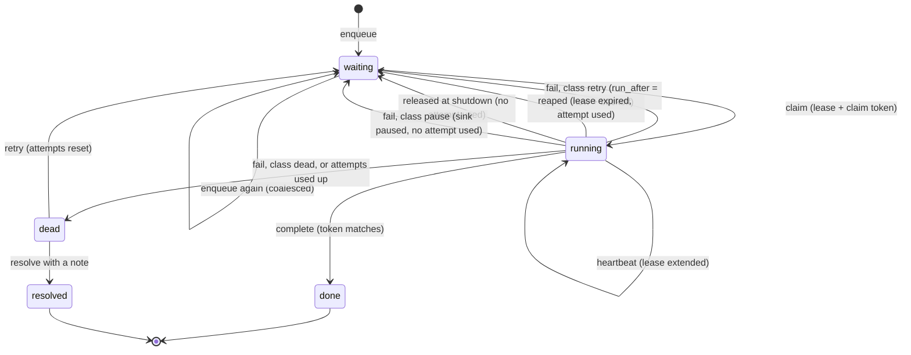
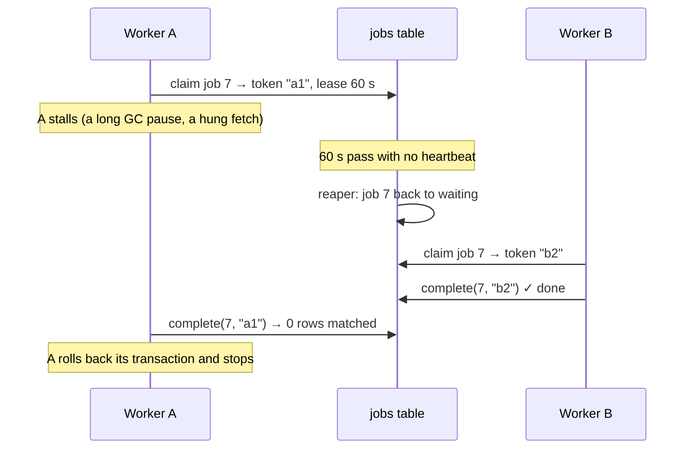
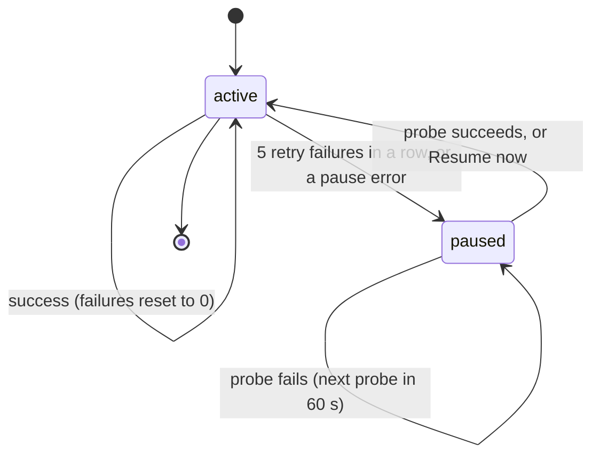

# The queue

**What this page contains.** The job state machine, the six operations and the SQL behind each, coalescing, leases and fencing with a worked crash timeline, the three error classes, the retry schedule, pausing a sink, and the dead-letter queue.

**How to read it.** The state machine and the crash timeline are what a newcomer needs. The SQL is reference. If you know Redis Streams, [ADR 0004](decisions/0004-queue-in-the-database-behind-an-interface.md) maps each Streams command onto an operation here.

## What the queue is

A table, `jobs` ([data-model.md](data-model.md)), and six operations on it. Nothing else in the service writes `jobs.status`. The queue knows nothing about payments: a job is a stage, a sink, a payment key and a state. Keeping it this narrow means a Redis Streams backend could replace the table later without touching anything else ([Q24](grilling-log.md)).

## A job's life



A job waiting for a **paused sink** is never claimed, so its attempts don't count down while the sink is broken ([Q30](grilling-log.md)).

## The six operations

**enqueue(stage, sink, source, payment_key, event_id).** Coalescing insert: if a waiting job already exists for this payment, stage and sink, it is reused.

```sql
INSERT INTO jobs (stage, sink, source, payment_key, status, attempts, max_attempts,
                  run_after, caused_by_event_id, created_at, updated_at)
VALUES (:stage, :sink, :source, :key, 'waiting', 0, :max, :now, :event_id, :now, :now)
ON CONFLICT (stage, sink, source, payment_key) WHERE status = 'waiting'
DO UPDATE SET caused_by_event_id = excluded.caused_by_event_id,
              updated_at         = excluded.updated_at;
```

`run_after` is left alone on a conflict. A job in backoff stays in backoff when another event arrives; the retry will fetch the current state anyway, so nothing is lost by waiting. enqueue always runs inside the caller's transaction (the **outbox**).

**claim(stage, sink, limit).** Takes up to `limit` due jobs: 1 for the ledger worker, up to 200 for the flusher.

```sql
-- Postgres: several workers can claim at once without blocking each other
UPDATE jobs SET status = 'running', claim_token = :token, lease_until = :now + interval '60 seconds',
                attempts = attempts + 1, updated_at = :now
WHERE id IN (SELECT id FROM jobs
             WHERE stage = :stage AND sink = :sink AND status = 'waiting' AND run_after <= :now
             ORDER BY run_after, id
             LIMIT :limit
             FOR UPDATE SKIP LOCKED)
RETURNING *;
```

On SQLite the same statement runs without `FOR UPDATE SKIP LOCKED`, inside `BEGIN IMMEDIATE`: SQLite has one writer, so there is nothing to skip. A claim on a paused sink returns nothing.

**heartbeat(job_ids, token).** Every 20 s while running: `UPDATE jobs SET lease_until = :now + 60 s WHERE id IN (…) AND claim_token = :token AND status = 'running'`. If it updates fewer rows than expected, the worker has lost its lease and stops, recording nothing.

**complete(job_id, token).** `UPDATE jobs SET status = 'done', … WHERE id = :id AND claim_token = :token AND status = 'running'`. It runs **in the same transaction** as the work's own write (the ledger upsert and the mirror enqueue), so the work and its completion commit together. If the update matches no row, the lease was lost: the transaction rolls back and the new owner's run counts.

**fail(job_id, token, error, class).** In its own short transaction, fenced the same way. It writes an `attempts` row and moves the job according to its class (below).

**reap().** Every 30 s: jobs with `status = 'running' AND lease_until < now` go back to `waiting` with `run_after = now + backoff(attempts)` and an `attempts` row marked `reaped`. If attempts are used up, they go to `dead`. driftless re-runs reaped jobs at once, which loops forever on a job that crashes its worker; here they back off like any failure.

## Fencing, in one timeline

A **lease** is a promise that expires. **Fencing** means the promise is checked at the moment it matters, when the result is recorded.



Without the token check, A's late "done" would record a result B had already superseded. driftless and procrastinate both lack it (feature inventory).

## The three error classes

Each adapter decides the class of each error ([Q28](grilling-log.md)).

| Class | Examples | What happens |
|---|---|---|
| `retry` | 429, 5xx, timeout, connection refused, SQLite "database is locked" | Back to `waiting` with `run_after = now + backoff(attempts)`; `dead` once attempts are used up. Counts towards pausing the sink. |
| `dead` | Our own bug, a payload we can't map, a Sheets 400 for a bad request | Straight to `dead`. Retrying can't help, so it doesn't wait 16 hours to say so. |
| `pause` | 401 or 403, spreadsheet or tab deleted, header row changed | The sink is paused, the job goes back to `waiting`, and its attempt is refunded. |

A fetch that returns 404 is not an error class: the ledger worker falls back to payload mode ([ledger-worker.md](ledger-worker.md)).

## Backoff

| Attempt that failed | 1 | 2 | 3 | 4 | 5 | 6 | 7 | 8 | 9 | 10 |
|---|---|---|---|---|---|---|---|---|---|---|
| Production wait | 5 s | 30 s | 2 min | 10 min | 30 min | 1 h | 2 h | 4 h | 8 h | → dead |
| Demo wait (`RETRY_PROFILE=demo`) | 1 s | 2 s | 4 s | 8 s | 16 s | → dead | | | | |

Production reaches `dead` after 10 attempts and about 16 hours of waiting, long enough to ride out a day's outage; the demo profile gets there in about 31 seconds, on camera. Each wait is multiplied by a random factor between 0.5 and 1.5, so jobs that failed together spread out instead of retrying in the same second. (Q29 named saq's full-jitter formula; it can produce a wait of almost 0 s, which the feature inventory flagged, so this wider but never-zero factor is used instead.) If the failing service sent `Retry-After`, the wait is at least that, never clamped; Svix clamps it, which the inventory flagged.

## Pausing a sink



While paused, no mirror job for that sink is claimed. Every 60 s, one **probe** runs: for Sheets, reading the header row. On success the sink resumes, and the flusher drains waiting jobs in its normal batches of 200, so a sink coming back up is never hit by everything at once. The admin page and an alert show the reason and the time it paused ([Q30](grilling-log.md), [operations.md](operations.md)).

The ledger stage has no pause of its own. A revoked source key is a `pause` error for the **source**: the ledger worker stops claiming that source's jobs, the same way.

## The dead-letter queue

A **dead** job keeps `last_error`, `last_error_class` and every attempt ([Q31](grilling-log.md)).

| Action | What it does |
|---|---|
| Retry one | Enqueues a fresh job for the same payment through the coalescing insert, with attempts 0, and marks the dead one `resolved` with the note "retried as job N". The fresh job fetches the current state, so it is never stale. |
| Retry all for a sink | The same for every dead job of that sink, in batches of 200. |
| Resolve with a note | Marks it `resolved`. A person decided it doesn't matter; the note says why. |

Dead jobs are never deleted, only resolved. Retrying through enqueue avoids driftless's bug where "retry all" flipped dead rows back to pending, collided with the one-live-job index and aborted the whole update.

## Open questions

- Whether a job that dies repeatedly for the same payment should stop being retried by "retry all". Written: no limit; a person sees the history on the timeline.
- Whether the ledger stage needs more than one worker on SQLite. Written: no; one worker does several fetches a second, far above payment volume.

## Where to go next

[ledger-worker.md](ledger-worker.md): what a ledger job does once claimed.
