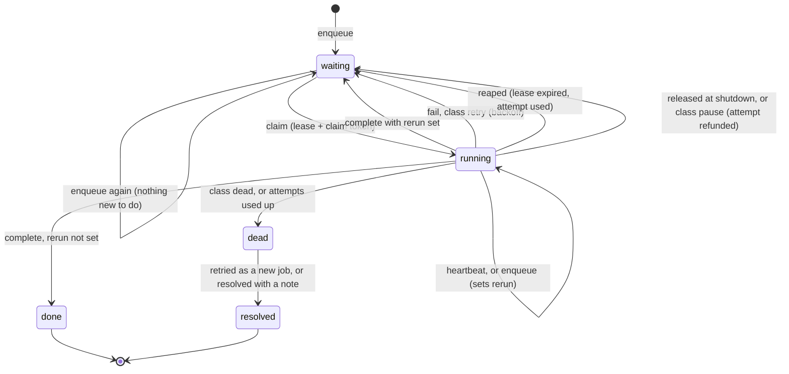
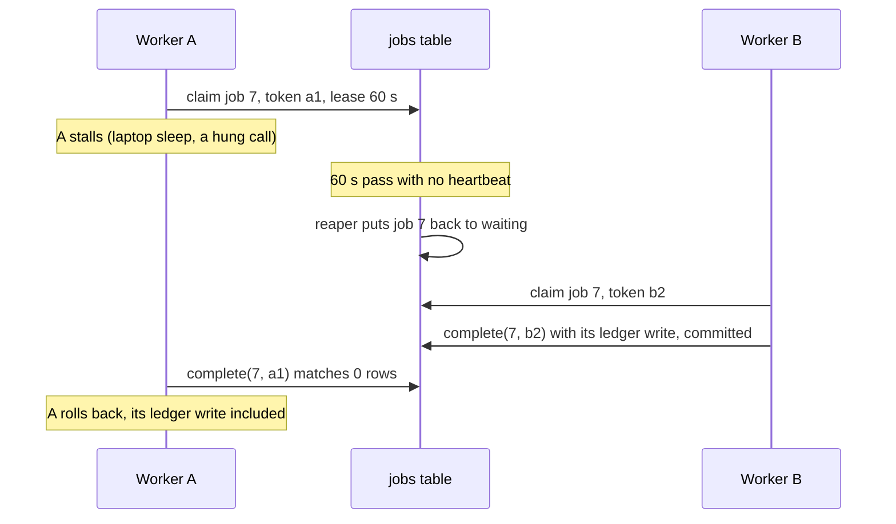
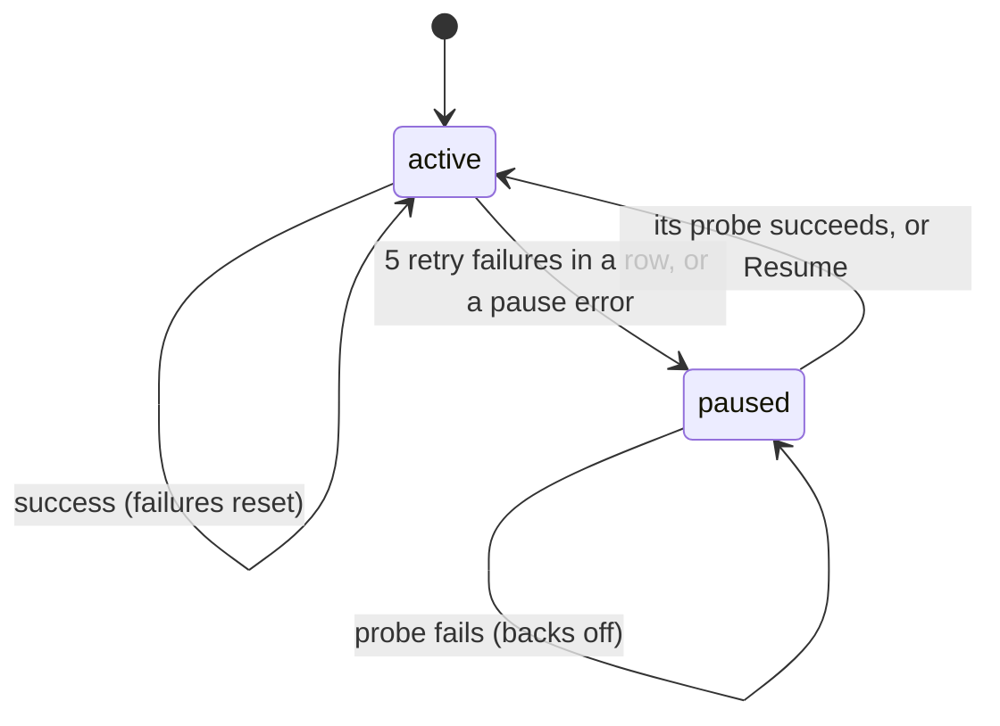

# The queue

**What this page contains.** The job state machine, the six operations and the statements behind each, the rerun flag, leases and fencing with a worked crash timeline, the three error classes, the retry schedule, pausing, and the dead-letter queue.

**How to read it.** The state machine and the crash timeline are what a newcomer needs; the SQL is reference. If you know Redis Streams, [ADR 0004](decisions/0004-queue-in-the-database-behind-an-interface.md) maps each Streams command onto an operation here.

## What the queue is

A table, `jobs` ([data-model.md](data-model.md)), and six operations on it. Nothing else writes `jobs.status`. A job is a stage, a sink, a payment and a state; the queue knows nothing about payments beyond that key.

**One live job per payment** ([Q70](grilling-log.md)). For each (stage, sink, payment) at most one job is `waiting` or `running`, enforced by a unique index. New work for a payment whose job is running doesn't create a second job: it sets that job's **rerun** flag, and when the job completes it goes straight back to waiting and runs once more. This replaced a first design that allowed a waiting job next to a running one, which the audit showed jams the queue (F01) and lets two fetches for one payment race (F04).

## A job's life



Because there is never a second live row, failing, reaping and releasing can't collide with anything.

## The six operations

**enqueue(stage, sink, key, event_id).** Runs inside the caller's transaction (the **outbox**).

```sql
INSERT INTO jobs (stage, sink, source, account, payment_key, status, rerun, attempts,
                  max_attempts, run_after, caused_by_event_id, prefetched, created_at, updated_at)
VALUES (:stage, :sink, :source, :account, :key, 'waiting', 0, 0, :max, :now, :event_id, :prefetched, :now, :now)
ON CONFLICT (stage, sink, source, account, payment_key) WHERE status IN ('waiting', 'running')
DO UPDATE SET rerun = CASE WHEN jobs.status = 'running' THEN 1 ELSE jobs.rerun END,
              prefetched = NULL,                -- a newer event beats a listed state
              caused_by_event_id = excluded.caused_by_event_id,
              updated_at = excluded.updated_at
RETURNING id;
```

`run_after` is left alone: a job in backoff stays in backoff when another event arrives, and its retry fetches the current state anyway. The returned id is written to `events.job_id`, so every folded event can find its job (F17).

**claim(stage, sink, limit).** Up to `limit` due jobs of a stage whose source or sink isn't paused: 1 for the ledger worker, up to 200 for the flusher.

```sql
UPDATE jobs SET status = 'running', claim_token = :token, claimed_by = :instance,
                lease_until = :now + 60 s, attempts = attempts + 1, updated_at = :now
WHERE id IN (SELECT id FROM jobs
             WHERE stage = :stage AND sink = :sink AND status = 'waiting' AND run_after <= :now
             ORDER BY run_after, id LIMIT :limit)
RETURNING *;
```

On SQLite this runs through the single writer. A Postgres version adds `FOR UPDATE SKIP LOCKED` inside the subquery; it lives in its own statements file and is built only when a client needs it ([Q75](grilling-log.md)).

**heartbeat(ids, token).** Every 20 s while running: extend `lease_until` where `claim_token = :token AND status = 'running'`. Fewer rows than expected means the lease was lost, and the worker stops without writing.

**complete(id, token).** In the **same transaction** as the work's own writes:

```sql
UPDATE jobs SET status = CASE WHEN rerun = 1 THEN 'waiting' ELSE 'done' END,
                attempts = CASE WHEN rerun = 1 THEN 0 ELSE attempts END,
                run_after = :now, rerun = 0, claim_token = NULL, lease_until = NULL, updated_at = :now
WHERE id = :id AND claim_token = :token AND status = 'running';
```

If it matches no row, the lease was lost: the transaction rolls back, so the stale worker's ledger write disappears with it.

**fail(id, token, error, class).** A short fenced transaction that writes an `attempts` row and moves the job by class (below). A job that goes `dead` with `rerun` set keeps its history; the new information arrives with the next event or verify's repair, as a fresh job.

**reap().** Every 30 s, **one row at a time**: each job with `status = 'running' AND lease_until < now` goes back to `waiting` with backoff and an `attempts` row marked `reaped`, or to `dead` if its attempts are used up. Reaped jobs back off like any failure; driftless re-runs them at once, which loops on a job that crashes its worker.

## Fencing, in one timeline



With one server process ([ADR 0007](decisions/0007-one-server-process-per-database.md)), a second worker is rare: a stall past the lease inside one process. Fencing still guarantees the stale result is discarded.

## The three error classes

| Class | Examples | What happens |
|---|---|---|
| `retry` | 429, 5xx, timeout, connection refused | Back to `waiting` with `run_after = now + backoff(attempts)`; `dead` once attempts are used up. Counts towards pausing. |
| `dead` | Our own bug; a mapped field missing; a Sheets 400 naming one cell value | Straight to `dead`. Retrying can't help. |
| `pause` | 401 or 403 on a main read; the spreadsheet or tab gone; the header changed; "sheet changed during write" twice | The source or sink pauses; the job goes back to `waiting` and its attempt is refunded. |

A 404 on fetch is not an error: the row is marked not found ([ledger-worker.md](ledger-worker.md)).

## Backoff

| Attempt that failed | 1 | 2 | 3 | 4 | 5 | 6 | 7 | 8 | 9 | 10 |
|---|---|---|---|---|---|---|---|---|---|---|
| Production wait | 5 s | 30 s | 2 min | 10 min | 30 min | 1 h | 2 h | 4 h | 8 h | → dead |
| Demo wait | 1 s | 2 s | 4 s | 8 s | 16 s | → dead | | | | |

About 16 hours to `dead` in production; about 31 seconds in the demo profile. Each wait is multiplied by a random factor between 0.5 and 1.5, so jobs that failed together spread out, and no wait is ever zero. A `Retry-After` from the failing service is honoured as a minimum, never clamped.

## Pausing a source or sink



While paused, nothing of that source or sink is claimed. Each pause **reason** has its own probe (F08): the header for "layout changed", the cell count for "sheet full", the Sync status owner for "another deployment writes here", a cheap read for a revoked key. "Sheet changed during write" and "rebuild incomplete" never resume by themselves; they need **Resume** or a finished rebuild. Probes run after 1, 2 and 5 minutes, then every 15, so a week-long pause costs few API reads (F18). On resume the flusher drains in its normal batches of 200.

In the pitch-ready cut, pausing is simpler: a pause-class error stops the sink and alerts, the pause is stored and survives restarts, and `wsync resume` (through the admin listener) restarts it ([Q133](grilling-log.md), [Q134](grilling-log.md)). Probes come after pitching ([build-order.md](build-order.md)).

## The dead-letter queue

| Action | What it does |
|---|---|
| Retry one | Enqueues a fresh job for the payment (attempts 0; it fetches the current state), and marks the dead one `resolved`, "retried as job N". |
| Retry all for a sink | The same for every dead job of that sink, in batches of 200, each through enqueue, so no single collision aborts the rest. |
| Resolve with a note | A person decided it doesn't matter. |

Dead jobs are never deleted, only resolved.

## Where to go next

[ledger-worker.md](ledger-worker.md): what a ledger job does once claimed.
