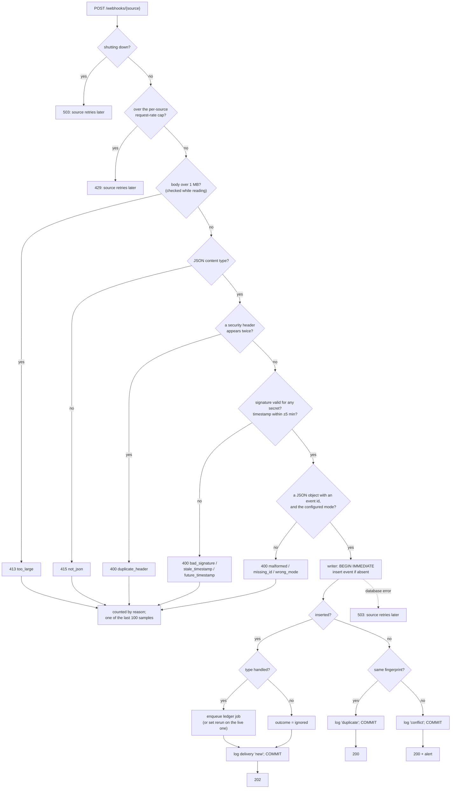

# The receiver

**What this page contains.** Everything between a source's HTTP request arriving and our answer: the checks in order, the one transaction, every status code and why, and the traps the studied repos fell into.

**How to read it.** The flowchart is the whole page in one picture; the checks table is the reference.

## The job in one sentence

Decide, fast and without calling anyone, whether a delivery is genuine; if it is, store the event exactly once together with its ledger job, and answer. Razorpay gives up after 5 seconds, so no real work happens here ([Q15](grilling-log.md)).

## From request to answer



## The checks, in order

| # | Check | Fails with | Why here |
|---|---|---|---|
| 1 | Not shutting down | 503 | A request accepted during shutdown might not commit; 503 makes the source retry ([Q37](grilling-log.md)). |
| 2 | Under the per-source request-rate cap (default 50 a second) | 429 | Stops a flood before any database work; real payment traffic is far below it (F12). |
| 3 | Body at most 1 MB, enforced while reading the stream | 413 `too_large` | Real events are a few KB. |
| 4 | `Content-Type` is `application/json` (any parameters) or any `…+json` type | 415 `not_json` | Cheap, and says clearly what went wrong. |
| 5 | No security header appears twice: `stripe-signature`, `x-razorpay-signature`, `x-razorpay-event-id`, `webhook-id`, `webhook-timestamp`, `webhook-signature` | 400 `duplicate_header` | Standard Webhooks verifies the last copy while FastAPI reads the first: a dedupe bypass (feature inventory). |
| 6 | Signature matches any of the source's secrets; Stripe's timestamp within 5 minutes **either side** of our clock | 400 `bad_signature`, `stale_timestamp`, `future_timestamp` | On the **raw bytes**, before parsing. stripe-python checks only the past, and only when given a tolerance, so both bounds are passed and checked. |
| 7 | Body is a JSON **object** with an event id where the source keeps it ([sources.md](sources.md)); the mode matches the configured mode | 400 `malformed`, `missing_id`, `wrong_mode` | The dedupe key is never empty. Test events never reach live books. Razorpay events carry no mode; its key prefix is checked at startup instead. |
| 8 | The transaction | 503 on a database error | See below. |

**Every check is wrapped.** Every studied library raises something other than "invalid signature" on some bad input (`UnicodeDecodeError`, `TypeError`, `ValueError`). Each adapter's `verify` catches everything and returns a reason, so malformed input never becomes a 500.

## The one transaction

All writes in the service go through one **writer**: a single database connection behind an async lock that issues `BEGIN IMMEDIATE` itself ([ADR 0004](decisions/0004-queue-in-the-database-behind-an-interface.md), [Q83](grilling-log.md)). Deliveries queue for it in our own code, in order, instead of fighting over SQLite's lock.

```sql
BEGIN IMMEDIATE;
INSERT INTO events (source, account, event_id, type, mode, fingerprint, body_sha256,
                    payment_key, origin, outcome, payload, source_created_at, received_at)
VALUES (...)
ON CONFLICT DO NOTHING          -- the primary key, and for Razorpay also (source, body_sha256)
RETURNING event_id;
-- inserted and handled:   enqueue the ledger job (queue.md), set events.job_id
-- inserted and unhandled: nothing more; outcome is 'ignored'
-- not inserted:           compare fingerprints → duplicate or conflict
INSERT INTO deliveries (...);
COMMIT;
```

It is all local and takes milliseconds. The event and its job commit together or not at all (the **outbox**), so a crash can't leave a stored event without work. If two deliveries of one event arrive together, the primary key lets one insert win and the other answers 200.

**Duplicates and conflicts** ([Q71](grilling-log.md)). Stripe renders one event with different bytes on different occasions (the endpoint's API version, a `pending_webhooks` count that changes), so comparing raw bytes would flag nearly every resend (F02). The comparison is on the **fingerprint**: type, object id, creation time and mode. A different fingerprint under a known id is a **conflict**: the first event is kept, the delivery is answered 200, and an alert names both.

**Razorpay replays** ([Q86](grilling-log.md)). Razorpay's event id travels in a header outside its signature, so a captured delivery could be resent under any id. The unique index on the signed body's hash makes such a replay a duplicate (F12).

## Status codes

| Code | Meaning to the source | When |
|---|---|---|
| 202 | Got it, stop | New event stored (handled or ignored) |
| 200 | Got it, stop | Duplicate, or conflict |
| 400, 413, 415 | Bad request (sources still retry) | Checks 3-7 |
| 429 | Slow down | The request-rate cap |
| 503 | Try again later | Shutting down, or the database unavailable |

A 500 is never sent on purpose; if one happens it is a bug and is logged with the request id. The one exception is the demo below.

**The demo fail-first switch** ([Q106](grilling-log.md)). `wsync serve --demo-fail-first N` stores each new event and its job exactly as above, then answers 500 to the first N attempts per event id, so Razorpay's own retries make the duplicate-storm scene: what a real "stored, but the answer was lost" looks like. Each attempt's arrival time, event id and signed-body SHA-256 are logged, which is also how the recording spike measures retries (G38, G48). Startup refuses the switch unless the source's key starts `rzp_test_` and the spreadsheet is on the demo allow-list.

## Rejections

Rejected requests are **counted** in memory by source and reason and written once a minute as one row per reason; the last 100 are kept as samples with secrets, signatures and IP addresses removed. No body is kept ([Q84](grilling-log.md)). A flood of junk therefore costs one write a minute, not one per request (F15).

## Endpoints

The public listener serves only `POST /webhooks/stripe`, `POST /webhooks/razorpay` and `GET /health`. The signature is the authentication. The admin pages and API live on a second port bound to localhost ([Q88](grilling-log.md), [operations.md](operations.md)).

## Starting up: fail closed

The service refuses to start, naming the variable, if:
- a configured source has no secret, or an empty one (hookline and razorpay-python both accept an empty secret and then accept anything);
- a source's key doesn't match its configured mode (Stripe `rk_test_`/`rk_live_`; Razorpay `rzp_test_`/`rzp_live_`), or a Stripe key isn't a restricted key ([Q85](grilling-log.md));
- another server already holds the database's lock file ([ADR 0007](decisions/0007-one-server-process-per-database.md)).

## Traps the studied repos fell into

- **Parsing before verifying.** Stripe's official sample parses first; a Pydantic body parameter in FastAPI re-reads the body and the bytes differ. The route reads `await request.body()` once.
- **Answering 500 to a bad signature.** The official sample returns an exception object, which Flask turns into a 500.
- **Printing an emoji.** The same sample's `print('💰…')` raises on a Windows console with redirected output. Logs are UTF-8 JSON.
- **Comparing signatures with `==`.** All comparison goes through the SDKs, which use `hmac.compare_digest`.

## Where to go next

[sources.md](sources.md): where each source keeps its event id and signature, and how an event names its payment.
