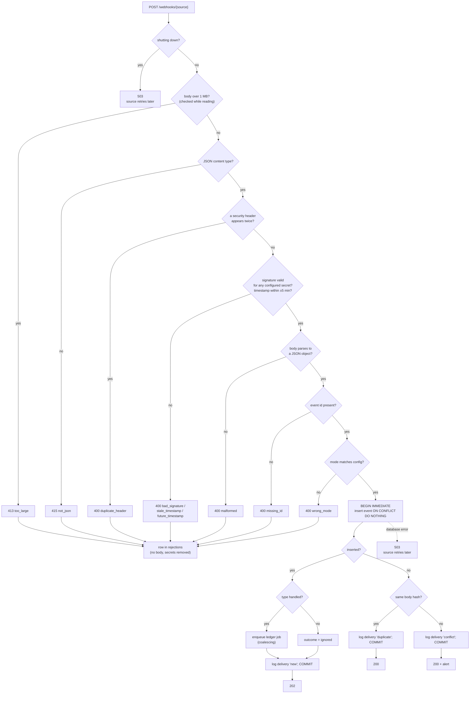

# The receiver

**What this page contains.** Everything that happens between a source's HTTP request arriving and our answer: the checks in order, the one transaction, every status code and why, and the traps the studied repos fell into.

**How to read it.** The flowchart is the whole page in one picture. The checks table is the reference. The traps section explains why the order matters.

## The job in one sentence

Decide, as fast as possible and without calling anyone, whether a delivery is genuine; if it is, store the event exactly once together with its ledger job, and answer. Stripe expects an answer quickly and Razorpay gives up after 5 seconds, so no real work happens here ([Q15](grilling-log.md)).

## From request to answer



## The checks, in order

| # | Check | Fails with | Why here |
|---|---|---|---|
| 1 | Not shutting down | 503 | A request accepted during shutdown might not be committed; 503 makes the source retry ([Q37](grilling-log.md)). |
| 2 | Body at most 1 MB, enforced while reading the stream, not only from `Content-Length` | 413 `too_large` | Stops a large or endless body before any work. Real payment events are a few KB. |
| 3 | `Content-Type` is JSON: `application/json` with any parameters (`; charset=utf-8`), or any `…/…+json` type | 415 `not_json` | Cheap, and says clearly what went wrong. |
| 4 | No security header appears twice (`stripe-signature`, `x-razorpay-signature`, `x-razorpay-event-id`, `webhook-id`, `webhook-timestamp`, `webhook-signature`) | 400 `duplicate_header` | Standard Webhooks verifies the last copy of a header while FastAPI reads the first: a captured request with a prepended id would verify under a fresh dedupe key (feature inventory). |
| 5 | Signature matches any of the source's secrets; for Stripe the timestamp is within 5 minutes **either side** of our clock | 400 `bad_signature`, `stale_timestamp`, `future_timestamp` | Done on the **raw bytes**, before parsing, so re-serialised JSON can't sneak through. Stripe's `verify_header` skips the time check unless given a tolerance and never rejects a future time, so both are passed and checked explicitly. |
| 6 | Body parses to a JSON **object** | 400 `malformed` | A list or a bare string can't be an event. |
| 7 | Event id present, from where the source keeps it ([sources.md](sources.md)) | 400 `missing_id` | The dedupe key must never be empty or `NULL`. |
| 8 | Event mode equals the configured mode | 400 `wrong_mode` | Test events never reach live books ([Q16](grilling-log.md)). Razorpay events carry no mode, so this check can't run for them: the configured mode is trusted, and `doctor` and startup check that the API key prefix (`rzp_test_` or `rzp_live_`) agrees with it. |
| 9 | The transaction | 503 on a database error | See below. |

**Every check is wrapped.** Every library we use raises something other than its "invalid signature" error on some bad input: `UnicodeDecodeError` on non-UTF-8 bodies, `TypeError` on bytes passed to razorpay-python, `ValueError` on a malformed Standard Webhooks signature list. Each adapter's `verify` catches everything and returns a rejection reason, so a malformed request can never become a 500 ([Q15](grilling-log.md)).

## The one transaction

```sql
BEGIN IMMEDIATE;                                   -- SQLite: take the write lock now, not halfway
INSERT INTO events (source, event_id, type, mode, payment_key, origin, outcome,
                    body_sha256, payload, source_created_at, received_at, secret_index)
VALUES (...)
ON CONFLICT (source, event_id) DO NOTHING
RETURNING event_id;
-- inserted and handled:   enqueue the ledger job (coalescing insert, queue.md)
-- inserted and unhandled: nothing more; outcome is already 'ignored'
-- not inserted:           compare body_sha256 with the stored one → duplicate or conflict
INSERT INTO deliveries (...);
COMMIT;
```

Everything in it is local and takes milliseconds. The ledger job and the event commit together or not at all, so a crash can't leave a stored event with no work, or work with no event (the **outbox**, [ADR 0004](decisions/0004-queue-in-the-database-behind-an-interface.md)). If two deliveries of the same event arrive at the same moment, the primary key lets exactly one insert win; the other sees "not inserted" and answers 200.

The inventory found that hookline never rolls back after a failed duplicate insert and so keeps holding SQLite's write lock. Here every path ends in `COMMIT`, and the database layer rolls back on any exception.

## Status codes

| Code | Meaning to the source | When |
|---|---|---|
| 202 | Got it, stop | New event stored (handled or ignored) |
| 200 | Got it, stop | Duplicate, or conflict (first body kept) |
| 400 | Bad request (Stripe and Razorpay still retry) | Any check 4-8 failed |
| 413, 415 | Bad request | Too large, not JSON |
| 503 | Try again later | Shutting down, or the database is unavailable or locked past `busy_timeout` |

A 500 is never sent on purpose. If one happens, it is a bug, and the error handler logs it with the request id.

## Endpoints

| Path | Source |
|---|---|
| `POST /webhooks/stripe` | Stripe |
| `POST /webhooks/razorpay` | Razorpay |
| `POST /webhooks/{name}` | A later Standard Webhooks source, one path per configured name |

A source that isn't configured answers 404 and logs nothing. The webhook paths need no admin token: the signature is the authentication ([Q22](grilling-log.md)).

## Starting up: fail closed

The service refuses to start, with a message naming the variable, if:
- a configured source has no secret, or an empty one (hookline and razorpay-python both accept an empty secret and so accept anything);
- a source's API key mode (Stripe `sk_test_` or `sk_live_`, also `rk_` restricted keys; Razorpay `rzp_test_` or `rzp_live_`) differs from its configured mode;
- it would listen on a non-local address without `ADMIN_TOKEN` ([Q22](grilling-log.md)).

## Traps the studied repos fell into

- **Parsing before verifying.** Stripe's official Flask sample parses the JSON first. Declaring a Pydantic body parameter in FastAPI has the same effect: FastAPI re-reads the body and the bytes differ. The route reads `await request.body()` once and passes those bytes on.
- **Answering 500 to a bad signature.** The official Stripe sample returns an exception object, which Flask turns into a 500. Our answer is 400.
- **Printing an emoji.** The same sample's `print('💰…')` raises `UnicodeEncodeError` on Windows when output is redirected, turning a real payment into a 500. Logging is structured JSON with UTF-8 forced ([operations.md](operations.md)).
- **Using `==` on signatures.** All comparison goes through the SDKs, which use `hmac.compare_digest`.

## Open questions

- Whether a burst of rejections from one address should be rate-limited. Written: no; they are cheap and logged. Revisit if a deployment sees abuse.

## Where to go next

[sources.md](sources.md): where each source keeps its event id and signature, and how an event names its payment.
