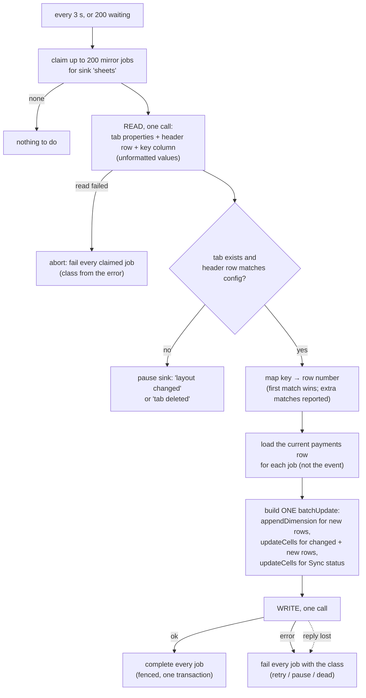
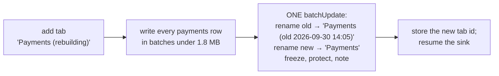

# The Sheets sink

**What this page contains.** The spreadsheet's layout, the flush step by step, how values are encoded, what happens when people edit the sheet, the rebuild, the API budget, and the failures that pause the sink.

**How to read it.** Read the layout and the flush. The tampering table is what a buyer will ask about. The algorithm is a port of sync-engine's `writer.ts` (Apache-2.0) with the fixes the feature inventory found; the ported file carries a header saying so ([ADR 0005](decisions/0005-permissive-licences-only.md)).

## What the buyer sees

Two tabs in one spreadsheet ([Q35](grilling-log.md)).

**Payments**: one row per payment, columns declared in config ([Q21](grilling-log.md)). The default:

| Payment ID | Source | Created | Status | Amount | Currency | Refunded | Dispute | Customer email | Description | Written from | Last event | Updated |
|---|---|---|---|---|---|---|---|---|---|---|---|---|
| pi_3Nx… | stripe | 2026-09-30 14:05:12 IST | succeeded | 19.99 | USD | 0.00 | | a***@gmail.com | Pro plan | fetch | evt_1Q… | 2026-09-30 14:05:15 IST |

- The key column, **Payment ID**, comes first and is frozen, with the header row. Stripe ids start `pi_` and Razorpay ids `pay_`, so one column holds both without collisions; the flusher checks the prefix matches the source.
- A note on the header cell: "Managed by webhook-sync. Add your own columns to the right."
- Our columns get a **warning-only protection**: editing one shows Sheets' "you're editing a protected range" warning, but doesn't block the buyer.

**Sync status**: last successful flush, rows written, jobs waiting, dead, whether the sink is paused and why, the last verify line. It is written in the same batch as rows, and at least every 10 minutes when idle, so a buyer who only has the sheet can see the sync is alive.

## The flush

The flusher is a singleton: one per deployment, held by a lease in `singletons` ([Q26](grilling-log.md)). It flushes every 3 s when mirror jobs are waiting, or at once when 200 are waiting ([Q32](grilling-log.md)).

1. **Claim** up to 200 waiting mirror jobs; several jobs for one payment were already coalesced into one.
2. **Read once** with `spreadsheets.get` and a field mask: the tab's id, title and grid size, the header row, and the key column as unformatted values. Unformatted matters: a formatted read would turn a long numeric-looking id into scientific notation.
3. **Any read failure aborts the flush.** sync-engine logs "proceeding without dedup" and appends every row again, and if its row-count read also fails it pastes new rows over the header. Here the jobs just fail and back off.
4. **Check the tab and the header.** The tab is found by its numeric id, so a renamed tab is followed rather than lost. A missing tab or a header that differs from the configured columns pauses the sink.
5. **Map keys to rows.** Rows whose key isn't ours (a buyer's total row, a note) are left alone. If a key appears twice, the first is updated and verify reports the rest.
6. **Load the ledger's current row** for each job. The sheet is written from `payments`, never from an event, so ordering was settled once, in the ledger, and the sheet needs no version guard ([ADR 0001](decisions/0001-database-is-the-ledger-sheet-is-a-mirror.md)).
7. **Build one `spreadsheets.batchUpdate`**: `appendDimension` for as many rows as are new, then `updateCells` for every changed and new row, then `updateCells` for Sync status. A `batchUpdate` is all or nothing, so the sheet is never half-written. If it would exceed about 1.8 MB (Google's limit is 2 MB), it is split into several, each complete in itself.
8. **Write once**, with a 30 s timeout (gspread's default is no timeout at all).
9. **Complete the jobs** in one fenced transaction.

**When the write succeeds but the reply is lost.** The jobs fail as `retry`. The next flush reads the key column again, finds the rows it wrote, and updates them in place. Because every write is an upsert by key, doing it twice changes nothing: this is what makes the flush idempotent. A new row can't be appended twice, because the second flush sees its key.

## Encoding values

| Rule | Why |
|---|---|
| Cells are written with typed `updateCells` values: text as `stringValue`, amounts as `numberValue`. Never user-entered. | A `stringValue` is stored exactly as given: `=HYPERLINK(…)` stays text, `+919876…` stays a phone number, `007` keeps its zeros. gspread's `update_cell` forces user-entered input, which does all three wrongly ([Q23](grilling-log.md)). |
| No `pasteData` or tab-separated text | sync-engine's `pasteData` turns newlines into spaces, and its handling of `=`, leading zeros and dates isn't documented. |
| Amounts: `Decimal(amount_minor) / 10^exponent`, sent as a number, with a number format set per currency exponent | 19.99 USD, 1999 JPY, 1.999 KWD ([Q19](grilling-log.md)); numbers, so the buyer can sum them |
| Times: text in the configured time zone, e.g. `2026-09-30 14:05:12 IST` | Sheets can't re-read it as a date in its own locale ([Q20](grilling-log.md)) |
| Any cell over 50,000 characters is cut, with `…[truncated]` at the end | Sheets' hard limit per cell; one oversized cell blocks sync-engine's flush for good |
| Newlines, tabs, emoji: kept | Typed values store them as they are |
| Email masked when configured: `a***@gmail.com` | [Q21](grilling-log.md) |

## When people touch the sheet

| They… | What happens ([Q33](grilling-log.md)) |
|---|---|
| sort or filter | Nothing breaks: rows are found by key, not position. |
| edit one of our cells | Sheets warns them (warning-only protection). The edit stays until that payment next changes, then it is overwritten; verify reports it before then. |
| add columns to the right of ours | Kept and never touched. |
| insert, rename, move or delete one of our columns | The header check fails and the sink pauses with "layout changed". The admin page offers **Rebuild**. |
| delete a row | It comes back when the payment next changes or on a rebuild. Verify reports it as missing from the sheet and repair enqueues a mirror job. |
| copy-paste a row, duplicating a key | The first is updated; verify reports the rest. Nothing of theirs is deleted. |
| rename the tab | Followed by its id. |
| delete the Sync status tab | Recreated on the next flush; it holds nothing of theirs. |
| delete the tab or the spreadsheet, or unshare it from the service account | The sink pauses with the reason; nothing is lost, jobs wait. |

## Rebuild

For "layout changed", or whenever a buyer says the sheet is wrong ([Q34](grilling-log.md)). Rebuild runs under the flusher's lease, so no flush runs alongside it.

The buyer never sees a half-written Payments tab, and their old tab, with any columns they added, stays until they delete it. Mirror jobs created while the rebuild runs wait, and flush right after the swap. If the rebuild fails partway, the half-written tab keeps the name "Payments (rebuilding)" and the next attempt deletes it first; the live tab is untouched.

## The API budget

Sheets allows 60 reads and 60 writes a minute per user ([Q32](grilling-log.md)). A flush costs one read and one write whatever its size, and runs at most every 3 s, so the busiest possible minute is 20 reads and 20 writes. A 200-event burst takes a handful of calls. When idle, the only calls are the 10-minute status update and, while paused, one probe a minute. Verify reads the whole tab in a few calls at night.

**Auth.** A Google service account, with the scope `https://www.googleapis.com/auth/spreadsheets` only. gspread's default scopes include full Drive access, which the service doesn't need. The buyer shares the one spreadsheet with the service account's email; `doctor` checks that it can read the header.

## Failures and their class

| Failure | Class |
|---|---|
| 429, 5xx, timeout, connection error | `retry`, honouring `Retry-After` |
| 401 or 403 (unshared, revoked key) | `pause` |
| 404: spreadsheet or tab gone | `pause` |
| Header row differs from config | `pause` ("layout changed") |
| 400 from a bad request we built | The batch is split in halves and retried until the one bad row is found; that mirror job goes `dead` (a bug, visible on the dead-letter page) and the rest are written |
| Spreadsheet near Sheets' 10-million-cell limit (counting every tab, including old rebuild tabs) | Cell use shown on Sync status and in `doctor`; alert at 80 %; a rebuild that would cross the limit is refused; at the limit, `pause` with "sheet full" and a message to start a new spreadsheet |
| Another deployment writes to the same spreadsheet | Each flush writes this deployment's id to Sync status. If a different id wrote there in the last 10 minutes, `pause` with "another deployment writes here" |

## Open questions

- **A buyer sorts the sheet during a flush** ([edge-cases.md](edge-cases.md) OQ11, needs Lalit's OK). Between the read and the write, a sort would send updates to the wrong rows. Proposed: after each write, re-read the keys of the rows just written; if any moved, pause with "sheet changed during write" and offer Rebuild. That adds one read per flush (at most 40 a minute, still under quota).

- A buyer who downloads the sheet as CSV and opens it in Excel could still trigger a formula stored as text. Written: out of scope for the sheet; the README warns about it. Revisit if a buyer exports regularly.
- Whether the config should allow renaming our column headers per buyer. Written: yes, labels are configurable, and the header check compares against the configured labels.

## Where to go next

[sweeper.md](sweeper.md): how events we never received get into the ledger at all.
