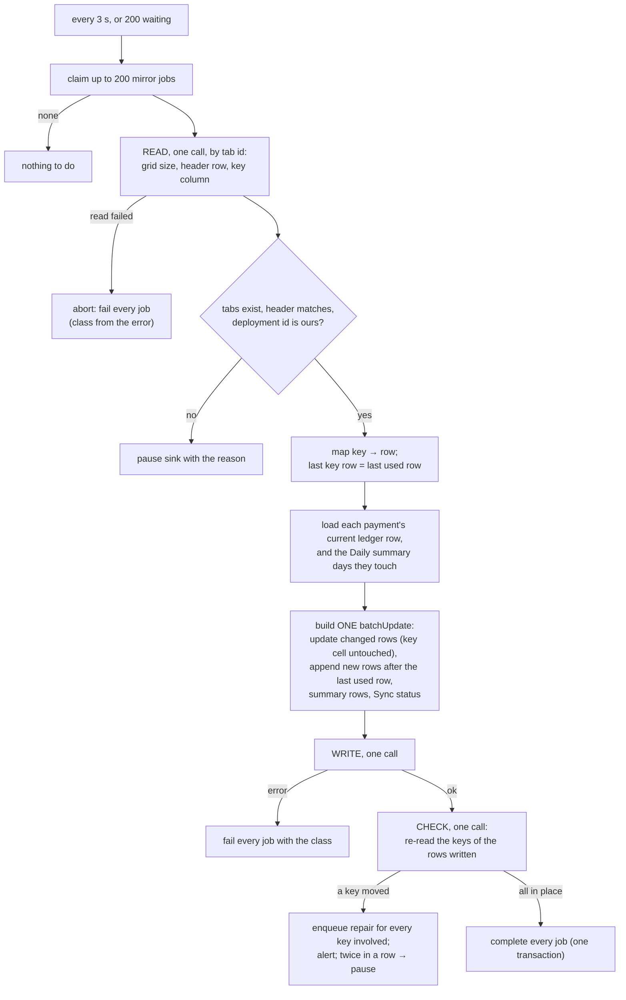
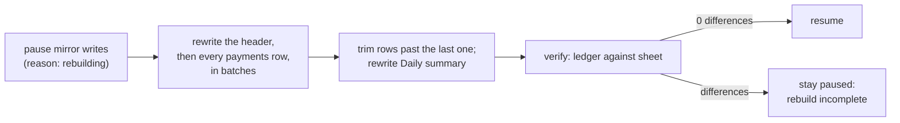

# The Sheets sink

**What this page contains.** The spreadsheet's tabs and columns, the flush step by step, how values are encoded, what happens when people touch the sheet, rebuild, the API budget, and the failures that pause the sink.

**How to read it.** Read the tabs and the flush. The algorithm is a port of sync-engine's `writer.ts` (Apache-2.0) with the fixes the feature inventory and the audit found; the ported file carries a header saying so ([ADR 0005](decisions/0005-permissive-licences-only.md)).

## What the buyer sees

Three **machine-owned** tabs: the service writes every cell, and buyers read, sort and filter them through **filter views** (Data › Create filter view), which change only their own view. Their own work goes in their own tabs, looking rows up by payment id ([ADR 0006](decisions/0006-machine-owned-tabs.md)).

**Payments**: one row per payment. Default columns, declared in config ([Q69](grilling-log.md)):

| Payment ID | Source | Created (IST) | Status | Amount | Currency | Refunded | Settled | Fee | Net | Settled in | Method | Dispute | Customer email | Description | order_id | Via | Note | Updated (IST) |
|---|---|---|---|---|---|---|---|---|---|---|---|---|---|---|---|---|---|---|
| pi_3Nx… | stripe | 2026-09-30 14:05:12 | succeeded | 19.99 | USD | 0.00 | 1,672.04 | 72.60 | 1,599.44 | INR | card visa | | a***@gmail.com | Pro plan | A-1042 | delivery | | 2026-09-30 14:05:15 |

- **Amount** and **Refunded** are in the currency the customer paid in. **Settled**, **Fee** and **Net** are in the currency the buyer is paid out in (**Settled in**), which is where fees are charged; for a buyer paid in the same currency the two match. They show `pending` until Stripe's balance transaction arrives, usually within an hour ([Q97](grilling-log.md)).
- **Payment ID** is first and frozen, with the header row. Stripe ids start `pi_` and Razorpay ids `pay_`, so one column holds both.
- `order_id` stands for the configured metadata keys: one column each.
- **Via** (`delivery` or `sweep`) is optional, on for the demo's outage scene. **Note** says "not found at source" or names unknown columns.
- The header note: "Managed by webhook-sync. Sort and filter with Data › Create filter view; put your own work in another tab."

**Daily summary**: one row per day, per currency paid in, per currency paid out, from payments that succeeded (fully or partly refunded included): count, gross and refunds in the currency paid in; settled, fees and net (before refunds) in the currency paid out. Days are the buyer's local days by payment date, and refunds count on the day of the payment they belong to; the tab header says both. A payment whose fee is still pending counts in count, gross and refunds, but not yet in settled, fees and net; Sync status shows how many are pending ([Q97](grilling-log.md)). Buyers get correct totals without summing raw rows that include failed attempts (F10). Refund-date accounting, and net after refunds, come with a refunds tab later.

**Sync status**: last successful flush, rows written, jobs waiting and dead, whether the sink is paused and why, the last verify line, this deployment's id.

## The flush

One flusher per deployment (one server process, [ADR 0007](decisions/0007-one-server-process-per-database.md)). It runs every 3 s when mirror jobs are waiting, or at once when 200 are waiting.

1. **Claim** up to 200 waiting mirror jobs.
2. **Read** with `spreadsheets.getByDataFilter`, addressing the tabs by their numeric **sheet id** and asking only for grid size, the header row and the key column (unformatted). Reading by id means a renamed tab is followed; plain A1 ranges would name the tab by title and fail after a rename (F08).
3. **Any read failure aborts the flush.** sync-engine carries on "without dedup" and appends every row again, or pastes over the header. Here the jobs fail and back off.
4. **Check** the tabs, the header against the configured columns, and that the deployment id on Sync status is ours. Any failure pauses the sink with that reason.
5. **Map keys to rows.** On a machine-owned tab the last key row is the last used row, so new rows go straight after it; the grid is extended with `appendDimension` only when too small (F07). If a key appears twice, the first is updated and verify reports the rest.
6. **Load the ledger's current row** for each job, never the event, so ordering was settled once, in the ledger ([ADR 0001](decisions/0001-database-is-the-ledger-sheet-is-a-mirror.md)). Load the Daily summary rows for every day those payments touch.
7. **Build one `spreadsheets.batchUpdate`**: `updateCells` for changed rows **without the key cell**, `updateCells` for appended rows **with** it, then the summary rows and Sync status. All requests in one call are applied atomically. Google recommends keeping a request under 2 MB and allows 180 s of processing, so a larger batch is split into several, each complete in itself (F20).
8. **Write once**, with a 30 s timeout.
9. **Check the write landed** ([Q63](grilling-log.md)): re-read the key cells of every row just written. Because updates never write the key cell, a row a person moved between our read and our write shows a different key than we expected (F05). Then every key involved gets a mirror job, the next flush re-maps and rewrites them, and an alert says what happened. If it happens on two flushes in a row, the sink pauses with "sheet changed during write" until Resume.
10. **Complete** the jobs in one transaction.

**When the write succeeds but the reply is lost.** The jobs fail as `retry`. The next flush reads the keys, finds the rows it wrote, and updates them in place. Every write is by key, so doing it twice changes nothing: the flush is idempotent.

## Encoding values

| Rule | Why |
|---|---|
| Typed `updateCells` values: text as `stringValue`, amounts and dates as `numberValue`; never user-entered | A `stringValue` is stored as given: `=HYPERLINK(…)` stays text, `+919876…` stays a phone number, `007` keeps its zeros ([Q23](grilling-log.md)) |
| Dates are date serials in the buyer's time zone with a `yyyy-mm-dd hh:mm:ss` format; the zone is in the header: its abbreviation where it has no daylight saving ("Created (IST)"), its name where it does ("Created (Europe/Berlin)"), accepting one ambiguous hour a year in the sheet while the ledger keeps UTC ([Q95](grilling-log.md)) | Date filters, pivots and monthly totals work; typed numbers aren't re-parsed by locale ([Q87](grilling-log.md)) |
| Amounts: `Decimal(minor) / 10^exponent`, with a number format per exponent. The exponent comes from ISO 4217 plus a per-source override table; codes upper-cased | 19.99 USD, 1999 JPY ([Q19](grilling-log.md)) |
| An unknown currency code holds back that sheet row: its mirror job goes `dead` with an alert. The table is built from Stripe's zero-decimal and special-case lists; BHD, JOD, KWD, OMR, TND, UGX and ISK count as unknown until the spike records a real charge in each ([Q100](grilling-log.md), G15) | No amount 100 times off reaches the sheet ([Q62](grilling-log.md)) |
| Amounts past 15 significant digits are written as text | A Sheets number can't hold them exactly |
| Cells over 50,000 characters are cut, ending `…[truncated]` | Sheets' hard limit per cell |
| Email masked when configured: `a***@gmail.com` | [Q21](grilling-log.md) |

## When people touch the sheet

| They… | What happens |
|---|---|
| sort or filter through a filter view | Nothing changes for anyone else. |
| sort the Payments tab itself | Works, more slowly: a move during a flush is caught by the check and repaired. |
| edit one of our cells | Overwritten when that payment next changes; verify reports it first. |
| add a column to the right of ours | Left alone: the header check compares only our configured columns. Sync status and `doctor` warn that a rebuild rewrites rows in ledger order, so the column won't stay next to its rows ([Q94](grilling-log.md)). |
| insert, rename, move or delete one of our columns | The header check fails; the sink pauses with "layout changed" and offers **Rebuild**. |
| delete a row | It comes back when the payment next changes or on a rebuild; verify reports it. |
| rename a tab | Followed by its id. |
| delete the Sync status tab | Recreated on the next flush. |
| delete the Payments tab or the spreadsheet, or unshare it | The sink pauses with the reason; jobs wait; nothing is lost. |

## Rebuild, in place

For "layout changed", or whenever a buyer says the sheet is wrong ([Q92](grilling-log.md)).

A crash at any point leaves the sink paused with "rebuild incomplete" until the rebuild is run again. Nothing of the buyer's is on these tabs, so nothing of theirs is at risk. The first version swapped in a new tab, which detached buyer columns and, after a crash, left the flusher writing to the old tab while verify agreed with it (F06).

## The API budget

Sheets allows 60 reads and 60 writes a minute per user. A flush costs **two reads and one write** whatever its size, and runs at most every 3 s: at worst 40 reads and 20 writes a minute. Calls grow with how long work keeps arriving, not with the number of events. 200 payments arriving over 30 seconds take about ten flushes, so around 30 calls; 200 events never cost 200 calls (F19). The README prints the number measured in rehearsal. Google says over-quota calls may be billed later in 2026, so a 429 always backs off.

**Auth** ([Q90](grilling-log.md)). A Google service account with the `spreadsheets` scope only; the buyer shares the one spreadsheet with its address. Sharing with the service account works unless the buyer's Workspace admin has turned off sharing outside the domain; the admin's allowlist takes only Workspace domains, so it can't admit a service account. For that buyer, or one whose Google organisation blocks service-account keys (the default for organisations created since May 2024), the fallback is an **Internal** OAuth app created in the buyer's own Workspace, with a dedicated user's refresh token: an Internal app needs no Google review, and its tokens don't expire after 7 days as a "Testing" app's do ([Q101](grilling-log.md), G3). `doctor` says which is in use and explains the sharing-blocked and key-blocked errors in plain words.

## Failures and their class

| Failure | Class |
|---|---|
| 429, 5xx, timeout, connection error | `retry`, honouring `Retry-After` |
| 401 or 403 (unshared, revoked) | `pause` |
| 404, or a 400 naming a sheet id, grid or range (tab deleted between read and write) | `pause`, "tab missing" (F08) |
| Header differs from config | `pause`, "layout changed" |
| A 400 naming one request's cell value | Split the batch in halves until the row is found; that job goes `dead`, the rest are written |
| Spreadsheet past 80 % of the configured cell limit (default 20 million, Google's limit since September 2026), or the API's own cell-limit error | Alert at 80 %; at the limit or on that error, `pause`, "sheet full" (G22) |
| Another deployment's id on Sync status within 10 minutes | `pause`, "another deployment writes here" |

## Where to go next

[sweeper.md](sweeper.md): how events we never received get into the ledger at all.
