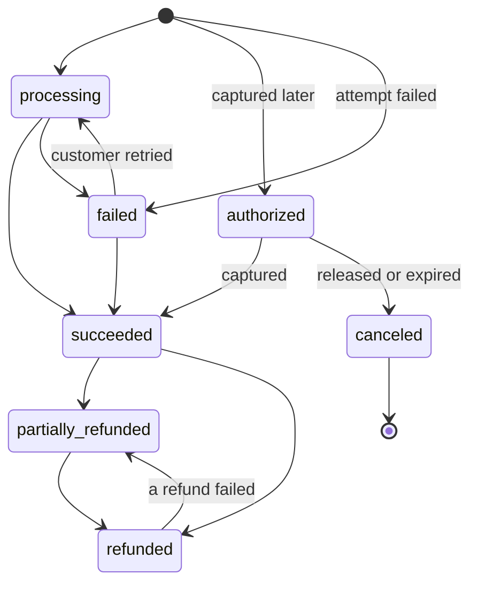

# Source adapters

**What this page contains.** The interface every source adapter implements, then Stripe and Razorpay in detail: signatures and event ids, which events are handled, how an event names its payment, what a fetch reads, how statuses and columns map, what the sweeper lists, and the API reads each costs.

**How to read it.** Read the interface and the status section, then Stripe. Razorpay is written as its differences from Stripe. **Razorpay is the first source built; Stripe is parked** until a buyer gives access, and its sections stay as the design of a second adapter ([Q103](grilling-log.md)).

## The interface

A **source adapter** is one module. The core calls only these functions and never imports a source's SDK itself.

| Function | Returns | Used by |
|---|---|---|
| `verify(raw_body, headers)` | event id, mode, which secret matched; or a rejection reason. Never raises. | receiver |
| `describe(event)` | type, account, **payment key**, creation time, **fingerprint**, handled or ignored with a reason | receiver, sweeper |
| `fetch(payment_key)` | the payment's current state as a business row, plus the columns an optional read couldn't fill; or an error with its class (`retry`, `dead`, `pause`, `not_found`) | ledger worker |
| `sweep(slice_start, slice_end)` | every event (or, for Razorpay, payment) in that window of source time | sweeper |
| `list_payments(created_from, created_to)` | every payment in a window with its current state, ready to write | verify, backfill |
| `check_setup()` | the permission, webhook-endpoint and mode checks `doctor` runs | `doctor` |

Every outbound call goes through the source's token-bucket rate limiter (10 a second by default). A 429 is class `retry` and honours `Retry-After`.

## Our status vocabulary

A row is created only once a payment reaches `processing`, `authorized`, `failed` or `succeeded`. Abandoned checkouts and payments canceled before any charge make no row, so the sheet isn't full of amounts nobody paid (F10). Only `canceled` is **terminal**. The fetched state is always written as it is: the source is the truth, and fetching already removes the ordering problem ([ADR 0002](decisions/0002-fetch-current-state-not-event-payload.md)).

**Disputes** are a separate column with seven values: `inquiry` (Stripe's `warning_needs_response` and `warning_under_review`), `needs_response`, `under_review`, `won`, `lost`, `prevented`, `closed` (Stripe's `warning_closed`). The source's own word stays in `source_status`.

## Stripe

| Thing | Where it is |
|---|---|
| Signature | `stripe-signature`: `t=<unix time>,v1=<hmac>[,v1=…]`, HMAC-SHA256 over `<t>.<raw body>`. Checked with `stripe.Webhook.construct_event(payload, header, secret, tolerance=300)`, plus our own check that `t` isn't more than 300 s in the future. During a secret roll Stripe sends one `v1` per secret; each configured secret is tried. |
| Event id, mode, account | `body.id` (`evt_…`); `body.livemode`; the configured account (an event carrying an `account` field is Stripe Connect and is ignored with reason `connect_account`, [ADR 0003](decisions/0003-one-buyer-per-deployment.md)) |
| Payment key | From `body.data.object`: a `payment_intent`'s own `id`, or the `payment_intent` field of a `charge`, `refund` or `dispute`. If that is empty (a legacy charge), the event is ignored with reason `no_payment_intent`, and verify reports the count (F38). |
| Fingerprint | `type`, `data.object.id`, `created`, `livemode` |

**Handled event types** ([Q12](grilling-log.md), refined by the audit, F10, F35): `payment_intent.processing`, `.succeeded`, `.payment_failed`, `.canceled`, `.amount_capturable_updated`; `charge.refunded`; `charge.updated` (the fee arrives on it, [Q97](grilling-log.md)); `refund.created`, `refund.updated`, `refund.failed`; `charge.dispute.created`, `.updated`, `.closed`, `.funds_withdrawn`, `.funds_reinstated`. `payment_intent.created` and `.requires_action` are stored and ignored. Everything else is ignored with reason `unhandled_type`.

**Fetch.** One call: `GET /v1/payment_intents/{id}?expand[]=latest_charge.balance_transaction`. If `latest_charge.disputed` is true, a second: `GET /v1/disputes?payment_intent={id}`. The adapter pins the Stripe API version in code, so a new version can't change the shapes we read.

| Column | From |
|---|---|
| status | `canceled` → canceled; `requires_capture` → authorized; `processing` → processing; `requires_payment_method` with `last_payment_error` → failed; `succeeded` with `latest_charge.amount_refunded` 0, between, or equal to `amount_received` → succeeded, partially_refunded, refunded |
| amount, authorized | `amount_received`; `amount` when it differs (a partial capture) |
| refunded | `latest_charge.amount_refunded` |
| fee, net, settlement | the balance transaction's `fee`, `net`, `amount` and `currency` (the settlement currency, e.g. INR for a USD sale). Card fees settle asynchronously: the balance transaction is often still empty at `payment_intent.succeeded` and arrives with `charge.updated`, which Stripe promises within an hour. Until then the three columns are **pending**, not unknown ([Q97](grilling-log.md), G2) |
| method | `latest_charge.payment_method_details.type`, plus `card.brand` |
| metadata | the configured keys of the PaymentIntent's `metadata` |
| customer, description | `receipt_email` or `latest_charge.billing_details.email`; `billing_details.name`; `description` |

**Fetch errors.** 404 → `not_found` (the row keeps its last values and is flagged); 401 → `pause` the source; 403 on the main read → `pause`; **403 on an optional read** (disputes, the balance transaction) → the row is written with those columns marked unknown, and an alert names the missing permission ([Q85](grilling-log.md)); 429, 5xx, timeout, connection error → `retry`; any other 4xx → `dead`.

**The key.** A **restricted** key with read access to PaymentIntents, Charges, Refunds, Disputes, Events, Balance transactions and Webhook endpoints, in test and live mode. `check_setup` makes one cheap read per resource and names any missing permission; it also finds the webhook endpoint whose URL matches, fails if any handled type isn't subscribed, and warns if the endpoint's API version differs from the pinned one (F29).

**Sweep.** `GET /v1/events?types[]=…&created[gte]=<slice start − 10 min>&created[lt]=<slice end>`, all pages. Stripe returns newest first; order doesn't matter, because the slice is committed only after all of it is stored (F03, [sweeper.md](sweeper.md)). Events are listed for 30 days only.

**Listing for verify and backfill.** `GET /v1/payment_intents?created[gte]=…&created[lt]=…&expand[]=data.latest_charge.balance_transaction`, 100 a page. The listed state is complete, so backfill and repair write it without fetching each payment again (F18).

## Razorpay: the differences

| Thing | Where it is |
|---|---|
| Signature | `x-razorpay-signature`: HMAC-SHA256 over the raw body, **no timestamp**. `razorpay.Utility.verify_webhook_signature` wants a `str`, so the adapter decodes UTF-8 itself; a decoding failure is `malformed`. |
| Event id | The `x-razorpay-event-id` header. It isn't covered by the signature, so the receiver also dedupes on the signed body's hash ([Q86](grilling-log.md)). |
| Mode | Not in the event, a header or an API response (G55). The config names the mode, and startup refuses to run unless the key prefix (`rzp_test_` or `rzp_live_`) matches it ([Q111](grilling-log.md)). A payment from the other mode can't be fetched (400 "The id provided does not exist"); its job ends dead as `not_found`, naming a possible mode mix-up. |
| Payment key | `payload.payment.entity.id`; `payload.refund.entity.payment_id`; `payload.dispute.entity.payment_id` (disputes are stored, not handled, in version 1) |
| Fingerprint | `event`, the entity id, `created_at` |

**Handled event types** ([Q109](grilling-log.md)): `payment.authorized`, `payment.captured`, `payment.failed`; `refund.created`, `refund.processed`, `refund.failed`, `refund.speed_changed`. **Stored and ignored with a reason:** `order.paid`, `payment_link.*`, and in version 1 `payment.dispute.created`, `.won`, `.lost`, `.closed`, `.under_review`, `.action_required` (handled once disputes are built; Razorpay test mode can't produce one, G52).

**Fetch.** `GET /v1/payments/{id}`. Status: `authorized` → authorized; `captured` with `refund_status` null, `partial` or `full` → succeeded, partially_refunded, refunded; `refunded` → refunded; `failed` → failed. Fee and fee tax (GST) from `fee` and `tax`, **only from the fetch**, never from an event's body. Both are null until capture, and a captured payment can still show null: null is **pending**, as for Stripe ([Q97](grilling-log.md), [Q110](grilling-log.md)). The fee already includes the tax, so net is `amount − fee`. A payment still `created` makes no row (G41); method from `method`; metadata from `notes`. A throttled call is recognised by HTTP **429**: its body's code says `BAD_REQUEST_ERROR` (G54). Once disputes are built, a payment fetch **never clears** the dispute column: dispute state comes only from dispute events and the disputes poll, so coalescing a dispute event with a later refund event can't lose it (F10).

**Sweep and polling** ([Q86](grilling-log.md), [Q107](grilling-log.md), [Q108](grilling-log.md), F13). Razorpay has no events list and no list by update time; its lists filter by **creation** time, newest first, with both bounds inclusive (G50, G53). So:
1. **Each sweep** lists `GET /v1/payments` and `GET /v1/refunds` created in the slice, storing each item's state as a synthetic event (`origin = 'sweep'`, id `sweep:<entity id>:<state hash>`) with a ledger job. Details in [sweeper.md](sweeper.md).
2. **Hourly, a re-list**: payments created in the last 7 days and refunds created in the last 21 days, all pages. An item whose state hash differs from the last one stored becomes a synthetic event and a ledger job. Seven days covers a late authorisation (`failed` → `authorized` up to 3 days after creation), the 3-day capture timeout and its auto-refund, and a fee set at capture; 21 days covers a normal refund's 7-10 working days.
3. **Once disputes are built**, hourly, a poll of `GET /v1/disputes` (an empty list comes back without `items` or `count`, G56).

The **state hash** is canonical JSON of: for a payment, `status`, `captured`, `amount`, `amount_refunded`, `refund_status`, `fee`, `tax`, `error_code`, `error_reason` (and `notes` when the sheet shows metadata); for a refund, `status`, `amount`, `speed_processed`. Never `acquirer_data`: a bank reference filled in after `processed` changes nothing in the row.

Synthetic event types, needed by the silent-webhook check: payment `authorized` → `payment.authorized`, `captured` or `refunded` → `payment.captured`, `failed` → `payment.failed`, `created` → none (not stored); refund `pending` → `refund.created`, `processed` → `refund.processed`, `failed` → `refund.failed`.

The adapter checks `from ≤ to` and that both are Unix seconds within Razorpay's range before calling: `from > to` returns an empty list, and `/v1/refunds` silently accepts milliseconds and unknown parameters (G56). A connection reset is transient. Changes to payments older than the re-list windows reach the ledger through nightly verify (30 days). The README states the gap.

**Keys.** Razorpay keys can't be restricted to reading. The handover note says so: they live only in the server's environment and are rolled at handover with Razorpay's 24-hour overlap, because the buyer's checkout uses the same key set and must be updated inside that window ([Q85](grilling-log.md), [Q102](grilling-log.md)).

## API reads per month

Stripe allows an average of about 500 reads per payment, with at least 10,000 a month per account (F18, [Q89](grilling-log.md)).

| What | Reads a month for a buyer with 100 payments |
|---|---|
| Sweeps (every 10 min, usually one page) | about 4,400 |
| Ledger fetches (about 2 per payment, plus disputes) | about 250 |
| Nightly verify (30 days of PaymentIntents, 100 a page) | about 30-60 |
| Probes while paused (1, 2, 5, then every 15 min) | about 100 a day paused |
| **Total** | about 5,000, half the minimum allowance |

**Razorpay** publishes no rate limit, so 429 backoff is the only guard (G54). For the same buyer: sweeps of two lists every 10 minutes, about 8,800 a month (most return an empty page); the hourly re-list, about 1,500; ledger fetches, about 250; nightly verify, about 30. About 10,500 in all.

## Where to go next

[queue.md](queue.md): what happens to the ledger job the receiver created.
