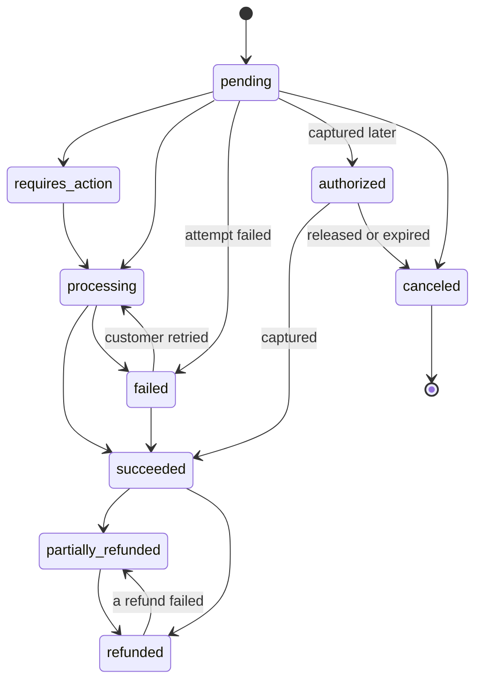

# Source adapters

**What this page contains.** The interface every source adapter implements, then Stripe and Razorpay in detail: where the signature and event id live, which events are handled, how an event names its payment, how a payment is fetched, how statuses map onto ours, and how the sweeper lists what we missed. It ends with the generic Standard Webhooks source that is designed for but not built.

**How to read it.** Read the interface and the status section. Then read the Stripe section; Razorpay is written as its differences from Stripe.

## The interface

A **source adapter** is one module. The core calls only these six functions and never imports a source's SDK itself.

| Function | Returns | Used by |
|---|---|---|
| `verify(raw_body, headers)` | the event id, the mode and which secret matched; or a rejection reason. Never raises. | receiver |
| `describe(event)` | the event type, the **payment key** it is about, its creation time, and handled or ignored (with a reason) | receiver, sweeper |
| `fetch(payment_key)` | the payment's current state as a business row; or an error with its class (`retry`, `dead`, `pause`, `not_found`) | ledger worker |
| `from_payload(event)` | the business row the event itself implies, for the payload fallback | ledger worker |
| `sweep(since)` | pages of missing-event candidates plus the checkpoint after each page | sweeper |
| `list_payments(created_from, created_to)` | every payment at the source in a window, current state | verify |

Every outbound call goes through the source's **rate limiter**: a token bucket, 10 requests a second by default ([Q36](grilling-log.md)). A 429 from the source is class `retry` and honours `Retry-After`.

## Our status vocabulary

Every source's statuses map onto one list, so the sheet reads the same whichever source a payment came from.

Only `canceled` is **terminal**. `failed` is not: the same Stripe PaymentIntent can fail and then succeed when the customer tries another card. `refunded` is not either: when a refund fails after being created (a closed card), the source reduces the refunded amount again. **Disputes** are a separate column (`open`, `won`, `lost`), so a dispute on a refunded payment is still visible.

**How stickiness works, refined while writing this page.** In fetch mode the source's current state is written as it is: it is the truth, and fetching already removes the ordering problem. Stickiness applies to **payload mode only**: a payload is never allowed to move a row out of `canceled`, or backwards along the order above, unless its `(created, event_id)` is newer than the row's `payload_version`. [Q13](grilling-log.md) said "terminal states are sticky" before refund failures were considered; this is the corrected rule.

## Stripe

| Thing | Where it is |
|---|---|
| Signature | `stripe-signature` header: `t=<unix time>,v1=<hmac>[,v1=<hmac>…]`, HMAC-SHA256 over `<t>.<raw body>`. Checked with `stripe.Webhook.construct_event(payload, sig_header, secret, tolerance=300)`, plus our own check that `t` is not more than 300 s in the future. During a secret roll Stripe sends two `v1` values; each configured secret is tried. |
| Event id | `body.id` (`evt_…`) |
| Mode | `body.livemode` |
| Payment key | From `body.data.object`: a `payment_intent` is its own `id`; a `charge`, `refund` or `dispute` names it in its `payment_intent` field. If that field is empty (a legacy charge with no PaymentIntent), the event is **ignored** with reason `no_payment_intent`. An event carrying an `account` field (Stripe Connect) is ignored with reason `connect_account` ([ADR 0003](decisions/0003-one-buyer-per-deployment.md)). |
| Created | `body.created` (Unix seconds) |

**Handled event types** ([Q12](grilling-log.md)): `payment_intent.created`, `.processing`, `.requires_action`, `.amount_capturable_updated`, `.succeeded`, `.payment_failed`, `.canceled`; `charge.refunded`; `refund.created`, `refund.updated`, `refund.failed`; `charge.dispute.created`, `.updated`, `.closed`, `.funds_withdrawn`, `.funds_reinstated`. Everything else is stored and ignored with reason `unhandled_type`.

**Fetch.** `GET /v1/payment_intents/{id}?expand[]=latest_charge`: one call. If `latest_charge.disputed` is true, a second call, `GET /v1/disputes?payment_intent={id}`, gets the dispute status. The client pins its API version in code, so a new Stripe version can't change the shapes we read. Because only ids are read from the event payload, the webhook endpoint's own API version doesn't matter.

| PaymentIntent state | Our status |
|---|---|
| `requires_payment_method` or `requires_confirmation`, no `last_payment_error` | `pending` |
| `requires_payment_method` with `last_payment_error` | `failed` |
| `requires_action` | `requires_action` |
| `processing` | `processing` |
| `requires_capture` | `authorized` |
| `canceled` | `canceled` |
| `succeeded`, and `latest_charge.amount_refunded` is 0 / between / equal to `amount_received` | `succeeded` / `partially_refunded` / `refunded` |

Other columns: `amount_minor` = `amount`; `refunded_minor` = `latest_charge.amount_refunded`; `customer_email` = `receipt_email`, else `latest_charge.billing_details.email`; `customer_name` = `latest_charge.billing_details.name`; `description` = `description`.

**Fetch errors.** 404 → `not_found` (the payload fallback, [ledger-worker.md](ledger-worker.md)); 401 or 403 → `pause` (the key was revoked or lacks permission); 429, 5xx, timeout, connection error → `retry`; anything else 4xx → `dead`.

**Sweep.** `GET /v1/events?types[]=…&created[gte]=<checkpoint − 60 s>`, auto-paginated oldest first, 100 a page ([sweeper.md](sweeper.md)). Only the 30 most recent days are listed.

**Verify listing.** `GET /v1/payment_intents?created[gte]=…&created[lt]=…&expand[]=data.latest_charge`, 100 a page.

## Razorpay: the differences

| Thing | Where it is |
|---|---|
| Signature | `x-razorpay-signature`: HMAC-SHA256 over the raw body, **no timestamp**. `razorpay.Utility.verify_webhook_signature` wants the body as a decoded `str` (raw bytes raise `TypeError`), so the adapter decodes UTF-8 itself and treats a decoding failure as `malformed`. |
| Replay protection | None in the signature. The dedupe key is the only defence against a captured request being replayed, which is why the event id must be present and unique. |
| Event id | The `x-razorpay-event-id` **header**. The body has no top-level `id`; hookline reads `body["id"]` and so rejects every Razorpay event. |
| Mode | Not in the event. The configured mode is trusted; startup and `doctor` check the key prefix `rzp_test_` or `rzp_live_`. |
| Payment key | `payload.payment.entity.id`; for refunds `payload.refund.entity.payment_id`; for disputes `payload.dispute.entity.payment_id`. |
| Created | `created_at` (Unix seconds) |

**Handled event types:** `payment.authorized`, `payment.captured`, `payment.failed`; `refund.created`, `refund.processed`, `refund.failed`; `payment.dispute.created`, `.won`, `.lost`, `.closed`, `.under_review`, `.action_required`.

**Fetch.** `GET /v1/payments/{id}`. Dispute status comes from `GET /v1/disputes/{dispute_id}` when the event names a dispute.

| Razorpay payment state | Our status |
|---|---|
| `created` | `pending` |
| `authorized` | `authorized` (Razorpay refunds uncaptured payments automatically after a few days; the next fetch sees it) |
| `captured`, and `refund_status` null / `partial` / `full` | `succeeded` / `partially_refunded` / `refunded` |
| `refunded` | `refunded` |
| `failed` | `failed` |

**Sweep.** No events list exists, so the sweeper polls `GET /v1/payments?from=&to=&count=100&skip=` and `GET /v1/refunds?from=&to=` from the checkpoint minus 10 minutes. Each payment found is stored as a **synthetic event** with `origin = 'sweep'`, event id `sweep:<payment id>:<updated state hash>`, and a ledger job. Polling sees current states, not every step between them, so the event trail has gaps for anything learned this way; the README says so ([Q39](grilling-log.md)).

**Retries on their side.** Razorpay retries for 24 hours and then **disables the webhook**. [sweeper.md](sweeper.md) detects that.

## Later: a generic Standard Webhooks source

Designed for, not built in version 1 ([Q2](grilling-log.md)). Signature: the `standardwebhooks` library (MIT) over `webhook-id.webhook-timestamp.body`, ±5 minutes. Event id: the `webhook-id` header. There is no API to fetch from, so it runs in payload mode only, with the payment key, status and amount read from configured JSON paths (Convoy's per-source key-location idea, reimplemented). There is no sweep; a missed event is recovered only by the sender's retries.

## Open questions

- Whether Razorpay offers a way to list disputes per payment. Written: dispute status comes only from dispute events and fetching the named dispute. Check during the Razorpay slice.
- Whether `payment_intent.created` should produce a sheet row for payments that never go further. Written: yes, as `pending`; a column filter hides them. Revisit if buyers find it noisy.

## Where to go next

[queue.md](queue.md): what happens to the ledger job the receiver created.
