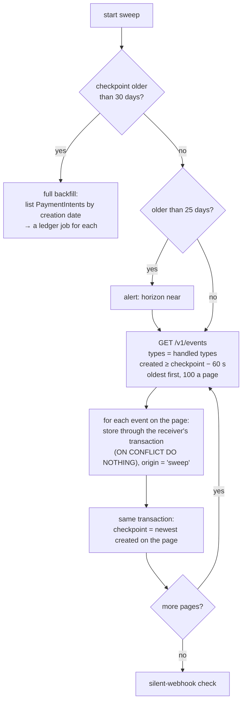

# The sweeper

**What this page contains.** Why a sweeper is needed, how it catches up from a checkpoint for Stripe and for Razorpay, the 30-day horizon, how it detects silent webhooks, and manual backfill and replay.

**How to read it.** The first section is the reason. The flowchart is Stripe's sweep; Razorpay's differences follow.

## Why it exists

Webhooks are best-effort. A source gives up on a failed delivery eventually, and some give up quickly:

| Source | Retries a failed delivery for | Then |
|---|---|---|
| Stripe, live mode | about 3 days | stops; the event is never sent again |
| Stripe, test mode | 3 times over a few hours | stops |
| Razorpay | 24 hours | **disables the webhook** |

So a server that is down for an afternoon, a bad deploy, or a restored backup can lose events for good. n8n has exactly this gap: it doesn't queue events missed while it's down (feature inventory). The **sweeper** asks the source what happened since our **checkpoint** and stores anything missing, through the same path as a delivery ([Q38](grilling-log.md)).

## Stripe: one sweep

Runs at startup (after a random 0-30 s delay, so restarting many copies doesn't hit Stripe at once) and every 10 minutes. It is a singleton, so two processes never sweep together.

- **All events of our types, not only undelivered ones.** Stripe's `delivery_success=false` filter would miss events Stripe delivered successfully but we lost, for instance after restoring an old backup ([Q49](grilling-log.md)).
- **The 60 s overlap window.** An event can appear in the list a little after its `created` time. Re-reading the last minute costs a few duplicate candidates, which the dedupe key turns into nothing.
- **A page and its checkpoint commit together.** A crash mid-sweep resumes from the last committed page instead of starting over; driftless saves no progress until the end (feature inventory).
- **The checkpoint uses Stripe's clock, not ours.** It is the newest `created` value actually seen, so our clock drifting can't open a gap.
- **Swept events look like deliveries.** Same verification of shape, same dedupe, same ledger job. Their `origin` is `sweep`, which the sheet and the video show.

## The 30-day horizon

Stripe lists events for 30 days only. The sweeper warns at 25 days since the checkpoint. Past 30 days, it can no longer see what it missed, so it switches to a **full backfill**: list every PaymentIntent created since the checkpoint and give each a ledger job. Fetch mode makes that safe, since a payment we already hold just costs one API call and changes nothing. The event trail for that gap is missing, and the admin page says so.

## Razorpay: polling instead

Razorpay has no events list ([Q39](grilling-log.md)). Each sweep lists `GET /v1/payments` and `GET /v1/refunds` with `from = checkpoint − 10 min`, 100 a page. For each payment found:
- a **synthetic event** is stored, with `origin = 'sweep'` and event id `sweep:<payment id>:<hash of the state seen>`, so seeing the same state twice is a duplicate and a changed state is new;
- a ledger job is enqueued.

Polling sees current states, not the steps between them, so the event trail has gaps for anything learned this way. The README states this limit.

## Silent webhooks

If the sweeper keeps finding events that never arrived as deliveries, the source has probably stopped sending: a disabled Razorpay webhook, a changed URL, an expired tunnel ([Q40](grilling-log.md)).

An alert fires when either:
- a sweep stores at least one event whose `origin` is `sweep` and that is more than 10 minutes old (so the source had time to deliver it), or
- no delivery has arrived for 24 hours while sweeps keep finding activity.

The alert says: "Events are reaching us only through the sweeper. Check the webhook settings in your Stripe/Razorpay dashboard." It is rate-limited to once an hour ([Q42](grilling-log.md)).

## Manual backfill and replay

| Action | Admin page | CLI | What it does |
|---|---|---|---|
| Replay one event | button on the event's timeline | `wsync replay <event_id>` | Enqueues a ledger job for its payment; the fetch writes the current state. Logged as an admin action. |
| Backfill a date range | form on the overview | `wsync backfill --from 2026-09-01 --to 2026-09-10` | Runs the sweep logic over that range without moving the checkpoint; events stored get `origin = 'backfill'`. Past the horizon, it lists payments instead. |
| Sweep now | button | `wsync sweep` | One ordinary sweep, immediately. |

## Open questions

- **The first checkpoint** ([edge-cases.md](edge-cases.md) OQ14, needs Lalit's OK). Proposed: on a first start the sweeper looks back 30 days (`initial_lookback_days = 30`), so a new buyer's sheet starts with the last month's payments; `0` starts empty; older history by `backfill`.

- Whether the sweep interval should shorten after an outage is detected. Written: no; 10 minutes, plus "Sweep now".

## Where to go next

[verify.md](verify.md): proving afterwards that nothing was missed.
