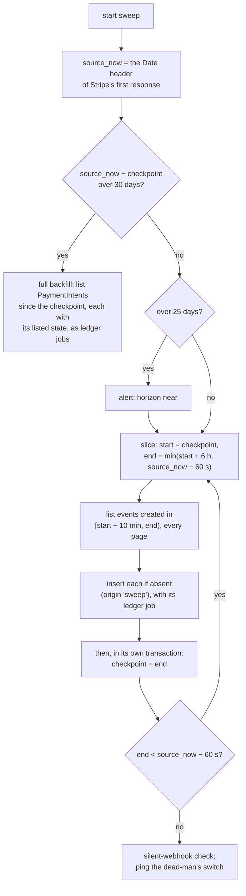

# The sweeper

**What this page contains.** Why a sweeper is needed, how it catches up in time slices for Stripe and Razorpay, the first start, the 30-day horizon, silent webhooks, the dead-man's switch, and manual backfill and replay.

**How to read it.** The first section is the reason; the flowchart is Stripe's sweep; Razorpay's differences follow. Razorpay is built first; Stripe is parked ([Q103](grilling-log.md)), but its sweep is the template Razorpay's follows.

## Why it exists

Webhooks are best-effort. A source gives up on a failed delivery eventually, and some give up quickly:

| Source | Retries a failed delivery for | Then |
|---|---|---|
| Stripe, live mode | about 3 days | stops; the event is never sent again |
| Stripe, test mode | 3 times over a few hours | stops |
| `stripe listen` (the demo) | never: the CLI acknowledges to Stripe, then forwards once | the event is only in the events list (G5) |
| Razorpay | 24 hours, intervals unpublished | **disables the webhook**, emails its alert address, and never re-enables it by itself (G42) |

A server that is down for an afternoon, a bad deploy or a restored backup can therefore lose events for good. The **sweeper** asks the source what happened and stores anything missing ([Q38](grilling-log.md)).

## Stripe: time slices

The sweeper runs at startup (after a random 0-30 s delay) and every 10 minutes. It walks source time in **time slices** of up to 6 hours, and moves the **checkpoint** only after a whole slice is stored ([Q72](grilling-log.md)). For Razorpay, the prototype builds the slice walk, at startup and on demand; the timer, the re-list and the heartbeat follow in P4 ([Q98](grilling-log.md), [Q107](grilling-log.md)).

- **Why slices, not pages.** Stripe lists events filtered by time **newest first** (oldest first needs an id cursor). Saving a checkpoint per page would, after a crash between pages, skip the older ones. A slice is committed only after every page of it is stored, so a crash re-walks at most one slice, and dedupe makes that free (F03).
- **The checkpoint is on Stripe's clock**, taken from the `Date` header, so our clock drifting can't open a gap. An empty slice still advances it, so a quiet account never looks stale.
- **A 10-minute overlap** is re-read before each slice, because an event can become listable a little after its `created` time.
- **All events of our types**, not only undelivered ones, so events lost after restoring a backup come back too.
- **Insert if absent, compare nothing.** A swept copy of an event never has the delivered bytes, so the sweeper doesn't check for conflicts and writes no `deliveries` row; its own count goes on `checkpoints` (F02).

## The first start and the horizon

With no checkpoint yet, the sweeper starts `initial_lookback_days` back (default 30, Stripe's events horizon), so a new buyer's sheet begins with the last month's payments; `0` starts empty; older history by `backfill` ([Q64](grilling-log.md)).

Stripe lists events for 30 days only. Past 25 days behind, an alert. Past 30, the sweeper switches to a **full backfill**: it lists every PaymentIntent created since the checkpoint, with its current state, and enqueues each as a ledger job carrying that listed state, so nothing is fetched twice (F18). The event trail for that gap is missing, and the admin page says so.

## Razorpay: polling

Razorpay has no events list, and its lists filter by **creation** time ([sources.md](sources.md), [Q86](grilling-log.md), [Q107](grilling-log.md), [Q108](grilling-log.md)). Two loops:

1. **Slices**, as for Stripe, over `GET /v1/payments` and `GET /v1/refunds`. The checkpoint (one per list, on Razorpay's clock from the `Date` header) means: every item **created** before it has been listed and stored at least once. Each slice is requested as `from = start − 600`, `to = end`, and only items with `created_at < end` are kept, so the 10-minute overlap re-reads the edge whatever the bounds do. Pages are read with `count=100` and no `skip`: the next page sets `to` to the oldest `created_at` seen plus one, and ids already seen are dropped. If a page brings nothing new (more than 100 items in two seconds), that two-second window is paged with `skip`. This doesn't rely on the order of items created in the same second, which Razorpay doesn't document. Each item becomes a synthetic event (`origin = 'sweep'`, id `sweep:<entity id>:<state hash>`) with a ledger job; a `created` payment is not stored.
2. **The hourly re-list**: payments created in the last 7 days and refunds created in the last 21 days, every page. An item whose state hash changed becomes a synthetic event and a ledger job. This is how a late authorisation, an auto-refund after the capture timeout, a fee set at capture and a refund reaching `processed` reach the row (G53).

The disputes poll joins when disputes are built. Changes to older payments reach the ledger through nightly verify. The README states the gap.

**In the outage scene** ([Q107](grilling-log.md)), the startup sweep stores the missed payments first, with Via = `sweep`; Razorpay's own retries of the same deliveries arrive later and are logged as duplicates. Each payment still has one row.

## Silent webhooks

If the sweeper keeps finding events that never arrived as deliveries, the source has probably stopped sending: a disabled Razorpay webhook, a changed URL, an expired tunnel ([Q40](grilling-log.md)). An alert fires when either:
- a sweep stores an event more than 10 minutes old whose type the webhook endpoint **is** subscribed to (types it isn't subscribed to are reported once by `doctor`, not every hour, F29); or
- no delivery has arrived for 24 hours while sweeps keep finding activity.

The alert says: "Events are reaching us only through the sweeper. Check the webhook settings in your Stripe/Razorpay dashboard." For Razorpay it adds: "A webhook Razorpay disabled after 24 hours of failures stays disabled until you re-enable it under Accounts & Settings › Webhooks."

## The dead-man's switch

Every alert above comes from inside the running process, so a dead process, a full disk or a stopped server says nothing. After every successful sweep, the sweeper pings a **heartbeat URL** (Healthchecks.io's free tier, or any equivalent). If the pings stop, that outside service emails or messages the buyer and Lalit. The ping follows successful sweeps only, so a source whose API is down for over 30 minutes also stops it; the runbook says so ([Q96](grilling-log.md)). An outside uptime check on `/health` covers the receiver ([Q81](grilling-log.md), [hosting.md](hosting.md)).

## Manual backfill and replay

| Action | Command | What it does |
|---|---|---|
| Replay one event | `wsync replay <event_id>` | Enqueues a ledger job for its payment; the fetch writes the current state. Works for any age, since only the payment id is needed. |
| Backfill a date range | `wsync backfill --from 2026-09-01 --to 2026-09-10` | Lists payments (Stripe: PaymentIntents, with their state) created in that range as ledger jobs, without moving the checkpoint. Razorpay's jobs fetch, because a listed payment's refunds come back empty ([Q147](grilling-log.md), [Q156](grilling-log.md)). |
| Sweep now | `wsync sweep` | One ordinary sweep, immediately. |

With a server running, these commands ask it over its admin port to do the work ([ADR 0007](decisions/0007-one-server-process-per-database.md)). Each is logged as an admin action.

## Where to go next

[verify.md](verify.md): proving afterwards that nothing was missed.
