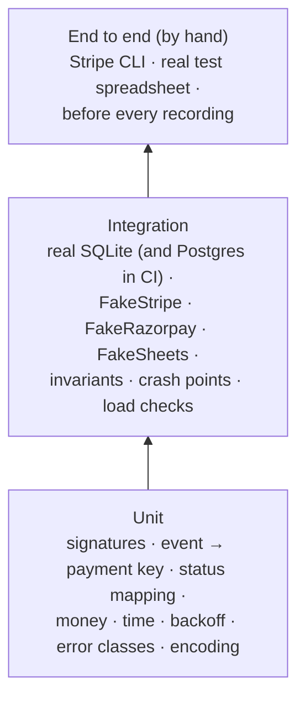

# Testing

**What this page contains.** How the guarantees are proved: the three test layers, the two fakes, the four invariants, the property-based scenarios and crash points, the load checks, and what runs in CI.

**How to read it.** The invariants section is the heart of the page: every other test exists to feed them nasty situations. The edge cases each test covers are listed in [edge-cases.md](edge-cases.md).

## Three layers

| Layer | Runs | Needs |
|---|---|---|
| Unit | every save, every push | nothing |
| Integration | every push, on SQLite and on a Postgres service container ([Q54](grilling-log.md)) | nothing outside the process |
| End to end | by hand, and before recording a scene | a Stripe test account, a Google service account, a test spreadsheet ([Q55](grilling-log.md)) |

CI never holds real credentials ([Q51](grilling-log.md)).

## The fakes

A **fake** behaves like the real service, failures included; it isn't a mock that only checks calls.

| Fake | Behaves like | Can be told to |
|---|---|---|
| **FakeStripe** (served through respx) | Stripe's webhook signing, `GET /v1/payment_intents/{id}`, `/v1/disputes`, `/v1/events` with `created` filters and pagination, `/v1/payment_intents` listing; holds a "true" state per payment | answer 429 with `Retry-After`, 500, time out, 404 a payment, deliver events out of order, deliver one event many times, sign with an old secret |
| **FakeRazorpay** | Razorpay's body-only signature, the event-id header, `GET /v1/payments/{id}`, `/v1/payments` and `/v1/refunds` by date | the same failures; disable its "webhook" after 24 simulated hours |
| **FakeSheets** | a spreadsheet in memory: tabs with ids, a grid size, header, typed cells, `spreadsheets.get` with ranges, all-or-nothing `batchUpdate`, 60-a-minute quotas; counts every call | answer 429, 500, 403; **apply a write and then lose the reply**; have a buyer sort, edit, insert a column, delete a row, rename or delete the tab |

Fixtures for FakeStripe are real test-mode events recorded from Lalit's Stripe account into `tests/fixtures/stripe/`; test mode holds no real customer data, so they are safe to commit. Razorpay fixtures come from its test mode, or from its documented sample payloads signed locally if sign-up is blocked ([Q55](grilling-log.md)).

## The four invariants

An **invariant** must hold once everything has settled (no job waiting or running, no sink paused), whatever happened on the way ([Q52](grilling-log.md)):

1. **The ledger equals the source.** For every payment FakeStripe knows, the `payments` row equals its true current state; no row exists for a payment it doesn't know.
2. **The sheet equals the ledger.** Every `payments` row appears in the Payments tab exactly once, with exactly the values the flusher would write.
3. **Every event is stored once.** Each `(source, event_id)` delivered at least once has exactly one `events` row; the delivery log accounts for every request.
4. **Nothing is stuck.** No job is `running`, and every job is `done`, or `dead` with a reason.

A settle helper runs the loops until the queue is empty (or fails the test after a time limit), then checks all four.

## Property-based scenarios

Hypothesis generates sequences of actions, runs them, settles and checks the invariants, thousands of times. When one fails it shrinks the sequence to the shortest that still fails, which is a ready-made bug report.

Actions it mixes:
- create, fail, succeed, refund (partial and full), fail a refund, dispute, cancel a payment at the source;
- deliver an event once, several times, concurrently with itself, out of order, or never;
- sign with the current or the previous secret;
- make FakeStripe or FakeSheets answer 429, 500, 403 or time out for a while, or lose a reply;
- run a sweep in the middle of deliveries;
- have a buyer edit the sheet;
- **crash** the process at a named crash point and restart it.

## Crash points

Named places where a test can kill the worker mid-flight. They are compiled in but do nothing unless a test enables them.

| Crash point | Where | Proves |
|---|---|---|
| `after_event_commit` | receiver, after `COMMIT`, before answering | the source retries; the retry is a duplicate; the work still happens once |
| `before_event_commit` | receiver, inside the transaction | nothing is stored; the source's retry stores it |
| `after_claim`, `after_fetch`, `before_ledger_commit`, `after_ledger_commit` | ledger worker | [ledger-worker.md](ledger-worker.md) |
| `after_sheet_write_before_done` | flusher, write sent, jobs not completed | the next flush finds the rows by key and updates in place: no duplicate rows |
| `mid_sweep_page` | sweeper, between pages | the next sweep resumes from the last committed page |
| `mid_rebuild` | rebuild, new tab half-written | the live tab is untouched; the next attempt starts clean |

## Load checks

Run in CI ([Q53](grilling-log.md)):

| Check | Asserts |
|---|---|
| **Burst:** 200 distinct payments delivered at once | 200 rows in the sheet, in no more than 10 Sheets API calls (FakeSheets counts them) |
| **Duplicate storm:** 1,000 concurrent deliveries of one event | one `events` row, one payment row, one sheet row, 999 deliveries logged as duplicates |
| **Race on Postgres:** 4 ledger workers, 500 jobs | every job completed exactly once; no payment written by two workers at once |

These are the README's numbers, next to n8n's "56 of 100".

## What CI runs

GitHub Actions, on every push:
1. `ruff check` and `ruff format --check`
2. unit tests
3. integration tests on SQLite
4. integration tests on Postgres (service container), including the multi-worker race
5. Hypothesis in its CI profile: a fixed number of examples, so runs are repeatable; a longer profile is run by hand before a release

Python 3.14 on Windows and Linux runners, since the demo runs on Windows and clients run Linux ([Q8](grilling-log.md)).

## Open questions

- How many Hypothesis examples CI can afford within the free minutes. Written: start at 200 per property, measure, adjust.

## Where to go next

[showcase.md](showcase.md): turning the load checks and crash points into the video.
