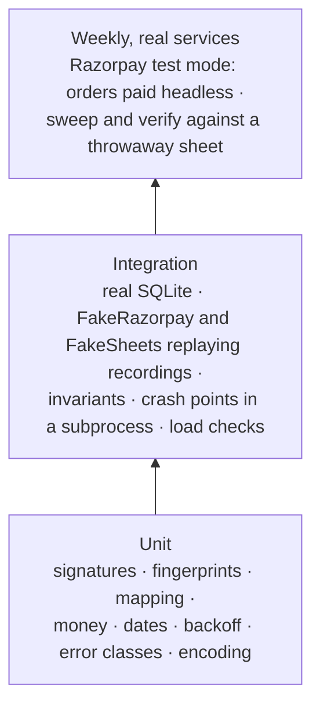

# Testing

**What this page contains.** How the guarantees are proved: the recording spike, the test layers, the fakes and why they replay recordings, the invariants, crash points in a real subprocess, the load checks, the weekly run against real services, and what CI runs.

**How to read it.** The invariants are the heart of the page. The first section explains the audit finding that reshaped the rest (F21).

*Updated 2026-10-04 after #53 measured the load checks: the storm runs against the rate cap and re-sends what it refused, its bar is the server-side p99, and the burst runs only under `-m load` (Q171-Q173).*

## Why the fakes replay recordings

A **fake** built from the design's own beliefs agrees with the design's bugs. The audit found five bugs that fakes written that way would have passed: Stripe resending an event with different bytes (F02), listing events newest first (F03), a sort landing between our read and write (F05), Sheets naming tabs by title (F08), and fetches taking real time (F19). So before any code, a **recording spike** captures what the real services do, and the fakes replay it ([Q82](grilling-log.md)). Razorpay is the first source; what its test mode can't produce is replayed from Razorpay's own documented samples, marked `unrecorded` ([Q113](grilling-log.md)).

**The recording spike** (P0, 2-3 h), against Razorpay test mode and a throwaway spreadsheet, on the owner's laptop through the tunnel ([Q113](grilling-log.md); steps in [razorpay-first.md](../research/razorpay-first.md)):
- one payment delivered while the receiver answers 500 to the first four attempts (`--demo-fail-first 4`): each attempt's arrival time, `x-razorpay-event-id`, signature and body SHA-256, to see the retry timing (G48) and whether retries resend the same bytes (G38);
- the same delivery opened in the Dashboard's webhook log, to see whether its Request and headers can be copied byte for byte;
- the tunnel's answer in that log, to rule out a warning page swallowing the POST (G49);
- two refunds of a captured payment, one at normal speed and one `optimum`: the create response, time to `processed`, and the webhooks;
- one payment with manual capture: `fee` and `tax` at `authorized`, then after `POST /v1/payments/{id}/capture` (G51);
- the bodies of `payment.authorized`, `payment.captured`, `payment.failed` (the mock bank page's **Failure**) and `order.paid`;
- Sheets answers after a tab rename, an unshare, a sort between two calls, a deleted tab, and a 429.

Stripe's half (resends, list order, a failed refund, `charge.updated` timing, UGX and ISK, the dispute states) waits until a buyer gives Stripe access ([Q103](grilling-log.md)).

Recordings go in `tests/recordings/`. Test mode holds no real customer data.

## Three layers

| Layer | Runs | Needs |
|---|---|---|
| Unit | every push | nothing |
| Integration | every push, Linux; weekly on Windows | nothing outside the process |
| Real services | weekly, scheduled | Razorpay **test** keys and a throwaway sheet's credentials as repository secrets. It pays a few test orders headless through Checkout's mock bank page, then runs `sweep` and `verify`: no webhook can reach CI, so it proves the sweep path against the real Razorpay ([Q113](grilling-log.md)) |

## The fakes

| Fake | Replays | Can also be told to |
|---|---|---|
| **FakeRazorpay** (through respx) | recorded bodies, headers and signatures; documented samples for what test mode can't make (`refund.failed`, `refund.speed_changed`, `payment.dispute.*`), re-signed by our fixture code and marked `unrecorded`; payment and refund lists newest first, with **items created in the same second in a shifting order**, a new payment arriving between page calls, and an empty disputes list without `items` | answer 429 (with a `BAD_REQUEST_ERROR` body), 500, 400 not found, a connection reset, time out; take real time per call; deliver out of order, many times, or never; move a payment `failed` → `authorized` (late authorisation) |
| **FakeStripe** (parked with Stripe) | documented payloads signed with stripe-python's `generate_signature_header`, marked `unrecorded`, with a switch per open fact (G6, G7, G10, G27, G28) so the invariants run under both answers | as FakeRazorpay |
| **FakeSheets** | recorded error shapes; tabs with ids; grid size; atomic `batchUpdate`; quotas; call counting | 429, 500, 403; apply a write and lose the reply; a person sorting, editing, deleting a row or a tab, or renaming a tab **between any two calls** |

## The invariants

Checked after every scenario, once it settles: no job waiting or running, and no source or sink paused unless the scenario broke it on purpose (F22).

1. **The ledger equals the source.** Every payment the fake knows has a row equal to its current state; no row exists for a payment it doesn't know (except those marked not found).
2. **The sheet equals the ledger.** Every row appears exactly once, with the values the flusher would write; the Daily summary equals its sums.
3. **Every event is stored once**, and every delivery is logged exactly once.
4. **Nothing is stuck.** Every job is `done`, or `dead` or `resolved` with a reason.
5. **Nothing moves backwards.** No ledger row ever takes a state older than one already written (F04).
6. **Nothing of the buyer's is touched.** No cell outside our tabs changes.
7. **No false conflict.** A conflict is recorded only when the scenario sent a different event under the same id (F02).
8. **No surprise dead job.** A job ends `dead` only if the scenario injected a permanent error.
9. **Quiet alerts.** At most the scenario's expected alerts fire.

## Crash points

A crash point kills a **subprocess** with `os._exit` at a named place, and a new process starts on the same database. An exception would run cleanup code a real crash never runs, and could hide exactly the bugs this is meant to find (F21).

| Crash point | Proves |
|---|---|
| `before_event_commit`, `after_event_commit` | The source's retry is stored once; the work happens once |
| `after_claim`, `after_fetch`, `before_ledger_commit`, `after_ledger_commit` | [ledger-worker.md](ledger-worker.md) |
| `after_flush_claim`, `after_sheet_write_before_check`, `after_sheet_write_before_done` | The next flush finds rows by key: no duplicate rows |
| `mid_slice` | The sweep re-walks at most one slice; nothing is skipped |
| `mid_reap`, `during_shutdown_release` | No job is left running forever |
| `mid_rebuild` | The sink stays paused, "rebuild incomplete" |

In the pitch-ready cut: `after_event_commit`, `after_sheet_write_before_done` and `mid_slice`. The rest come with the slices that build their code.

## Scenarios

**In the cut:** five scripted scenarios, each run with the invariants: a duplicate storm, an outage and catch-up, a Sheets 429 then recovery, a late authorisation (`failed`, then `authorized` and captured, caught by the re-list), and a partial and a failed refund (the failure from Razorpay's sample). Disputes come with the disputes slice.

**After pitching:** Hypothesis generates sequences of these actions (payments, refunds, disputes; deliveries repeated, reordered or missing; fake failures; sweeps mid-delivery; a person touching the sheet; crashes), thousands of times, and shrinks any failure to the shortest sequence that still fails ([Q52](grilling-log.md)).

## Load checks

| Check | Asserts |
|---|---|
| **Duplicate storm:** 1,000 concurrent replays of one recorded, signed delivery, some under a different `x-razorpay-event-id` (caught by the signed-body hash), against the default 50-a-second cap | every reply 2xx or 429 `rate_capped`, with **zero** 503s; each delivery that got a 429 sent again under the cap, as Razorpay's retries would, until answered 2xx; then one event, one row, one sheet row, 999 duplicates logged. The server-side p99 (its own handling time of the deliveries it accepted) under 2 s on the development laptop; the client-side p99 printed, never asserted ([Q83](grilling-log.md), [Q171](grilling-log.md), [Q172](grilling-log.md)) |
| **Burst:** 200 payments whose fetches take recorded real time | 200 rows; Sheets calls at most three per flush, and flushes no more than one per 3 s of work arriving. The count and the time taken are printed for the README (F19). It takes minutes, so it runs only under `-m load` ([Q173](grilling-log.md)) |

## What CI runs

On every push, on Linux: `ruff check`, `ruff format --check`, unit tests, integration tests. Weekly, scheduled: integration tests on Windows, and the Razorpay real-services run (it installs the `wsync[demo]` extra and Chromium). There is no Stripe or Postgres job in version 1 ([Q75](grilling-log.md), [Q103](grilling-log.md)).

## Where to go next

[showcase.md](showcase.md): turning the scenes into the video.
