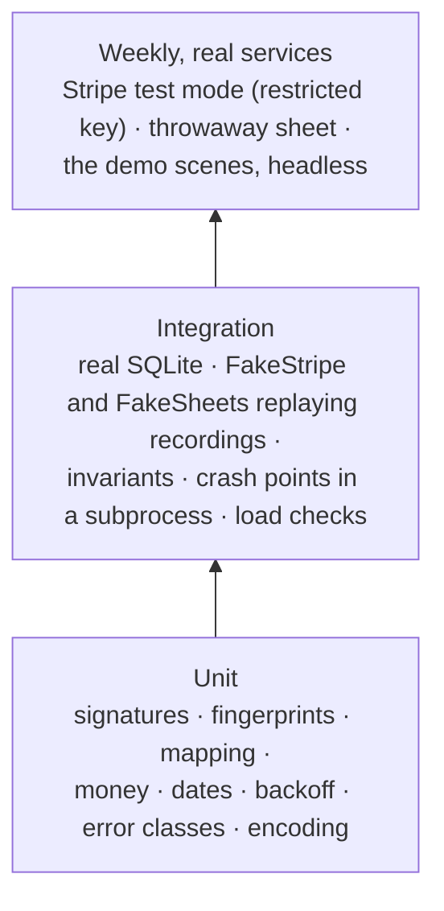

# Testing

**What this page contains.** How the guarantees are proved: the recording spike, the test layers, the fakes and why they replay recordings, the invariants, crash points in a real subprocess, the load checks, the weekly run against real services, and what CI runs.

**How to read it.** The invariants are the heart of the page. The first section explains the audit finding that reshaped the rest (F21).

## Why the fakes replay recordings

A **fake** built from the design's own beliefs agrees with the design's bugs. The audit found five bugs that fakes written that way would have passed: Stripe resending an event with different bytes (F02), listing events newest first (F03), a sort landing between our read and write (F05), Sheets naming tabs by title (F08), and fetches taking real time (F19). So before any code, a **recording spike** captures what the real services do, and the fakes replay it ([Q82](grilling-log.md)).

**The recording spike** (slice 0, 2-3 h), against Stripe test mode and a throwaway spreadsheet:
- one payment delivered, `stripe events resend` twice, and the same event from `/v1/events`, to diff the bytes;
- a two-page events listing, to see its order;
- a partial refund and a failed refund (test card 4000000000005126), to see `amount_refunded`;
- a card payment's `payment_intent.succeeded` and its later `charge.updated`, to time the fee's arrival ([Q97](grilling-log.md));
- a charge in UGX and one in ISK, to see their minor units ([Q100](grilling-log.md));
- a read with a key lacking Balance read, to see whether only the expanded balance transaction returns 403 (G1);
- a dispute (Stripe's test cards create one), to see the dispute states;
- Sheets answers after a tab rename, an unshare, a sort between two calls, a deleted tab, and a 429.

Recordings go in `tests/recordings/`. Test mode holds no real customer data.

## Three layers

| Layer | Runs | Needs |
|---|---|---|
| Unit | every push | nothing |
| Integration | every push, Linux; weekly on Windows | nothing outside the process |
| Real services | weekly, scheduled, and before each recording | a Stripe **test-mode restricted key** and a throwaway sheet's credentials as repository secrets ([Q82](grilling-log.md)) |

## The fakes

| Fake | Replays | Can also be told to |
|---|---|---|
| **FakeStripe** (through respx) | recorded bodies and headers, including different bytes for one event; list pages in Stripe's real order; recorded refund and dispute states | answer 429, 500, 404, time out; take real time per call; deliver out of order, many times, or never |
| **FakeSheets** | recorded error shapes; tabs with ids; grid size; atomic `batchUpdate`; quotas; call counting | 429, 500, 403; apply a write and lose the reply; a person sorting, editing, deleting a row or a tab, or renaming a tab **between any two calls** |

## The invariants

Checked after every scenario, once it settles: no job waiting or running, and no source or sink paused unless the scenario broke it on purpose (F22).

1. **The ledger equals the source.** Every payment the fake knows has a row equal to its current state; no row exists for a payment it doesn't know (except those marked not found).
2. **The sheet equals the ledger.** Every row appears exactly once, with the values the flusher would write; the Daily summary equals its sums.
3. **Every event is stored once**, and every delivery is logged exactly once.
4. **Nothing is stuck.** Every job is `done`, or `dead` or `resolved` with a reason.
5. **Nothing moves backwards.** No ledger row ever takes a state older than one already written (F04).
6. **Nothing of the buyer's is touched.** No cell outside our tabs changes.
7. **No false conflict.** A conflict is recorded only when the scenario sent a different event under the same id (F02).
8. **No surprise dead job.** A job ends `dead` only if the scenario injected a permanent error.
9. **Quiet alerts.** At most the scenario's expected alerts fire.

## Crash points

A crash point kills a **subprocess** with `os._exit` at a named place, and a new process starts on the same database. An exception would run cleanup code a real crash never runs, and could hide exactly the bugs this is meant to find (F21).

| Crash point | Proves |
|---|---|
| `before_event_commit`, `after_event_commit` | The source's retry is stored once; the work happens once |
| `after_claim`, `after_fetch`, `before_ledger_commit`, `after_ledger_commit` | [ledger-worker.md](ledger-worker.md) |
| `after_flush_claim`, `after_sheet_write_before_check`, `after_sheet_write_before_done` | The next flush finds rows by key: no duplicate rows |
| `mid_slice` | The sweep re-walks at most one slice; nothing is skipped |
| `mid_reap`, `during_shutdown_release` | No job is left running forever |
| `mid_rebuild` | The sink stays paused, "rebuild incomplete" |

In the pitch-ready cut: `after_event_commit`, `after_sheet_write_before_done` and `mid_slice`. The rest come with the slices that build their code.

## Scenarios

**In the cut:** five scripted scenarios, each run with the invariants: a duplicate storm, an outage and catch-up, a Sheets 429 then recovery, a partial and a failed refund, and a payment with a dispute.

**After pitching:** Hypothesis generates sequences of these actions (payments, refunds, disputes; deliveries repeated, reordered or missing; fake failures; sweeps mid-delivery; a person touching the sheet; crashes), thousands of times, and shrinks any failure to the shortest sequence that still fails ([Q52](grilling-log.md)).

## Load checks

| Check | Asserts |
|---|---|
| **Duplicate storm:** 1,000 concurrent deliveries of one event | every request answered 2xx with **zero** 503s and a p99 under 2 s on the development laptop; then one event, one row, one sheet row, 999 duplicates logged ([Q83](grilling-log.md)) |
| **Burst:** 200 payments whose fetches take recorded real time | 200 rows; Sheets calls at most three per flush, and flushes no more than one per 3 s of work arriving. The count is printed for the README (F19) |

## What CI runs

On every push, on Linux: `ruff check`, `ruff format --check`, unit tests, integration tests. Weekly, scheduled: integration tests on Windows, and the real-services run. There is no Postgres job in version 1 ([Q75](grilling-log.md)).

## Where to go next

[showcase.md](showcase.md): turning the scenes into the video.
