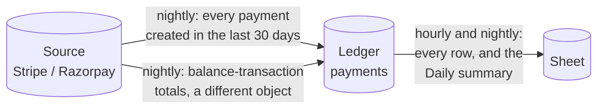

# Verify

**What this page contains.** The check that the source, the ledger and the sheet agree: what is compared, what each difference means, the hourly and nightly runs, repair, exactly what the proof covers, and what the buyer sees.

**How to read it.** The picture shows the comparisons; the findings table is the reference.

## Why it exists

The sweeper recovers what it can see. Verify is the independent check that the whole chain worked: it doesn't trust our own records, and compares each hop against the one before. It is demo 1's "prove every row" idea applied to syncing ([Q41](grilling-log.md)).

## The checks

| Check | When | Compares | API cost |
|---|---|---|---|
| **Ledger against sheet** | hourly, and nightly | every `payments` row against its Payments row (each key exactly once, every column equal to what the flusher would write) and every Daily summary row against the ledger | a few Sheets reads, no source calls |
| **Source against ledger** | nightly | every payment created in the window (default 30 days), listed with its current state, against its `payments` row | one Stripe read per 100 payments |
| **Independent totals** | nightly | for the window, the sum of the source's balance transactions of type charge and refund against the ledger's gross, fees and refunds | a few reads |

The hourly check needs no source calls, because Stripe has no totals endpoint and summing would mean listing every payment each hour against the read allowance (F18, [Q89](grilling-log.md)).

The independent totals use a different Stripe object from the one the ledger is built from. That catches a mapping bug (which a row-by-row comparison through the same mapping can't see) and payments outside the PaymentIntent model (F38).

## What it can find

| Finding | Meaning | Repair |
|---|---|---|
| **missing** | At the source, not in the ledger | A ledger job carrying the listed state |
| **stale** | In both, but different | A ledger job carrying the listed state |
| **orphaned** | In the ledger, not at the source | None: usually deleted test data or the wrong account. Shown for a person. |
| sheet missing, sheet differs | In the ledger; absent or different in the sheet | A mirror job |
| sheet duplicate, sheet foreign | A key twice; a row whose key isn't in the ledger | None: shown for a person |
| totals differ | The independent totals disagree | None: a person looks; the difference is shown per currency |
| not found at source; unknown columns | Rows flagged by the ledger worker | None; listed so a person knows |

Payments with a live job, or changed since the run started, are skipped, so work in progress is never reported as stale.

## Repair

Repair never edits a row. It enqueues the ordinary jobs above, so a repair is checked, coalesced, retried and logged like everything else. After a nightly run it happens automatically (`verify.auto_repair = true`); otherwise from `wsync verify --full --repair`. The same payment found stale on two nights running raises an alert: something keeps undoing the repair.

## What the proof covers, exactly

"Every night, verify proves that the last 30 days of payments match Stripe, and that the sheet matches the database." It does not cover a refund or dispute on a payment older than the window (widen it with `--days`), or payments the source adapter ignores, whose count is shown on the verify line (F38).

## Schedule

Nightly at 02:00 in the buyer's time zone; on a daylight-saving change day, the first valid local time at or after 02:00, once per local date. Hourly on the hour for ledger against sheet.

## What the buyer sees

- **Sync status tab:** one line, e.g. `Verified 30 Sep 02:00 IST: last 30 days, 1,204 payments, 0 differences (3 ignored events)`.
- **Verify output** (`wsync verify`, and the admin page later): each run, its counts, totals per currency, and every finding.
- **Alert:** differences it couldn't repair, or the same payment stale two nights running.

## Where to go next

[operations.md](operations.md): running it day to day.
