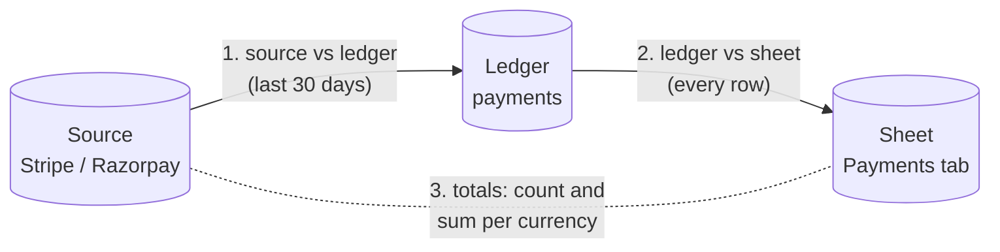

# Verify

**What this page contains.** The nightly proof that the source, the ledger and the sheet agree: the three checks, what each kind of difference means, the two modes, how repair works, and what the buyer sees.

**How to read it.** The picture shows the three comparisons. The table of findings is the reference.

## Why it exists

The sweeper recovers what it can see. Verify is the independent check that the whole chain worked: it doesn't trust our own records, and compares each hop against the one before. It is demo 1's "prove every row" idea applied to syncing, and the strongest line in the pitch: every night it proves your sheet matches Stripe ([Q41](grilling-log.md)).

## The three checks

**1. Source vs ledger.** List every payment created in the window (default the last 30 days) through the adapter's `list_payments`, and compare each with its `payments` row.

**2. Ledger vs sheet.** Read the whole Payments tab (a few calls) and compare it with every `payments` row: each key must appear exactly once and every mirrored column must equal the value the flusher would write.

**3. Totals.** Count and sum per currency, at the source, in the ledger and in the sheet, for the same window. Totals catch what row checks can't make visible at a glance: one missing and one extra row cancel out in a count of rows but not in a sum. An r/n8n thread describes exactly that failure.

## What it can find

| Finding | Meaning | Repair |
|---|---|---|
| **missing** | At the source, not in the ledger | Enqueue a ledger job |
| **stale** | In both, but status, amount, refunded amount or dispute differ | Enqueue a ledger job |
| **orphaned** | In the ledger, not at the source | None automatic: usually deleted test data or a wrong account. Shown for a person. |
| sheet missing | In the ledger, not in the sheet | Enqueue a mirror job |
| sheet differs | In both, values differ (a manual edit, a failed write) | Enqueue a mirror job |
| sheet duplicate | Key appears more than once | None automatic: we never delete the buyer's rows. Shown for a person. |
| sheet foreign | A row whose key isn't in the ledger | None; reported only |
| payload-written | Row has `written_from = 'payload'` | None; listed so a person knows which rows weren't confirmed by a fetch |

A payment that changed at the source while verify was running would look stale. Verify skips payments with a ledger or mirror job waiting or running, and compares only rows whose `updated_at` is older than the start of the run, so it never reports a sync that is simply in progress.

## Two modes

| Mode | Runs | Does | Cost |
|---|---|---|---|
| **quick** | after every sweep, hourly at most | check 3 only: counts and sums per currency | a few calls |
| **full** | nightly at 02:00 in the buyer's time zone (on a daylight-saving change day, the first valid local time at or after 02:00, once per local date), and on demand | all three checks, row by row | one source API call per 100 payments, plus a few Sheets reads |

## Repair

**Repair never edits a row.** It enqueues the same ledger and mirror jobs that normal work uses, so a repair is fetched, checked, coalesced, retried and logged like everything else, and can't make things worse than a replay would ([Q41](grilling-log.md)). It runs automatically after a nightly full verify if `verify.auto_repair = true` (the default), or from the verify page's **Repair** button, or `wsync verify --full --repair`.

## What the buyer sees

- **Sync status tab:** one line, e.g. `Verified 30 Sep 02:00 IST: 1,204 payments, 0 differences` or `… 3 differences, repair queued`.
- **Verify page:** each run, its counts and totals per currency, and every finding linked to the payment's timeline.
- **Alert:** when a full run finds differences it couldn't repair (orphaned, duplicates) or when the same payment is found stale on two nights in a row.
- **Capacity warning:** when the Payments tab passes 80 % of Sheets' 10-million-cell limit.

## Open questions

- Whether verify should look back further than 30 days. Written: 30 by default, configurable; a full backfill-style check can be run by hand with `--days`.

## Where to go next

[operations.md](operations.md): the admin pages, CLI, alerts and running it day to day.
