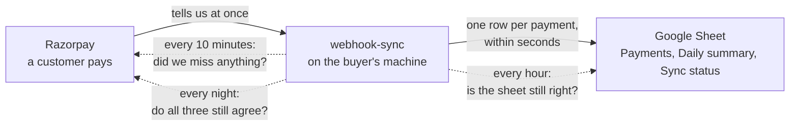

# What is built, and what to say about it

**What this page contains.** Everything webhook-sync does today, in the words you would use with a buyer: the pitch, each feature and where you can watch it work, the numbers you can quote, the limits to say out loud, and what is not built.

**How to read it.** Read it top to bottom once. Every feature names a step of [01-see-it-yourself.md](01-see-it-yourself.md), where you run it and watch the sheet. Words in **bold** are defined in [CONTEXT.md](../../CONTEXT.md). Nothing here explains how the code works; the design pages do that.

**Status.** Built (2026-10-05). Build steps P1 to P6 are merged. What is left of the pitch-ready cut is the recording of the GIF and the video.

## In one paragraph

webhook-sync receives payment events from Razorpay and keeps a Google Sheet in step with them: one row per **payment**, with its fee, GST, net amount and payment method, plus a **Daily summary**. It keeps that promise when Razorpay sends the same event five times, when the server was switched off while customers paid, when a refund arrives days later, and when somebody sorts or edits the sheet. Every night it compares the last 30 days with Razorpay and writes the number of differences into the sheet.

The solid arrows are the normal path. The dashed arrows are the three checks that catch whatever the normal path missed, and they are what the alternatives don't have.

## The pitch

Zapier's own help page says a Zap can write the same row twice. On n8n's forum a user sent 100 events at once and got 56 to 63 rows. webhook-sync is the same "payments to a sheet" job done so that neither can happen, and it proves it every night.

| # | Promise | Say it like this | Watch it in |
|---|---|---|---|
| 1 | One payment, one row | "Razorpay can send the same event many times. You still get one row." | step 13 |
| 2 | Nothing acknowledged is lost | "Once we tell Razorpay 'received', the payment is on disk, even if the machine dies the next second." | step 16 |
| 3 | Missed payments come back | "If the server was down while customers paid, the rows appear after it starts, marked `sweep`." | step 2 |
| 4 | Later changes update the same row | "A refund or a late capture changes the payment's own row. It never adds a second one." | step 14 |
| 5 | A nightly proof | "Every night the last 30 days are compared with Razorpay, and the sheet shows '0 differences'." | step 4 |

## What the buyer gets

| Feature | What it does for the buyer | Watch it in |
|---|---|---|
| **Payments tab** | One row per payment: status, amount, refunded, fee, GST on the fee, net, method, masked email, description, and whether it came by **delivery** or by sweep. | step 3 |
| **Daily summary** tab | Per day: number of payments, gross, refunds, fees and net. Failed attempts are left out, so the totals are right without any formula. | step 3 |
| **Sync status** tab | Says inside the sheet whether everything is healthy: last write, jobs waiting, anything paused and why, and the last nightly check. | step 3 |
| Duplicates ignored | The same event sent again changes nothing and is counted as a **duplicate**. | step 13 |
| Catch-up after downtime | The **sweeper** asks Razorpay every 10 minutes, and at every start, what it missed, and stores it. | step 2 |
| Refunds and late changes | Each event makes the service fetch the payment's current state, so the row shows what is true now, whatever order events arrive in. | step 14 |
| The hourly and nightly check | **Verify** compares the sheet with the database every hour and the database with Razorpay every night, and repairs what it can. | steps 4, 6, 7 |
| A sheet people can touch | Sorting, renaming a tab, editing a cell or deleting a row never produces a wrong or doubled row. The service finds its rows by payment id. | steps 6 to 9 |
| It stops instead of guessing | If the sheet is unshared or a column is moved, the sheet is **paused** with the reason. Payments keep being stored and are written once it is resumed. | steps 10, 11, 15 |
| A setup check | `wsync doctor` checks keys, the webhook, the clock, the sheet and the database, one plain line each. | steps 1, 12 |
| One-line status | `wsync status` shows what is running, waiting, paused or failed. | step 5 |
| **Alerts** | A Slack or Discord message when something is paused, a job has failed for good, webhooks went silent or the nightly check found differences. A **heartbeat URL** is pinged after each healthy sweep, so an outside service can email when the server itself is dead. | not in the walkthrough: needs a Slack or Discord URL |
| Refuses unsafe starts | A missing secret, a live key in a test setup, or a second server on the same database: it will not start, and says why in one line. | step 12 |
| Older history | `wsync backfill --from … --to …` brings in payments from before the service was installed. | not in the walkthrough |
| Privacy | Emails are masked in the sheet. Phone numbers and card digits are never stored or logged. Text is written as text, so a description starting with `=` can't run as a formula. | step 3 (the masked email) |

## Numbers you can quote

All measured on 4 October 2026 on the development laptop (Acer Nitro, Core i7-12650H, 16 GB, Windows 11), against local stand-ins for Razorpay and Google.

| Claim | Number |
|---|---|
| 1,000 copies of one event sent at the same moment | 1 row, 999 counted duplicates, no server error |
| How fast the server handled the ones it accepted | 99% within 0.79 s |
| 200 payments in one burst | all 200 on the sheet in 324 s, using 314 Google calls, not thousands |
| The automated test suite | 751 tests pass |

Do not say the caller gets every answer in under 2 seconds. Measured from the caller's side it was 4.3 s for that storm.

## Against the alternatives

| Tool | Their limit | What to say |
|---|---|---|
| Coupler.io | Copies on a schedule: daily on the cheaper plans, hourly at $259 a month. | "Here the row follows the payment by seconds." |
| Zapier | From about $20 to $30 a month for 750 tasks, and its own help page admits duplicate rows. | "No subscription, no task count, no duplicates." |
| Hookdeck | Receives and retries webhooks, then hands them to code you still have to write. | "That code is already written here, and it runs on your own machine." |

Prices are from each pricing page on 5 October 2026. Check them again before you quote them.

## Limits to say out loud

- A row appears a few seconds after the payment, not instantly.
- One installation serves one buyer: one Razorpay account and one spreadsheet.
- Razorpay's own list of payments can be late. In test mode on 5 October 2026 it showed new payments 28 to 101 minutes after they were made. So after an outage, a row can take that long to come back. This was not measured in live mode.
- Because of that lateness, a check run minutes after a payment can report one difference that clears by itself later. Issue #70 tracks what to do about it.
- A big burst drains at about one payment every 1.6 seconds.
- Fees in test mode are examples. A live account's plan sets the real ones.
- The three tabs belong to the service. Buyers sort with filter views and keep their own work in another tab.

## Not built, so don't promise it yet

| Not built | What exists instead |
|---|---|
| Stripe | Designed only. Razorpay is the one source. |
| Web pages for the admin | The command line and the Sync status tab. |
| Rebuilding the sheet with one command | Put the changed column back, then `wsync resume sheets`. |
| Retrying a failed job by command | It shows in `wsync status`; the nightly check repairs the row. |
| Backups, hosting templates, disputes | Designed only. Today it runs on your laptop. |
| Sending events on to n8n or Zapier; writing to the buyer's own database | Outlined in [next-adapters.md](../design/next-adapters.md) as the next paid work. |

## Reading order

1. This page.
2. [01-see-it-yourself.md](01-see-it-yourself.md): run every feature and watch the sheet.
3. [guide-agent-prompt.md](guide-agent-prompt.md): the prompt for the agent that walks you through it.
4. [README.md](../../README.md): what a buyer reads.
5. [showcase.md](../design/showcase.md): the video's scenes, once you know the features.
