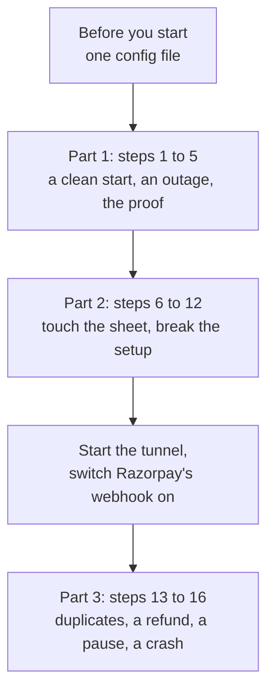

# See it yourself

**What this page contains.** Sixteen steps that show every feature of webhook-sync working, by running a command or touching the sheet and watching what happens. No test is run and no code is read.

**How to read it.** Do the steps in order, with the demo sheet open in a browser beside the terminal. Each row says what to do, what you should see and what it shows a buyer. A dagger (†) marks a step that the automated tests prove against a stand-in for Google or Razorpay but that nobody has yet done by hand on the real ones: if what you see differs, that is a finding worth writing down, not a mistake of yours. Words in **bold** are defined in [CONTEXT.md](../../CONTEXT.md).

**Status.** Built (2026-10-05). Step 1 was run on that day and passed. Steps 2, 4 and 5 were run by the build's own flow check.

Parts 1 and 2 need only the laptop. Part 3 needs Razorpay to reach the laptop, so it starts with the tunnel.

## Before you start

| Need | How |
|---|---|
| A terminal in the repository folder | Every command below is typed there. |
| The demo sheet open in a browser | It is the sheet whose id is `SHEET_ID` in `.env`. |
| A config file | Copy `webhook-sync.toml.example` to `webhook-sync.toml`. Set `public_listen = "127.0.0.1:8080"`, `account` to the test account, `spreadsheet_id` to the demo sheet's id, put the same id in `[demo] spreadsheet_ids`, set `heartbeat_url = ""`, and delete the `metadata_keys` line (the demo sheet has no `order_id` column). The guiding agent does this for you. |
| The browser the demo pays with | Already installed on this laptop. On another machine: `uv run playwright install chromium`. |

The secrets are already in `.env`, next to the config file. They are test-mode keys: no real money moves in any step.

## Part 1: a clean start, an outage, and the proof

| # | Do this | You should see | It shows |
|---|---|---|---|
| 1 | `uv run wsync doctor` | One line per check, each starting `ok`, `warning` or `fail`. Expect `ok` for config, secrets, the Razorpay key, the clock and the sheet. Expect a `warning` that Razorpay's webhook is disabled; Part 3 fixes it. | A new setup can be checked in ten seconds, and the tool says in plain words what is wrong. |
| 2 | `uv run wsync demo reset`, then `uv run wsync demo outage` | `reset` empties the three tabs. `outage` pays three test orders while nothing is listening, then starts the service and prints each of the three as it comes back: "one ledger row and one sheet row, Via = sweep". On a day when Razorpay's list is slow this step can wait a long time (up to two hours); the command says what it is waiting for. | Promise 3: payments made while the server was down come back by themselves. |
| 3 | Look at the three tabs | **Payments**: one row for every test payment of the last 30 days (about forty, because a fresh start looks back 30 days), the three new ones among them. Each has amount, fee, GST on fee, net, method, a masked email and `sweep` in the Via column. **Daily summary**: one row per day with the number of payments, gross, fees and net. **Sync status**: the last write, jobs waiting 0, nothing paused. | What the buyer actually gets, including history from before the service was installed. |
| 4 | `uv run wsync demo verify` | A line such as "Verified 05 Oct 14:39 IST: last 30 days, 41 payments, 0 differences". The same line appears on the Sync status tab. | Promise 5: the proof. Razorpay, the database and the sheet agree. |
| 5 | `uv run wsync status` | The source and the sheet as `active`, jobs waiting 0 and dead 0, the last sweep and the last verify. | One command answers "is it healthy?". |

## Part 2: touch the sheet, break the setup

Open a second terminal and start the service there with `uv run wsync serve`. Leave it running for steps 6 to 12 and type the commands in the first terminal.

| # | Do this | You should see | It shows |
|---|---|---|---|
| 6 † | Change one Amount cell to a wrong number. Run `uv run wsync verify`. | "1 findings, 1 repaired" and a line starting `sheet_differs`. Within a few seconds the cell is back to the right amount. | A person's edit can't leave a wrong number in the sheet. This check also runs by itself every hour. |
| 7 † | Delete one payment's whole row. Run `uv run wsync verify`. | A line starting `sheet_missing`, and the row is written again at the bottom. | A deleted row comes back. |
| 8 † | Sort the Payments tab by Amount (Data › Sort range). Run `uv run wsync verify`. | "0 findings". Every row still holds its own payment's values. | Rows are found by payment id, not by position, so sorting breaks nothing. |
| 9 † | Rename the Payments tab to anything. Run `uv run wsync verify`. Rename it back. | "0 findings". | A renamed tab is still followed. |
| 10 † | In Share, remove the service account (the address ending `iam.gserviceaccount.com`). Run `uv run wsync doctor`. Then share the sheet with that address again as Editor. | The `sheet` line says `fail` and tells you to share the spreadsheet with that address as an Editor. After sharing again it says `ok`. | A buyer who breaks the sharing is told exactly what to do. |
| 11 | Rename the column header "Amount" to "Total". Run `uv run wsync doctor`. Put the header back and run it again. | The `sheet` line says `fail` and names the column: it reads "Total", not "Amount". After the fix it says `ok`. | The service notices a changed layout before writing into the wrong column. |
| 12 | In a third terminal run `uv run wsync serve`. Then run `uv run wsync doctor --url https://example.com/` | The second server refuses to start, in one line: "another wsync serve holds the lock file … one server per database". The doctor's last line says `fail`: that address is not our receiver. | It refuses to run twice on one database, and it catches a public address that would swallow Razorpay's messages. |

Stop the service in the second terminal with Ctrl-C when step 12 is done.

## Part 3: real deliveries from Razorpay

Razorpay has to reach the laptop. Do this once before step 13:

1. Start the tunnel: the zrok commands are in [hosting.md](../design/hosting.md), under "The demo laptop's tunnel". The public address ends in `/webhooks/razorpay`.
2. In the Razorpay Dashboard, in test mode, open Webhooks and switch the webhook on. Its URL must be the tunnel's address. It is switched off today because the tunnel was down for more than 24 hours.
3. Start `uv run wsync serve`, run `uv run wsync doctor --url <the public address>` and check that the `razorpay webhook` line and the last line both say `ok`. Then stop the service with Ctrl-C.

| # | Do this | You should see | It shows |
|---|---|---|---|
| 13 | `uv run wsync demo duplicates` | The scene pays one test order. The service answers "error" to Razorpay's first four attempts on purpose, so Razorpay sends the same event again and again; each attempt is printed. It ends with "one ledger row and one sheet row; 4 duplicates", and the sheet has one new row with `delivery` in the Via column. The last line gives the command that stops the service it leaves running: keep it running. | Promise 1: five deliveries, one row. This is the first scene of the video. |
| 14 † | In the Razorpay Dashboard (test mode), open that payment and issue a partial refund, for example ₹50. | Within seconds the same row changes: Status `partially_refunded`, Refunded 50.00. The Daily summary's Refunds for today changes too. No new row appears. | Promise 4: a later change updates the payment's own row. |
| 15 † | Remove the service account from the sheet's sharing, as in step 10. Issue another small refund. Run `uv run wsync status`. Share the sheet again as Editor, then run `uv run wsync resume sheets`. | Status shows the sheet `paused` with the reason, and one job waiting. The refund is not on the sheet yet. After the resume the row updates within a few seconds. | It stops instead of guessing, loses nothing while stopped, and catches up when the cause is fixed. |
| 16 † | Stop the service with the command step 13 printed. Start it with a planned crash, in Git Bash: `WSYNC_CRASH_AT=after_event_commit uv run wsync serve`. (In PowerShell: `$env:WSYNC_CRASH_AT='after_event_commit'` first, and `Remove-Item Env:WSYNC_CRASH_AT` before the normal start.) Issue one more small refund. When the service has exited by itself, start it normally: `uv run wsync serve`. | The service exits the moment it has stored Razorpay's message, before it could answer. After the restart the refund reaches the row once. Razorpay's resend of the same message is counted as a duplicate. | Promise 2: what was received is on disk, even when the process dies the next instant. |

When you are done, stop the service with Ctrl-C and stop the tunnel.

## If something looks different

| You see | What it means |
|---|---|
| `demo reset`, `outage` or `duplicates` says "a server is running" | Stop `wsync serve` first. These three start and stop the service themselves. |
| `demo verify` reports 1 difference, kind `orphaned`, right after step 13 | Razorpay's list has not shown the new payment yet. Run it again later; it clears by itself (issue #70). |
| `demo outage` waits many minutes on "not listed yet" | Razorpay's list is late today. It is waiting, not stuck. |
| `demo duplicates` says no retry arrived | Razorpay could not reach the laptop: check the tunnel and the webhook with `wsync doctor --url`. |
| A † step shows something else | Write down what you did and what you saw. It is either a wrong line on this page or a real fault, and both are worth knowing before the video. |

## Where to go next

[showcase.md](../design/showcase.md): the scenes of the video, which are steps 13, 2 and 4 of this page.
