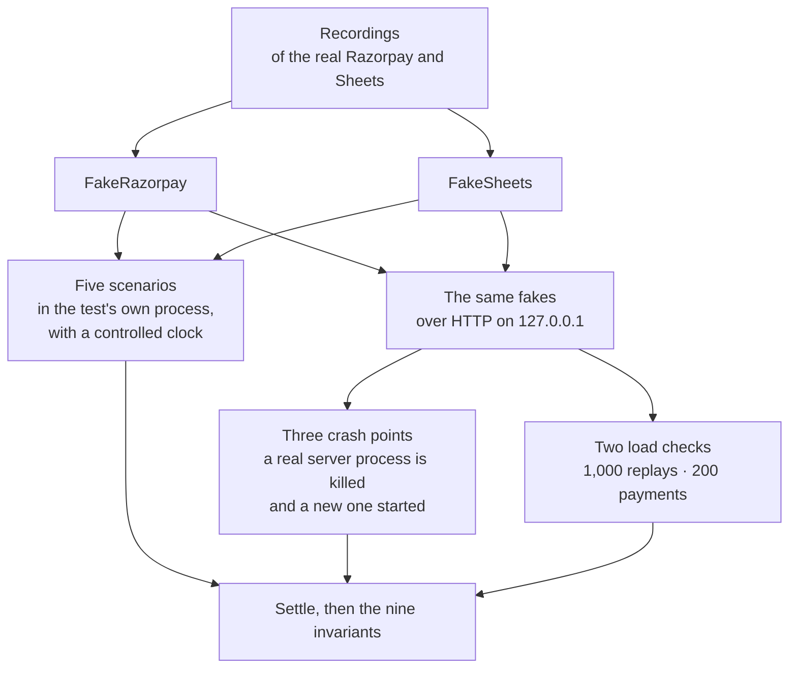

Status: planned

# P5: prove nothing is lost or written twice

Feature issue: #48

**What this page contains.** What build step P5 adds: the full fakes, the nine invariants, five scenarios, three crash points and two load checks, with the decisions and assumptions behind them.

**How to read it.** The diagram shows the three kinds of test and what each runs against. The user stories say what each must prove; the Assumptions at the end list every choice made without a question.

## Plain-language summary

P1 to P4 built the service: it receives Razorpay's events, keeps one ledger row per payment, mirrors it to the sheet, sweeps for what webhooks missed and verifies the result. Each piece has tests for its own behaviour. P5 adds the tests that prove the whole thing together: five scripted stories of things going wrong, each ending with the same nine checks; three places where the real server is killed mid-work and restarted; and two checks under load. It adds no feature a buyer uses. What a buyer gets is that every promise in the README has a test behind it.

**Rests on:** [build-order.md](../design/build-order.md) step P5; [testing.md](../design/testing.md) (the fakes, the invariants, crash points, scenarios, load checks, CI); [edge-cases.md](../design/edge-cases.md); grilling log [Q52](../design/grilling-log.md), [Q83](../design/grilling-log.md), [Q113](../design/grilling-log.md), [Q115](../design/grilling-log.md), [Q120](../design/grilling-log.md) and round 16, [Q158-Q170](../design/grilling-log.md); [ADR 0007](../design/decisions/0007-one-server-process-per-database.md).

Every kind of test ends in the same place: the service settles, then the nine invariants are checked.

## Problem Statement

The service makes two promises: no payment is lost, and none is written twice. So far each part proves its own behaviour, against fakes that grew ticket by ticket. Nothing yet proves the promises across the whole path, under the failures that actually happen: Razorpay delivering one event many times, the server being down, Sheets refusing writes, a payment changing after it failed, a refund failing, the process dying between two steps, and a thousand requests arriving at once. A buyer reading the README has no test to point to for each claim, and the open question of whether the database's safest setting is fast enough ([Q83](../design/grilling-log.md), G33) has no measurement.

## Solution

One FakeRazorpay and one FakeSheets replay what the real services were recorded doing, and can be told to fail, be slow, deliver out of order, many times or never, and to behave like a person editing the sheet. A **settle** helper waits until no job is waiting or running. Nine **invariants** are then checked: the ledger equals the source, the sheet equals the ledger, every event is stored once, nothing is stuck, nothing moves backwards, nothing of the buyer's is touched, no false conflict, no surprise dead job, and only the expected alerts.

Five **scenarios** run in the test's own process, each followed by the invariants. Three **crash points** kill a real `wsync serve` process at a named place, start a new one on the same database, and check the invariants. Two **load checks** send 1,000 replays of one delivery and 200 payments at the real server and check the counts, with the timing printed. A weekly CI job runs the tests on Windows.

## User Stories

1. As the owner, I want one FakeRazorpay that every test uses, so that two fakes of one service never drift apart.
2. As the owner, I want FakeRazorpay to replay recorded bodies, headers and signatures, so that the tests see what Razorpay really sends.
3. As the owner, I want FakeRazorpay to deliver an event many times, out of order, or never, so that each delivery failure can be scripted.
4. As the owner, I want FakeRazorpay to answer 429, 500, "not found", a connection reset and a timeout on request, so that each API failure can be scripted.
5. As the owner, I want FakeRazorpay's lists to return items created in the same second in a shifting order, and a payment that appears between two page calls, so that the sweeper is tested against what the lists really do.
6. As the owner, I want FakeRazorpay to move a payment from failed to authorized and captured, so that a late authorisation can be scripted.
7. As the owner, I want what test mode can't produce (a failed refund) replayed from Razorpay's documented sample and marked `unrecorded`, so that nobody mistakes it for a recording.
8. As the owner, I want FakeSheets to act like a person sorting, editing, deleting a row or a tab, or renaming a tab between any two calls, so that the flusher is tested against a sheet that changes under it.
9. As the owner, I want FakeSheets to hold a buyer's own tab and cells, so that a test can prove the service never touches them.
10. As the owner, I want a settle helper, so that every test waits the same way before it checks anything.
11. As the owner, I want the nine invariants written once and called by every scenario, crash test and load check, so that each proof checks the same promises.
12. As a buyer, I want proof that one event delivered many times makes one row, so that I can trust the sheet's totals.
13. As a buyer, I want proof that payments made while the server was down come back, marked Via = sweep, so that an outage loses nothing.
14. As a buyer, I want proof that a Sheets 429 is retried and then recovers, with Sync status saying what happened, so that a busy Google doesn't lose a row.
15. As a buyer, I want proof that a payment that failed and was later authorised and captured updates the same row, so that late payments are not missed.
16. As a buyer, I want proof that a partial refund and a failed refund each leave the right refund state on the same row, so that refunds are shown correctly.
17. As a buyer, I want proof that a crash right after an event is stored loses nothing and stores it once, so that a restart is safe.
18. As a buyer, I want proof that a crash after the sheet was written but before the job was marked done makes no second row, so that a restart never duplicates.
19. As a buyer, I want proof that a crash in the middle of a sweep slice skips nothing and re-walks at most one slice, so that the catch-up is safe to interrupt.
20. As the owner, I want crash points to kill a real process with no clean-up, so that the test sees what a real crash leaves behind.
21. As the owner, I want the server to refuse to start with a crash point armed unless the key is a test key, so that nobody can take a buyer's server down with it.
22. As the owner, I want the server to refuse a crash-point name it doesn't know, so that a typo doesn't make a test pass by doing nothing.
23. As a buyer, I want proof that 1,000 replays of one delivery are all answered 2xx with no 503, and leave one event, one row, one sheet row and 999 logged duplicates, so that a retry storm does no harm.
24. As the owner, I want the storm's p99 measured on the laptop and printed, so that the README's claim and the choice of `synchronous=FULL` rest on a number.
25. As the owner, I want the build to stop and ask me if the storm misses its bar, so that the durability setting is never changed without me.
26. As a buyer, I want proof that 200 payments arriving together make 200 rows with at most three Sheets calls per flush, so that a busy day stays within Google's quota.
27. As the owner, I want the burst's Sheets call count printed, so that P6 can put it in the README.
28. As the owner, I want the load checks' counts asserted on every run and the timing asserted only when I run them by themselves on the laptop, so that CI doesn't fail at random.
29. As the owner, I want a weekly CI run on Windows, so that the tests keep passing where the service is developed.
30. As the owner, I want a product bug a scenario uncovers fixed in the same ticket when the design already says what is right, and listed in the changelog, so that no proof is left failing.
31. As the developer of P6, I want the scenarios, crash tests and load checks named after the promises they prove, so that the README can put each promise beside its test.

## Implementation Decisions

- **One FakeRazorpay** ([Q163](../design/grilling-log.md)). The fake the sweeper tests use moves into the fakes package and becomes the full fake of [testing.md](../design/testing.md): recorded deliveries (signed, with the recorded headers), fetches, refunds and lists; failures on request; real time per call; same-second items in a shifting order; a payment arriving between page calls; late authorisation. Existing tests import it from there and keep passing unchanged in behaviour.
- **FakeSheets grows** a person's actions between any two calls (sort, edit, delete a row, delete a tab, rename a tab) and a buyer's own tab and cells ([Q168](../design/grilling-log.md)). It stays held to the live recordings by its contract test.
- **Settle and the invariants** live in the tests' shared code. Settle means no job waiting or running, and no source or sink paused unless the scenario broke it on purpose. The nine invariants are those of [testing.md](../design/testing.md), each a separate check that names what it found. A scenario declares what it broke on purpose: the conflicts it sent, the permanent errors it injected, the alerts it expects.
- **Scenarios run in-process** ([Q164](../design/grilling-log.md)): the app, respx and a controlled clock, as the sweeper and verify tests do today.
- **Crash points** ([Q159](../design/grilling-log.md)). The environment variable `WSYNC_CRASH_AT=<name>` is read once at start. The server refuses to start with it set unless the Razorpay key starts `rzp_test_`, refuses an unknown name, and logs a warning when armed. At the named place it calls `os._exit`. P5 knows three names: `after_event_commit` (the receiver, after the event's transaction commits and before it answers), `after_sheet_write_before_done` (the flusher, after the post-write check and before its jobs are completed) and `mid_slice` (the sweeper, after some of a slice's items are stored and before its checkpoint moves). The other ten names of testing.md come with later slices.
- **Fakes over HTTP.** Crash tests and load checks run a real `wsync serve` subprocess, so the fakes are also served over HTTP on 127.0.0.1: Razorpay's fetches, refunds and lists, and the Sheets calls the flusher makes, with Google's token endpoint. They grow from the upstreams the smoke test already starts, and share the in-process fakes' behaviour instead of copying it.
- **Load checks** ([Q161](../design/grilling-log.md)). The storm sends 1,000 concurrent replays of one recorded, signed delivery, some under a different event id. The burst sends 200 payments whose fetches take the recorded time ([Q167](../design/grilling-log.md)). Both carry a `load` marker. Counts are asserted on every run; the p99 under 2 s is asserted only when the run selects the marker by itself (`uv run pytest -m load`), and printed otherwise. The numbers are printed for P6's README ([Q169](../design/grilling-log.md)).
- **The durability setting stays** ([Q160](../design/grilling-log.md)). `synchronous=FULL` is not changed by this build. If the storm misses zero 503s or the p99 on the laptop, the ticket is parked with the numbers.
- **Weekly CI** ([Q170](../design/grilling-log.md)). A scheduled workflow runs the tests on Windows once a week. The push workflow keeps running everything on Linux. P6 adds the real-services job.
- **Bugs found** ([Q162](../design/grilling-log.md)). A product bug a scenario uncovers is fixed in the ticket that found it when the design already says what is right; otherwise the ticket asks. Each fix gets a changelog line.
- **No schema change.** P5 adds no migration, no command and no configuration key. The crash-point variable is the only change to how the server starts.

## Testing Decisions

- **A good test here** scripts what the outside world does (payments, deliveries, failures, a person's edits, a kill) and checks only what a buyer could check: the ledger, the sheet, Sync status, the alerts, the HTTP answers. It never reaches into a worker's internals.
- **The seams** (two, both existing): the in-process app with respx and the controlled clock, used by the scenarios; and the real `wsync serve` subprocess with upstreams over HTTP, used by the crash tests and load checks. No new seam is added.
- **Each scenario ends with the invariants**, and so does each crash test after the restart and each load check after it settles.
- **Each new fake ability has a contract test** against the recordings where a recording exists, so the fake can't drift from the real service.
- **A crash test fails if the crash point was never reached**: the first process must exit with the crash point's exit code.
- **Prior art:** the sweeper and verify tests (in-process app, respx, time-machine, FakeRazorpay); the smoke test and the process helpers (a real server, upstreams over HTTP); the fake Sheets contract test; the `unrecorded` and `posix` markers.
- **Suite time.** The scenarios and crash tests run in the default suite. The load checks run in it too, with a time budget of about a minute together on the laptop; if they can't meet it, the ticket says so and proposes the split.

## Out of Scope

- The weekly real-services run, `wsync demo`, `doctor`, the README, the GIF and the video (P6).
- Hypothesis suites, the other ten crash points, disputes, FakeStripe (after pitching, or parked with Stripe).
- Moving the existing test files into `unit/` and `integration/` folders ([Q165](../design/grilling-log.md)).
- Any change to `synchronous=FULL` ([Q160](../design/grilling-log.md)).
- New product behaviour, beyond fixes under [Q162](../design/grilling-log.md) and the crash-point variable.

## Further Notes

- G33 (the storm against `synchronous=FULL`) is closed by this build's measurement; `research-gaps.md` is updated with the numbers at the build's end.
- Six server tests are marked `posix` and skip on Windows; the crash tests kill with `os._exit` inside the server, so they need no signal and run on both.
- P4's flow check could not walk three hourly flows because it can't move the running app's clock. The late-authorisation scenario covers the hourly re-list in-process; nothing in P5 changes how the flow checker works.

## Assumptions

- A1 [CLIENT] P5 contains the fakes, the settle helper, the nine invariants, five scenarios, three crash points, two load checks and the weekly Windows run; the real-services run, `demo`, `doctor` and the README are P6 (Q158) — the owner accepted the recommendation.
- A2 [HARD-TO-CHANGE] A crash point is armed by `WSYNC_CRASH_AT`, accepted only with a test-mode key, an unknown name refused, a warning logged (Q159) — the owner accepted the recommendation.
- A3 [HARD-TO-CHANGE] The build never changes `synchronous=FULL`; a storm that misses its bar parks the ticket with numbers (Q160) — the owner accepted the recommendation.
- A4 [CLIENT] Counts are asserted on every run; the p99 only under `-m load` on the laptop; the README cites the laptop numbers (Q161) — the owner accepted the recommendation.
- A5 [CLIENT] A product bug a scenario uncovers is fixed in that ticket when the design says what is right, else the ticket asks; every fix is in the changelog (Q162) — the owner accepted the recommendation.
- A6 [INTERNAL] One FakeRazorpay, in the fakes package (Q163) — two fakes drift apart.
- A7 [INTERNAL] Scenarios in-process; crash tests and load checks against a real server process with fakes over HTTP (Q164) — a crash must kill a real process, and 503s and p99 need real HTTP.
- A8 [INTERNAL] New tests in `tests/scenarios/`, `tests/crash/`, `tests/load/`; existing files stay (Q165) — a mass move buys nothing.
- A9 [INTERNAL] The failed refund replays the documented sample, marked `unrecorded` (Q166) — test mode can't make one.
- A10 [INTERNAL] The burst's fetches take the recorded time per call (Q167) — F19.
- A11 [INTERNAL] FakeSheets holds a buyer's own tab and cells for invariant 6 (Q168).
- A12 [INTERNAL] Load numbers are printed; P6 copies them into the README (Q169).
- A13 [INTERNAL] P5 adds the weekly Windows job only (Q170) — the real run needs P6's `demo`.
- A14 [INTERNAL] The three crash points sit after the event's commit and before the answer, after the flusher's post-write check and before its jobs complete, and inside a sweep slice before the checkpoint moves — the places testing.md's "proves" column describes.
- A15 [INTERNAL] The crash exit uses one fixed non-zero exit code, and a crash test fails unless the first process exited with it — otherwise a test could pass without crashing.
- A16 [INTERNAL] The load checks run in the default suite within about a minute on the laptop — the suite already includes the smoke tests; a ticket that can't meet the budget says so.
- A17 [INTERNAL] No research step: the design route skips it, and G33 is measured by the storm itself.

## Decisions made during the build

- #49: invariant 5's "older" means earlier in the order of states FakeRazorpay served for that payment; a ledger row version that matches no served state fails the invariant.
- #49: sending a delivery adds its payment to the fake's known payments, which are what invariant 1 holds the ledger to.
- #49: scenarios run with `initial_lookback_days = 0`, so the sweeper adds nothing a scenario didn't send.
- #49: invariants 2 and 5 compare against the product's own encoding and mapping (`payment_columns`, `payment_row`, `business_columns`).
