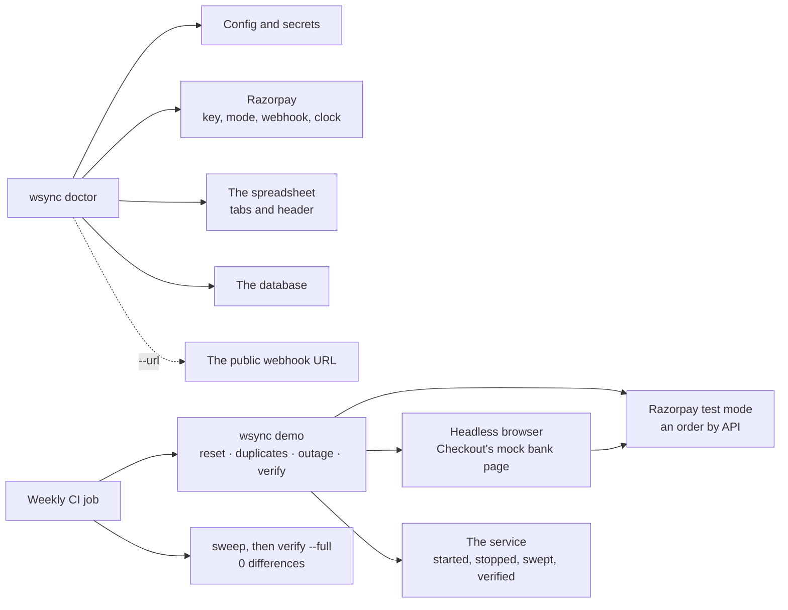

Status: implemented

# P6: demo, doctor, the weekly real run and the README

Feature issue: #59

**What this page contains.** What build step P6 adds: `wsync demo`, `wsync doctor`, the weekly run against the real Razorpay, the README and the third-party notices, plus the two things P5 left open. The decisions and assumptions behind them follow.

**How to read it.** The diagram shows what each new command talks to. The user stories say what each must do; the Assumptions at the end list every choice made without a question.

## Plain-language summary

P1 to P5 built the service and proved it. P6 makes it showable and hand-over-able. `wsync demo` pays real test orders on Razorpay with no person at a browser, so the scenes of the video can be run on demand. `wsync doctor` checks a setup end to end and says in plain words what is wrong. Once a week CI pays two test orders on the real Razorpay, sweeps and verifies, so the service is proved against the real thing and not only against fakes. The README states each promise beside the test that proves it, with honest limits. P6 also fixes two things P5 found. After P6 only the recording of the GIF and the video is left of the cut.

**Rests on:** [build-order.md](../design/build-order.md) step P6; [showcase.md](../design/showcase.md); [operations.md](../design/operations.md) (commands, `doctor`); [testing.md](../design/testing.md) (the real-services layer, CI); [hosting.md](../design/hosting.md) (the tunnel); [sweeper.md](../design/sweeper.md); grilling log [Q104, Q105, Q111, Q112, Q113, Q120](../design/grilling-log.md), round 17 (Q171-Q173) and round 18 (Q174-Q187); [ADR 0005](../design/decisions/0005-permissive-licences-only.md).

`demo` is the only part that needs a browser, and only when it pays; `doctor` only reads. The dashed check runs when `--url` is given.

## Problem Statement

The service works and is proved against fakes, but nobody can see it work. A scene for the video needs real test payments, and making one today means a person clicking through Checkout. A new setup has no way to say what is wrong with it: a wrong key, an unshared sheet, a database on a synced folder, or a tunnel whose warning page swallows deliveries all look the same from outside. Nothing proves the sweep path against the real Razorpay on a schedule, so a change on Razorpay's side would be found by a buyer. There is no README: a buyer has nothing that says what the service promises, how each promise is proved, and where its limits are. And P5 left two findings: the sweeper's paging can miss an item when more than 100 payments are created inside two seconds, and the verify skill's launcher never writes the port file its own commands read.

## Solution

`wsync demo` runs the scenes of [showcase.md](../design/showcase.md): `reset` empties the database and the demo spreadsheet's tabs, `duplicates` provokes Razorpay's own retries of one payment, `outage` pays orders while the receiver is stopped and brings them back with a sweep, and `verify` runs a full verify. A test payment is an order created by API and paid in a headless browser through Checkout's mock bank page. `demo` refuses to run unless the key is a test key and the spreadsheet is on the demo allow-list.

`wsync doctor` runs the core checks of [operations.md](../design/operations.md), prints one line per check, and exits 0 only when none fails. With `--url` it also POSTs an empty body to the public webhook URL and fails on anything but the receiver's own 400.

The weekly workflow gains a real-services job: `demo reset`, two paid test orders, a sweep, then `verify --full`, which must report 0 differences. Its secrets are set by a command that copies the test-mode values from `.env` to the repository's Actions secrets without printing them.

The README states the problem, the guarantees with their tests, the comparison with the alternatives, the architecture, a quickstart, the honest limits and the credits. `THIRD_PARTY_NOTICES.md` credits the ported code.

The sweeper's `skip` paging is made independent of the order of same-second items, and the verify skill's launcher writes its port file.

## User Stories

1. As the owner, I want `wsync demo reset` to empty the database and the demo spreadsheet's tabs and set the demo retry profile, so that every scene starts clean.
2. As the owner, I want `demo` to refuse to run unless the Razorpay key starts `rzp_test_` and the spreadsheet is on the demo allow-list, so that a mistyped id can never empty a real sheet.
3. As the owner, I want `demo` to create an order by API and pay it in a headless browser through Checkout's mock bank page, so that a test payment needs no person.
4. As the owner, I want the payment to be ₹100 or more by netbanking, so that fee and GST show non-zero values on the sheet.
5. As the owner, I want `demo` to print the payment URL to pay by hand when the headless run fails, so that a scene is never blocked by a browser problem.
6. As the owner, I want the browser to live in an optional extra, so that the service itself never needs one.
7. As the owner, I want `wsync demo duplicates` to restart the receiver with the demo fail-first switch, pay one order and wait for its row and Razorpay's retries, so that the duplicate-storm scene can be filmed in one take.
8. As the owner, I want `wsync demo outage` to stop the receiver, pay test orders, restart it and run a sweep, so that the catch-up scene shows the rows returning with Via = `sweep`.
9. As the owner, I want `wsync demo verify` to run a full verify and print its line, so that the third scene ends on "N payments, 0 differences".
10. As the owner, I want each `demo` scene to say what it is doing and what it is waiting for, so that the recording has no dead air I can't explain.
11. As the owner, I want `demo` covered by tests that use a fake payer and the fakes, so that the default suite stays offline.
12. As the owner, I want one opt-in live test that runs `demo reset`, `demo outage` and `demo verify` against Razorpay test mode and the throwaway sheet, so that the real path is exercised before I record.
13. As a buyer's developer, I want `wsync doctor` to check the config, the secrets, the key and mode, Razorpay's webhook, the clock, the sheet and the database, so that I know a setup works before I trust it.
14. As a buyer's developer, I want one line per check that says ok, warning or fail with the reason in plain words, so that I know what to fix.
15. As a buyer's developer, I want `doctor` to exit 0 only when no check fails, so that a script can depend on it.
16. As a buyer's developer, I want a missing or disabled Razorpay webhook to be a warning and not a failure, so that an account whose webhook list can't be read still passes.
17. As a buyer's developer, I want `doctor` to fail when the database sits on a network drive or a synced folder, so that the lock and the write-ahead log are safe.
18. As a buyer's developer, I want `doctor` to explain in plain words when the organisation blocks outside sharing or service-account keys, so that I know whom to ask.
19. As the owner, I want `wsync doctor --url <public URL>` to fail on a 200 with an HTML page, so that a tunnel's warning page that would swallow deliveries is caught.
20. As the owner, I want `doctor` to make no change anywhere, so that running it is always safe.
21. As the owner, I want a weekly CI job that pays two test orders on the real Razorpay, sweeps and verifies, so that a change on Razorpay's side is found by CI and not by a buyer.
22. As the owner, I want the weekly job to skip with a clear notice when its secrets are missing, so that a fork or a fresh clone does not fail.
23. As the owner, I want one command that copies the test-mode values from `.env` to the repository's Actions secrets without printing them, so that the weekly job can run without me pasting keys.
24. As the owner, I want that command to refuse a Razorpay key that is not a test key, so that a live key never reaches CI.
25. As a buyer, I want a README that states the problem in two lines, so that I know at once whether this is for me.
26. As a buyer, I want each guarantee beside the test that proves it, so that I can check the claim myself.
27. As a buyer, I want the measured numbers with their date and machine, so that I can judge them.
28. As a buyer, I want the honest limits listed, so that I am not surprised after buying.
29. As a buyer, I want "why not Coupler, Zapier or Hookdeck" answered in four lines, so that I can compare.
30. As a buyer's developer, I want a quickstart in five commands, so that I can run it in minutes.
31. As a reader, I want the README to read as a careful engineer wrote it, so that I trust it.
32. As the author of ported code, I want my licence and copyright credited, so that the licences are honoured.
33. As the owner, I want the sweeper to store every payment even when more than 100 are created inside two seconds, so that the checkpoint's promise holds.
34. As a developer using the verify skill, I want the launcher to write the port file its commands read, so that the documented commands work.

## Implementation Decisions

- **`demo` and the payer** ([Q105](../design/grilling-log.md), Q181). A test payment is `POST /v1/orders` followed by Checkout in a headless browser: Netbanking, any bank, then Success on the mock bank page. The browser sits behind a small payer interface in the `wsync[demo]` extra; the service imports nothing from it. When the headless run fails, `demo` prints the payment URL.
- **`demo`'s guard** ([Q120](../design/grilling-log.md), F36). Every `demo` command refuses unless the key starts `rzp_test_` and the configured spreadsheet id is on `[demo] spreadsheet_ids`.
- **The four scenes** follow [showcase.md](../design/showcase.md). `verify` talks to the running server when there is one and runs on its own otherwise, like the other commands. `reset` and `outage` refuse while a server runs, with a line saying to stop `wsync serve` first: a database is not emptied under a server (ADR 0007), and the demo retry profile takes effect only at a restart (A17). `duplicates` and `outage` start and stop the receiver themselves. Each prints what it is doing and what it waits for.
- **`duplicates` needs the tunnel** (Q175). Razorpay's retries must reach the receiver, so it runs live only with the owner's tunnel up. Its tests use the fakes: a fake payer and FakeRazorpay delivering the retries.
- **`doctor`** (Q180, Q182). The checks are the core list. Each check is independent, so one failure doesn't hide the next. Razorpay's webhook list (`GET /v1/webhooks`) gives a warning only, and a 4xx from it reads "can't check" ([Q111](../design/grilling-log.md)). The clock check compares ours with Razorpay's `Date` header and fails beyond 30 s. The sheet check reads only. The database check fails on a read-only file, pending migrations, a schema newer than the code, WAL or `synchronous=FULL` off, and a network drive or a synced folder. `doctor` runs with or without a server and changes nothing.
- **`--url`** ([Q112](../design/grilling-log.md)). An empty POST must get the receiver's 400. A 200, an HTML body, a redirect, a timeout or a DNS failure each fail with its own reason.
- **The weekly job** (Q183). A second job in the weekly workflow, on Linux, installing the `demo` extra and Chromium: `demo reset`, two paid orders with the receiver stopped, a sweep, `verify --full`. It fails when verify reports a difference. It skips with a notice when a secret is missing.
- **Setting the secrets** (Q176). The existing secrets helper gains a command that copies the test-mode values named in `.env.example`, and the demo spreadsheet's id, from `.env` to the repository's Actions secrets with `gh secret set`, each read from standard input. It prints names only, and refuses a Razorpay key that does not start `rzp_test_`. The ticket's worker runs it once, starts the weekly workflow by hand and reports the run's result.
- **The README** (Q177, Q179). The nine sections of [showcase.md](../design/showcase.md). Guarantees name their test. Numbers are P5's, with the date and the machine. Outside claims are re-checked when written and dropped if they no longer hold. The GIF lines are commented out until the files exist in `docs/media/` (Q185). The author line is "Lalit Karthikeyan M A" with a link to the GitHub profile.
- **How the README is written.** Plain sentences in everyday words, concrete numbers with their source, no sales language, no emoji, no staged openers or one-line closers, no "not X but Y" turns, and no bold-label bullet lists standing in for prose. The worker runs the `humanizer` skill over it before finishing and fixes what it flags.
- **Notices** (Q178). `THIRD_PARTY_NOTICES.md` lists each ported file with its origin, licence and copyright, from the table in [build-order.md](../design/build-order.md). No licence file is added and the repository stays private.
- **The sweeper's paging** (Q186). When a window can't be narrowed (over 100 items in two seconds), it is walked with `skip` and collected by id, and the walk is repeated until one whole walk brings no new id. After five walks without settling, the slice fails: the checkpoint stays and the next pass retries. [sweeper.md](../design/sweeper.md) is updated.
- **The verify skill's launcher** (Q187) writes the public port to `.verify/port`.
- **No schema change.** P6 adds no migration. It adds two commands and one optional extra.

## Testing Decisions

- **A good test here** runs the command as a user does and checks what the user would see: the printed lines, the exit code, the ledger, the sheet. It does not reach into the command's internals.
- **The seams** (existing): the commands run as subprocesses against a real server with the fakes over HTTP, as P4's command tests and P5's crash tests do; `doctor`'s individual checks and `demo`'s scenes run in-process with respx and the fake payer where a subprocess adds nothing.
- **`doctor`**: one test per check for its failing case with the reason it prints, one passing run, and the `--url` cases (our 400, a 200 with HTML, a timeout).
- **`demo`**: the guard's refusals; each scene against the fakes with a fake payer; the headless payer itself only in the live test.
- **The live test** carries a `live` marker, is left out of the default run, and needs the `.env` test keys and the throwaway sheet. The flow check runs it once (Q175).
- **The sweeper's paging**: FakeRazorpay returns more than 100 items created in the same second in a shifting order; the sweep stores each exactly once; a window that never settles fails the slice without moving the checkpoint.
- **The README** is checked by a test that every test it names exists and every command in its quickstart is a real `wsync` command.
- **Prior art:** the command tests of P4, the crash harness and the fakes over HTTP of P5, the `unrecorded`, `posix` and `load` markers.

## Out of Scope

- Recording the GIF and the video; `docs/media/` files (the owner's, after P6).
- The rest of `doctor`: admin-token length, heartbeat and backup reachability, the deployment id, every Stripe row (operations step).
- A licence file, or making the repository public (Q178).
- The later scenes of the full video (access revoked, burst).
- `wsync dead`, `backup`, `rebuild-sheet`, `replay` and the admin pages (operations step).

## Further Notes

- The video is the only part of the pitch-ready cut left after P6. `demo duplicates` is run live by the owner, with the zrok tunnel of [hosting.md](../design/hosting.md) up.
- G36 (what Upwork previews) and G63 (the Dashboard's replay) concern only the video; G63 is moot because real retries arrive within about 40 s (G48). The README half of G36 is closed by Q177's re-check.
- Test-mode keys only, everywhere. No value of a secret appears in a file in the repo, a commit, an issue, a PR or a log.

## Assumptions

- A1 [CLIENT] The build delivers `demo`, `doctor`, the weekly real-services job, the README and the notices; the owner records the GIF and the video afterwards (Q174) — the owner accepted the recommendation.
- A2 [HARD-TO-CHANGE] Workers and the flow check may make real calls in test mode behind the guards; the default suite stays offline; `demo duplicates` is proved against fakes (Q175) — the owner accepted the recommendation.
- A3 [HARD-TO-CHANGE] The agent sets the weekly job's secrets with a command that prints no value and refuses a non-test key (Q176) — the owner's decision, overruling the recommendation.
- A4 [CLIENT] The README cites P5's measured numbers and re-checked outside claims (Q177) — the owner accepted the recommendation.
- A5 [HARD-TO-CHANGE] The repository stays private with no licence file; the notices file is added (Q178) — the owner accepted the recommendation.
- A6 [CLIENT] The author line is "Lalit Karthikeyan M A" with a GitHub profile link and no email (Q179) — the owner's answer.
- A7 [CLIENT] `doctor` gets the core checks and `--url` (Q180) — the owner accepted the recommendation.
- A8 [CLIENT] The README is written plainly, not in the manner of generated text, and is run through the `humanizer` skill — the owner's instruction.
- A9 [INTERNAL] Playwright sits in the `wsync[demo]` extra behind a payer interface (Q181).
- A10 [INTERNAL] `doctor` prints one line per check and exits 0 unless a check fails (Q182).
- A11 [INTERNAL] The weekly job runs `demo reset`, two paid orders, a sweep and `verify --full` on Linux (Q183).
- A12 [INTERNAL] No gaps run before P6 (Q184); media goes in `docs/media/` (Q185).
- A13 [INTERNAL] The sweeper repeats a `skip` walk until one whole walk brings no new id, and fails the slice after five (Q186) — the owner asked this session to settle P5's leftovers.
- A14 [INTERNAL] The verify skill's launcher writes `.verify/port` (Q187).
- A15 [INTERNAL] The live test is marked `live` and left out of the default run, as the load checks' burst is — the suite never calls Razorpay or Google by default.
- A16 [INTERNAL] The clock check's limit is 30 s, as operations.md states.
- A17 [INTERNAL] `demo reset` and `demo outage` refuse while a server runs, where the plan had `reset` talk to the running server — settled during the build of #62: emptying a database under a server breaks ADR 0007, and the service should not ship a route that wipes the ledger.
- A18 [INTERNAL] The sweeper's overlap stays at 10 minutes although Razorpay's test-mode list showed new payments 28 to 54 minutes late on 2026-10-05: the hourly re-list stores a payment listed later, and `demo outage` asks for the re-list itself and waits up to two hours — settled during the build of #69, on its measurements (`docs/research/razorpay-list-facts.md`, Q7).
